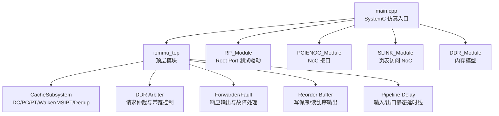
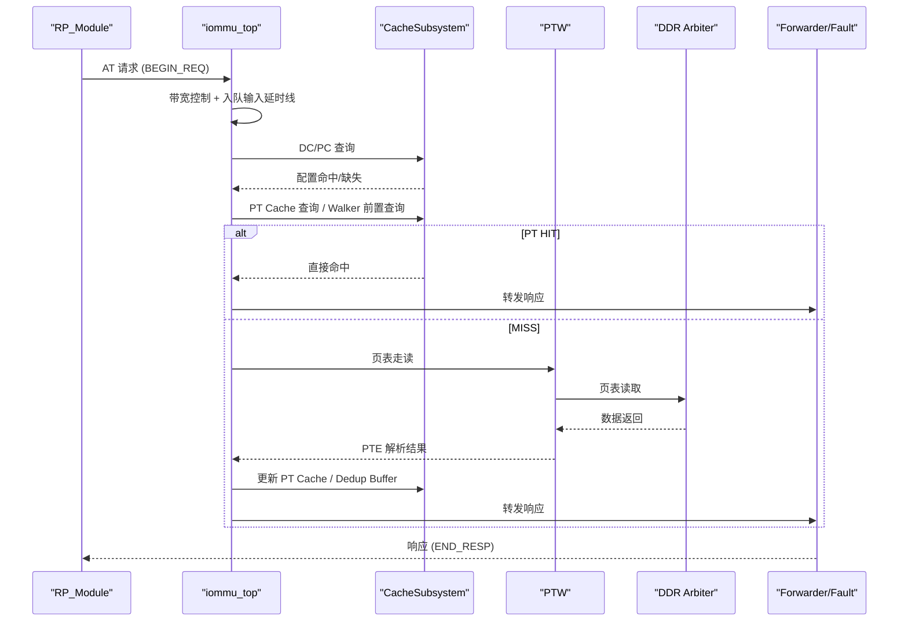
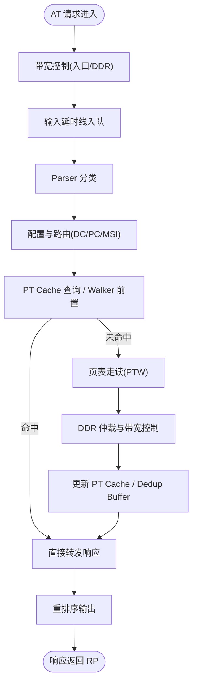
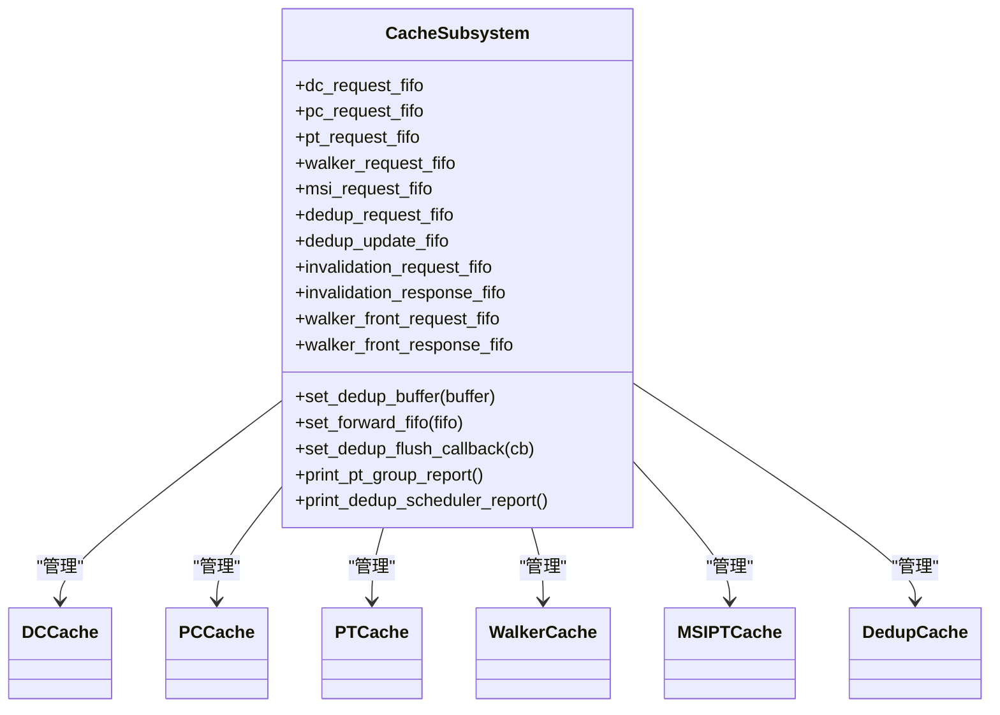
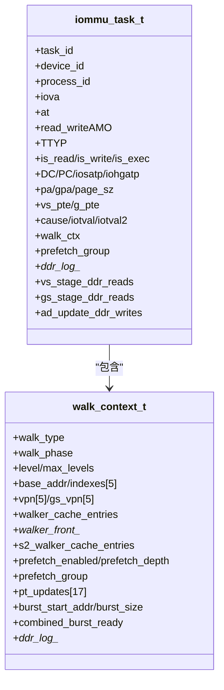
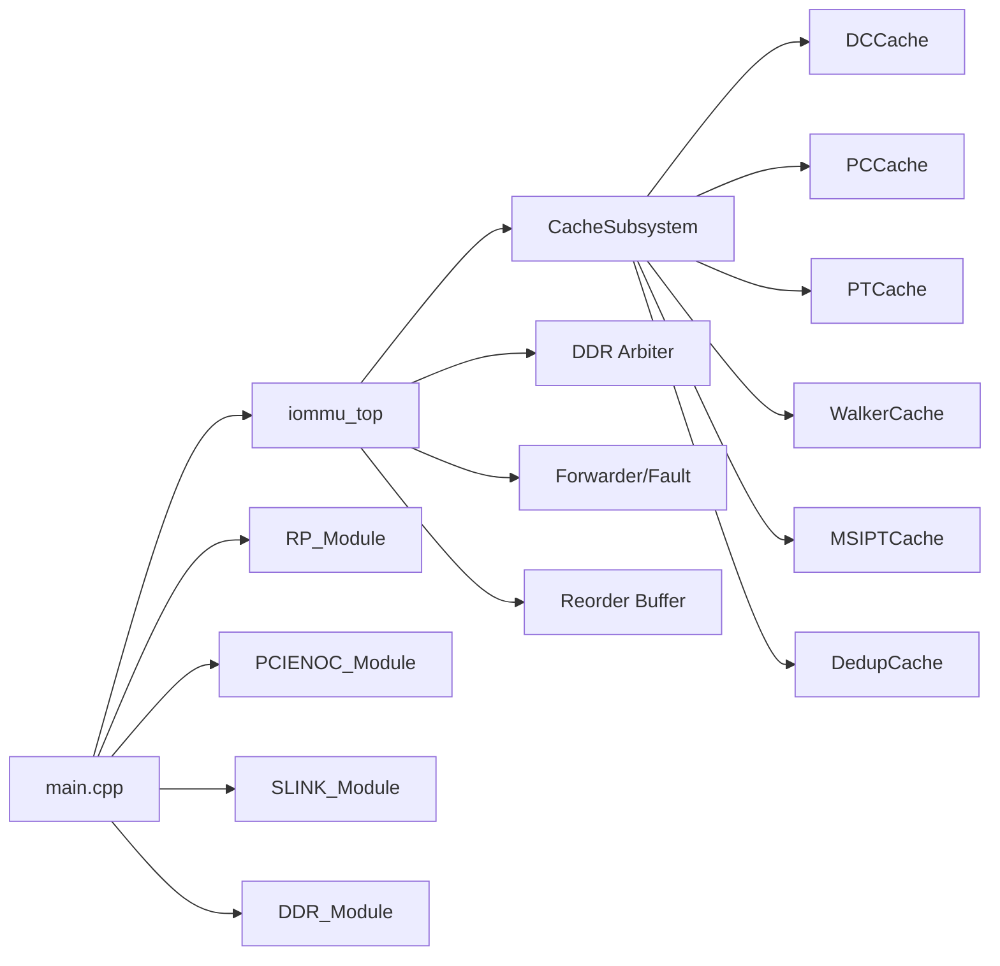

# 性能分析工具

<cite>
**本文引用的文件**   
- [README.md](file://README.md)
- [main.cpp](file://main.cpp)
- [Makefile](file://Makefile)
- [iommu/iommu_top.hh](file://iommu/iommu_top.hh)
- [iommu/iommu_top.cc](file://iommu/iommu_top.cc)
- [iommu/include/iommu_task.hh](file://iommu/include/iommu_task.hh)
- [iommu/iommu_perf_model/iommu_perf_model.hh](file://iommu/iommu_perf_model/iommu_perf_model.hh)
- [rp/test_rp_func.cc](file://rp/test_rp_func.cc)
- [iommu/cache_src/subsystem/cache_subsystem.h](file://iommu/cache_src/subsystem/cache_subsystem.h)
- [iommu/cache_src/common/types.h](file://iommu/cache_src/common/types.h)
</cite>

## 目录
1. [简介](#简介)
2. [项目结构](#项目结构)
3. [核心组件](#核心组件)
4. [架构总览](#架构总览)
5. [详细组件分析](#详细组件分析)
6. [依赖关系分析](#依赖关系分析)
7. [性能考量](#性能考量)
8. [故障排查指南](#故障排查指南)
9. [结论](#结论)
10. [附录](#附录)

## 简介
本项目是一个基于 SystemC 的 RISC-V IOMMU 性能建模与仿真系统，提供地址转换、故障处理、设备上下文管理、多级缓存（DC/PC/PT/Walker/MSIPT）、去重与预取、两阶段翻译、MSI 路径、DDR 仲裁与带宽控制等能力。通过可配置的测试场景与丰富的统计指标，可用于评估不同负载下的吞吐、延迟、缓存命中率、并发度与瓶颈点。

## 项目结构
- 顶层入口：main.cpp 负责实例化 IOMMU、RP、PCIENOC、SLINK、DDR 模块并绑定 TLM 端口，启动仿真。
- IOMMU 顶层：iommu_top.* 实现流水线、缓存子系统集成、DDR 仲裁、重排序输出、统计监控、失效桥接等。
- 功能模型：iommu_fun_model.* 实现规范语义（ATC/ATS/中断/故障/两阶段翻译等）。
- 性能模型：iommu_perf_model.* 实现命令队列、页表走读（PTW）、重排序、转发器、MSIPT Cache、任务缓存转换、解析器等。
- 缓存子系统：cache_src/* 提供 DC/PC/PT/Walker/MSIPT/Dedup 缓存及多 RAM 并行、失效管线、统计收集。
- 外设与测试：rp/*、pcienoc/*、ddr/*、slink/* 提供 Root Port、NoC、DDR、链路等模型与多种测试线程。
- 构建与脚本：Makefile 支持多场景编译与运行；tmp/* 包含大量分析脚本与数据。

图表来源
- [main.cpp:39-94](file://main.cpp#L39-L94)
- [iommu/iommu_top.hh:45-120](file://iommu/iommu_top.hh#L45-L120)
- [iommu/iommu_top.cc:204-323](file://iommu/iommu_top.cc#L204-L323)
- [iommu/cache_src/subsystem/cache_subsystem.h:23-120](file://iommu/cache_src/subsystem/cache_subsystem.h#L23-L120)

章节来源
- [README.md:1-92](file://README.md#L1-L92)
- [main.cpp:39-94](file://main.cpp#L39-L94)
- [Makefile:1-40](file://Makefile#L1-L40)

## 核心组件
- IOMMU 顶层 iommu_top：封装所有流水线阶段、缓存子系统、DDR 仲裁、重排序、统计与失效桥接。
- 缓存子系统 CacheSubsystem：统一管理 DC/PC/PT/Walker/MSIPT/Dedup 缓存，提供统一消息通道、失效管线、多 RAM 并行与统计报告。
- 任务与上下文 iommu_task_t：贯穿全流水线的任务载体，携带地址类型、上下文、翻译结果、Walker 中间状态、预取组信息等。
- 性能模型辅助：分类 TTYP、提取 VPN/GVPN、检查规范地址、MSI 识别等。
- 测试驱动 RP：构造 TLM 事务，发起翻译请求，验证响应与故障。

章节来源
- [iommu/iommu_top.hh:45-120](file://iommu/iommu_top.hh#L45-L120)
- [iommu/cache_src/subsystem/cache_subsystem.h:23-120](file://iommu/cache_src/subsystem/cache_subsystem.h#L23-L120)
- [iommu/include/iommu_task.hh:20-237](file://iommu/include/iommu_task.hh#L20-L237)
- [iommu/iommu_perf_model/iommu_perf_model.hh:7-155](file://iommu/iommu_perf_model/iommu_perf_model.hh#L7-L155)
- [rp/test_rp_func.cc:11-97](file://rp/test_rp_func.cc#L11-L97)

## 架构总览
IOMMU 接收来自 RP 的 AT 请求，经 Parser 分类后进入 Collector，查询 DC/PC 配置，再进入 PT Cache/Walker Cache 前置查询，必要时触发 PTW 进行页表走读，结合 Dedup Buffer 与预取机制减少重复 DDR 访问，最终由 Forwarder 输出响应或 Fault/CQ 处理。DDR 访问经 Arbiter 按优先级与带宽限制调度。

图表来源
- [iommu/iommu_top.cc:204-323](file://iommu/iommu_top.cc#L204-L323)
- [iommu/iommu_top.cc:638-719](file://iommu/iommu_top.cc#L638-L719)
- [iommu/cache_src/subsystem/cache_subsystem.h:38-86](file://iommu/cache_src/subsystem/cache_subsystem.h#L38-L86)

## 详细组件分析

### IOMMU 顶层 iommu_top
- 职责：
  - 接收 AT 请求，执行带宽控制与入队输入流水线延时线。
  - 配置与路由：根据 DC/PC 决定翻译阶段、MSI 分流、Walker 前置查询、PT Cache 查询。
  - 管理多个 FIFO 与 PEQ，协调各子模块（xDTW、PT Cache、PTW、MSIPTW、Forwarder、Fault/CQ）。
  - DDR 仲裁：统一调度 xDTW/PTW/MSIPTW/CTRL/MRIF 请求，维护 outstanding 计数与读写分离并发统计。
  - 重排序输出：写请求按 task_id 单调保序，读请求到达即输出。
  - 统计与监控：端到端延迟、端口间隔、PTW 并发、DDR 并发峰值、失效监控等。
- 关键流程：
  - 输入路径：axi_slave_nb_transport_fw -> input_delay_thread -> inbound_fifo -> parser_thread。
  - 配置与路由：configure_and_route -> walker_front_request_fifo -> pt_request_fifo。
  - DDR 响应：ddr_nb_transport_bw -> 按 source_module 分发到对应 rsp_ddr_fifo。
  - 输出路径：forwarder/fault -> reorder_output_thread -> send_response_to_initiator。

图表来源
- [iommu/iommu_top.cc:204-323](file://iommu/iommu_top.cc#L204-L323)
- [iommu/iommu_top.cc:638-719](file://iommu/iommu_top.cc#L638-L719)
- [iommu/iommu_top.cc:362-451](file://iommu/iommu_top.cc#L362-L451)
- [iommu/iommu_top.cc:456-602](file://iommu/iommu_top.cc#L456-L602)

章节来源
- [iommu/iommu_top.hh:45-120](file://iommu/iommu_top.hh#L45-L120)
- [iommu/iommu_top.cc:204-323](file://iommu/iommu_top.cc#L204-L323)
- [iommu/iommu_top.cc:362-451](file://iommu/iommu_top.cc#L362-L451)
- [iommu/iommu_top.cc:456-602](file://iommu/iommu_top.cc#L456-L602)
- [iommu/iommu_top.cc:638-719](file://iommu/iommu_top.cc#L638-L719)

### 缓存子系统 CacheSubsystem
- 职责：
  - 统一管理 DC/PC/PT/Walker/MSIPT/Dedup 缓存，提供统一的请求/更新/失效通道。
  - 失效管线：支持全局、DDT/PDT、VMA/GVMA、范围扫描、延迟失效（LIB/VN）等。
  - 多 RAM 并行：PT/Walker/Dedup 采用 Hash + 多 RAM Worker + Join 模式，提升吞吐。
  - 统计报告：Scheduler 间隔、RAM 利用率、Hash 忙时、反压次数、预取丢弃等。
- 关键接口：
  - dc_request_fifo/pc_request_fifo/pt_request_fifo/walker_request_fifo/msi_request_fifo
  - dedup_request_fifo/dedup_update_fifo/dedup_inside_request_fifo
  - invalidation_request_fifo/invalidation_response_fifo
  - walker_front_request_fifo/walker_front_response_fifo

图表来源
- [iommu/cache_src/subsystem/cache_subsystem.h:23-120](file://iommu/cache_src/subsystem/cache_subsystem.h#L23-L120)
- [iommu/cache_src/subsystem/cache_subsystem.h:182-234](file://iommu/cache_src/subsystem/cache_subsystem.h#L182-L234)
- [iommu/cache_src/subsystem/cache_subsystem.h:266-507](file://iommu/cache_src/subsystem/cache_subsystem.h#L266-L507)

章节来源
- [iommu/cache_src/subsystem/cache_subsystem.h:23-120](file://iommu/cache_src/subsystem/cache_subsystem.h#L23-L120)
- [iommu/cache_src/subsystem/cache_subsystem.h:182-234](file://iommu/cache_src/subsystem/cache_subsystem.h#L182-L234)
- [iommu/cache_src/subsystem/cache_subsystem.h:266-507](file://iommu/cache_src/subsystem/cache_subsystem.h#L266-L507)

### 任务与上下文 iommu_task_t
- 职责：
  - 承载任务身份、地址类型、上下文（DC/PC/IOSATP/IOHGATP）、翻译结果（PA/GPA/页大小）、Walker 中间状态、预取组信息、MSI 标记等。
  - 支持两阶段预取、Burst DDR 合并、DDoS 日志、DDR 访问分解统计等。
- 关键字段：
  - walk_ctx：walk_type、phase、level、base_addr、vpn/gs_vpn、A/D 位更新、Walker Cache 中间结果、前置查询结果、S2 Walker Cache、预取参数与组状态。
  - prefetch_group：主任务组完成计数、组内 IOVA/PTE/PA/页大小数组。
  - ddr_log_*：DDR 访问类型、级别、地址、大小、计数。
  - vs_stage_ddr_reads/gs_stage_ddr_reads/ad_update_ddr_writes：两阶段 DDR 访问分解计数。

图表来源
- [iommu/include/iommu_task.hh:83-237](file://iommu/include/iommu_task.hh#L83-L237)
- [iommu/include/iommu_task.hh:239-336](file://iommu/include/iommu_task.hh#L239-L336)

章节来源
- [iommu/include/iommu_task.hh:83-237](file://iommu/include/iommu_task.hh#L83-L237)
- [iommu/include/iommu_task.hh:239-336](file://iommu/include/iommu_task.hh#L239-L336)

### 性能模型辅助与测试驱动
- 性能模型辅助：
  - classify_ttype_and_attribs：根据 at/read/write/exec/priv 分类 TTYP。
  - extract_DDI/extract_vpn/extract_gs_vpn：提取设备标识与虚拟页号，确定层级与 PTE 大小。
  - check_canonical/get_bare_page_size/check_is_msi_address：规范地址检查、Bare 页大小、MSI 地址识别。
- 测试驱动 RP：
  - 构造 TLM 事务，设置扩展字段，发送翻译请求，提取 PA 与状态，验证故障记录。

章节来源
- [iommu/iommu_perf_model/iommu_perf_model.hh:7-155](file://iommu/iommu_perf_model/iommu_perf_model.hh#L7-L155)
- [rp/test_rp_func.cc:11-97](file://rp/test_rp_func.cc#L11-L97)

## 依赖关系分析
- main.cpp 依赖 iommu_top、RP、PCIENOC、SLINK、DDR 模块，并通过 TLM 端口绑定形成完整仿真拓扑。
- iommu_top 依赖 CacheSubsystem、各类 FIFO/PEQ、统计与监控逻辑，以及功能模型（ATC/ATS/中断/故障/两阶段翻译）。
- CacheSubsystem 依赖 DC/PC/PT/Walker/MSIPT/Dedup 缓存实现，以及失效管线与统计收集。
- 任务 iommu_task_t 依赖数据结构与性能参数定义，贯穿全流水线。

图表来源
- [main.cpp:39-94](file://main.cpp#L39-L94)
- [iommu/iommu_top.hh:45-120](file://iommu/iommu_top.hh#L45-L120)
- [iommu/cache_src/subsystem/cache_subsystem.h:23-120](file://iommu/cache_src/subsystem/cache_subsystem.h#L23-L120)

章节来源
- [main.cpp:39-94](file://main.cpp#L39-L94)
- [iommu/iommu_top.hh:45-120](file://iommu/iommu_top.hh#L45-L120)
- [iommu/cache_src/subsystem/cache_subsystem.h:23-120](file://iommu/cache_src/subsystem/cache_subsystem.h#L23-L120)

## 性能考量
- 带宽控制：
  - 入口端口按数据长度计算延迟，控制包固定延迟；DDR 端口按带宽公式计算延迟，维护 outstanding 计数与峰值统计。
- 并发与反压：
  - DDR 仲裁按优先级（CTRL > RR）调度，维护全局与读写分离 outstanding；FIFO 满时阻塞上游，避免丢包。
- 缓存与预取：
  - PT Cache 与 Walker Cache 前置查询减少 DDR 访问；Dedup Buffer 与预取组降低重复 walk；多 RAM 并行提升吞吐。
- 统计与监控：
  - 端到端延迟、端口间隔、PTW 并发、DDR 并发峰值、失效监控、Scheduler 间隔、RAM 利用率、Hash 忙时、反压次数等。

章节来源
- [iommu/iommu_top.cc:204-323](file://iommu/iommu_top.cc#L204-L323)
- [iommu/iommu_top.cc:456-602](file://iommu/iommu_top.cc#L456-L602)
- [iommu/cache_src/subsystem/cache_subsystem.h:297-507](file://iommu/cache_src/subsystem/cache_subsystem.h#L297-L507)

## 故障排查指南
- 常见问题：
  - DDR 响应队列为空：检查 pending 队列与 outstanding 计数，确认请求已正确入队。
  - FIFO 阻塞：检查深度与消费速率，调整反压策略或优化下游处理。
  - 失效未生效：确认失效管线启用与 NL/S 扩展位配置，检查 LIB 容量与 VN 回绕。
- 调试建议：
  - 启用 DEBUG 宏，打印关键路径日志（如 axi_slave_nb_transport_fw、ddr_nb_transport_bw、configure_and_route）。
  - 使用 Makefile 的 TEST 选项切换不同场景，逐步缩小问题范围。
  - 利用 tmp/* 中的分析脚本提取统计与分布，定位瓶颈。

章节来源
- [iommu/iommu_top.cc:362-451](file://iommu/iommu_top.cc#L362-L451)
- [Makefile:1-40](file://Makefile#L1-L40)

## 结论
本性能分析工具提供了完整的 RISC-V IOMMU 仿真环境，涵盖地址转换、缓存优化、预取与去重、两阶段翻译、MSI 路径、DDR 仲裁与带宽控制等关键特性。通过丰富的统计与监控指标，能够准确评估不同负载下的性能表现与瓶颈点，为设计与优化提供可靠依据。

## 附录
- 构建与运行：
  - 推荐使用 compile_wsl.sh 或 make all/DEBUG=1/0 进行编译。
  - 通过 TEST 选项选择不同场景（如 rand4k_singlestage、seq128k_twostage、msi_perf 等）。
- 参考文档：
  - README.md 提供环境与编译说明。
  - tmp/* 包含大量分析与可视化脚本。

章节来源
- [README.md:17-53](file://README.md#L17-L53)
- [Makefile:41-319](file://Makefile#L41-L319)