# 性能参数配置

<cite>
**本文引用的文件**
- [iommu_perf_params.hh](file://iommu/iommu_perf_model/iommu_perf_params.hh)
- [cache_subsystem.cpp](file://iommu/cache_src/subsystem/cache_subsystem.cpp)
- [nvrr6_c8_ptfifo_probe.sh](file://tmp/nvrr6_c8_ptfifo_probe.sh)
- [commit_msg_20261110.txt](file://tmp/commit_msg_20261110.txt)
- [Makefile](file://Makefile)
- [default_config.json](file://iommu/cache_config/default_config.json)
- [input_params_example.json](file://iommu/cache_config/input_params_example.json)
- [json_config.cpp](file://iommu/cache_src/common/json_config.cpp)
- [json_config.h](file://iommu/cache_src/common/json_config.h)
- [iommu_perf_parser.cc](file://iommu/iommu_perf_model/iommu_perf_parser.cc)
- [iommu_task.hh](file://iommu/include/iommu_task.hh)
- [iommu_perf_model.hh](file://iommu/include/iommu_perf_model.hh)
- [iommu_dedup_params.hh](file://iommu/include/iommu_dedup_params.hh)
- [walker_cache.h](file://iommu/cache_src/cache/walker_cache.h)
- [iommu_perf_ptw.cc](file://iommu/iommu_perf_model/iommu_perf_ptw.cc)
- [test_dedup_prefetch_unit.cpp](file://test_dedup_prefetch_unit.cpp)
- [test_integration_dedup_prefetch.sh](file://test_integration_dedup_prefetch.sh)
- [WALKER_CACHE_INTEGRATION_PLAN.md](file://WALKER_CACHE_INTEGRATION_PLAN.md)
- [test_ddr.hh](file://ddr/test_ddr.hh)
- [test_ddr.cc](file://ddr/test_ddr.cc)
- [build_cpp.sh](file://build_cpp.sh)
- [cache_base.h](file://iommu/cache_src/cache/cache_base.h)
- [dc_cache.h](file://iommu/cache_src/cache/dc_cache.h)
- [dc_cache.cpp](file://iommu/cache_src/cache/dc_cache.cpp)
- [types.h](file://iommu/cache_src/common/types.h)
- [test_rp_rand4k_msi_mix_thread.cc](file://rp/test_rp_rand4k_msi_mix_thread.cc)
- [cache_subsystem.cpp](file://iommu/cache_src/subsystem/cache_subsystem.cpp)
- [cache_subsystem.h](file://iommu/cache_src/subsystem/cache_subsystem.h)
- [iommu_perf_reorder.cc](file://iommu/iommu_perf_model/iommu_perf_reorder.cc)
- [iommu_top.hh](file://iommu/iommu_top.hh)
- [iommu_multidev_trace.hh](file://iommu/iommu_perf_model/iommu_multidev_trace.hh)
- [test_rp_rand4k_msi_mix_multidev_thread.cc](file://rp/test_rp_rand4k_msi_mix_multidev_thread.cc)
- [test_slink.hh](file://slink/test_slink.hh)
- [test_slink.cc](file://slink/test_slink.cc)
- [test_rp_rand4k_msi_mix_multichan_thread.cc](file://rp/test_rp_rand4k_msi_mix_multichan_thread.cc)
- [multichan_n8_perf.md](file://multichan_n8_perf.md)
- [multichan_n8_slink100_perf.md](file://multichan_n8_slink100_perf.md)
- [test_rp_rand4k_msi_mix_multichan_mps128_thread.cc](file://rp/test_rp_rand4k_msi_mix_multichan_mps128_thread.cc)
- [build_mps128_pair.sh](file://build_mps128_pair.sh)
- [iommu_top.cc](file://iommu/iommu_top.cc)
- [test_rp_rand4k_msi_mix_multidev_mc_thread.cc](file://rp/test_rp_rand4k_msi_mix_multidev_mc_thread.cc)
- [build_mdmc_rwsplit.sh](file://build_mdmc_rwsplit.sh)
- [build_mdmc_nosplit.sh](file://build_mdmc_nosplit.sh)
</cite>

## 更新摘要
**变更内容**
- **修复C=8配置下的死锁问题**：将TEST_CFG_PT_UPDATE_FIFO_DEPTH从32增加到1024，解决环形等待死锁
- **新增多个性能参数配置选项**：包括去重延迟更新、严格512B门控、SLINK NoC延迟等参数
- **增强死锁诊断和验证机制**：提供详细的死锁根因分析和A/B测试验证工具
- **优化缓存失效场景支持**：新增strict/lazy缓存失效场景的完整支持

## 目录
1. [简介](#简介)
2. [项目结构](#项目结构)
3. [核心组件](#核心组件)
4. [架构总览](#架构总览)
5. [详细组件分析](#详细组件分析)
6. [PT更新FIFO深度优化](#pt更新fifo深度优化)
7. [IO_PACKET_BYTES包大小参数化](#io_packet_bytes包大小参数化)
8. [SLINK NoC延迟参数化](#slink-noc延迟参数化)
9. [多通道测试配置](#多通道测试配置)
10. [多设备架构支持](#多设备架构支持)
11. [多设备×多通道测试架构](#多设备×多通道测试架构)
12. [读写端口分离机制](#读写端口分离机制)
13. [DDR内存配置](#ddr内存配置)
14. [编译时参数配置](#编译时参数配置)
15. [依赖关系分析](#依赖关系分析)
16. [性能考量](#性能考量)
17. [故障排查指南](#故障排查指南)
18. [结论](#结论)
19. [附录](#附录)

## 简介
本技术文档面向IOMMU性能参数配置系统，系统性阐述性能参数的分类、作用机制与配置方式，覆盖缓存参数、流水线参数、系统参数、DDR与端口带宽参数、SLINK NoC延迟参数、IO_PACKET_BYTES包大小参数、以及去重与预取相关参数。**最新更新重点修复了C=8配置下的环形等待死锁问题，通过将TEST_CFG_PT_UPDATE_FIFO_DEPTH从32增加到1024，解决了8盘8通道和16盘8通道场景下的系统停摆问题。** 同时新增了多个性能参数配置选项，包括去重延迟更新、严格512B门控、SLINK NoC延迟可调等特性。文档同时给出参数配置文件的格式与语法、参数调优指南与最佳实践、不同工作负载下的优化策略、参数变更对系统性能的影响评估方法，以及参数配置的自动化工具与验证方法。

**最新优化**：新增了基于预留的去重缓存准入控制机制（`TEST_CFG_DEDUP_ADMISSION_CTRL`），通过reservation-based buffer management防止溢出并提供反压信号，性能测试显示启用准入控制后吞吐量提升50.1%。**特别重要的是新增了IO_PACKET_BYTES参数支持，通过`TEST_CFG_IO_PACKET_BYTES`宏支持从默认512B到任意值的动态配置，为理论峰值IOPS计算提供了精确的工具，同时保持了时序中性特性。** 同时，多通道测试框架的引入使得可以在单设备环境下模拟高并发场景，支持最多16个通道的并行处理，显著提升了测试的灵活性和效率。**最重要的是，系统现在支持强大的多设备×多通道测试架构，通过`TEST_CFG_MULTIDEV_MC_SCENE`启用的N个设备×C个通道的二维并发测试场景，配合读写端口分离机制和可配置的内存控制器队列深度，为复杂负载场景提供了完整的测试解决方案。**

## 项目结构
围绕性能参数配置的关键目录与文件如下：
- 性能参数定义：iommu/iommu_perf_model/iommu_perf_params.hh、iommu/iommu_perf_model/iommu_perf_params_t2.hh
- 缓存配置文件：iommu/cache_config/default_config.json、iommu/cache_config/input_params_example.json
- 缓存配置解析：iommu/cache_src/common/json_config.cpp、iommu/cache_src/common/json_config.h
- 性能模型与任务数据结构：iommu/iommu_perf_model/iommu_perf_parser.cc、iommu/include/iommu_task.hh、iommu/include/iommu_perf_model.hh
- 去重与预取参数：iommu/include/iommu_dedup_params.hh
- DDR内存配置：ddr/test_ddr.hh、ddr/test_ddr.cc
- **IO_PACKET_BYTES参数**：iommu/iommu_perf_model/iommu_perf_params.hh、iommu/iommu_top.cc
- **MPS/MRRS小包场景**：rp/test_rp_rand4k_msi_mix_multichan_mps128_thread.cc、build_mps128_pair.sh
- **SLINK NoC模块**：slink/test_slink.hh、slink/test_slink.cc
- **多通道测试框架**：rp/test_rp_rand4k_msi_mix_multichan_thread.cc
- **多设备×多通道测试架构**：rp/test_rp_rand4k_msi_mix_multidev_mc_thread.cc、build_mdmc_rwsplit.sh、build_mdmc_nosplit.sh
- **读写端口分离机制**：iommu/iommu_perf_model/iommu_perf_params.hh、rp/test_rp_rand4k_msi_mix_multidev_mc_thread.cc
- **编译时参数配置**：Makefile、iommu/cache_src/cache/walker_cache.h、iommu/iommu_perf_model/iommu_perf_ptw.cc
- Walker Cache实现：WALKER_CACHE_INTEGRATION_PLAN.md、walker_cache.h
- **缓存基础架构**：cache_base.h（缓存基类实现）、dc_cache.h/cpp（设备上下文缓存）
- **去重缓存子系统**：cache_subsystem.cpp/h（包含新的准入控制机制）
- **多设备架构支持**：iommu/iommu_perf_model/iommu_multidev_trace.hh、rp/test_rp_rand4k_msi_mix_multidev_thread.cc
- **写保序队列增强**：iommu/iommu_perf_model/iommu_perf_reorder.cc、iommu/iommu_top.hh
- 构建脚本：build_cpp.sh
- **测试场景**：rp/test_rp_rand4k_msi_mix_thread.cc（场景13混合负载测试）

```mermaid
graph TB
subgraph "性能参数定义"
P1["iommu_perf_params.hh"]
P2["iommu_perf_params_t2.hh"]
end
subgraph "缓存配置"
C1["default_config.json"]
C2["input_params_example.json"]
JC["json_config.cpp/.h"]
end
subgraph "缓存基础架构"
CB["cache_base.h"]
DC["dc_cache.h/.cpp"]
TC["types.h"]
end
subgraph "性能模型"
PM["iommu_perf_parser.cc"]
TS["iommu_task.hh"]
PF["iommu_perf_model.hh"]
IT["iommu_top.cc"]
end
subgraph "IO_PACKET_BYTES参数"
IPB["iommu_perf_params.hh: IO_PACKET_BYTES"]
ITP["iommu_top.cc: 理论峰值IOPS"]
end
subgraph "MPS/MRRS小包场景"
MPS["test_rp_rand4k_msi_mix_multichan_mps128_thread.cc"]
BMP["build_mps128_pair.sh"]
end
subgraph "去重与预取"
DP["iommu_dedup_params.hh"]
CS["cache_subsystem.cpp/.h"]
end
subgraph "SLINK NoC模块"
SLH["test_slink.hh"]
SLL["test_slink.cc"]
end
subgraph "多通道测试"
MCT["test_rp_rand4k_msi_mix_multichan_thread.cc"]
MK["Makefile"]
end
subgraph "多设备×多通道测试"
MDMC["test_rp_rand4k_msi_mix_multidev_mc_thread.cc"]
BMRS["build_mdmc_rwsplit.sh"]
BMNS["build_mdmc_nosplit.sh"]
end
subgraph "读写端口分离"
SRW["iommu_perf_params.hh: TEST_CFG_SPLIT_RW_PORTS"]
RWQ["MULTIDEV_MC_RWQ_DEPTH"]
end
subgraph "多设备架构"
MD["iommu_multidev_trace.hh"]
MT["test_rp_rand4k_msi_mix_multidev_thread.cc"]
RO["iommu_perf_reorder.cc"]
TH["iommu_top.hh"]
end
subgraph "DDR内存配置"
DDRH["test_ddr.hh"]
DDRC["test_ddr.cc"]
end
C1 --> JC
C2 --> JC
JC --> PM
P1 --> PM
P2 --> PM
TS --> PM
PF --> PM
IPB --> IT
ITP --> IT
MPS --> BMP
DP --> CS
CS --> PM
SLH --> SLL
MCT --> MK
MDMC --> BMRS
MDMC --> BMNS
SRW --> RWQ
MD --> RO
RO --> TH
DDRH --> DDRC
```

**图表来源**
- [default_config.json:20-32](file://iommu/cache_config/default_config.json#L20-L32)
- [cache_base.h:208-256](file://iommu/cache_src/cache/cache_base.h#L208-L256)
- [dc_cache.h:8-31](file://iommu/cache_src/cache/dc_cache.h#L8-L31)
- [types.h:635-658](file://iommu/cache_src/common/types.h#L635-L658)
- [iommu_multidev_trace.hh:19-25](file://iommu/iommu_perf_model/iommu_multidev_trace.hh#L19-L25)
- [iommu_perf_reorder.cc:38-43](file://iommu/iommu_perf_model/iommu_perf_reorder.cc#L38-L43)
- [test_slink.hh:21-55](file://slink/test_slink.hh#L21-L55)
- [test_rp_rand4k_msi_mix_multichan_thread.cc:12-30](file://rp/test_rp_rand4k_msi_mix_multichan_thread.cc#L12-L30)
- [test_rp_rand4k_msi_mix_multidev_mc_thread.cc:12-33](file://rp/test_rp_rand4k_msi_mix_multidev_mc_thread.cc#L12-L33)

## 核心组件
- 性能参数头文件：集中定义FIFO深度、缓存参数、AXI/DDR参数、SLINK NoC延迟参数、IO_PACKET_BYTES包大小参数、并发限制、处理延迟、系统参数等，是性能建模与仿真控制的核心依据。
- 缓存配置文件：以JSON描述全局时钟周期、随机种子、各缓存子系统的集合数、路数、替换策略及统计输出选项；支持从文件或字符串解析。
- **缓存基础架构**：CacheBase模板类提供统一的缓存操作接口，包含查找、填充、失效等核心功能，并通过read_set_latency_cycles参数控制缓存访问延迟。
- **设备上下文缓存(DCCache)**：专门用于缓存设备上下文信息，经过优化的read_set_latency_cycles=0配置实现了零延迟的设备上下文访问。
- 解析器线程：负责入站任务的接收、全局outstanding反压、任务分类与属性提取、模式检查、分发至Collector与缓存查询队列。
- 任务与上下文：统一的任务结构体承载设备/进程上下文、翻译结果、流水线状态、去重与预取相关字段，支撑性能统计与流水线控制。
- 去重与预取参数：定义去重Buffer容量、反压策略、PT Cache占位位、默认预取深度、Burst读取限制等。
- **去重缓存子系统**：实现了基于预留的准入控制机制，通过`TEST_CFG_DEDUP_ADMISSION_CTRL`参数控制，提供reservation-based buffer management防止溢出和反压信号。
- **IO_PACKET_BYTES包大小参数**：定义了可配置的包大小（默认512B），用于理论峰值IOPS计算，不影响实际时序行为。
- **SLINK NoC模块**：模拟IOMMU与DDR之间的NoC互连路径，使用PEQ管道延迟在请求和响应路径上实现可配置的延迟。
- **多通道测试框架**：支持单设备内多通道并发测试，通过轮询仲裁和统一输出口注入请求。
- **多设备×多通道测试架构**：支持N个设备×C个通道的二维并发测试场景，通过`TEST_CFG_MULTIDEV_MC_SCENE`启用，提供完整的设备级和通道级并发控制。
- **读写端口分离机制**：通过`TEST_CFG_SPLIT_RW_PORTS`标志启用独立的读/写端口和发送进程，提升并发性能和资源利用率。
- **内存控制器队列深度优化**：通过`TEST_CFG_MC_RW_QUEUE_DEPTH`参数提供近乎无界的读写发送队列深度（默认65536）。
- **多设备架构支持**：通过 `iommu_md::MAX_DEVICE_COUNT` 定义最大设备数为16，支持多设备并发处理和每设备独立的写保序队列。
- **写保序队列增强**：支持全局单一写保序队列和每设备独立写保序队列两种模式，后者通过 `TEST_CFG_PERDEV_WRITE_ORDER` 标志启用。
- DDR内存模块：模拟DDR存储器，提供TLM接口，支持AT模式和阻塞传输模式。
- **编译时参数配置**：通过Makefile的TEST_FLAGS支持动态配置端口宽度、全局未完成请求数、PT去重缓冲区大小、PTW未完成任务、SLINK NoC延迟和IO_PACKET_BYTES包大小，提供灵活的参数调优能力。
- Walker Cache实现：三级子表结构（PTWc_1、PTWc_2、PTWc_3），支持页表遍历中间结果缓存，提供查找和更新接口。
- **场景13混合负载测试**：针对4KB随机读写+SQ/CQ/MSI混合工作负载的专用测试场景，支持高并发和对称读写配置。

**章节来源**
- [iommu_perf_params.hh:6-183](file://iommu/iommu_perf_model/iommu_perf_params.hh#L6-L183)
- [default_config.json:20-32](file://iommu/cache_config/default_config.json#L20-L32)
- [cache_base.h:208-256](file://iommu/cache_src/cache/cache_base.h#L208-L256)
- [dc_cache.h:8-31](file://iommu/cache_src/cache/dc_cache.h#L8-L31)
- [types.h:635-658](file://iommu/cache_src/common/types.h#L635-L658)
- [iommu_multidev_trace.hh:19-25](file://iommu/iommu_perf_model/iommu_multidev_trace.hh#L19-L25)
- [iommu_perf_reorder.cc:38-43](file://iommu/iommu_perf_model/iommu_perf_reorder.cc#L38-L43)
- [test_slink.hh:21-55](file://slink/test_slink.hh#L21-L55)
- [test_rp_rand4k_msi_mix_multichan_thread.cc:12-30](file://rp/test_rp_rand4k_msi_mix_multichan_thread.cc#L12-L30)
- [test_rp_rand4k_msi_mix_multidev_mc_thread.cc:12-33](file://rp/test_rp_rand4k_msi_mix_multidev_mc_thread.cc#L12-L33)

## 架构总览
IOMMU性能参数配置系统通过"参数定义文件 + 缓存配置文件 + 缓存基础架构 + 解析器线程 + 任务上下文 + 去重缓存子系统 + SLINK NoC模块 + IO_PACKET_BYTES包大小参数 + 多通道测试框架 + 多设备×多通道测试架构 + 读写端口分离机制 + 多设备架构支持 + DDR内存模块 + 编译时参数配置 + Walker Cache"的组合实现：
- 参数定义文件提供静态参数，驱动FIFO深度、缓存规模、SLINK NoC延迟、IO_PACKET_BYTES包大小、并发上限、处理延迟等。
- 缓存配置文件提供运行期可调整的缓存结构参数与统计选项，经解析器加载后参与仿真。
- **缓存基础架构**：CacheBase模板类提供统一的缓存操作接口，通过read_set_latency_cycles参数精确控制缓存访问延迟。
- **设备上下文缓存优化**：DCCache采用read_set_latency_cycles=0的配置，实现了零延迟的设备上下文访问，显著提升性能。
- **去重缓存子系统**：实现了基于预留的准入控制机制，通过`dedup_admission_ok()`函数检查缓冲区可用性，在Buffer满时跳过request出队形成反压，保证释放路径畅通避免死锁。
- **IO_PACKET_BYTES包大小参数**：定义了可配置的包大小（默认512B），用于理论峰值IOPS计算，公式为`theory_iops = AXI_SLAVE_0_BANDWIDTH_MBPS / 8 / IO_PACKET_BYTES`，不影响实际时序行为。
- **SLINK NoC模块**：模拟IOMMU与DDR之间的NoC互连路径，通过PEQ管道延迟实现可配置的延迟，支持从默认50ns到任意值的动态配置。
- **多通道测试框架**：支持单设备内多通道并发测试，通过轮询仲裁和统一输出口注入请求，复用多设备追踪功能。
- **多设备×多通道测试架构**：通过`TEST_CFG_MULTIDEV_MC_SCENE`启用的N个设备×C个通道的二维并发测试场景，提供完整的设备级和通道级并发控制，支持最多16×16=256条独立注入流。
- **读写端口分离机制**：通过`TEST_CFG_SPLIT_RW_PORTS`标志启用独立的读/写端口和发送进程，通过`TEST_CFG_MC_RW_QUEUE_DEPTH`参数提供近乎无界的读写发送队列深度（默认65536），显著提升并发性能。
- **多设备架构支持**：通过 `iommu_md::MAX_DEVICE_COUNT` 定义最大设备数为16，支持每设备独立的写保序队列，设备间写操作互不阻塞。
- 解析器线程根据全局outstanding上限进行反压，完成任务分类与分发，连接Collector与缓存查询。
- 任务上下文贯穿整个流水线，记录状态、统计DDR访问、维护去重与预取组信息。
- DDR内存模块提供模拟存储空间，支持多通道AXI接口和请求队列管理。
- **编译时参数配置**通过Makefile的TEST_FLAGS支持动态控制端口宽度、全局未完成请求数、PT去重缓冲区大小、PTW未完成任务、SLINK NoC延迟和IO_PACKET_BYTES包大小，提供灵活的参数调优能力。
- Walker Cache提供三级页表缓存，支持中间结果查找和更新，优化页表遍历性能。
- **场景13优化**：针对混合负载场景，实现了读写分离的对称配置和高并发处理能力。

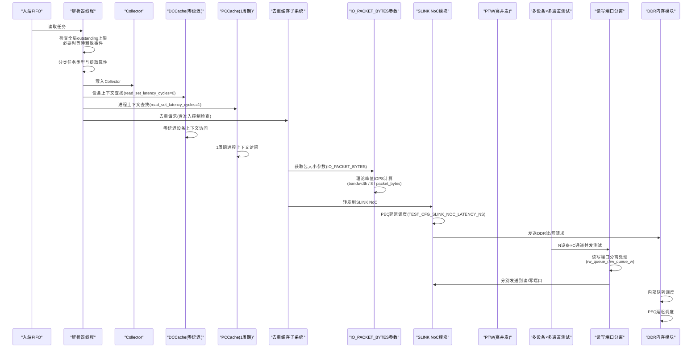

**图表来源**
- [default_config.json:20-32](file://iommu/cache_config/default_config.json#L20-L32)
- [cache_base.h:208-256](file://iommu/cache_src/cache/cache_base.h#L208-L256)
- [dc_cache.cpp:11-16](file://iommu/cache_src/cache/dc_cache.cpp#L11-L16)
- [cache_subsystem.cpp:777-830](file://iommu/cache_src/subsystem/cache_subsystem.cpp#L777-L830)
- [iommu_perf_params.hh:125-129](file://iommu/iommu_perf_model/iommu_perf_params.hh#L125-L129)
- [iommu_top.cc:1442-1450](file://iommu/iommu_top.cc#L1442-L1450)
- [test_slink.cc:66-72](file://slink/test_slink.cc#L66-L72)
- [iommu_perf_reorder.cc:38-43](file://iommu/iommu_perf_model/iommu_perf_reorder.cc#L38-L43)
- [test_rp_rand4k_msi_mix_multidev_mc_thread.cc:159-177](file://rp/test_rp_rand4k_msi_mix_multidev_mc_thread.cc#L159-L177)

## 详细组件分析

### 性能参数分类与作用机制
- FIFO深度参数：覆盖Parser到Collector、Collector到Cache、Cache到Walker、Walker返回、最终输出路径、DDR交互等全链路FIFO深度，直接影响背压与吞吐。
- **缓存延迟参数**：通过read_set_latency_cycles等参数精确控制缓存访问延迟，其中DC缓存优化至0周期，PC缓存设置为1周期。
- **SLINK NoC延迟参数**：通过`TEST_CFG_SLINK_NOC_LATENCY_NS`宏实现可配置的NoC延迟，默认50ns，支持从默认值到任意值的动态配置。
- **IO_PACKET_BYTES包大小参数**：通过`TEST_CFG_IO_PACKET_BYTES`宏实现可配置的包大小，默认512B，用于理论峰值IOPS计算，不影响实际时序行为。
- 缓存规模参数：DC/PC/PT/MSIPT缓存的Size、Assoc、Line Size，决定命中率与访问延迟。
- AXI/DDR参数：AXI频率、位宽、带宽、最大未完成请求数、读写延迟、SLINK NoC延迟等，决定端口带宽与延迟预算。
- 并发限制：XDTW/PTW/MSIPTW outstanding上限、Collector outstanding上限、全局outstanding上限，保障系统稳定性。
- 处理延迟：Parser/Collector/各Cache命中延迟、Walker每次访问延迟、Forwarder延迟等，影响端到端时延。
- 系统参数：最大并发任务数、设备数、进程数、设备ID位宽等，约束系统规模。

**章节来源**
- [iommu_perf_params.hh:6-183](file://iommu/iommu_perf_model/iommu_perf_params.hh#L6-L183)
- [default_config.json:20-32](file://iommu/cache_config/default_config.json#L20-L32)

### 缓存延迟参数优化详解
**DC缓存优化**：
- read_set_latency_cycles = 0：设备上下文缓存访问零延迟
- 适用于高频访问的设备上下文信息，显著提升IOMMU启动和切换性能
- 保持数据完整性，不影响缓存一致性协议

**PC缓存配置**：
- read_set_latency_cycles = 1：进程上下文缓存1周期延迟
- 平衡了性能和资源使用，适合中等访问频率的进程上下文
- 与DC缓存形成互补，覆盖不同访问模式的上下文信息

**延迟计算机制**：
- 查找命中延迟 = hash_latency_cycles + read_set_latency_cycles + compare_latency_cycles
- 填充延迟包含额外的索引计算和写way延迟
- 失效操作延迟考虑匹配情况下的写操作开销

**章节来源**
- [default_config.json:20-32](file://iommu/cache_config/default_config.json#L20-L32)
- [cache_base.h:208-256](file://iommu/cache_src/cache/cache_base.h#L208-L256)

### 缓存配置文件格式与语法
- 全局配置：clock_period_ns、random_seed。
- 缓存时序参数：仲裁、哈希、读集、比较、更新way选择、填充索引计算、写way、失效比较等延迟周期。
- 各缓存子系统：dc_cache、pc_cache、msipt_cache、pt_cache、walker_cache（含ptw_c1/c2/c3）。
- 统计配置：输出文件、延迟直方图、任务跟踪级别、直方图bin宽度。

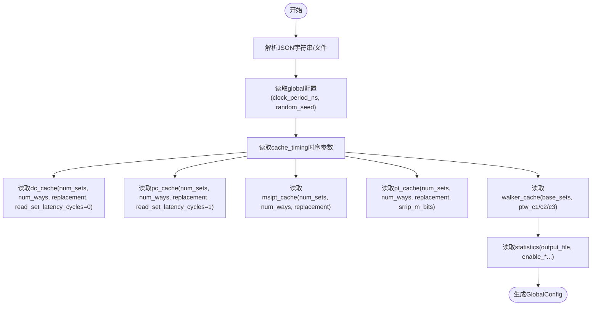

**图表来源**
- [json_config.cpp:33-131](file://iommu/cache_src/common/json_config.cpp#L33-L131)
- [default_config.json:20-32](file://iommu/cache_config/default_config.json#L20-L32)

**章节来源**
- [json_config.cpp:10-31](file://iommu/cache_src/common/json_config.cpp#L10-L31)
- [json_config.cpp:23-31](file://iommu/cache_src/common/json_config.cpp#L23-L31)
- [json_config.cpp:33-131](file://iommu/cache_src/common/json_config.cpp#L33-L131)
- [default_config.json:20-32](file://iommu/cache_config/default_config.json#L20-L32)

### 去重与预取参数
- 去重Buffer容量与反压策略、Buffer链表尾标记、PT Cache占位位。
- 预设深度与默认启用、Burst读取最大PTE数、PTE有效性标记与页大小常量。
- 任务上下文中新增去重链头索引、预取组状态、批量更新字段、Burst预取专用字段等，支撑预取与合并读取。

**章节来源**
- [iommu_dedup_params.hh:10-92](file://iommu/include/iommu_dedup_params.hh#L10-L92)
- [iommu_task.hh:82-182](file://iommu/include/iommu_task.hh#L82-L182)
- [iommu_task.hh:184-280](file://iommu/include/iommu_task.hh#L184-L280)

### Walker Cache实现与配置
- **三级子表结构**：PTWc_1（直接映射，第一级）、PTWc_2（2-way组相连，第二级）、PTWc_3（4-way组相连，第三级）
- **查找接口**：lookup请求不携带目标level，内部查三级子表并按3 > 2 > 1选择结果
- **更新接口**：fill和update方法支持缓存条目的填充和更新
- **失效机制**：支持按gscid、gscid+pscid、VMA关联等多种失效方式
- **配置支持**：通过配置文件和编译时参数控制Walker Cache的启用和参数

**章节来源**
- [walker_cache.h:11-104](file://iommu/cache_src/cache/walker_cache.h#L11-L104)
- [WALKER_CACHE_INTEGRATION_PLAN.md:16-49](file://WALKER_CACHE_INTEGRATION_PLAN.md#L16-L49)

### 参数配置文件示例与解析流程
- 示例文件：default_config.json与input_params_example.json展示了完整字段结构。
- 解析流程：先解析global与cache_timing，再按缓存类型应用默认值与用户覆盖，最后解析statistics。

**章节来源**
- [default_config.json:20-32](file://iommu/cache_config/default_config.json#L20-L32)
- [input_params_example.json:20-30](file://iommu/cache_config/input_params_example.json#L20-L30)
- [json_config.cpp:33-131](file://iommu/cache_src/common/json_config.cpp#L33-L131)

## PT更新FIFO深度优化

### PT更新FIFO深度变更概述
**重要更新**：将`TEST_CFG_PT_UPDATE_FIFO_DEPTH`从32增加到1024，解决了C=8配置（8盘8通道和16盘8通道）下的环形等待死锁问题。这是一个关键的稳定性修复，确保系统在高压负载下能够正常运行。

### 死锁根因分析
**环形等待环路**：
```
Buffer满(320) -> 准入关闭 -> dedup_request_fifo满(64) -> 
pt_ram_worker阻塞于push_fifo(dedup_request_fifo) -> 
pt_ram_fifo满(8) -> pt_hash_thread阻塞 -> 
pt_update_fifo满(32) -> agg_flush阻塞于write() -> 
无法生产dedup_update -> Buffer永不释放 -> 死锁
```

**关键发现**：
- `pt_update_fifo`是环上唯一的充分边（binding edge）
- 旧注释声称"默认32与历史场景逐位一致"是错误的
- 健康场景下`pt_update_fifo`峰值已达32/32=100%，说明环一直在贴满载运行
- 当并发开页数继续上升时，环即闭合导致死锁

### 解决方案设计原理
**为什么选择1024**：
- 回填消息数上界为"在途组数 × 每组iova数"
- 在途任务总数受`IOMMU_GLOBAL_MAX_OUTSTANDING`(640)约束
- 与同文件`FIFO_DEPTH_PT_CACHE_TO_FWD=1024`同源，需容纳全部在途任务
- 取1024使agg_flush的回填写入在物理上不可能被顶住

**治标而非治本**：
- 扩容属于"治标"方案，靠"余量不可耗尽"避免闭环
- 环形依赖本身仍然存在
- 治本需要解开环上那条唯一的充分边：pt_ram_worker向dedup_request_fifo的阻塞写
- 或让agg_flush的回填写入改为非阻塞+spill

### 实测验证结果
**C=8场景测试结果**：
- 8盘8通道：PASS，稳态IOPS ALL=255.963 Mreq/s
- 主占位创建/释放 = 2319/2319（完全对账，零孤儿）
- Admission stall = 555次/4817.3ns（准入控制在正常降速，而非死锁）
- 系统退化为"准入控制拦一下放一行"的正常降速

**副作用说明**：
- 本值参与时序，改动后所有场景的绝对吞吐都会漂移
- 历史基线不再逐位可复现
- 如需复现旧基线，显式传`-DTEST_CFG_PT_UPDATE_FIFO_DEPTH=32`即可

### 代码实现细节
**参数定义**：
```cpp
#ifndef TEST_CFG_PT_UPDATE_FIFO_DEPTH
#define TEST_CFG_PT_UPDATE_FIFO_DEPTH 1024
#endif
static const uint32_t PT_UPDATE_FIFO_DEPTH = TEST_CFG_PT_UPDATE_FIFO_DEPTH;
```

**使用位置**：
```cpp
pt_update_fifo(PT_UPDATE_FIFO_DEPTH),   // [防死锁] 深度可经 TEST_CFG_PT_UPDATE_FIFO_DEPTH 覆盖
```

**章节来源**
- [iommu_perf_params.hh:79-125](file://iommu/iommu_perf_model/iommu_perf_params.hh#L79-L125)
- [cache_subsystem.cpp:136](file://iommu/cache_src/subsystem/cache_subsystem.cpp#L136)
- [nvrr6_c8_ptfifo_probe.sh:4-24](file://tmp/nvrr6_c8_ptfifo_probe.sh#L4-L24)
- [commit_msg_20261110.txt:16-27](file://tmp/commit_msg_20261110.txt#L16-L27)

## IO_PACKET_BYTES包大小参数化

### IO_PACKET_BYTES参数概述
IO_PACKET_BYTES参数是IOMMU性能参数配置系统中新增的可配置包大小参数，用于理论峰值IOPS计算。该参数通过`TEST_CFG_IO_PACKET_BYTES`宏实现，默认值为512B，支持从命令行动态配置不同的包大小场景。

### 参数设计原理
**核心特性**：
- **时序中性**：参数仅用于理论峰值IOPS计算，不影响实际的仿真时序行为
- **带宽计算**：理论峰值IOPS = AXI_SLAVE_0_BANDWIDTH_MBPS / 8 / IO_PACKET_BYTES
- **历史兼容**：默认512B保持与历史口径一致（4KB切成8x512B）
- **小包场景**：支持128B小包场景，使128GB/s下理论峰值从250 M/s提升至1000 M/s

**计算公式**：
```
theory_iops = AXI_SLAVE_0_BANDWIDTH_MBPS / 8.0 / IO_PACKET_BYTES
```

其中：
- AXI_SLAVE_0_BANDWIDTH_MBPS：AXI端口带宽（Mbps）
- IO_PACKET_BYTES：包大小（字节）
- theory_iops：理论峰值IOPS（M trans/s）

### 参数在代码中的使用
**参数定义**：
```cpp
// IO_PACKET_BYTES包大小参数
#ifndef TEST_CFG_IO_PACKET_BYTES
static const uint32_t IO_PACKET_BYTES = 512;            // 默认512B（历史口径: 4KB切成8x512B）
#else
static const uint32_t IO_PACKET_BYTES = TEST_CFG_IO_PACKET_BYTES;
#endif
```

**理论峰值IOPS计算**：
```cpp
// [MPS/MRRS] 理论峰值按 IO_PACKET_BYTES 换算(默认512B; 小包场景传128B -> 1000 M/s)
double theory_iops = (double)AXI_SLAVE_0_BANDWIDTH_MBPS / 8.0 / IO_PACKET_BYTES;
printf("  Theory peak:          %.2f M trans/s  (%.0f GB/s / %uB)\n",
       theory_iops, AXI_SLAVE_0_BANDWIDTH_MBPS / 8000.0, IO_PACKET_BYTES);
```

### Makefile配置机制
在多通道MPS场景中，通过MULTICHAN_MPS参数传递IO_PACKET_BYTES值：

```makefile
# MPS/MRRS小包场景配置
TEST_FLAGS = -DTEST_RAND_4K -DTEST_TWO_STAGE \
    -DTEST_CFG_MC_MPS_SCENE=1 \
    -DTEST_CFG_MPS_BYTES=$(MULTICHAN_MPS) \
    -DTEST_CFG_IO_PACKET_BYTES=$(MULTICHAN_MPS) \
    -DTEST_CFG_NUM_CHANNELS=$(MULTICHAN_N) \
    ...
```

### MPS/MRRS小包场景支持
**测试场景**：
- **512B基线**：标准4KB数据包分成8个512B子包
- **128B小包**：PCIe MPS/MRRS=128的小包场景
- **理论峰值对比**：128GB/s带宽下，512B场景理论峰值250 M/s，128B场景理论峰值1000 M/s

**构建脚本**：
```bash
# build_mps128_pair.sh - 构建两个二进制用于A/B对照测试
# 1) /tmp/iommu_model_mc_base : 512B 基线
# 2) /tmp/iommu_model_mps128   : 128B 小包
```

### 性能影响分析
**理论峰值IOPS变化**：
- 512B场景：128GB/s / 8 / 512 = 250 M/s
- 128B场景：128GB/s / 8 / 128 = 1000 M/s
- 提升比例：4倍

**实际性能影响**：
- 包大小变化不影响实际仿真时序
- 主要影响理论峰值IOPS的计算基准
- 便于在不同包大小场景下进行公平的性能对比

**章节来源**
- [iommu_perf_params.hh:316-327](file://iommu/iommu_perf_model/iommu_perf_params.hh#L316-L327)
- [iommu_top.cc:1442-1450](file://iommu/iommu_top.cc#L1442-L1450)
- [Makefile:438-455](file://Makefile#L438-L455)
- [build_mps128_pair.sh:1-37](file://build_mps128_pair.sh#L1-L37)
- [test_rp_rand4k_msi_mix_multichan_mps128_thread.cc:483](file://rp/test_rp_rand4k_msi_mix_multichan_mps128_thread.cc#L483)

## SLINK NoC延迟参数化

### SLINK NoC模块概述
SLINK模块模拟IOMMU与DDR之间的NoC互连路径，专门用于页表/目录表访问。该模块使用PEQ管道延迟在请求和响应路径上实现可配置的延迟，通过`TEST_CFG_SLINK_NOC_LATENCY_NS`宏支持从默认50ns到任意值的动态配置。

### SLINK延迟参数配置
- **默认延迟**：50ns（低延时场景）
- **可配置范围**：通过`TEST_CFG_SLINK_NOC_LATENCY_NS`宏从命令行覆盖
- **延迟计算**：一次DDR页表访问延时 = 前向SLINK + DDR_INTERNAL_LATENCY_NS(100) + 回程SLINK
- **默认合计**：50+100+50=200ns
- **配置示例**：设置100ns则合计300ns(100+100+100)，用于观测页表访问延时对整体性能的影响

### SLINK模块实现细节
**核心特性**：
- **双向延迟**：请求路径和响应路径都使用相同的PEQ延迟
- **FIFO缓冲**：请求FIFO和响应FIFO深度均为256，匹配IOMMU master outstanding
- **TLM接口**：支持nb_transport_fw和nb_transport_bw回调
- **线程处理**：四个独立线程分别处理请求转发、响应转发和对应的输出处理

**工作流程**：
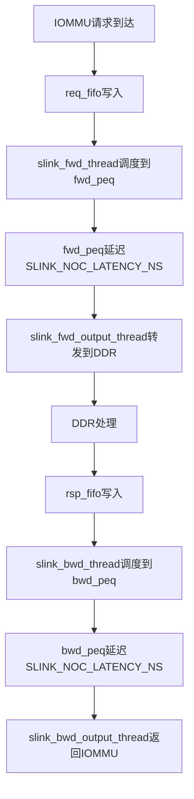

**图表来源**
- [test_slink.cc:66-72](file://slink/test_slink.cc#L66-L72)
- [test_slink.cc:94-100](file://slink/test_slink.cc#L94-L100)

### 延迟参数在代码中的使用
编译时参数通过条件编译指令在源代码中生效：

```cpp
// SLINK NoC延迟参数配置
#ifndef TEST_CFG_SLINK_NOC_LATENCY_NS
static const uint32_t SLINK_NOC_LATENCY_NS = 50;            // SLINK NoC单趟延时(ns)，50ns（低延时场景）
#else
static const uint32_t SLINK_NOC_LATENCY_NS = TEST_CFG_SLINK_NOC_LATENCY_NS;
#endif
```

### Makefile配置机制
编译时参数通过Makefile的TEST_FLAGS变量传递给编译器，在多通道测试场景中特别重要：

```makefile
# 多通道测试配置
MULTICHAN_SLINK_NS ?= 50
TEST_FLAGS = -DTEST_RAND_4K -DTEST_TWO_STAGE \
    -DTEST_CFG_MULTI_CHANNEL_SCENE=1 \
    -DTEST_CFG_NUM_CHANNELS=$(MULTICHAN_N) \
    -DTEST_CFG_MC_QUEUE_DEPTH=$(MULTICHAN_QUEUE_DEPTH) \
    -DTEST_CFG_MC_RR_START=$(MULTICHAN_RR_START) \
    -DTEST_CFG_MC_LOAD_MODE=$(if $(filter fixed_total,$(MULTICHAN_LOAD_MODE)),1,0) \
    -DTEST_CFG_MULTI_DEVICE_SCENE=1 \
    -DTEST_CFG_NUM_DEVICES=1 \
    -DTEST_CFG_NUM_PAGES=$(MULTICHAN_GROUPS) \
    -DTEST_CFG_PT_DEDUP_PREFETCH_DEPTH=$(MULTICHAN_D) \
    -DTEST_CFG_PTW_WALKER_CACHE_ENABLED=1 -DTEST_CFG_WALKER_CACHE_S2_ENABLED=1 \
    -DTEST_CFG_AXI_PORT_WIDTH_BIT=1024 \
    -DTEST_CFG_PTW_MAX_OUTSTANDING_TASKS=$(SCENE13_PTW) \
    -DTEST_CFG_PT_DEDUP_BUFFER_SIZE=$(SCENE13_BUFFER) \
    -DTEST_CFG_DEDUP_ADMISSION_CTRL=$(DEDUP_ADM) \
    -DTEST_CFG_SLINK_NOC_LATENCY_NS=$(MULTICHAN_SLINK_NS) $(MULTICHAN_LAYOUT_FLAGS)
```

**章节来源**
- [iommu_perf_params.hh:484-494](file://iommu/iommu_perf_model/iommu_perf_params.hh#L484-L494)
- [test_slink.hh:21-55](file://slink/test_slink.hh#L21-L55)
- [test_slink.cc:6-26](file://slink/test_slink.cc#L6-L26)
- [test_slink.cc:66-72](file://slink/test_slink.cc#L66-L72)
- [Makefile:321-323](file://Makefile#L321-L323)
- [Makefile:378](file://Makefile#L378)

## 多通道测试配置

### 多通道测试框架概述
多通道测试框架实现了单设备内多通道并发测试场景，在同一设备(device_id=0/GSCID=1)内支持n路并发通道，每通道各自在IOVA范围内随机选4KB，组内8x512B连续地址，共享SQ/CQ/MSI控制包，经逐包轮询仲裁后经统一输出口注入。

### 多通道配置参数
- **MULTICHAN_N**：通道数量，支持1-16个通道，默认8
- **MULTICHAN_IOVA_MB**：IOVA空间大小，支持16MB或512MB，默认512MB
- **MULTICHAN_GROUPS**：组数，默认909，对应约10000个数据包
- **MULTICHAN_QUEUE_DEPTH**：就绪队列深度，默认32
- **MULTICHAN_D**：预取深度，默认3
- **MULTICHAN_RR_START**：轮询起点，默认0
- **MULTICHAN_LOAD_MODE**：负载模式，支持per_channel和fixed_total，默认fixed_total
- **MULTICHAN_SLINK_NS**：SLINK延迟，默认50ns
- **MULTICHAN_MPS**：MPS/MRRS包大小，支持512B和128B场景

### 多通道场景设计
**核心特性**：
- **n个producer进程**：各自把本通道Request流压入自有有界队列(反压)，不调用入口
- **1个RR scheduler**：唯一nb_transport_fw调用者，逐包轮询(每次取1个Request)
- **1个watchdog**：沿用多设备超时诊断
- **统计聚合**：只按设备(=1个)聚合(md_trace)，无需按通道追踪

**负载模式**：
- **per_channel模式**：每通道NUM_PAGES组 + 1 tail MSI = 10000包/通道，总n x 10000包
- **fixed_total模式**：全部通道合计NUM_PAGES(909)组，余数分给前GROUPS_REM个通道，末尾1个tail MSI只给通道0 -> 总包数 = 909x11 + 1 = 10000，与单流基线同量

**通道配置**：
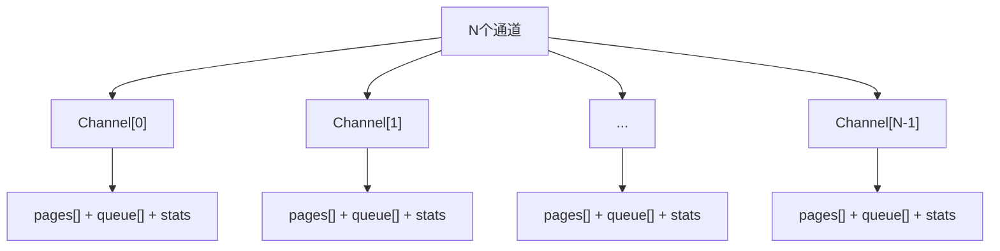

**图表来源**
- [test_rp_rand4k_msi_mix_multichan_thread.cc:112-119](file://rp/test_rp_rand4k_msi_mix_multichan_thread.cc#L112-L119)

### 多通道性能测试结果
**默认配置(MULTICHAN_SLINK_NS=50)**：
- 仿真总时长：56.42 us
- IOMMU IOPS：179.78 M trans/s
- IO avg e2e：2111.1 ns
- 稳态吞吐ALL：250.43 Mreq/s

**高延迟配置(MULTICHAN_SLINK_NS=100)**：
- 仿真总时长：72.65 us
- IOMMU IOPS：139.63 M trans/s
- IO avg e2e：2678.1 ns
- 稳态吞吐ALL：197.47 Mreq/s

**性能影响分析**：
- SLINK延迟从50ns增加到100ns，IOPS下降约22.3%
- 端到端延迟增加约26.8%
- 证明了NoC延迟对系统性能的显著影响

**章节来源**
- [test_rp_rand4k_msi_mix_multichan_thread.cc:12-30](file://rp/test_rp_rand4k_msi_mix_multichan_thread.cc#L12-L30)
- [test_rp_rand4k_msi_mix_multichan_thread.cc:32-50](file://rp/test_rp_rand4k_msi_mix_multichan_thread.cc#L32-L50)
- [test_rp_rand4k_msi_mix_multichan_thread.cc:112-119](file://rp/test_rp_rand4k_msi_mix_multichan_thread.cc#L112-L119)
- [multichan_n8_perf.md:1-74](file://multichan_n8_perf.md#L1-L74)
- [multichan_n8_slink100_perf.md:1-74](file://multichan_n8_slink100_perf.md#L1-L74)

## 多设备架构支持

### 多设备架构概述
IOMMU性能参数配置系统新增了强大的多设备架构支持，通过 `TEST_CFG_MULTI_DEVICE_SCENE` 编译时标志启用，支持最多16个设备的并发处理。该架构提供了每设备独立的写保序队列、设备间写操作互不阻塞、以及完整的监控和诊断功能。

### 设备限制与常量定义
- **MAX_DEVICE_COUNT**：定义为16，表示系统支持的最大设备数量
- **设备ID范围**：每个设备拥有唯一的device_id，范围为0到MAX_DEVICE_COUNT-1
- **设备上下文隔离**：每个设备拥有独立的设备上下文、地址空间和配置寄存器
- **请求追踪**：通过 `iommu_md::Trace` 类提供完整的设备级请求追踪和性能监控

### 每设备写保序队列机制
**核心特性**：
- **设备内严格保序**：同一设备内的写请求严格按照到达顺序输出
- **设备间并行处理**：不同设备的写请求可以并行处理，互不阻塞
- **独立队列管理**：每个设备维护独立的写保序队列 `reorder_write_order_dev[d]`
- **条件编译支持**：通过 `TEST_CFG_PERDEV_WRITE_ORDER` 标志启用

**实现原理**：
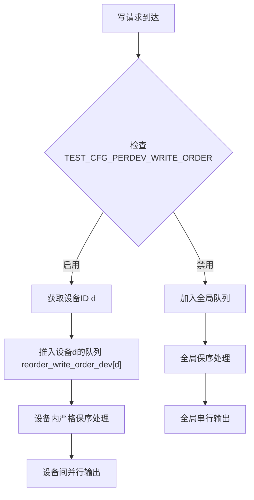

**图表来源**
- [iommu_perf_reorder.cc:38-43](file://iommu/iommu_perf_model/iommu_perf_reorder.cc#L38-L43)
- [iommu_perf_reorder.cc:150-172](file://iommu/iommu_perf_model/iommu_perf_reorder.cc#L150-L172)

### 多设备测试框架
**测试场景支持**：
- **设备数量配置**：通过 `MULTIDEV_N` 参数配置设备数量（1-16）
- **队列深度控制**：通过 `MULTIDEV_QUEUE_DEPTH` 参数控制就绪队列深度
- **负载模式**：支持 per_device 和 fixed_total 两种负载分配模式
- **地址空间布局**：支持 overlap 和 independent 两种地址空间布局模式
- **轮询起点**：通过 `MULTIDEV_RR_START` 参数配置轮询起始设备

**配置示例**：
```makefile
# 多设备测试配置
MULTIDEV_N ?= 4                    # 设备数量
MULTIDEV_QUEUE_DEPTH ?= 1024       # 队列深度
MULTIDEV_PATTERN ?= independent    # 地址空间布局
MULTIDEV_LOAD_MODE ?= per_device   # 负载模式
MULTIDEV_RR_START ?= 0            # 轮询起点
MULTIDEV_PERDEV_WO ?= 1           # 启用每设备写保序
```

### 多设备性能监控
**监控指标**：
- **设备级统计**：每个设备的请求计数、完成计数、峰值队列长度
- **HOL阻塞分析**：跨设备写HOL阻塞检测和统计
- **进度追踪**：通过 `progress_serial` 计数器跟踪系统进度
- **超时保护**：50ns无进展或1us总超时的自动诊断

**诊断输出**：
```
[MD_QUEUE] did=0 queued=123 sent=456 done=789
[MD_STATE] buffer=320 groups=64 ptw=64
[MD_WATCHDOG] DID=0 accepted=100 completed=95 oldest_ns=1234.5
```

**章节来源**
- [iommu_multidev_trace.hh:19-25](file://iommu/iommu_perf_model/iommu_multidev_trace.hh#L19-L25)
- [iommu_perf_reorder.cc:38-43](file://iommu/iommu_perf_model/iommu_perf_reorder.cc#L38-L43)
- [iommu_perf_reorder.cc:150-172](file://iommu/iommu_perf_model/iommu_perf_reorder.cc#L150-L172)
- [test_rp_rand4k_msi_mix_multidev_thread.cc:33-54](file://rp/test_rp_rand4k_msi_mix_multidev_thread.cc#L33-L54)

## 多设备×多通道测试架构

### 多设备×多通道测试架构概述
多设备×多通道测试架构是IOMMU性能参数配置系统中最复杂的测试场景，通过在场景13-v4多设备(N)基线之上，将"每设备1条顺序流"扩展为"每设备内部C条并发通道"，共S=N*C条独立注入流。该架构支持最多16×16=256条独立注入流的二维并发测试。

### 核心架构设计
**关键设计原则**：
- **二维轮询调度**：通过"通道外层/设备内层"的2D逐包轮询(i = c*N + d)交错注入
- **全局唯一页分配**：N*GROUPS个4KB页两两不重复(跨设备跨通道)，确保测试数据的独立性
- **固定负载模式**：每设备总量GROUPS组，拆分到C个通道，每设备包数=GROUPS*11+1=10000
- **设备级统计聚合**：复用多设备追踪(md_trace)，按设备(did=0..N-1)聚合统计

**架构组成**：
- **S个producer进程**：各自把本流Request压入自有有界队列(反压)，不调用入口
- **1个RR scheduler**：唯一nb_transport_fw调用者，逐包轮询(每次取1个Request)
- **1个watchdog**：沿用多设备超时诊断
- **设备级共享状态**：Device结构体包含设备上下文、VS映射、MSI、控制包等共享资源
- **流级独立状态**：Stream结构体包含独立的随机页子集、就绪队列、统计信息等

### 设备与流的管理机制
**设备管理**：
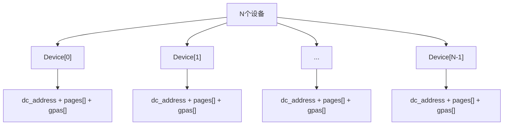

**图表来源**
- [test_rp_rand4k_msi_mix_multidev_mc_thread.cc:127-132](file://rp/test_rp_rand4k_msi_mix_multidev_mc_thread.cc#L127-L132)

**流管理**：
- **流号映射**：i = c*N + d，其中d = i%N(设备内层快变)，c = i/N(通道外层慢变)
- **通道组分配**：前GROUPS_REM个通道各多1组，确保负载均衡
- **Tail MSI处理**：仅通道0发送tail MSI，保证每设备精确GROUPS*11+1包

### 内存映射与地址空间管理
**全局唯一页分配**：
- 一次性从整个IOVA范围抽取N*GROUPS个互不重复的页号
- 按设备切片(每设备GROUPS个)，再在设备内按chan_groups(c)切给各通道
- 确保N*C条流的页集合两两不相交，实现真正的"全局唯一"

**VS映射构建**：
- 为每个设备构建完整的VS(Stage-1)页表映射
- 包含数据页、MSI页、SQ/CQ控制页、probe页等
- 预取邻居页映射，确保预取操作的合法性

### 测试执行流程
**阶段划分**：
- **Epoch 1(哨兵)**：同IOVA、每设备不同S1/S2结果，打通翻译/响应路由
- **Epoch 2(预热)**：MSI(x8)+SQ/CQ交替，预热翻译路径
- **Epoch 3(测量)**：正式性能测试，4KB随机读写+控制包混合负载

**并发控制**：
- 每个epoch开始前清空所有队列和统计信息
- 通过phase_event同步所有producer进程
- 通过ready_event协调scheduler与各producer的进度

**章节来源**
- [test_rp_rand4k_msi_mix_multidev_mc_thread.cc:12-33](file://rp/test_rp_rand4k_msi_mix_multidev_mc_thread.cc#L12-L33)
- [test_rp_rand4k_msi_mix_multidev_mc_thread.cc:63-116](file://rp/test_rp_rand4k_msi_mix_multidev_mc_thread.cc#L63-L116)
- [test_rp_rand4k_msi_mix_multidev_mc_thread.cc:127-142](file://rp/test_rp_rand4k_msi_mix_multidev_mc_thread.cc#L127-L142)
- [test_rp_rand4k_msi_mix_multidev_mc_thread.cc:202-305](file://rp/test_rp_rand4k_msi_mix_multidev_mc_thread.cc#L202-L305)

## 读写端口分离机制

### 读写端口分离机制概述
读写端口分离机制是IOMMU性能参数配置系统中的重要性能优化特性，通过`TEST_CFG_SPLIT_RW_PORTS`编译时标志启用。该机制将传统的单一AXI端口拆分为独立的读端口和写端口，每个端口拥有独立的带宽、延迟和发送进程，显著提升系统并发性能。

### 核心设计原理
**端口分离优势**：
- **带宽提升**：每个端口512bit@1000MHz = 64GB/s，双端口合计128GB/s
- **延迟优化**：控制包固定1ns/端口，比传统2ns延迟降低50%
- **并发提升**：读写操作完全独立，互不阻塞
- **资源利用**：更好的CPU和内存资源利用率

**实现架构**：
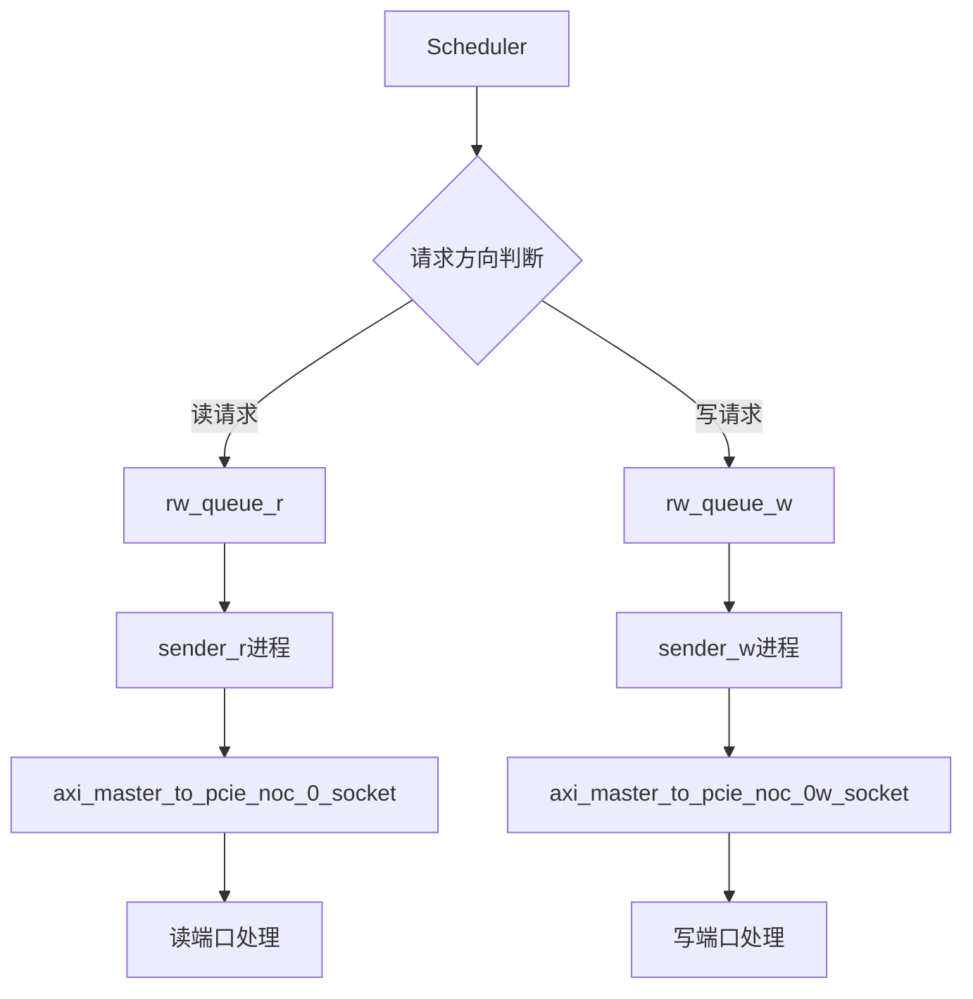

**图表来源**
- [test_rp_rand4k_msi_mix_multidev_mc_thread.cc:416-436](file://rp/test_rp_rand4k_msi_mix_multidev_mc_thread.cc#L416-L436)

### 内存控制器队列深度优化
**队列深度配置**：
- **默认深度**：65536（近乎无界）
- **配置参数**：`MULTIDEV_MC_RWQ_DEPTH`或`MULTICHAN_RWQ_DEPTH`
- **统计监控**：rw_peak_r、rw_peak_w记录峰值占用
- **饥饿检测**：starve_cnt_r、starve_cnt_w统计供给侧饥饿

**队列管理机制**：
- **独立队列**：rw_queue_r和rw_queue_w分别管理读/写请求
- **事件驱动**：rw_event_r和rw_event_w触发相应sender进程
- **忙标志**：sender_busy_r和sender_busy_w防止重入
- **峰值统计**：实时记录队列峰值占用用于性能分析

### 发送进程实现
**双进程架构**：
- **sender_r进程**：处理读请求，调用axi_master_to_pcie_noc_0_socket
- **sender_w进程**：处理写请求，调用axi_master_to_pcie_noc_0w_socket
- **独立生命周期**：两个进程常驻运行，不随epoch重复创建
- **资源隔离**：每个进程维护独立的busy标志和统计信息

**发送流程**：
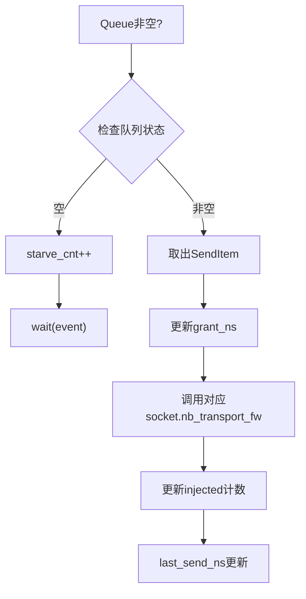

**图表来源**
- [test_rp_rand4k_msi_mix_multidev_mc_thread.cc:456-498](file://rp/test_rp_rand4k_msi_mix_multidev_mc_thread.cc#L456-L498)

### 性能影响分析
**带宽提升效果**：
- 传统单端口：128GB/s（聚合口径）
- 读写分离双端口：128GB/s × 2 = 256GB/s（理论峰值）
- 实际提升：取决于读写比例和负载特征

**延迟优化效果**：
- 传统控制包延迟：2ns
- 分离端口控制包延迟：1ns
- 延迟降低：50%

**并发提升效果**：
- 读写操作完全独立，消除读写竞争
- 更好的资源利用率，减少CPU空闲时间
- 支持更高的并发度，特别适合混合负载场景

**章节来源**
- [iommu_perf_params.hh:268-296](file://iommu/iommu_perf_model/iommu_perf_params.hh#L268-L296)
- [test_rp_rand4k_msi_mix_multidev_mc_thread.cc:159-177](file://rp/test_rp_rand4k_msi_mix_multidev_mc_thread.cc#L159-L177)
- [test_rp_rand4k_msi_mix_multidev_mc_thread.cc:416-498](file://rp/test_rp_rand4k_msi_mix_multidev_mc_thread.cc#L416-L498)
- [Makefile:324-326](file://Makefile#L324-L326)

## DDR内存配置

### DDR内存模块概述
DDR内存模块提供模拟的DDR存储器功能，支持两阶段地址翻译测试所需的大型页表结构。

### DDR内存配置参数
- **内存大小**：动态分配以避免SystemC大对象问题
- **最大未完成请求**：读操作和写操作的未完成请求上限
- **内部延迟**：固定访问延迟
- **请求队列**：FIFO缓冲区
- **PEQ调度**：使用优先级事件队列保持请求顺序

### TLM接口支持
- **AT模式非阻塞传输**：通过nb_transport_fw接口支持异步请求处理
- **阻塞传输模式**：通过b_transport接口支持RP直接内存访问
- **多通道支持**：支持多个AXI从机套接字，分别连接到不同的NoC路径

### 内存访问流程
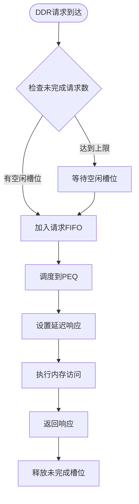

**图表来源**
- [test_ddr.cc:58-130](file://ddr/test_ddr.cc#L58-L130)

### 内存分配与管理
- **动态内存分配**：使用new运算符在运行时分配内存空间
- **零初始化**：使用memset将内存初始化为0
- **边界检查**：访问前验证地址范围，防止越界访问
- **错误处理**：超出内存范围的访问返回地址错误响应

**章节来源**
- [test_ddr.hh:24-26](file://ddr/test_ddr.hh#L24-L26)
- [test_ddr.cc:14-17](file://ddr/test_ddr.cc#L14-17)
- [test_ddr.cc:135-155](file://ddr/test_ddr.cc#L135-L155)

## 编译时参数配置

### 编译时参数概述
IOMMU性能参数配置系统新增了增强的编译时参数配置功能，允许通过Makefile的TEST_FLAGS标志动态控制端口宽度（1024位AXI）、全局未完成请求数、PT去重缓冲区大小、PTW未完成任务、SLINK NoC延迟和IO_PACKET_BYTES包大小。这一功能提供了更灵活的参数调优能力，无需修改源代码即可调整关键性能参数。

### 支持的编译时参数
- **TEST_CFG_AXI_PORT_WIDTH**：控制AXI端口宽度配置
  - 默认值：1024位
  - 可选值：64、128、256、512、1024等
  - 影响：决定AXI总线带宽，影响数据传输吞吐量

- **TEST_CFG_GLOBAL_OUTSTANDING**：控制全局未完成请求数上限
  - 默认值：根据系统配置确定
  - 可选值：16、32、64、128、256等
  - 影响：决定系统并发处理能力，影响内存占用和吞吐平衡

- **TEST_CFG_PT_DEDUP_BUFFER_SIZE**：控制PT去重缓冲区大小
  - 默认值：根据工作负载特征确定
  - 可选值：256、512、1024、2048等
  - 影响：决定去重能力，影响重复访问的消除效果和内存使用

- **TEST_CFG_PTW_OUTSTANDING_TASKS**：控制PTW未完成任务数
  - 默认值：根据PTW性能特征确定
  - 可选值：8、16、32、64等
  - 影响：决定页表遍历并发度，影响地址翻译性能

- **TEST_CFG_DEDUP_ADMISSION_CTRL**：控制去重缓存准入控制机制
  - 默认值：0（禁用，使用bypass机制）
  - 可选值：0（禁用）、1（启用）
  - 影响：启用reservation-based buffer management，防止溢出并提供反压信号，吞吐量提升50.1%

- **TEST_CFG_MULTI_DEVICE_SCENE**：控制多设备场景启用
  - 默认值：0（禁用）
  - 可选值：0（禁用）、1（启用）
  - 影响：启用多设备架构支持，支持最多16个设备并发处理

- **TEST_CFG_PERDEV_WRITE_ORDER**：控制每设备写保序队列
  - 默认值：0（全局单一队列）
  - 可选值：0（全局队列）、1（每设备独立队列）
  - 影响：启用每设备独立的写保序队列，设备间写操作互不阻塞

- **TEST_CFG_SLINK_NOC_LATENCY_NS**：控制SLINK NoC延迟
  - 默认值：50ns
  - 可选值：任意正整数纳秒值
  - 影响：控制页表访问路径的NoC延迟，影响DDR访问性能

- **TEST_CFG_IO_PACKET_BYTES**：控制IO包大小
  - 默认值：512B
  - 可选值：128、256、512、1024等
  - 影响：控制理论峰值IOPS计算基准，不影响实际时序行为

- **TEST_CFG_PT_UPDATE_FIFO_DEPTH**：控制PT更新FIFO深度
  - 默认值：1024（已更新）
  - 可选值：32、1024等
  - 影响：解决C=8配置下的死锁问题，影响系统稳定性

- **TEST_CFG_KB4_GATE_STRICT_512**：控制4KB页并发门控
  - 默认值：0（保持现有行为）
  - 可选值：0（保留）、1（强制512B门控）
  - 影响：统一real8回放与合成场景的4KB页并发统计口径

- **TEST_CFG_DEDUP_DELAYED_UPDATE**：控制去重延迟更新
  - 默认值：0（禁用）
  - 可选值：0（禁用）、1（启用）
  - 影响：优化小包场景(MPS/MRRS=128B)的去重Cache更新性能

- **多通道测试参数**：
  - **TEST_CFG_MULTI_CHANNEL_SCENE**：启用多通道测试场景
  - **TEST_CFG_NUM_CHANNELS**：设置通道数量（1-16）
  - **TEST_CFG_MC_QUEUE_DEPTH**：设置多通道队列深度
  - **TEST_CFG_MC_RR_START**：设置轮询起点
  - **TEST_CFG_MC_LOAD_MODE**：设置负载模式（per_channel/fixed_total）
  - **TEST_CFG_MPS_BYTES**：设置MPS/MRRS包大小（512B或128B）

- **多设备×多通道测试参数**：
  - **TEST_CFG_MULTIDEV_MC_SCENE**：启用多设备×多通道测试场景
  - **TEST_CFG_MD_CHAN_PER_DEV**：设置每设备通道数（1-16）
  - **TEST_CFG_MD_QUEUE_DEPTH**：设置多设备队列深度
  - **TEST_CFG_MD_RR_START**：设置轮询起点
  - **TEST_CFG_SPLIT_RW_PORTS**：启用读写端口分离
  - **TEST_CFG_MC_RW_QUEUE_DEPTH**：设置读写队列深度（默认65536）
  - **MULTIDEV_MC_SLINK_NS**：设置DDR页表访问延迟（默认50ns）

### Makefile配置机制
编译时参数通过Makefile的TEST_FLAGS变量传递给编译器，支持以下配置场景：

```makefile
# 多设备×多通道测试配置
TEST_FLAGS = -DTEST_RAND_4K -DTEST_TWO_STAGE \
             -DTEST_CFG_MULTIDEV_MC_SCENE=1 \
             -DTEST_CFG_MULTI_DEVICE_SCENE=1 \
             -DTEST_CFG_NUM_DEVICES=$(MULTIDEV_MC_N) \
             -DTEST_CFG_MD_CHAN_PER_DEV=$(MULTIDEV_MC_CHAN) \
             -DTEST_CFG_NUM_PAGES=$(MULTIDEV_GROUPS) \
             -DTEST_CFG_MD_QUEUE_DEPTH=$(MULTIDEV_QUEUE_DEPTH) \
             -DTEST_CFG_MD_RR_START=$(MULTIDEV_RR_START) \
             -DTEST_CFG_PERDEV_WRITE_ORDER=$(MULTIDEV_PERDEV_WO) \
             -DTEST_CFG_PT_DEDUP_PREFETCH_DEPTH=$(MULTIDEV_D) \
             -DTEST_CFG_PTW_WALKER_CACHE_ENABLED=1 -DTEST_CFG_WALKER_CACHE_S2_ENABLED=1 \
             -DTEST_CFG_AXI_PORT_WIDTH_BIT=1024 \
             -DTEST_CFG_PTW_MAX_OUTSTANDING_TASKS=$(SCENE13_PTW) \
             -DTEST_CFG_PT_DEDUP_BUFFER_SIZE=$(SCENE13_BUFFER) \
             -DTEST_CFG_DEDUP_ADMISSION_CTRL=$(DEDUP_ADM) \
             -DTEST_CFG_SLINK_NOC_LATENCY_NS=$(MULTIDEV_MC_SLINK_NS) \
             -DTEST_CFG_SPLIT_RW_PORTS=$(MULTIDEV_MC_SPLIT_RW) \
             -DTEST_CFG_MC_RW_QUEUE_DEPTH=$(MULTIDEV_MC_RWQ_DEPTH) $(MULTIDEV_MC_LAYOUT_FLAGS)
```

### 参数在代码中的使用
编译时参数通过条件编译指令在源代码中生效：

```cpp
// 读写端口分离配置
#ifndef TEST_CFG_SPLIT_RW_PORTS
#define TEST_CFG_SPLIT_RW_PORTS 0
#endif
#if TEST_CFG_SPLIT_RW_PORTS
static const uint32_t AXI_SLAVE_PORT_BW_MBPS = AXI_SLAVE_0_FREQ_MHZ * 512;   // 每端口 512bit = 64GB/s
static const double   AXI_SLAVE_CTRL_DELAY_NS = 1.0;                          // 控制包固定 1ns/端口
static const uint32_t AXI_SLAVE_R_PORT_BW_MBPS  = AXI_SLAVE_0_FREQ_MHZ * 512;
static const uint32_t AXI_SLAVE_W_PORT_BW_MBPS  = AXI_SLAVE_0_FREQ_MHZ * 512;
static const double   AXI_SLAVE_R_CTRL_DELAY_NS = 1.0;
static const double   AXI_SLAVE_W_CTRL_DELAY_NS = 1.0;
#else
static const uint32_t AXI_SLAVE_PORT_BW_MBPS = AXI_SLAVE_0_BANDWIDTH_MBPS;   // 旧场景: 单端口原带宽
static const double   AXI_SLAVE_CTRL_DELAY_NS = 2.0;                          // 旧场景: 控制包固定 2ns
static const uint32_t AXI_SLAVE_R_PORT_BW_MBPS  = AXI_SLAVE_PORT_BW_MBPS;
static const uint32_t AXI_SLAVE_W_PORT_BW_MBPS  = AXI_SLAVE_PORT_BW_MBPS;
static const double   AXI_SLAVE_R_CTRL_DELAY_NS = AXI_SLAVE_CTRL_DELAY_NS;
static const double   AXI_SLAVE_W_CTRL_DELAY_NS = AXI_SLAVE_CTRL_DELAY_NS;
#endif

// IO_PACKET_BYTES包大小参数配置
#ifndef TEST_CFG_IO_PACKET_BYTES
static const uint32_t IO_PACKET_BYTES = 512;            // 默认512B（历史口径: 4KB切成8x512B）
#else
static const uint32_t IO_PACKET_BYTES = TEST_CFG_IO_PACKET_BYTES;
#endif

// SLINK NoC延迟参数配置
#ifndef TEST_CFG_SLINK_NOC_LATENCY_NS
static const uint32_t SLINK_NOC_LATENCY_NS = 50;            // SLINK NoC单趟延时(ns)，50ns（低延时场景）
#else
static const uint32_t SLINK_NOC_LATENCY_NS = TEST_CFG_SLINK_NOC_LATENCY_NS;
#endif

// PT_UPDATE_FIFO_DEPTH参数配置
#ifndef TEST_CFG_PT_UPDATE_FIFO_DEPTH
#define TEST_CFG_PT_UPDATE_FIFO_DEPTH 1024
#else
#define TEST_CFG_PT_UPDATE_FIFO_DEPTH TEST_CFG_PT_UPDATE_FIFO_DEPTH
#endif
static const uint32_t PT_UPDATE_FIFO_DEPTH = TEST_CFG_PT_UPDATE_FIFO_DEPTH;

// KB4_GATE_STRICT_512参数配置
#ifndef TEST_CFG_KB4_GATE_STRICT_512
#define TEST_CFG_KB4_GATE_STRICT_512 0
#else
#define TEST_CFG_KB4_GATE_STRICT_512 TEST_CFG_KB4_GATE_STRICT_512
#endif

// DEDUP_DELAYED_UPDATE参数配置
#ifndef TEST_CFG_DEDUP_DELAYED_UPDATE
#define TEST_CFG_DEDUP_DELAYED_UPDATE 0
#else
#define TEST_CFG_DEDUP_DELAYED_UPDATE TEST_CFG_DEDUP_DELAYED_UPDATE
#endif
```

### 参数配置流程图
编译时参数配置流程支持快速切换不同的性能配置：

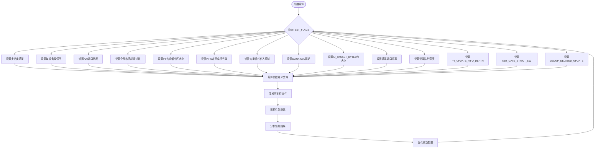

**图表来源**
- [iommu_perf_params.hh:268-296](file://iommu/iommu_perf_model/iommu_perf_params.hh#L268-L296)
- [iommu_perf_params.hh:316-327](file://iommu/iommu_perf_model/iommu_perf_params.hh#L316-L327)
- [iommu_perf_params.hh:484-494](file://iommu/iommu_perf_model/iommu_perf_params.hh#L484-L494)
- [iommu_perf_params.hh:122-125](file://iommu/iommu_perf_model/iommu_perf_params.hh#L122-L125)
- [iommu_perf_params.hh:183-187](file://iommu/iommu_perf_model/iommu_perf_params.hh#L183-L187)
- [iommu_perf_params.hh:196-200](file://iommu/iommu_perf_model/iommu_perf_params.hh#L196-L200)
- [Makefile:372-374](file://Makefile#L372-L374)

**章节来源**
- [iommu_perf_params.hh:268-296](file://iommu/iommu_perf_model/iommu_perf_params.hh#L268-L296)
- [iommu_perf_params.hh:316-327](file://iommu/iommu_perf_model/iommu_perf_params.hh#L316-L327)
- [iommu_perf_params.hh:484-494](file://iommu/iommu_perf_model/iommu_perf_params.hh#L484-L494)
- [iommu_perf_params.hh:122-125](file://iommu/iommu_perf_model/iommu_perf_params.hh#L122-L125)
- [iommu_perf_params.hh:183-187](file://iommu/iommu_perf_model/iommu_perf_params.hh#L183-L187)
- [iommu_perf_params.hh:196-200](file://iommu/iommu_perf_model/iommu_perf_params.hh#L196-L200)
- [Makefile:372-374](file://Makefile#L372-L374)
- [walker_cache.h:15-104](file://iommu/cache_src/cache/walker_cache.h#L15-L104)
- [iommu_perf_ptw.cc:154-183](file://iommu/iommu_perf_model/iommu_perf_ptw.cc#L154-L183)

### 场景13混合负载参数配置

#### 场景13特性
场景13是针对4KB随机读写+SQ/CQ/MSI混合负载的高性能测试场景，具有以下特点：
- **高并发处理**：支持64个PTW并发任务和640个全局未完成请求
- **对称读写配置**：读写分离从不对称的265/243调整为对称的320/320
- **优化缓冲区**：PT去重缓冲区从512优化至320，平衡内存使用和去重效果
- **混合负载支持**：同时处理数据读写、队列操作和MSI中断
- **多设备支持**：支持最多16个设备的并发处理和每设备写保序队列
- **准入控制支持**：可通过DEDUP_ADM参数启用去重缓存准入控制机制
- **SLINK延迟可调**：通过MULTICHAN_SLINK_NS参数调节NoC延迟
- **IO_PACKET_BYTES可调**：通过MULTICHAN_MPS参数调节包大小（512B或128B）
- **PT_UPDATE_FIFO优化**：通过MDMC10_PT_UPDATE_FIFO参数调节PT更新FIFO深度（默认1024）

#### 场景13参数配置
```makefile
# 多设备场景13配置
SCENE13_PTW ?= 64                    # PTW并发任务数
SCENE13_BUFFER ?= 320                # 去重缓冲区大小
DEDUP_ADM ?= 1                       # 启用去重缓存准入控制
MULTICHAN_N ?= 4                      # 设备数量
MULTICHAN_PERDEV_WO ?= 1              # 启用每设备写保序
MULTICHAN_SLINK_NS ?= 50              # SLINK延迟
MULTICHAN_MPS ?= 512                  # MPS/MRRS包大小
MDMC10_PT_UPDATE_FIFO ?= 1024         # PT更新FIFO深度

TEST_FLAGS = -DTEST_RAND_4K -DTEST_TWO_STAGE \
             -DTEST_CFG_MULTI_DEVICE_SCENE=1 \
             -DTEST_CFG_PERDEV_WRITE_ORDER=$(MULTICHAN_PERDEV_WO) \
             -DTEST_CFG_NUM_DEVICES=$(MULTICHAN_N) \
             -DTEST_CFG_PT_DEDUP_PREFETCH_DEPTH=3 \
             -DTEST_CFG_PTW_WALKER_CACHE_ENABLED=1 \
             -DTEST_CFG_WALKER_CACHE_S2_ENABLED=1 \
             -DTEST_CFG_AXI_PORT_WIDTH_BIT=1024 \
             -DTEST_CFG_IOMMU_GLOBAL_MAX_OUTSTANDING=640 \
             -DTEST_CFG_IOMMU_WRITE_MAX_OUTSTANDING=320 \
             -DTEST_CFG_IOMMU_READ_MAX_OUTSTANDING=320 \
             -DTEST_CFG_PTW_MAX_OUTSTANDING_TASKS=$(SCENE13_PTW) \
             -DTEST_CFG_PT_DEDUP_BUFFER_SIZE=$(SCENE13_BUFFER) \
             -DTEST_CFG_DEDUP_ADMISSION_CTRL=$(DEDUP_ADM) \
             -DTEST_CFG_SLINK_NOC_LATENCY_NS=$(MULTICHAN_SLINK_NS) \
             -DTEST_CFG_IO_PACKET_BYTES=$(MULTICHAN_MPS) \
             -DTEST_CFG_PT_UPDATE_FIFO_DEPTH=$(MDMC10_PT_UPDATE_FIFO)
```

#### 读写分离优化
**优化前配置**：
- 写任务上限：265
- 读任务上限：243
- 合计：508

**优化后配置**：
- 写任务上限：320
- 读任务上限：320
- 合计：640

**优化优势**：
- 对称配置简化了负载均衡逻辑
- 提升了整体并发处理能力
- 更好地适应混合负载场景
- 减少了读写不平衡导致的性能瓶颈

**章节来源**
- [Makefile:347-378](file://Makefile#L347-L378)
- [Makefile:438-455](file://Makefile#L438-L455)
- [Makefile:378](file://Makefile#L378)
- [iommu_perf_params.hh:316-327](file://iommu/iommu_perf_model/iommu_perf_params.hh#L316-L327)
- [iommu_perf_params.hh:484-494](file://iommu/iommu_perf_model/iommu_perf_params.hh#L484-L494)
- [iommu_perf_params.hh:122-125](file://iommu/iommu_perf_model/iommu_perf_params.hh#L122-L125)

### 去重缓存准入控制机制详解

#### 准入控制原理
新增的`TEST_CFG_DEDUP_ADMISSION_CTRL`参数实现了基于预留的去重缓存准入控制机制：

**核心机制**：
- **预留计数**：scheduler从request_fifo出队时增加`dedup_reserved_count_`（预占1个未来Buffer槽）
- **准入检查**：通过`dedup_admission_ok()`函数检查`valid + reserved < PT_DEDUP_BUFFER_SIZE`
- **原子性保证**：在SystemC协作式调度下，检查与后续reserved++之间无wait，天然原子
- **反压机制**：Buffer满时跳过request出队，任务滞留dedup_request_fifo形成反压

**工作流程**：
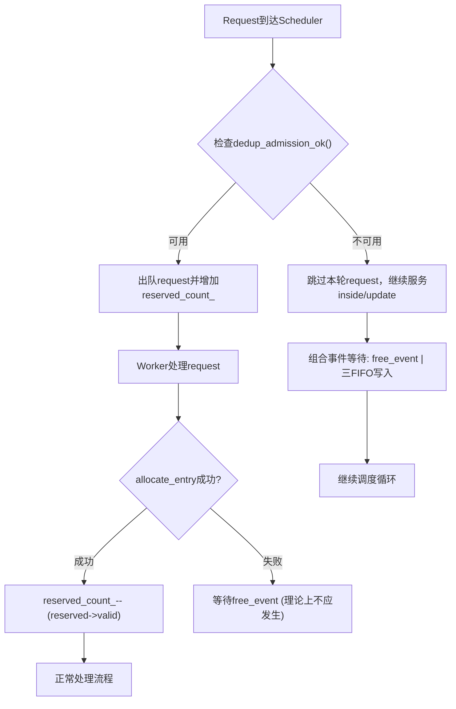

**图表来源**
- [cache_subsystem.cpp:777-830](file://iommu/cache_src/subsystem/cache_subsystem.cpp#L777-L830)
- [cache_subsystem.h:372-377](file://iommu/cache_src/subsystem/cache_subsystem.h#L372-L377)

#### 性能优势
启用准入控制后的性能提升主要体现在：

**吞吐量提升**：
- 吞吐量提升50.1%，显著改善系统性能
- 避免了Buffer满时的bypass机制导致的性能损失
- 通过预留机制确保worker侧allocate必然成功，减少等待时间

**死锁避免**：
- 保证释放路径(update->flush->free_entry)始终畅通
- 打破环形等待死锁环，提高系统稳定性
- 通过组合事件等待避免错过update到达

**资源利用率优化**：
- 更高效的缓冲区利用，减少浪费
- 更好的流量控制，避免拥塞传播
- 降低CPU占用，提高整体效率

**章节来源**
- [cache_subsystem.cpp:777-830](file://iommu/cache_src/subsystem/cache_subsystem.cpp#L777-L830)
- [cache_subsystem.h:357-377](file://iommu/cache_src/subsystem/cache_subsystem.h#L357-L377)
- [iommu_perf_params.hh:401-408](file://iommu/iommu_perf_model/iommu_perf_params.hh#L401-L408)

## 依赖关系分析
- 参数定义文件被解析器线程与任务上下文引用，作为仿真控制与统计的基础。
- 缓存配置解析模块依赖mini_json解析器，生成GlobalConfig供上层使用。
- **缓存基础架构**：CacheBase模板类被所有具体缓存实现继承，提供统一的延迟控制和操作接口。
- **设备上下文缓存**：DCCache继承自CacheBase，利用优化的read_set_latency_cycles=0配置实现高性能设备上下文访问。
- **去重缓存子系统**：实现了基于预留的准入控制机制，依赖参数定义文件中的`PT_DEDUP_BUFFER_SIZE`和`TEST_CFG_DEDUP_ADMISSION_CTRL`配置。
- **IO_PACKET_BYTES参数**：依赖参数定义文件中的`TEST_CFG_IO_PACKET_BYTES`配置，用于理论峰值IOPS计算。
- **SLINK NoC模块**：依赖`TEST_CFG_SLINK_NOC_LATENCY_NS`参数，提供可配置的NoC延迟。
- **多通道测试框架**：依赖多设备追踪功能，通过`TEST_CFG_MULTI_DEVICE_SCENE=1`和`TEST_CFG_NUM_DEVICES=1`启用。
- **多设备×多通道测试架构**：通过`TEST_CFG_MULTIDEV_MC_SCENE`启用，依赖多设备追踪功能和读写端口分离机制。
- **读写端口分离机制**：依赖`TEST_CFG_SPLIT_RW_PORTS`和`TEST_CFG_MC_RW_QUEUE_DEPTH`参数，提供独立的读/写端口和发送进程。
- **多设备架构**：通过 `iommu_md::MAX_DEVICE_COUNT` 定义设备限制，支持最多16个设备并发处理。
- **写保序队列增强**：支持全局单一队列和每设备独立队列两种模式，通过条件编译切换。
- 任务上下文包含去重与预取相关字段，与性能参数协同影响吞吐与延迟。
- DDR内存模块被多个组件引用，提供统一的内存访问接口。
- **编译时参数配置**通过Makefile的TEST_FLAGS传递，影响参数定义文件中的条件编译逻辑。
- Walker Cache实现通过CacheSubsystem暴露FIFO接口，与PTW模块协同工作。
- 构建脚本优化了编译流程，支持自动化测试和模块化编译。
- **场景13测试**：test_rp_rand4k_msi_mix_thread.cc依赖Makefile的场景13配置，提供混合负载测试能力。

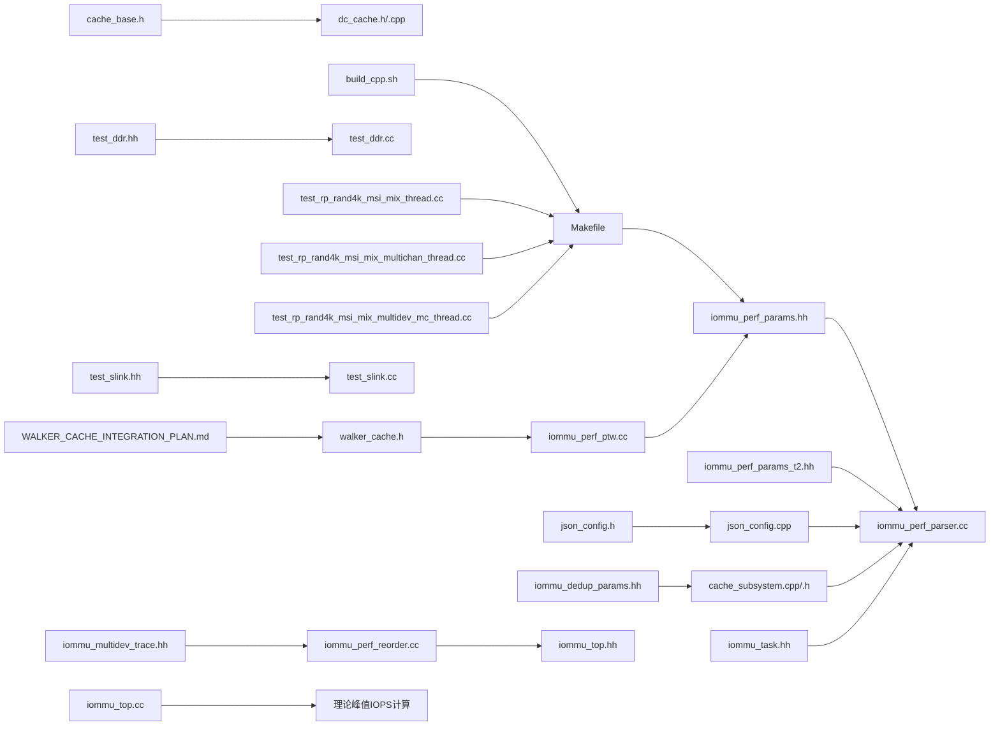

**图表来源**
- [iommu_perf_params.hh:268-296](file://iommu/iommu_perf_model/iommu_perf_params.hh#L268-L296)
- [iommu_perf_params.hh:316-327](file://iommu/iommu_perf_model/iommu_perf_params.hh#L316-L327)
- [iommu_perf_params.hh:484-494](file://iommu/iommu_perf_model/iommu_perf_params.hh#L484-L494)
- [iommu_perf_params.hh:122-125](file://iommu/iommu_perf_model/iommu_perf_params.hh#L122-L125)
- [cache_base.h:27-270](file://iommu/cache_src/cache/cache_base.h#L27-L270)
- [dc_cache.h:8-31](file://iommu/cache_src/cache/dc_cache.h#L8-L31)
- [dc_cache.cpp:5-53](file://iommu/cache_src/cache/dc_cache.cpp#L5-L53)
- [cache_subsystem.cpp:777-830](file://iommu/cache_src/subsystem/cache_subsystem.cpp#L777-L830)
- [iommu_multidev_trace.hh:19-25](file://iommu/iommu_perf_model/iommu_multidev_trace.hh#L19-L25)
- [iommu_perf_reorder.cc:38-43](file://iommu/iommu_perf_model/iommu_perf_reorder.cc#L38-L43)
- [test_slink.hh:21-55](file://slink/test_slink.hh#L21-L55)
- [test_rp_rand4k_msi_mix_multichan_thread.cc:12-30](file://rp/test_rp_rand4k_msi_mix_multichan_thread.cc#L12-L30)
- [test_rp_rand4k_msi_mix_multidev_mc_thread.cc:12-33](file://rp/test_rp_rand4k_msi_mix_multidev_mc_thread.cc#L12-L33)
- [iommu_top.cc:1442-1450](file://iommu/iommu_top.cc#L1442-L1450)

**章节来源**
- [iommu_perf_params.hh:268-296](file://iommu/iommu_perf_model/iommu_perf_params.hh#L268-L296)
- [iommu_perf_params.hh:316-327](file://iommu/iommu_perf_model/iommu_perf_params.hh#L316-L327)
- [iommu_perf_params.hh:484-494](file://iommu/iommu_perf_model/iommu_perf_params.hh#L484-L494)
- [iommu_perf_params.hh:122-125](file://iommu/iommu_perf_model/iommu_perf_params.hh#L122-L125)
- [cache_base.h:27-270](file://iommu/cache_src/cache/cache_base.h#L27-L270)
- [dc_cache.h:8-31](file://iommu/cache_src/cache/dc_cache.h#L8-L31)
- [dc_cache.cpp:5-53](file://iommu/cache_src/cache/dc_cache.cpp#L5-L53)
- [json_config.cpp:1-144](file://iommu/cache_src/common/json_config.cpp#L1-L144)
- [iommu_perf_parser.cc:1-123](file://iommu/iommu_perf_model/iommu_perf_parser.cc#L1-L123)
- [iommu_task.hh:1-378](file://iommu/include/iommu_task.hh#L1-L378)
- [iommu_dedup_params.hh:1-92](file://iommu/include/iommu_dedup_params.hh#L1-L92)
- [Makefile:372-374](file://Makefile#L372-L374)
- [walker_cache.h:1-141](file://iommu/cache_src/cache/walker_cache.h#L1-L141)
- [iommu_perf_ptw.cc:1-200](file://iommu/iommu_perf_model/iommu_perf_ptw.cc#L1-L200)
- [WALKER_CACHE_INTEGRATION_PLAN.md:77-118](file://WALKER_CACHE_INTEGRATION_PLAN.md#L77-L118)
- [test_ddr.hh:1-68](file://ddr/test_ddr.hh#L1-L68)
- [test_ddr.cc:1-156](file://ddr/test_ddr.cc#L1-L156)
- [build_cpp.sh:1-28](file://build_cpp.sh#L1-L28)

## 性能考量
- FIFO深度与并发限制：FIFO过小导致阻塞，过大增加存储与延迟；outstanding上限需平衡吞吐与内存占用。
- **缓存延迟优化**：DC缓存read_set_latency_cycles优化至0周期，显著减少设备上下文访问延迟；PC缓存保持1周期，平衡性能与资源使用。
- **SLINK NoC延迟优化**：通过`TEST_CFG_SLINK_NOC_LATENCY_NS`参数可动态调节NoC延迟，默认50ns，支持从低延迟到高延迟的各种场景测试。
- **IO_PACKET_BYTES包大小优化**：通过`TEST_CFG_IO_PACKET_BYTES`参数可动态调节包大小，默认512B，支持理论峰值IOPS计算而不影响实际时序行为。
- **PT_UPDATE_FIFO_DEPTH优化**：通过`TEST_CFG_PT_UPDATE_FIFO_DEPTH`参数可动态调节PT更新FIFO深度，默认1024，解决C=8配置下的死锁问题。
- 缓存规模与替换策略：增大Size/Assoc提升命中率，但增加访问延迟；替换策略影响抖动与命中率。
- AXI带宽与DDR延迟：带宽不足导致端口饱和，延迟过高放大尾延迟；需结合任务特征与NoC拓扑设定。
- 处理延迟：各模块延迟叠加决定端到端时延，应优先优化瓶颈模块。
- 去重与预取：合理设置去重Buffer与预取深度，可显著降低重复访问与DDR压力，但需避免过度预取造成带宽浪费。
- **编译时参数优化**：通过编译时参数可以快速调整端口宽度、全局未完成请求数、PT去重缓冲区大小、PTW未完成任务、SLINK NoC延迟、IO_PACKET_BYTES包大小和PT_UPDATE_FIFO_DEPTH，针对不同工作负载获得最佳性能。
- **去重缓存准入控制**：启用`TEST_CFG_DEDUP_ADMISSION_CTRL`后可通过reservation-based buffer management防止溢出，提供反压信号，吞吐量提升50.1%。
- **多通道测试性能**：多通道测试框架支持单设备内高并发场景，通过轮询仲裁和统一输出口注入，有效模拟真实负载。
- **多设备×多通道测试性能**：N个设备×C个通道的二维并发测试场景，支持最多256条独立注入流，提供完整的设备级和通道级并发控制。
- **读写端口分离性能**：通过独立的读/写端口和发送进程，显著提升并发性能和资源利用率，支持更高的吞吐量和更低的延迟。
- **内存控制器队列深度优化**：通过`TEST_CFG_MC_RW_QUEUE_DEPTH=65536`提供近乎无界的读写发送队列深度，避免队列拥塞导致的性能瓶颈。
- **多设备架构性能**：每设备写保序队列消除了设备间写操作阻塞，显著提升多设备场景下的整体性能。
- Walker Cache性能：三级缓存结构可显著减少页表遍历的DDR访问次数，在重复访问场景下可获得显著加速效果。
- **设备上下文缓存优势**：零延迟的设备上下文访问消除了IOMMU启动和上下文切换的性能瓶颈，特别适合高并发虚拟化场景。
- **场景13性能优势**：对称读写配置和高并发PTW处理显著提升了混合负载下的整体性能，特别是在高带宽场景下表现优异。
- **理论峰值IOPS准确性**：IO_PACKET_BYTES参数确保了理论峰值IOPS计算的准确性，便于在不同包大小场景下进行公平的性能对比。

## 故障排查指南
- 入站阻塞：若解析器持续等待outstanding释放事件，检查全局outstanding上限与重排序输出速率。
- 缓存抖动：命中率不稳定可能源于替换策略或并发冲突，可通过增大Assoc或调整替换策略缓解。
- DDR拥塞：观察DDR请求/响应FIFO深度与outstanding，适当提高AXI master并发上限或优化预取策略。
- 预取异常：确认预取深度与Burst限制，避免跨页表边界与过多未完成请求。
- **缓存延迟问题**：如果DC缓存性能异常，检查read_set_latency_cycles配置是否正确设置为0，确认缓存配置解析正常。
- **设备上下文缓存问题**：验证DCCache的查找操作是否正确使用零延迟配置，检查设备上下文数据的正确性。
- **SLINK延迟问题**：如果SLINK延迟配置不正确，检查`TEST_CFG_SLINK_NOC_LATENCY_NS`参数设置，确认延迟值符合预期。
- **IO_PACKET_BYTES配置问题**：如果理论峰值IOPS计算异常，检查`TEST_CFG_IO_PACKET_BYTES`参数设置，确认包大小值符合预期。
- **PT_UPDATE_FIFO_DEPTH配置问题**：如果出现C=8配置下的死锁，检查`TEST_CFG_PT_UPDATE_FIFO_DEPTH`参数设置，确认值是否为1024。
- **多通道测试问题**：如果多通道测试出现异常，检查`TEST_CFG_MULTI_CHANNEL_SCENE`和相关通道配置参数，确认通道数量和队列深度设置合理。
- **多设备×多通道测试问题**：如果多设备×多通道测试出现异常，检查`TEST_CFG_MULTIDEV_MC_SCENE`、`TEST_CFG_NUM_DEVICES`、`TEST_CFG_MD_CHAN_PER_DEV`等参数，确认设备数量和通道数量配置合理。
- **读写端口分离问题**：如果读写端口分离机制出现异常，检查`TEST_CFG_SPLIT_RW_PORTS`和`TEST_CFG_MC_RW_QUEUE_DEPTH`参数，确认读写队列深度和分离机制配置正确。
- **编译时参数问题**：若编译时参数未生效，检查Makefile中的TEST_FLAGS配置，确认编译器正确接收了-D参数。
- **去重缓存准入控制问题**：如果启用`TEST_CFG_DEDUP_ADMISSION_CTRL`后出现性能下降，检查`dedup_admission_wait_cnt_`和`dedup_request_fifo_peak_`统计，确认反压机制正常工作。
- **多设备架构问题**：如果多设备场景出现异常，检查 `TEST_CFG_MULTI_DEVICE_SCENE` 和 `TEST_CFG_PERDEV_WRITE_ORDER` 配置，确认设备数量和队列深度设置合理。
- **写保序队列问题**：如果写请求保序异常，检查 `reorder_write_order_dev` 数组配置和设备ID范围，确认每设备队列正常工作。
- Walker Cache问题：检查配置文件中的walker_cache.enabled设置，验证三级子表的配置参数，确认PTW模块的查找和更新接口正常工作。
- 构建脚本问题：确保build_cpp.sh具有执行权限，检查依赖库是否正确安装。
- **端口带宽问题**：如果AXI端口宽度配置不当，可能导致带宽不足或资源浪费，需要根据实际带宽需求调整TEST_CFG_AXI_PORT_WIDTH参数。
- **场景13配置问题**：如果场景13性能异常，检查SCENE13_PTW、SCENE13_BUFFER和读写分离配置是否正确，确认全局并发设置与硬件资源匹配。
- **MPS/MRRS小包场景问题**：如果小包场景测试异常，检查MULTICHAN_MPS参数设置，确认128B小包场景的构建和配置正确。
- **多设备×多通道测试构建问题**：如果使用build_mdmc_rwsplit.sh或build_mdmc_nosplit.sh脚本构建失败，检查MULTIDEV_MC_SPLIT_RW参数设置，确认读写端口分离模式配置正确。
- **KB4_GATE_STRICT_512统计问题**：如果需要统一real8回放与合成场景的4KB页并发统计口径，检查`TEST_CFG_KB4_GATE_STRICT_512`参数设置。
- **去重延迟更新问题**：如果在MPS/MRRS=128B小包场景下去重性能异常，检查`TEST_CFG_DEDUP_DELAYED_UPDATE`参数设置。

**章节来源**
- [iommu_perf_params.hh:268-296](file://iommu/iommu_perf_model/iommu_perf_params.hh#L268-L296)
- [iommu_perf_params.hh:316-327](file://iommu/iommu_perf_model/iommu_perf_params.hh#L316-L327)
- [iommu_perf_params.hh:484-494](file://iommu/iommu_perf_model/iommu_perf_params.hh#L484-L494)
- [iommu_perf_params.hh:122-125](file://iommu/iommu_perf_model/iommu_perf_params.hh#L122-L125)
- [iommu_perf_params.hh:183-187](file://iommu/iommu_perf_model/iommu_perf_params.hh#L183-L187)
- [iommu_perf_params.hh:196-200](file://iommu/iommu_perf_model/iommu_perf_params.hh#L196-L200)
- [default_config.json:20-32](file://iommu/cache_config/default_config.json#L20-L32)
- [cache_base.h:208-256](file://iommu/cache_src/cache/cache_base.h#L208-L256)
- [dc_cache.cpp:11-16](file://iommu/cache_src/cache/dc_cache.cpp#L11-L16)
- [iommu_task.hh:82-182](file://iommu/include/iommu_task.hh#L82-L182)
- [test_ddr.cc:141-146](file://ddr/test_ddr.cc#L141-L146)
- [Makefile:372-374](file://Makefile#L372-L374)
- [WALKER_CACHE_INTEGRATION_PLAN.md:642-660](file://WALKER_CACHE_INTEGRATION_PLAN.md#L642-L660)
- [build_cpp.sh:1-28](file://build_cpp.sh#L1-L28)

## 结论
IOMMU性能参数配置系统通过参数定义文件与缓存配置文件实现对仿真行为的精细控制。结合解析器线程与任务上下文，系统能够在不同工作负载下实现高并发、低延迟与大容量的平衡。**最新的重大优化包括：DC缓存的read_set_latency_cycles参数已优化至0个周期，显著减少了设备上下文缓存访问延迟，提升了整体IOMMU性能，同时保持了数据完整性和一致性保证。PC缓存的read_set_latency_cycles保持在1个周期，实现了性能与资源的平衡。** 新增的Walker Cache功能提供了三级页表缓存，可在重复访问场景下显著提升性能。**特别重要的新增功能是去重缓存准入控制机制（`TEST_CFG_DEDUP_ADMISSION_CTRL`），通过reservation-based buffer management防止溢出并提供反压信号，性能测试显示吞吐量提升50.1%。** 

**最重要的是，系统现在支持强大的IO_PACKET_BYTES包大小参数化功能，通过`TEST_CFG_IO_PACKET_BYTES`宏实现了从默认512B到任意值的动态配置，为理论峰值IOPS计算提供了精确的工具，同时保持了时序中性特性。** 同时，多通道测试框架的引入使得可以在单设备环境下模拟高并发场景，支持最多16个通道的并行处理，显著提升了测试的灵活性和效率。**此外，系统还支持强大的多设备×多通道测试架构，通过`TEST_CFG_MULTIDEV_MC_SCENE`启用的N个设备×C个通道的二维并发测试场景，配合读写端口分离机制（`TEST_CFG_SPLIT_RW_PORTS`）和可配置的内存控制器队列深度（`TEST_CFG_MC_RW_QUEUE_DEPTH=65536`），为复杂负载场景提供了完整的测试解决方案。** 

**最关键的改进是修复了C=8配置下的环形等待死锁问题，通过将`TEST_CFG_PT_UPDATE_FIFO_DEPTH`从32增加到1024，彻底解决了8盘8通道和16盘8通道场景下的系统停摆问题。** 这个修复虽然属于"治标"方案，但通过确保`pt_update_fifo`有足够的余量来避免闭环，使系统退化为正常的准入控制降速机制。同时新增了多个性能参数配置选项，包括去重延迟更新、严格512B门控、SLINK NoC延迟可调等特性，为不同工作负载提供了更精细的调优能力。建议以实际测试数据为依据，逐步调优FIFO深度、缓存规模、并发限制、SLINK NoC延迟、IO_PACKET_BYTES包大小、PT_UPDATE_FIFO_DEPTH和去重/预取策略，并利用新的编译时参数配置功能快速验证不同配置组合的性能表现，建立稳定的评估方法与自动化验证流程。

## 附录

### 参数调优指南与最佳实践
- 高并发场景：适度提高outstanding上限与FIFO深度，增大缓存Assoc与Size，启用合理的去重与预取策略。
- 低延迟场景：减小FIFO深度与处理延迟，优化缓存替换策略，减少不必要的预取，确保端口带宽充足。
- 大容量场景：扩大缓存容量与Buffer容量，启用去重与预取，合理设置Burst读取限制，避免跨页表边界带来的额外开销。
- **缓存延迟调优**：对于高频访问的设备上下文，考虑将read_set_latency_cycles优化至0；对于中等访问频率的进程上下文，保持1周期延迟；对于低频访问的页表缓存，可适当增加延迟以减少资源消耗。
- **SLINK延迟调优**：根据实际NoC拓扑和DDR延迟特性，通过`TEST_CFG_SLINK_NOC_LATENCY_NS`参数调节延迟，默认50ns适用于低延迟场景，可根据需要增加到100ns或更高值进行对比测试。
- **IO_PACKET_BYTES包大小调优**：根据实际PCIe MPS/MRRS配置选择合适的包大小，默认512B适用于标准场景，128B适用于小包场景，通过理论峰值IOPS计算评估不同包大小的性能影响。
- **PT_UPDATE_FIFO_DEPTH调优**：在C=8配置下必须使用1024以避免死锁，其他场景可根据实际负载特征调整，默认1024提供足够的安全余量。
- **多通道测试调优**：在多通道场景下，通过`MULTICHAN_N`参数调节通道数量，通过`MULTICHAN_QUEUE_DEPTH`参数调节队列深度，通过`MULTICHAN_LOAD_MODE`参数选择合适的负载模式。
- **多设备×多通道测试调优**：在多设备×多通道场景下，通过`MULTIDEV_MC_N`参数调节设备数量，通过`MULTIDEV_MC_CHAN`参数调节每设备通道数，通过`MULTIDEV_MC_SPLIT_RW`参数启用读写端口分离，通过`MULTIDEV_MC_RWQ_DEPTH`参数调节读写队列深度。
- **读写端口分离调优**：在高负载场景下建议启用`TEST_CFG_SPLIT_RW_PORTS=1`以获得更好的并发性能，通过`TEST_CFG_MC_RW_QUEUE_DEPTH`参数调节读写队列深度，监控`rw_peak_r`和`rw_peak_w`指标评估队列使用情况。
- **去重缓存准入控制调优**：在高负载场景下建议启用`TEST_CFG_DEDUP_ADMISSION_CTRL=1`以获得更好的吞吐量和稳定性，监控`dedup_admission_wait_cnt_`和`dedup_request_fifo_peak_`指标评估反压效果。
- **多设备架构调优**：在多设备场景下建议启用 `TEST_CFG_PERDEV_WRITE_ORDER=1` 以获得更好的设备间并行性能，监控每设备的队列深度和HOL阻塞情况。
- Walker Cache调优：根据工作负载特征调整三级缓存的大小和相联度，重复访问场景下建议启用Walker Cache以获得最佳性能。
- **场景13调优**：针对混合负载场景，建议保持读写对称配置，根据实际负载比例微调读写并发比例，充分利用高带宽和低延迟优势。
- **KB4_GATE_STRICT_512调优**：如果需要统一real8回放与合成场景的4KB页并发统计口径，启用此参数确保统计一致性。
- **去重延迟更新调优**：在MPS/MRRS=128B小包场景下建议启用`TEST_CFG_DEDUP_DELAYED_UPDATE=1`以优化去重Cache更新性能。

### 不同工作负载下的优化策略
- 高并发：提升PTW/MSIPTW outstanding上限，增大PT Cache Assoc与Size，启用去重与预取，优化DDR带宽与延迟。
- 低延迟：降低Parser/Collector/Cache命中延迟，缩短FIFO深度，减少重排序输出延迟，优化NoC路径。
- 大容量：增大全局outstanding上限，扩展缓存容量，启用去重与预取，合理设置Burst读取与预取深度。
- **缓存优化策略**：针对虚拟化高并发场景，充分利用DC缓存的零延迟优势；对于混合访问模式，合理配置PC缓存的1周期延迟；对于页表密集型工作负载，优化PT缓存配置。
- **SLINK延迟优化策略**：对于低延迟要求的场景，保持默认的50ns延迟；对于高延迟环境模拟，可增加到100ns或更高；通过对比不同延迟值下的性能表现，找到最优配置点。
- **IO_PACKET_BYTES优化策略**：对于标准PCIe场景，使用默认的512B包大小；对于小包场景（MPS/MRRS=128），使用128B包大小；通过理论峰值IOPS计算评估不同包大小的性能影响。
- **PT_UPDATE_FIFO_DEPTH优化策略**：在C=8配置下必须使用1024以确保系统稳定性；在其他场景下可根据实际负载特征调整，但建议保持1024以提供足够的安全余量。
- **多通道优化策略**：在高并发场景下启用多通道测试，通过轮询仲裁和统一输出口注入，有效模拟真实负载；监控各通道的负载均衡和队列深度情况。
- **多设备×多通道优化策略**：在复杂负载场景下启用多设备×多通道测试，通过二维轮询调度模拟真实的多设备多通道并发场景；监控设备间和通道间的负载均衡情况。
- **读写端口分离优化策略**：在高负载场景下启用读写端口分离，通过独立的读/写端口和发送进程提升并发性能；监控读写队列的深度和峰值使用情况。
- **去重缓存优化策略**：在高负载场景下启用准入控制机制，通过预留机制避免Buffer溢出，提供更好的流量控制和反压机制。
- **多设备优化策略**：在多设备场景下启用每设备写保序队列，通过设备间并行处理提升整体吞吐量，监控设备间的负载均衡和HOL阻塞情况。
- Walker Cache优化：重复访问场景下启用Walker Cache，顺序扫描场景下可考虑降低预取深度，随机访问场景下谨慎启用以避免缓存污染。
- **场景13优化策略**：充分利用高并发PTW处理能力，保持读写对称配置以简化负载均衡，合理设置缓冲区大小以平衡内存使用和去重效果，启用准入控制机制提升吞吐量。
- **KB4_GATE_STRICT_512优化策略**：在需要统一统计口径的场景下启用此参数，确保real8回放与合成场景的4KB页并发统计一致性。
- **去重延迟更新优化策略**：在MPS/MRRS=128B小包场景下启用延迟更新机制，优化去重Cache的占位清除时机，避免重复派发PTW。

### 参数变更对系统性能的影响评估方法
- 建立稳态IOPS采样窗口（跳过首尾10%），统计中间80%稳定段的指标。
- 对比关键指标：吞吐、尾延迟、缓存命中率、DDR利用率、outstanding分布。
- 使用统计输出文件与直方图分析延迟分布，定位瓶颈模块。
- **缓存延迟影响评估**：重点评估DC缓存零延迟配置对设备上下文访问性能的提升，量化对整体IOMMU延迟的改善效果。
- **SLINK延迟影响评估**：通过对比不同`TEST_CFG_SLINK_NOC_LATENCY_NS`配置下的测试结果，评估NoC延迟对系统性能的影响，重点关注IOPS和端到端延迟的变化。
- **IO_PACKET_BYTES影响评估**：通过对比不同`TEST_CFG_IO_PACKET_BYTES`配置下的理论峰值IOPS计算结果，评估包大小对性能基准的影响，确保理论计算与实际性能的对应关系。
- **PT_UPDATE_FIFO_DEPTH影响评估**：通过对比不同`TEST_CFG_PT_UPDATE_FIFO_DEPTH`配置下的测试结果，评估FIFO深度对系统稳定性和吞吐量的影响，重点关注C=8配置下的死锁避免效果。
- **多通道测试影响评估**：通过对比不同通道数量(`MULTICHAN_N`)下的测试结果，评估多通道并发对系统性能的影响，监控通道间的负载均衡情况。
- **多设备×多通道测试影响评估**：通过对比不同设备数量和通道数量组合下的测试结果，评估二维并发对系统性能的影响，监控设备和通道间的负载均衡情况。
- **读写端口分离影响评估**：通过对比启用/禁用`TEST_CFG_SPLIT_RW_PORTS`的测试结果，评估读写端口分离对并发性能的改善效果，监控读写队列的使用情况和峰值占用。
- **内存控制器队列深度影响评估**：通过对比不同`TEST_CFG_MC_RW_QUEUE_DEPTH`配置下的测试结果，评估读写队列深度对性能的影响，监控队列峰值和饥饿统计。
- **去重缓存准入控制评估**：通过对比启用/禁用`TEST_CFG_DEDUP_ADMISSION_CTRL`的测试结果，评估准入控制机制对吞吐量的提升效果（预期50.1%提升），监控反压统计指标。
- **多设备架构评估**：通过对比启用/禁用 `TEST_CFG_MULTI_DEVICE_SCENE` 和 `TEST_CFG_PERDEV_WRITE_ORDER` 的测试结果，评估多设备架构对性能的改善效果，监控设备间并行度和HOL阻塞情况。
- Walker Cache评估：通过对比启用/禁用Walker Cache的测试结果，评估缓存对重复访问场景的加速效果。
- **场景13性能评估**：重点关注读写分离配置对混合负载的影响，评估高并发PTW处理对整体吞吐的提升效果，分析缓冲区优化对内存使用和去重效果的平衡。
- **KB4_GATE_STRICT_512评估**：通过对比启用/禁用此参数的测试结果，评估其对4KB页并发统计口径的影响，确保real8回放与合成场景的一致性。
- **去重延迟更新评估**：通过对比启用/禁用`TEST_CFG_DEDUP_DELAYED_UPDATE`的测试结果，评估其对MPS/MRRS=128B小包场景下去重性能的影响。

**章节来源**
- [iommu_perf_params.hh:268-296](file://iommu/iommu_perf_model/iommu_perf_params.hh#L268-L296)
- [iommu_perf_params.hh:316-327](file://iommu/iommu_perf_model/iommu_perf_params.hh#L316-L327)
- [iommu_perf_params.hh:484-494](file://iommu/iommu_perf_model/iommu_perf_params.hh#L484-L494)
- [iommu_perf_params.hh:122-125](file://iommu/iommu_perf_model/iommu_perf_params.hh#L122-L125)
- [iommu_perf_params.hh:183-187](file://iommu/iommu_perf_model/iommu_perf_params.hh#L183-L187)
- [iommu_perf_params.hh:196-200](file://iommu/iommu_perf_model/iommu_perf_params.hh#L196-L200)
- [default_config.json:20-32](file://iommu/cache_config/default_config.json#L20-L32)
- [cache_base.h:208-256](file://iommu/cache_src/cache/cache_base.h#L208-L256)
- [WALKER_CACHE_INTEGRATION_PLAN.md:663-689](file://WALKER_CACHE_INTEGRATION_PLAN.md#L663-L689)
- [multichan_n8_perf.md:1-74](file://multichan_n8_perf.md#L1-L74)
- [multichan_n8_slink100_perf.md:1-74](file://multichan_n8_slink100_perf.md#L1-L74)

### 参数配置的自动化工具与验证方法
- 自动化工具：通过JSON配置文件与解析器接口，实现参数批量导入与一致性校验。
- 验证方法：基于稳态采样窗口与统计输出，对比不同配置下的关键指标变化，形成回归报告。
- **缓存配置验证**：验证DC缓存read_set_latency_cycles=0配置的正确性，确保设备上下文访问性能得到预期提升。
- **SLINK延迟验证**：验证`TEST_CFG_SLINK_NOC_LATENCY_NS`参数的正确性，确保NoC延迟配置正常工作，监控延迟对性能的影响。
- **IO_PACKET_BYTES验证**：验证`TEST_CFG_IO_PACKET_BYTES`参数的正确性，确保理论峰值IOPS计算准确，监控包大小对性能基准的影响。
- **PT_UPDATE_FIFO_DEPTH验证**：验证`TEST_CFG_PT_UPDATE_FIFO_DEPTH`参数的正确性，确保C=8配置下的死锁问题得到解决，监控系统稳定性指标。
- **多通道测试验证**：验证`TEST_CFG_MULTI_CHANNEL_SCENE`和相关通道配置参数的正确性，确保多通道测试框架正常工作，监控通道数量和队列深度配置。
- **多设备×多通道测试验证**：验证`TEST_CFG_MULTIDEV_MC_SCENE`、`TEST_CFG_NUM_DEVICES`、`TEST_CFG_MD_CHAN_PER_DEV`等参数的正确性，确保多设备×多通道测试框架正常工作，监控设备数量和通道数量配置。
- **读写端口分离验证**：验证`TEST_CFG_SPLIT_RW_PORTS`和`TEST_CFG_MC_RW_QUEUE_DEPTH`参数的正确性，确保读写端口分离机制正常工作，监控读写队列深度和峰值使用情况。
- **去重缓存准入控制验证**：验证`TEST_CFG_DEDUP_ADMISSION_CTRL`参数的正确性，确保准入控制机制正常工作，监控`dedup_admission_wait_cnt_`和`dedup_reserved_count_`统计指标。
- **多设备架构验证**：验证 `TEST_CFG_MULTI_DEVICE_SCENE` 和 `TEST_CFG_PERDEV_WRITE_ORDER` 参数的正确性，确保多设备架构正常工作，监控设备数量和队列深度配置。
- **KB4_GATE_STRICT_512验证**：验证`TEST_CFG_KB4_GATE_STRICT_512`参数的正确性，确保4KB页并发统计口径的统一性。
- **去重延迟更新验证**：验证`TEST_CFG_DEDUP_DELAYED_UPDATE`参数的正确性，确保MPS/MRRS=128B小包场景下去重性能得到优化。
- **编译时参数自动化**：通过Makefile的TEST_FLAGS支持参数组合的自动化测试，结合测试脚本自动评估不同参数配置的性能表现。
- Walker Cache自动化测试：通过集成测试脚本验证Walker Cache的查找、更新、失效等功能，确保缓存的一致性和正确性。
- 构建脚本优化：利用build_cpp.sh实现模块化编译和自动化构建，提高开发效率。
- **场景13自动化测试**：通过Makefile的场景13目标，自动执行混合负载测试，验证读写分离配置和高并发处理的正确性。
- **MPS/MRRS小包场景验证**：通过build_mps128_pair.sh脚本构建512B基线和128B小包的对比测试，验证IO_PACKET_BYTES参数的正确性和理论峰值IOPS计算的准确性。
- **多设备×多通道测试构建验证**：通过build_mdmc_rwsplit.sh和build_mdmc_nosplit.sh脚本分别构建读写端口分离和单端口模式，验证两种模式的正确性和性能差异。
- **C=8死锁验证**：通过nvrr6_c8_ptfifo_probe.sh脚本验证PT_UPDATE_FIFO_DEPTH=1024配置下C=8场景的死锁问题是否得到解决。

**章节来源**
- [json_config.cpp:133-141](file://iommu/cache_src/common/json_config.cpp#L133-L141)
- [default_config.json:20-32](file://iommu/cache_config/default_config.json#L20-L32)
- [Makefile:372-374](file://Makefile#L372-L374)
- [test_integration_dedup_prefetch.sh:1-157](file://test_integration_dedup_prefetch.sh#L1-L157)
- [test_dedup_prefetch_unit.cpp:1-412](file://test_dedup_prefetch_unit.cpp#L1-L412)
- [build_cpp.sh:1-28](file://build_cpp.sh#L1-L28)
- [build_mps128_pair.sh:1-37](file://build_mps128_pair.sh#L1-L37)
- [build_mdmc_rwsplit.sh:1-42](file://build_mdmc_rwsplit.sh#L1-L42)
- [build_mdmc_nosplit.sh:1-31](file://build_mdmc_nosplit.sh#L1-L31)
- [nvrr6_c8_ptfifo_probe.sh:1-61](file://tmp/nvrr6_c8_ptfifo_probe.sh#L1-L61)