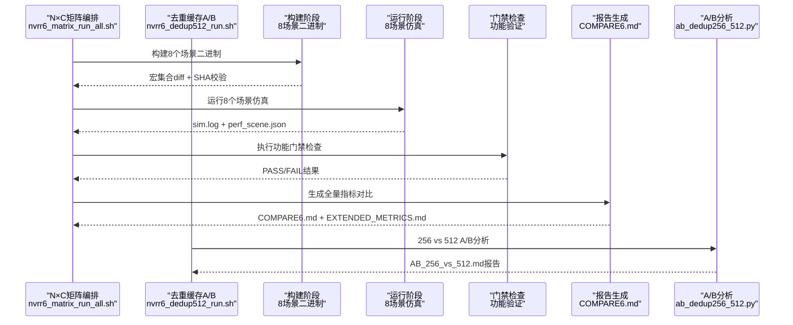
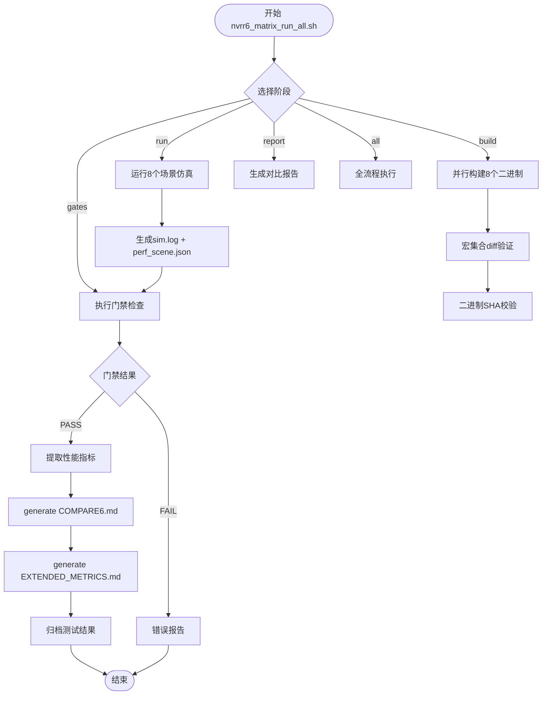
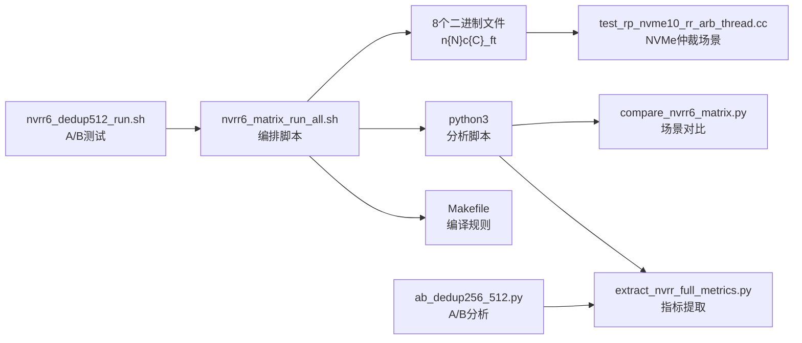

# 性能基准测试

<cite>
**本文引用的文件**   
- [README.md](file://README.md)
- [main.cpp](file://main.cpp)
- [Makefile](file://Makefile)
- [nvrr6_matrix_run_all.sh](file://tmp/nvrr6_matrix_run_all.sh)
- [nvrr6_dedup512_run.sh](file://tmp/nvrr6_dedup512_run.sh)
- [ab_dedup256_512.py](file://rp/ab_dedup256_512.py)
- [compare_nvrr6_matrix.py](file://rp/compare_nvrr6_matrix.py)
- [extract_nvrr_full_metrics.py](file://rp/extract_nvrr_full_metrics.py)
- [test_rp_nvme10_rr_arb_thread.cc](file://rp/test_rp_nvme10_rr_arb_thread.cc)
- [iommu_perf_collector.cc](file://iommu/iommu_perf_model/iommu_perf_collector.cc)
- [stats_collector.h](file://iommu/cache_src/common/stats_collector.h)
</cite>

## 更新摘要
**变更内容**   
- 新增N×C扩展性矩阵A/B测试基础设施，支持8个场景的全量性能对比
- 实现nvrr6_matrix_run_all.sh编排脚本，提供构建、运行、门禁、报告全流程自动化
- 添加nvrr6_dedup512_run.sh去重缓存A/B对比脚本，支持256->512 cacheline配置验证
- 集成ab_dedup256_512.py分析工具，自动生成256 vs 512的完整对照报告
- 增强compare_nvrr6_matrix.py比较工具，支持8场景横向指标对比和倍率分析
- 完善extract_nvrr_full_metrics.py提取器，支持稳态窗口和全程口径的统一分析

## 目录
1. [简介](#简介)
2. [项目结构](#项目结构)
3. [核心组件](#核心组件)
4. [架构总览](#架构总览)
5. [详细组件分析](#详细组件分析)
6. [依赖关系分析](#依赖关系分析)
7. [性能考量](#性能考量)
8. [故障排查指南](#故障排查指南)
9. [结论](#结论)
10. [附录](#附录)

## 简介
本文件面向IOMMU性能基准测试体系，系统化阐述测试设计原理、实施方法与流程规范，覆盖测试场景设计、测试用例选择、测试环境搭建、工具使用、结果标准化报告模板、性能回归与对比实验设计、统计分析与结果验证技术，并结合仓库现有脚本与代码给出可落地的实操步骤与案例。

**更新** 本次更新重点反映了N×C扩展性矩阵A/B测试基础设施的引入，该基础设施通过nvrr6_matrix_run_all.sh编排脚本实现了8个场景（8盘×{1,2,4,8}通道 + 16盘×{1,2,4,8}通道）的全量性能对比，结合ab_dedup256_512.py分析工具提供了完整的去重缓存容量优化验证能力。

## 项目结构
该项目基于SystemC构建RISC-V IOMMU仿真模型，包含顶层模块、地址转换引擎、命令队列、ATC/ATS、故障与中断、性能采集与缓存子系统等模块；同时提供多种专门的测试场景文件，用于不同访问模式和地址翻译场景的性能与功能验证，包括新增的N×C扩展性矩阵测试场景和去重缓存A/B对比测试。

```mermaid
graph TB
subgraph "顶层与接口"
MAIN["main.cpp<br/>创建模块实例并绑定Socket"]
TOP["iommu_top<br/>顶层控制与调度"]
END
subgraph "IOMMU核心模块"
TRANS["translate<br/>地址转换引擎"]
CMDQ["command_queue<br/>命令队列"]
ATC["atc<br/>地址转换缓存"]
ATS["ats<br/>ATS支持"]
FAULT["faults<br/>故障处理"]
INT["interrupt<br/>中断"]
HPM["hpm<br/>硬件性能监控"]
END
subgraph "性能与缓存"
COL["perf_collector<br/>收集器线程"]
STATS["stats_collector<br/>统计采集器"]
PARAMS["perf_params<br/>性能参数集"]
END
subgraph "N×C扩展性矩阵测试"
MATRIX["nvrr6_matrix_run_all.sh<br/>8场景编排脚本"]
COMPARE["compare_nvrr6_matrix.py<br/>全量指标对比"]
EXTENDED["extract_nvrr_full_metrics.py<br/>完整指标提取"]
NVME["test_rp_nvme10_rr_arb_thread.cc<br/>NVMe任务仲裁场景"]
END
subgraph "去重缓存A/B测试"
DEDUP_RUN["nvrr6_dedup512_run.sh<br/>256->512对比"]
AB_ANALYZE["ab_dedup256_512.py<br/>A/B分析报告"]
END
subgraph "外部接口"
RP["rp/test_rp_func.cc<br/>测试函数库"]
PCIE["pcienoc<br/>PCIe NoC接口"]
DDR["ddr<br/>DDR仿真"]
SLINK["slink<br/>SLINK NoC路径"]
END
MAIN --> TOP
TOP --> TRANS
TOP --> CMDQ
TOP --> ATC
TOP --> ATS
TOP --> FAULT
TOP --> INT
TOP --> HPM
TOP --> COL
TOP --> STATS
TOP --> PARAMS
MAIN --> MATRIX
MAIN --> DEDUP_RUN
MAIN --> RP
MAIN --> PCIE
MAIN --> DDR
MAIN --> SLINK
MATRIX --> COMPARE
MATRIX --> EXTENDED
MATRIX --> NVME
DEDUP_RUN --> AB_ANALYZE
```

**图表来源**
- [main.cpp:39-94](file://main.cpp#L39-L94)
- [nvrr6_matrix_run_all.sh:1-433](file://tmp/nvrr6_matrix_run_all.sh#L1-L433)
- [nvrr6_dedup512_run.sh:1-22](file://tmp/nvrr6_dedup512_run.sh#L1-L22)
- [ab_dedup256_512.py:1-76](file://rp/ab_dedup256_512.py#L1-L76)
- [compare_nvrr6_matrix.py:1-591](file://rp/compare_nvrr6_matrix.py#L1-L591)
- [extract_nvrr_full_metrics.py:1-200](file://rp/extract_nvrr_full_metrics.py#L1-L200)
- [test_rp_nvme10_rr_arb_thread.cc:1-200](file://rp/test_rp_nvme10_rr_arb_thread.cc#L1-L200)

**章节来源**
- [README.md:63-92](file://README.md#L63-L92)
- [main.cpp:39-94](file://main.cpp#L39-L94)
- [Makefile:51-104](file://Makefile#L51-104)

## 核心组件
- 顶层与绑定：main.cpp负责创建IOMMU、RP、PCIENOC、DDR、SLINK模块实例，并通过TLM Socket将各模块互联，启动仿真。
- 性能收集器：iommu_perf_collector.cc实现两条收集器线程，分别处理缓存查询结果与xDTW回填结果，驱动状态机推进与故障处理。
- 统计采集器：stats_collector.h定义CacheStats结构与StatsCollector类，提供命中/缺失/替换/失效/预取命中等统计接口与报告输出。
- **N×C扩展性矩阵测试框架**：nvrr6_matrix_run_all.sh编排脚本支持8个场景的全量性能对比，包括8盘×{1,2,4,8}通道和16盘×{1,2,4,8}通道的组合测试。
- **去重缓存A/B测试**：nvrr6_dedup512_run.sh脚本专门用于256->512 cacheline配置的A/B对比验证，ab_dedup256_512.py生成详细的对照分析报告。
- **NVMe任务仲裁场景**：test_rp_nvme10_rr_arb_thread.cc实现了严格的读写交替任务和嵌套轮询仲裁机制，确保公平性和负载均衡。
- **全量指标提取**：extract_nvrr_full_metrics.py提供稳态窗口和全程口径的统一分析，支持端口带宽、并发峰值、4KB页并发等关键指标。

**更新** 核心组件现在包含了完整的N×C扩展性矩阵测试框架和去重缓存A/B测试能力，为IOMMU在不同设备数和通道数配置下的性能评估提供了精确的基准参考。

**章节来源**
- [main.cpp:49-94](file://main.cpp#L49-94)
- [iommu_perf_collector.cc:14-457](file://iommu/iommu_perf_model/iommu_perf_collector.cc#L14-L457)
- [stats_collector.h:13-196](file://iommu/cache_src/common/stats_collector.h#L13-L196)
- [nvrr6_matrix_run_all.sh:1-433](file://tmp/nvrr6_matrix_run_all.sh#L1-L433)
- [nvrr6_dedup512_run.sh:1-22](file://tmp/nvrr6_dedup512_run.sh#L1-L22)
- [ab_dedup256_512.py:1-76](file://rp/ab_dedup256_512.py#L1-L76)
- [test_rp_nvme10_rr_arb_thread.cc:1-200](file://rp/test_rp_nvme10_rr_arb_thread.cc#L1-L200)

## 架构总览
IOMMU性能基准测试围绕"N×C扩展性矩阵—请求注入—解析—缓存查询—页表遍历—转发/故障"闭环展开，nvrr6_matrix_run_all.sh编排脚本协调8个场景的构建、运行、门禁和报告生成，compare_nvrr6_matrix.py进行全量指标横向对比，extract_nvrr_full_metrics.py提供深度性能分析；去重缓存A/B测试通过nvrr6_dedup512_run.sh和ab_dedup256_512.py完成256->512 cacheline配置的验证。



**图表来源**
- [nvrr6_matrix_run_all.sh:94-433](file://tmp/nvrr6_matrix_run_all.sh#L94-L433)
- [nvrr6_dedup512_run.sh:1-22](file://tmp/nvrr6_dedup512_run.sh#L1-L22)
- [ab_dedup256_512.py:1-76](file://rp/ab_dedup256_512.py#L1-L76)
- [compare_nvrr6_matrix.py:341-591](file://rp/compare_nvrr6_matrix.py#L341-L591)

## 详细组件分析

### 组件A：N×C扩展性矩阵编排脚本（nvrr6_matrix_run_all.sh）
- **职责**：协调8个N×C扩展性场景的完整测试流程，包括构建、运行、门禁检查和报告生成
- **核心特性**：
  - 8场景矩阵：8盘×{1,2,4,8}通道 + 16盘×{1,2,4,8}通道
  - fixed_total负载模式：每设备任务数恒定，C只影响通道交织粒度
  - 严格一致性保证：同一工作树、同一批次内make -B全量重建
  - 宏集合diff验证：确保IOMMU侧配置逐宏一致，仅激励宏不同
- **工作流程**：
  - 构建阶段：并行构建8个二进制文件，记录宏集合差异和SHA校验
  - 运行阶段：每个场景独立运行目录，超时保护1800秒
  - 门禁阶段：功能闭合、包型自检、供给充足性、端口占用三分法
  - 报告阶段：生成COMPARE6.md全量指标对比和EXTENDED_METRICS.md深度分析
- **关键参数**：
  - EXTRA_FLAGS=-DTEST_CFG_DDR_PORT_BEAT_ALIGN=0
  - GLOBAL/READ/WRITE=640/320/320, PTW=64, BUFFER=320, D=3
  - PORT_WIDTH_BIT=1024, SLINK=50ns, DDR=100ns



**图表来源**
- [nvrr6_matrix_run_all.sh:94-433](file://tmp/nvrr6_matrix_run_all.sh#L94-L433)

**章节来源**
- [nvrr6_matrix_run_all.sh:1-433](file://tmp/nvrr6_matrix_run_all.sh#L1-L433)

### 组件B：去重缓存A/B测试（nvrr6_dedup512_run.sh + ab_dedup256_512.py）
- **职责**：验证去重缓存从256到512 cacheline容量的性能影响
- **核心特性**：
  - 复用基线二进制：sha256逐位相同，唯一变量是运行时JSON配置
  - 运行时配置修改：dedup_cache.num_sets从64改为128
  - 几何约束验证：num_sets必须为2的幂且被num_rams整除
- **工作流程**：
  - nvrr6_dedup512_run.sh：设置环境变量NVRR6_DEDUP_SETS=128，复用ptfifo1024批次的二进制
  - ab_dedup256_512.py：读取两个批次的EXTENDED_METRICS.md，生成AB_256_vs_512.md对照报告
  - 每格格式："256值 -> 512值"，IOPS行附带Δ%变化百分比
- **关键指标**：
  - IOMMU IOPS稳态变化
  - 去重hash冲突次数
  - bypass任务数比例
  - 实际占用cacheline数量

**章节来源**
- [nvrr6_dedup512_run.sh:1-22](file://tmp/nvrr6_dedup512_run.sh#L1-L22)
- [ab_dedup256_512.py:1-76](file://rp/ab_dedup256_512.py#L1-L76)

### 组件C：NVMe任务仲裁场景（test_rp_nvme10_rr_arb_thread.cc）
- **职责**：实现严格的NVMe任务生成和嵌套轮询仲裁机制
- **核心特性**：
  - 严格读写交替：每设备C个generator(d,c)，严格按"1读任务+1写任务"交替
  - 嵌套轮询仲裁：外层设备RR，内层设备内队列RR，每步只出队1个包
  - 构造性饱和：默认无界队列深度(TASKS+8)，确保供给恒充足
  - 控制包散布：SQ/CQ按任务序号轮转散布到多个4KB页，避免PT Cache命中率虚高
- **任务结构**：
  - 1个NVMe任务 = 10包：SQ(读,64B) -> 8x512B数据 -> CQ(写,16B)
  - 方向突发：读向突发=读任务[SQ,D0..D7](9包)/写任务[SQ](1包)
  - 派发规则：同索引c的任务流进入同索引c的读口/写口队列
- **地址布局**：
  - IOVA范围：512MB，131072个4KB页
  - SQ/CQ控制区：45个SQ页 + 24个CQ页，步长CTRL_STRIDE=8
  - 块状分配：每页承载blk=ceil(TASKS_DEV/cnt)个连续任务

**章节来源**
- [test_rp_nvme10_rr_arb_thread.cc:1-200](file://rp/test_rp_nvme10_rr_arb_thread.cc#L1-L200)

### 组件D：全量指标提取器（extract_nvrr_full_metrics.py）
- **职责**：从sim.log和md_trace summary CSV中提取完整性能指标
- **核心能力**：
  - IOMMU端口带宽：全程平均/稳态窗口(10%~90%)读口、写口、入口合计、出口
  - 并发峰值/时间加权平均：全程面积法(三场景同口径) + 注入窗口
  - 4KB页平均/峰值并发：TOTAL行解析
  - 去重Cache实际占用：avg/max/main-req cacheline数
  - IO e2e按包型拆分：数据包(type0) vs 控制包(type1/2/3) vs 全部(type4)
- **输出格式**：Markdown表格，支持多场景并列对比

**章节来源**
- [extract_nvrr_full_metrics.py:1-200](file://rp/extract_nvrr_full_metrics.py#L1-L200)

### 组件E：场景对比工具（compare_nvrr6_matrix.py）
- **职责**：将8个场景的纵向指标表转置为横向对比表
- **核心功能**：
  - 指标行定义：5大段指标（任务数与均衡性、吞吐/并发/e2e/端口间隔、Cache命中率、去重Cache/Buffer、PTW）
  - 横向对比：每行指标对应8个场景列，末列给出相对场景1的倍率
  - 模型侧扩展指标：4KB页并发、端口带宽、在途并发、端口占用三分法
  - 逐设备任务数与Jain公平性分析
- **关键指标**：
  - IOPS稳态ALL/DATA Mreq/s（主口径）
  - IOMMU全局/Read/Write并发peak/max
  - DC/PC/PT缓存命中率
  - 去重Cache命中率、hash冲突、bypass任务数
  - PTW总任务数、并发利用率、DDR访问次数

**章节来源**
- [compare_nvrr6_matrix.py:1-591](file://rp/compare_nvrr6_matrix.py#L1-L591)

## 依赖关系分析
- **构建与运行**：nvrr6_matrix_run_all.sh作为主控脚本，依赖Makefile进行编译，依赖python3脚本进行数据分析
- **N×C矩阵测试依赖**：需要TEST_CFG_NVME10_RR_SCENE和TEST_CFG_MULTI_DEVICE_SCENE同时启用，复用多设备追踪机制
- **去重缓存A/B测试依赖**：复用ptfifo1024批次的二进制文件，通过环境变量NVRR6_DEDUP_SETS控制运行时配置
- **指标提取依赖**：extract_nvrr_full_metrics.py依赖sim.log和perf_scene*.json文件，compare_nvrr6_matrix.py依赖EXTENDED_METRICS.md



**图表来源**
- [nvrr6_matrix_run_all.sh:35-53](file://tmp/nvrr6_matrix_run_all.sh#L35-L53)
- [nvrr6_dedup512_run.sh:6-15](file://tmp/nvrr6_dedup512_run.sh#L6-L15)
- [test_rp_nvme10_rr_arb_thread.cc:82-91](file://rp/test_rp_nvme10_rr_arb_thread.cc#L82-L91)

**章节来源**
- [nvrr6_matrix_run_all.sh:35-53](file://tmp/nvrr6_matrix_run_all.sh#L35-L53)
- [nvrr6_dedup512_run.sh:6-15](file://tmp/nvrr6_dedup512_run.sh#L6-L15)
- [test_rp_nvme10_rr_arb_thread.cc:82-91](file://rp/test_rp_nvme10_rr_arb_thread.cc#L82-L91)

## 性能考量
- **N×C扩展性分析**：通过8个场景的横向对比，分析设备数N和通道数C对性能的影响，识别瓶颈点
- **固定负载模式**：fixed_total模式确保每设备任务数恒定，C只影响通道交织粒度，便于公平对比
- **稳态窗口采样**：采用(t10,t90]完成事务的10%~90%作为稳态窗口，提高IOPS估算稳定性
- **端口带宽利用**：监控读口/写口GB/s和util%，识别端口线速限制或并发额度限制
- **4KB页并发分析**：直接反映同时压在页表/去重子系统上的不同页数，解释PTW负载与去重Buffer占用变化
- **去重缓存容量优化**：通过256->512 cacheline的A/B对比，验证容量增加对hash冲突和bypass任务数的影响
- **公平性与负载均衡**：Jain指数衡量设备间公平性，逐设备任务数分布评估负载均衡效果
- **构造性饱和保证**：默认无界队列深度确保供给恒充足，避免仲裁饥饿问题

**更新** 新增了N×C扩展性矩阵和去重缓存A/B测试的性能考量，这些新能力提供了更精细的性能分析和容量优化验证手段。

## 故障排查指南
- **N×C矩阵测试问题**：
  - 检查宏集合diff是否只有NUM_DEVICES/MD_CHAN_PER_DEV/NVRR_TASKS_PER_DEV差异
  - 验证二进制SHA256是否与预期一致
  - 确认每个场景的sim.log包含NVRR_RESULT、MDMC_CONFIG、NVRR_PATTERN_OK等关键字
  - 检查门禁结果，重点关注包序验证、供给充足性、端口占用三分法
- **去重缓存A/B测试问题**：
  - 验证NVRR6_DEDUP_SETS环境变量设置为128
  - 确认运行时JSON中dedup_cache.num_sets从64改为128
  - 检查ab_dedup256_512.py生成的AB_256_vs_512.md报告是否包含所有8个场景
- **指标提取问题**：
  - 确认sim.log尾部20000行包含必要的性能统计信息
  - 验证perf_scene*.json文件格式正确
  - 检查EXTENDED_METRICS.md是否包含所有预期的指标行
- **NVMe仲裁场景问题**：
  - 验证严格读写交替是否正确（每设备C个generator）
  - 检查嵌套轮询仲裁顺序是否符合预期
  - 确认控制包散布到正确的SQ/CQ页区域

**更新** 新增了N×C扩展性矩阵和去重缓存A/B测试的故障排查要点，这些新场景需要特别关注宏集合一致性、运行时配置正确性和指标完整性。

**章节来源**
- [nvrr6_matrix_run_all.sh:144-192](file://tmp/nvrr6_matrix_run_all.sh#L144-L192)
- [nvrr6_matrix_run_all.sh:262-297](file://tmp/nvrr6_matrix_run_all.sh#L262-L297)
- [nvrr6_dedup512_run.sh:1-22](file://tmp/nvrr6_dedup512_run.sh#L1-L22)
- [ab_dedup256_512.py:14-76](file://rp/ab_dedup256_512.py#L14-L76)

## 结论
本基准测试体系以SystemC仿真为核心，通过N×C扩展性矩阵A/B测试基础设施实现了从8个场景的构建、运行、门禁到报告生成的全流程自动化。nvrr6_matrix_run_all.sh编排脚本提供了统一的测试入口，compare_nvrr6_matrix.py和extract_nvrr_full_metrics.py提供了完整的指标分析和对比能力。**新增的去重缓存A/B测试**通过nvrr6_dedup512_run.sh和ab_dedup256_512.py完成了256->512 cacheline配置的验证，为缓存容量优化提供了精确的基准参考。**完善的NVMe任务仲裁场景**确保了严格的读写交替和公平的仲裁机制，为性能测试的可信度提供了保障。**标准化的报告生成**包括COMPARE6.md全量指标对比和EXTENDED_METRICS.md深度分析，为性能回归和优化决策提供了可靠的数据支撑。

**更新** 重构后的测试体系通过N×C扩展性矩阵、去重缓存A/B测试、NVMe仲裁场景和标准化的报告生成，提供了更全面、更精确的IOMMU性能评估能力，特别是在大规模设备配置和缓存优化方面的验证能力得到了显著增强。

## 附录

### A. 测试环境搭建与运行
- **环境要求**：WSL2、Ubuntu、SystemC库、GCC/G++、GNU Make、Python3。
- **N×C矩阵测试**：
  - `bash tmp/nvrr6_matrix_run_all.sh all`：全流程执行（构建+运行+门禁+报告）
  - `bash tmp/nvrr6_matrix_run_all.sh build`：只构建8个二进制
  - `bash tmp/nvrr6_matrix_run_all.sh run`：只运行8个仿真
  - `bash tmp/nvrr6_matrix_run_all.sh report`：生成对比报告
  - `NVRR6_ONLY="s7_n8c8 s8_n16c8" bash tmp/nvrr6_matrix_run_all.sh report`：只跑指定场景
- **去重缓存A/B测试**：
  - `bash tmp/nvrr6_dedup512_run.sh`：执行256->512的A/B对比
  - 自动生成AB_256_vs_512.md对照报告
- **单独指标提取**：
  - `python3 rp/extract_nvrr_full_metrics.py --scene "场景1|dir1" --scene "场景2|dir2" --out EXTENDED_METRICS.md`
  - `python3 rp/compare_nvrr6_matrix.py --scene "场景1|dir1" --scene "场景2|dir2" --batch test --out COMPARE.md`

**更新** 新增了N×C扩展性矩阵和去重缓存A/B测试的运行选项，支持灵活的场景选择和批量处理。

**章节来源**
- [nvrr6_matrix_run_all.sh:17-31](file://tmp/nvrr6_matrix_run_all.sh#L17-L31)
- [nvrr6_dedup512_run.sh:17-21](file://tmp/nvrr6_dedup512_run.sh#L17-L21)
- [extract_nvrr_full_metrics.py:12-16](file://rp/extract_nvrr_full_metrics.py#L12-L16)
- [compare_nvrr6_matrix.py:5-8](file://rp/compare_nvrr6_matrix.py#L5-L8)

### B. N×C扩展性矩阵测试场景
- **场景1**：8盘×1通道，250任务/设备，20000包
- **场景2**：8盘×2通道，250任务/设备，20000包
- **场景3**：8盘×4通道，250任务/设备，20000包
- **场景4**：16盘×1通道，124任务/设备，19840包
- **场景5**：16盘×2通道，124任务/设备，19840包
- **场景6**：16盘×4通道，124任务/设备，19840包
- **场景7**：8盘×8通道，250任务/设备，20000包
- **场景8**：16盘×8通道，124任务/设备，19840包
- **关键特性**：
  - fixed_total负载模式：每设备任务数恒定
  - 严格读写交替：1读任务+1写任务交替生成
  - 嵌套轮询仲裁：外层设备RR，内层队列RR
  - 构造性饱和：默认无界队列深度

**更新** 新增了完整的N×C扩展性矩阵8场景配置说明，涵盖了从8盘到16盘、从1通道到8通道的全面测试覆盖。

**章节来源**
- [nvrr6_matrix_run_all.sh:56-81](file://tmp/nvrr6_matrix_run_all.sh#L56-L81)
- [test_rp_nvme10_rr_arb_thread.cc:24-58](file://rp/test_rp_nvme10_rr_arb_thread.cc#L24-L58)

### C. 测试流程与工具使用
- **N×C矩阵测试流程**：
  - 步骤1：`bash tmp/nvrr6_matrix_run_all.sh build` 构建8个二进制
  - 步骤2：`bash tmp/nvrr6_matrix_run_all.sh run` 运行8个场景
  - 步骤3：`bash tmp/nvrr6_matrix_run_all.sh gates` 执行门禁检查
  - 步骤4：`bash tmp/nvrr6_matrix_run_all.sh report` 生成对比报告
  - 步骤5：查看rwsplit_results/nvrr6_<ts>/COMPARE6.md和EXTENDED_METRICS.md
- **去重缓存A/B测试流程**：
  - 步骤1：`bash tmp/nvrr6_dedup512_run.sh` 执行A/B对比
  - 步骤2：查看rwsplit_results/nvrr6_dedup512_20261112/AB_256_vs_512.md
  - 步骤3：分析IOPS变化和去重缓存指标变化
- **自定义指标提取**：
  - 使用extract_nvrr_full_metrics.py提取额外指标
  - 使用compare_nvrr6_matrix.py生成自定义对比报告

**更新** 新增了N×C扩展性矩阵和去重缓存A/B测试的详细流程和工具使用说明。

**章节来源**
- [nvrr6_matrix_run_all.sh:419-433](file://tmp/nvrr6_matrix_run_all.sh#L419-L433)
- [nvrr6_dedup512_run.sh:17-21](file://tmp/nvrr6_dedup512_run.sh#L17-L21)
- [ab_dedup256_512.py:66-76](file://rp/ab_dedup256_512.py#L66-L76)

### D. 标准化报告模板
- **N×C矩阵报告头**：
  - 批次号、测试日期、测试环境、版本信息
  - 8场景配置说明（N×C组合、任务数、包数）
  - 负载模式（fixed_total）、仲裁方式（嵌套轮询）
- **N×C矩阵关键指标**：
  - IOPS稳态ALL/DATA Mreq/s（主口径）
  - IOMMU全局/Read/Write并发peak/max
  - DC/PC/PT缓存命中率
  - 去重Cache命中率、hash冲突、bypass任务数
  - PTW总任务数、并发利用率、DDR访问次数
  - 端口带宽GB/s和util%
  - 4KB页并发avg/peak
  - Jain公平性指数
- **去重缓存A/B报告**：
  - 256 vs 512 cacheline配置对比
  - IOPS变化百分比
  - 去重hash冲突次数变化
  - bypass任务数比例变化
  - 实际占用cacheline数量变化

**更新** 新增了N×C扩展性矩阵和去重缓存A/B测试相关的指标和配置记录要求。

**章节来源**
- [compare_nvrr6_matrix.py:246-324](file://rp/compare_nvrr6_matrix.py#L246-L324)
- [ab_dedup256_512.py:43-76](file://rp/ab_dedup256_512.py#L43-L76)

### E. 性能回归测试与对比实验设计
- **N×C矩阵回归**：定期运行8场景矩阵测试，监控各场景IOPS和关键指标的变化趋势
- **去重缓存容量回归**：定期运行256->512 A/B对比，监控hash冲突和bypass任务数的变化
- **扩展性分析**：逐步增加设备数（8->16）和通道数（1->8），验证系统扩展性
- **瓶颈识别**：通过端口带宽、并发额度、缓存命中率等指标识别性能瓶颈
- **容量优化验证**：通过A/B对比验证缓存容量优化的有效性
- **公平性验证**：监控Jain指数和逐设备任务数分布，确保负载均衡

**更新** 新增了N×C扩展性矩阵和去重缓存A/B测试的回归测试实验设计。

**章节来源**
- [nvrr6_matrix_run_all.sh:419-433](file://tmp/nvrr6_matrix_run_all.sh#L419-L433)
- [nvrr6_dedup512_run.sh:1-22](file://tmp/nvrr6_dedup512_run.sh#L1-L22)

### F. 测试数据统计分析与结果验证技术
- **N×C矩阵统计分析**：
  - 8场景横向对比，识别N和C对性能的影响规律
  - 倍率分析：末场景/场景1的性能提升倍数
  - 瓶颈识别：端口带宽限制、并发额度限制、缓存命中率限制
  - 公平性分析：Jain指数和逐设备任务数分布
- **去重缓存A/B统计分析**：
  - 256 vs 512 cacheline的IOPS变化百分比
  - hash冲突次数和bypass任务数的变化趋势
  - 实际占用cacheline数量的变化
  - 容量利用率分析
- **结果验证技术**：
  - 门禁检查：功能闭合、包型自检、供给充足性
  - 宏集合diff：确保IOMMU侧配置一致性
  - 二进制SHA校验：确保构建产物一致性
  - 指标交叉验证：稳态窗口vs全程口径

**更新** 新增了N×C扩展性矩阵和去重缓存A/B测试的统计分析和结果验证技术要求。

**章节来源**
- [nvrr6_matrix_run_all.sh:144-192](file://tmp/nvrr6_matrix_run_all.sh#L144-L192)
- [nvrr6_matrix_run_all.sh:262-297](file://tmp/nvrr6_matrix_run_all.sh#L262-L297)
- [ab_dedup256_512.py:38-76](file://rp/ab_dedup256_512.py#L38-L76)

### G. 实际基准测试案例与测试报告示例
- **案例1：N×C扩展性矩阵测试**
  - 8场景完整测试流程，从构建到报告生成
  - COMPARE6.md显示各场景IOPS和关键指标对比
  - EXTENDED_METRICS.md提供深度性能分析
  - 识别16盘8通道场景的性能瓶颈和优化机会
- **案例2：去重缓存A/B测试**
  - 256->512 cacheline配置的A/B对比
  - AB_256_vs_512.md显示IOPS变化和去重缓存指标变化
  - 验证容量增加对hash冲突和bypass任务数的改善效果
- **案例3：NVMe仲裁场景验证**
  - 严格读写交替的正确性验证
  - 嵌套轮询仲裁的公平性验证
  - 控制包散布对PT Cache命中率的影响分析

**更新** 新增了N×C扩展性矩阵和去重缓存A/B测试的实际案例，展示了完整的测试流程和结果分析方法。

**章节来源**
- [nvrr6_matrix_run_all.sh:316-345](file://tmp/nvrr6_matrix_run_all.sh#L316-L345)
- [ab_dedup256_512.py:43-76](file://rp/ab_dedup256_512.py#L43-L76)
- [test_rp_nvme10_rr_arb_thread.cc:24-58](file://rp/test_rp_nvme10_rr_arb_thread.cc#L24-L58)