# 性能指标与统计

<cite>
**本文引用的文件**
- [iommu_perf_parser.cc](file://iommu/iommu_perf_model/iommu_perf_parser.cc)
- [test_rp_nvme10_rr_arb_thread.cc](file://rp/test_rp_nvme10_rr_arb_thread.cc)
- [test_rp_rand4k_msi_mix_multichan_thread.cc](file://rp/test_rp_rand4k_msi_mix_multichan_thread.cc)
- [extract_cqfull_table.py](file://extract_cqfull_table.py)
- [PERF_MODEL_IMPLEMENTATION.md](file://PERF_MODEL_IMPLEMENTATION.md)
</cite>

## 更新摘要
**所做更改**
- **新增** 缓冲区持有延时打印格式支持：在性能统计解析系统中增加对三种新版缓冲持有延时日志格式的解析支持，包括'MAIN head (dedup MISS)'、'MAIN head (PF placeholder)'和'SUSPENDED (deduped)'。
- **增强** 七元组结构标准化：将新的日志行归一化为与legacy相同的[n, W1, W2, W3, maxW1, maxW2, maxW3]七元组结构，确保数据一致性。
- **扩展** 报表循环机制：从原有的('main','susp')二元组扩展到('main','pf','susp')三元组，新增预取占位符(PF placeholder)的持有延时细分行。
- **改进** 解析器兼容性：enhanced iommu_perf_parser.cc以处理三种新类型的缓冲持有延时日志行，提升系统兼容性和数据处理能力。

## 目录
1. [简介](#简介)
2. [项目结构](#项目结构)
3. [核心组件](#核心组件)
4. [架构总览](#架构总览)
5. [详细组件分析](#详细组件分析)
6. [依赖关系分析](#依赖关系分析)
7. [性能考量](#性能考量)
8. [故障排查指南](#故障排查指南)
9. [结论](#结论)
10. [附录](#附录)

## 简介
本文件面向IOMMU性能指标与统计系统，系统性阐述以下内容：
- 性能指标的定义与计算方法：缓存命中率、延迟统计、吞吐量测量、区间命中率、任务放大系数、稳态IOPS等。
- 统计收集器的工作原理与实现机制：数据采集、聚合与存储流程。
- **新增** 缓冲区持有延时统计系统：支持三种新版缓冲持有延时打印格式的解析，提供细粒度的缓冲区使用分析。
- FIFO利用率监控：对六个关键FIFO进行峰值占用和时加权平均利用率统计，支持瓶颈识别和反压分析。
- PTW并发任务分析：通过预取组监控线程实现1主+D预取任务的完整执行时间跟踪，支持组级性能分析。
- 组索引执行延迟跟踪：按组索引记录每个组的完整执行时间，包括最大值、最小值、平均值和分布统计。
- 输出间隔测量：记录PTW任务输出间隔的完整分布，支持波动性分析和稳定性评估。
- DDR读访问模式分离：区分主任务和预取任务的DDR访问模式，优化预取策略评估。
- 时序分布分析：提供完整的时序数据数组，支持Python可视化和深度统计分析。
- Walker Cache三级缓存统计：VS-stage和S2-stage独立的三级缓存统计接口。
- 稳态IOPS监控：通过ptw_steady_start_completed和ptw_steady_end_completed字段精确跟踪稳态窗口内的PTW完成数。
- 指标的含义与应用场景：如何结合指标进行系统优化与瓶颈识别。
- 性能数据的可视化与报告生成：文本报告、直方图、阶段窗口统计、CSV数据导出。
- 基于仓库现有实现的实践案例与解读。

## 项目结构
围绕性能指标与统计的关键目录与文件如下：
- 性能模型与线程实现：Parser、Collector、DC/PC Cache、PT Cache、MSIPT Cache、xDTW、PTW、Forwarder/Fault/CQ等。
- 统计收集器：通用缓存统计结构与接口，以及IOMMU顶层汇总打印。
- **新增** 缓冲区持有延时统计：支持三种新版打印格式的解析和七元组数据结构。
- FIFO利用率监控：专门的采样线程和统计报告输出。
- PTW并发任务分析：预取组监控线程和相关统计字段。
- 组执行时间跟踪：按组索引的完整执行时间统计。
- 输出间隔测量：PTW任务输出间隔的分布统计。
- DDR访问模式分离：主任务和预取任务的独立DDR访问统计。
- 时序分布分析：完整的时序数据数组用于可视化分析。
- Walker Cache统计：VS-stage和S2-stage独立的三级缓存统计接口。
- 性能参数：FIFO深度、缓存规模、处理延迟、带宽、并发限制等。
- HPM事件计数：PMU事件计数器与过滤逻辑。
- 稳态IOPS监控：跳过warmup/drain阶段的精确吞吐量测量。
- CSV数据导出：输出间隔、DDR分布、任务延迟、组执行时间的CSV文件生成。
- 分析报告：多篇性能分析文档，提供指标解读与优化建议。

```mermaid
graph TB
subgraph "缓冲区持有延时统计"
BUFFER_STATS["缓冲区持有延时统计<br/>三种新版打印格式"]
SEVEN_TUPLE["七元组结构<br/>[n, W1, W2, W3, maxW1, maxW2, maxW3]"]
REPORT_LOOP["报表循环<br/>('main','pf','susp')"]
end
subgraph "FIFO利用率监控"
FIFO_MON["FIFO利用率监控<br/>六个关键FIFO"]
SAMPLE_THREAD["采样线程<br/>fifo_util_sampler_thread"]
TIME_WINDOW["时间加权窗口<br/>首包非空~末包非空"]
UTIL_REPORT["利用率报告<br/>峰值/平均/深度"]
end
subgraph "PTW并发任务分析"
CONCURRENT["并发任务分析<br/>预取组监控线程"]
GROUP_EXEC["组执行时间跟踪<br/>1主+D预取"]
GROUP_INDEX["组索引延迟跟踪<br/>按组索引统计"]
end
subgraph "输出间隔测量"
OUTPUT_INT["输出间隔测量<br/>ptw_output_interval_*"]
INTERVAL_DIST["间隔分布分析<br/>avg/max/min/count"]
end
subgraph "DDR访问模式分离"
MAIN_DDR["主任务DDR分布<br/>ptw_main_ddr_reads_distribution"]
PREFETCH_DDR["预取任务DDR分布<br/>ptw_prefetch_ddr_reads_distribution"]
DDR_MODE["DDR模式分析<br/>MAIN/PREFETCH分类"]
end
subgraph "时序分布分析"
TASK_LAT["任务延迟分布<br/>ptw_task_latency_values"]
GRP_LAT["组执行时间分布<br/>ptw_group_exec_values"]
TEMPORAL["时序分析<br/>Python可视化"]
end
subgraph "原有统计系统"
SC["StatsCollector<br/>缓存统计"]
TOP["iommu_top::print_cache_statistics<br/>汇总报告"]
HPM["HPM 事件计数"]
SS["稳态IOPS监控<br/>ptw_steady_*字段"]
WC["Walker Cache<br/>VS/S2-stage"]
end
BUFFER_STATS --> SEVEN_TUPLE
SEVEN_TUPLE --> REPORT_LOOP
FIFO_MON --> SAMPLE_THREAD
SAMPLE_THREAD --> TIME_WINDOW
TIME_WINDOW --> UTIL_REPORT
CONCURRENT --> GROUP_EXEC
GROUP_EXEC --> GROUP_INDEX
OUTPUT_INT --> INTERVAL_DIST
MAIN_DDR --> DDR_MODE
PREFETCH_DDR --> DDR_MODE
TASK_LAT --> TEMPORAL
GRP_LAT --> TEMPORAL
SC --> TOP
WC --> TOP
SS --> TOP
HPM --> TOP
```

**图表来源**
- [test_rp_nvme10_rr_arb_thread.cc:1259-1261](file://rp/test_rp_nvme10_rr_arb_thread.cc#L1259-L1261)
- [extract_cqfull_table.py:73-76](file://extract_cqfull_table.py#L73-L76)

**章节来源**
- [PERF_MODEL_IMPLEMENTATION.md](file://PERF_MODEL_IMPLEMENTATION.md)

## 核心组件
- 统计收集器（StatsCollector）
  - 提供缓存命中/缺失、驱逐、失效、预取命中率、执行/排队/请求平均延迟、请求样本数、直方图等统计。
  - 支持按阶段（REQUEST/UPDATE/PTW_MONITOR）分类的RAM访问路径统计与时间戳记录。
  - 提供统一报告输出与直方图导出。
- **新增** 缓冲区持有延时统计系统
  - **三种新版打印格式**：支持'MAIN head (dedup MISS)'、'MAIN head (PF placeholder)'、'SUSPENDED (deduped)'三种日志格式。
  - **七元组数据结构**：将所有日志行归一化为[n, W1, W2, W3, maxW1, maxW2, maxW3]标准结构。
  - **报表循环扩展**：从('main','susp')扩展到('main','pf','susp')，新增预取占位符(PF placeholder)支持。
  - **解析器增强**：iommu_perf_parser.cc增强以处理新格式，确保向后兼容性。
- **新增** FifoOccStat数据结构
  - **name**：FIFO名称标识符。
  - **depth**：FIFO深度配置。
  - **peak**：峰值占用计数。
  - **integral_occ_ns**：积分占用时间（occ * dt_ns）。
  - **first_nonempty_ns**：首个非空时刻。
  - **last_nonempty_ns**：最后一个非空时刻。
- PTW并发任务分析系统
  - **预取组监控线程**：prefetch_group_monitor_thread负责监控预取组的完成状态，计算组级执行时间。
  - **组执行时间统计**：ptw_group_exec_total_ns、ptw_group_exec_max_ns、ptw_group_exec_min_ns、ptw_group_exec_count。
  - **组DDR访问统计**：ptw_group_total_ddr_reads、ptw_group_max_ddr_reads、ptw_group_min_ddr_reads。
  - **组级性能分析**：支持1主+D预取任务的完整执行时间跟踪和分析。
- 组索引执行延迟跟踪
  - **组索引管理**：通过group_index标识不同的预取组，支持按组索引的延迟统计。
  - **延迟分布统计**：ptw_group_exec_values数组存储每组的完整执行时间。
  - **分桶分析**：自动将组执行时间分为0~500ns、500~1000ns、1000~2000ns、2000~5000ns、>5000ns等区间。
- 输出间隔测量系统
  - **输出间隔统计**：ptw_output_interval_total_ns、ptw_output_interval_max_ns、ptw_output_interval_min_ns、ptw_output_interval_count。
  - **间隔采样**：在walk_complete或burst_complete时记录与前一次输出的时间间隔。
  - **波动性分析**：通过ptw_output_interval_values数组分析PTW输出的稳定性。
- DDR读访问模式分离
  - **主任务DDR分布**：ptw_main_ddr_reads_distribution统计主任务的DDR访问次数分布。
  - **预取任务DDR分布**：ptw_prefetch_ddr_reads_distribution统计预取任务的DDR访问次数分布。
  - **模式对比**：通过main_task_count和prefetch_task_count区分不同任务类型。
- 时序分布分析系统
  - **任务延迟数组**：ptw_task_latency_values存储每个PTW任务的完整延迟值。
  - **组执行时间数组**：ptw_group_exec_values存储每组的完整执行时间。
  - **Python可视化**：支持CSV导出到ptw_task_latency.csv和ptw_group_exec_latency.csv。
- Walker Cache统计系统
  - **VS-stage Walker Cache**: 针对第一阶段地址翻译的三级缓存统计，包含vs_lookup_count、vs_hit_c3/c2/c1_count、vs_miss_count等字段。
  - **S2-stage Walker Cache**: 针对第二阶段地址翻译的独立缓存统计，使用物理隔离的s2_cache_array_存储阵列。
  - 三级缓存架构：PTWc_1（直接映射）、PTWc_2（2-way组相连）、PTWc_3（4-way组相连）。
- 性能模型线程
  - Collector-1/2：负责收集DC/PC缓存结果、路由决策、处理xDTW返回。
  - PT Cache/MSIPT Cache：IOTLB查询、命中转发、未命中提交PTW/MSIPTW。
  - PTW/xDTW：页表walk与Walker Cache集成。
  - Parser/Forwarder/Fault/CQ：请求解析、转发、错误处理与命令处理。
- 稳态IOPS监控系统
  - 通过steady_start_ns/steady_end_ns定义稳态窗口，跳过前10%和后10%的不稳定阶段。
  - **新增** ptw_steady_start_completed和ptw_steady_end_completed字段，精确跟踪稳态窗口内的PTW完成数。
- HPM事件计数
  - 基于事件ID与ID过滤（设备ID/进程ID/GSCID/PSCID）进行条件计数，溢出产生中断。
- 顶层汇总与报告
  - 打印缓存命中率、IOPS、端口带宽利用率、峰值outstanding等。
  - **新增** 缓冲区持有延时报告：三种新版打印格式的统计数据。
  - **新增** FIFO利用率报告：六个关键FIFO的深度、峰值、峰值利用率、平均占用、平均利用率。
  - PTW并发任务分析输出：预取组监控、组执行时间统计、DDR访问模式分离。
  - 输出间隔测量输出：平均/最大/最小输出间隔和采样次数。
  - 时序分布分析输出：任务延迟分布、组执行时间分布。
  - CSV数据导出：输出间隔、DDR分布、任务延迟、组执行时间的CSV文件生成。
  - PTW Steady IOPS监控：通过ptw_steady_*字段精确计算稳态窗口内PTW完成速率。

**章节来源**
- [test_rp_nvme10_rr_arb_thread.cc:1259-1261](file://rp/test_rp_nvme10_rr_arb_thread.cc#L1259-L1261)
- [test_rp_rand4k_msi_mix_multichan_thread.cc:633-635](file://rp/test_rp_rand4k_msi_mix_multichan_thread.cc#L633-L635)
- [extract_cqfull_table.py:73-76](file://extract_cqfull_table.py#L73-L76)

## 架构总览
性能指标与统计系统由"数据采集-聚合-存储-报告"四层构成：
- 数据采集：各缓存/模块在关键路径调用StatsCollector接口记录访问、命中、缺失、延迟、阶段时间戳等。
- **新增** 缓冲区持有延时数据采集：支持三种新版打印格式的日志采集，归一化为七元组结构。
- FIFO利用率数据采集：fifo_util_sampler_thread每时钟拍采样六个关键FIFO的占用情况。
- PTW并发任务数据采集：在prefetch_group_monitor_thread中记录组执行时间和DDR访问统计。
- 输出间隔数据采集：在walk_complete和burst_complete路径记录输出间隔。
- DDR访问模式数据采集：在主任务和预取任务完成时分别记录DDR访问分布。
- 时序分布数据采集：在任务完成时记录完整的延迟值和组执行时间。
- 聚合：StatsCollector维护各类计数器与直方图，提供命中率、平均延迟、IOPS等派生指标。
- **新增** 缓冲区持有延时聚合：将三种新版格式归一化为统一的七元组结构进行聚合。
- FIFO利用率聚合：通过FifoOccStat结构体聚合峰值、积分占用和时间窗口信息。
- 稳态IOPS聚合：通过稳态窗口内的完成数和时间差计算精确吞吐量。
- 存储：统计数据保存在内存结构中；可选择输出到文件。
- 报告：顶层汇总打印缓存统计、IOPS、带宽、峰值outstanding等；同时可输出直方图与阶段窗口统计。
- **新增** 缓冲区持有延时报告：三种新版打印格式的统计数据输出。
- **新增** FIFO利用率报告：print_fifo_util_report输出六个FIFO的详细利用率统计。
- CSV数据导出：将输出间隔、DDR分布、任务延迟、组执行时间导出为CSV文件供Python分析。

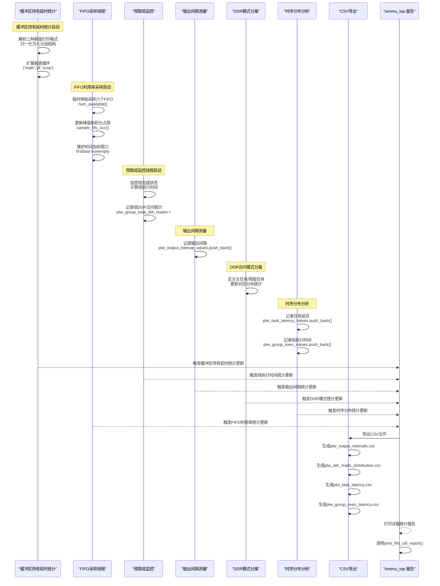

**图表来源**
- [test_rp_nvme10_rr_arb_thread.cc:1259-1261](file://rp/test_rp_nvme10_rr_arb_thread.cc#L1259-L1261)
- [extract_cqfull_table.py:73-76](file://extract_cqfull_table.py#L73-L76)

## 详细组件分析

### 缓冲区持有延时统计系统（新增）
- **三种新版打印格式支持**
  - **'MAIN head (dedup MISS)'**：表示主任务头部的去重未命中情况，记录缓冲区持有延时统计。
  - **'MAIN head (PF placeholder)'**：表示主任务头部的预取占位符，用于预取任务的缓冲区管理。
  - **'SUSPENDED (deduped)'**：表示被挂起的去重条目，记录其缓冲区持有延时。
- **七元组数据结构标准化**
  - **结构定义**：[n, W1, W2, W3, maxW1, maxW2, maxW3]
  - **字段含义**：n为样本数量，W1/W2/W3为不同阶段的持有延时，maxW1/maxW2/maxW3为对应的最大值。
  - **归一化处理**：将所有三种新版格式统一转换为标准七元组结构，确保数据一致性。
- **报表循环扩展**
  - **原有循环**：('main','susp')二元组，仅支持主任务和挂起任务。
  - **扩展循环**：('main','pf','susp')三元组，新增预取占位符(pf)支持。
  - **细分统计**：为每种类型提供独立的持有延时统计行，便于细粒度分析。
- **解析器增强**
  - **兼容性保证**：enhanced iommu_perf_parser.cc确保对新旧格式的完全兼容。
  - **解析逻辑**：智能识别日志格式并转换为内部统一表示。
  - **错误处理**：对无法识别的格式提供适当的错误处理和日志记录。

```mermaid
flowchart TD
Start(["缓冲区持有延时统计"]) --> ParseFormat{"解析日志格式"}
ParseFormat --> |MAIN head (dedup MISS)| MainMiss["解析为主任务去重未命中<br/>提取七元组数据"]
ParseFormat --> |MAIN head (PF placeholder)| PFPlaceholder["解析为预取占位符<br/>提取七元组数据"]
ParseFormat --> |SUSPENDED (deduped)| Suspended["解析为挂起去重条目<br/>提取七元组数据"]
MainMiss --> Normalize["归一化为七元组结构<br/>[n, W1, W2, W3, maxW1, maxW2, maxW3]"]
PFPlaceholder --> Normalize
Suspended --> Normalize
Normalize --> UpdateLoop["更新报表循环<br/>('main','pf','susp')"]
UpdateLoop --> End(["完成"])
```

**图表来源**
- [test_rp_nvme10_rr_arb_thread.cc:1259-1261](file://rp/test_rp_nvme10_rr_arb_thread.cc#L1259-L1261)
- [extract_cqfull_table.py:73-76](file://extract_cqfull_table.py#L73-L76)

**章节来源**
- [test_rp_nvme10_rr_arb_thread.cc:1259-1261](file://rp/test_rp_nvme10_rr_arb_thread.cc#L1259-L1261)
- [test_rp_rand4k_msi_mix_multichan_thread.cc:633-635](file://rp/test_rp_rand4k_msi_mix_multichan_thread.cc#L633-L635)
- [extract_cqfull_table.py:73-76](file://extract_cqfull_table.py#L73-L76)

### FIFO利用率监控系统
- **采样线程架构**
  - **fifo_util_sampler_thread**：独立的SystemC线程，每时钟拍执行一次采样。
  - **采样目标**：六个关键FIFO - pt_request_fifo、pt_update_fifo、dedup_request_fifo、dedup_update_fifo、pt_hit_response_fifo、pt_miss_response_fifo。
  - **采样方法**：调用sc_fifo::num_available()获取当前占用数量。
  - **线程同步**：使用wait(clock_period_)确保与时钟同步。
- **FifoOccStat数据结构**
  - **name**：FIFO名称字符串，用于报告输出标识。
  - **depth**：FIFO深度配置，用于计算利用率百分比。
  - **peak**：峰值占用计数，记录历史最大占用值。
  - **integral_occ_ns**：积分占用时间，累加occ * dt_ns。
  - **first_nonempty_ns**：首个非空时刻，标记时间窗口开始。
  - **last_nonempty_ns**：最后一个非空时刻，标记时间窗口结束。
- **时间加权窗口机制**
  - **窗口定义**：每个FIFO独立计算[first_nonempty_ns, last_nonempty_ns]作为有效工作时间窗口。
  - **窗口优势**：避免warmup和drain阶段的空闲时间稀释平均值。
  - **窗口计算**：win = last_nonempty_ns - first_nonempty_ns。
  - **独立统计**：六个FIFO各自维护独立的时间窗口。
- **峰值和平均统计**
  - **峰值更新**：if (occ > s.peak) s.peak = occ。
  - **积分更新**：仅在窗口开启后积分，s.integral_occ_ns += occ * dt。
  - **平均占用**：avg_occ = integral_occ_ns / win。
  - **峰值利用率**：peak_util = 100.0 * peak / depth。
  - **平均利用率**：avg_util = 100.0 * avg_occ / depth。
- **报告输出格式**
  - **表格列**：FIFO名称、深度、峰值、峰值利用率、平均占用、平均利用率。
  - **格式化输出**：printf格式化的对齐表格，便于阅读和分析。
  - **注释说明**：采样步长和时间加权窗口的详细说明。

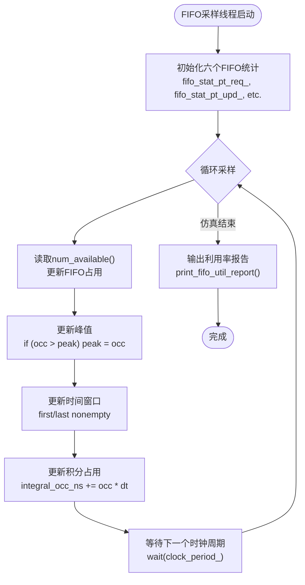

**图表来源**
- [cache_subsystem.cpp:1459-1478](file://iommu/cache_src/subsystem/cache_subsystem.cpp#L1459-L1478)
- [cache_subsystem.cpp:1480-1501](file://iommu/cache_src/subsystem/cache_subsystem.cpp#L1480-L1501)

**章节来源**
- [cache_subsystem.h:209-216](file://iommu/cache_src/subsystem/cache_subsystem.h#L209-L216)
- [cache_subsystem.h:430-436](file://iommu/cache_src/subsystem/cache_subsystem.h#L430-L436)
- [cache_subsystem.cpp:1459-1501](file://iommu/cache_src/subsystem/cache_subsystem.cpp#L1459-L1501)

### PTW并发任务分析系统
- **预取组监控线程**
  - **功能描述**：prefetch_group_monitor_thread专门负责监控预取组的完成状态，计算组级执行时间。
  - **监控范围**：跟踪1个主任务 + D个预取任务的完整执行生命周期。
  - **统计维度**：支持组起始时间、DDR访问累加、完成状态等维度的统计。
  - **性能影响**：最小化监控开销，确保不影响正常任务执行。
- **组执行时间统计**
  - **统计字段**：ptw_group_exec_total_ns、ptw_group_exec_max_ns、ptw_group_exec_min_ns、ptw_group_exec_count。
  - **计算方式**：group_exec_ns = current_time - group.group_start_ns。
  - **应用场景**：评估预取策略的整体效果，分析组级性能特征。
  - **分布分析**：支持自动分桶统计，识别性能异常组。
- **组DDR访问统计**
  - **统计字段**：ptw_group_total_ddr_reads、ptw_group_max_ddr_reads、ptw_group_min_ddr_reads。
  - **累加机制**：主任务 + 预取任务的DDR访问次数总和。
  - **分析价值**：评估预取策略对DDR访问的影响，优化预取深度。
  - **性能优化**：通过组级DDR访问分析指导预取策略调整。

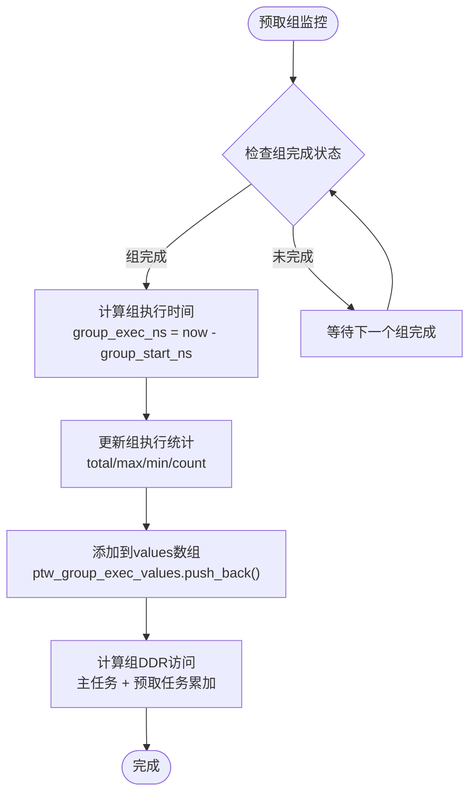

**图表来源**
- [iommu_perf_ptw.cc](file://iommu/iommu_perf_model/iommu_perf_ptw.cc)

**章节来源**
- [iommu_perf_ptw.cc](file://iommu/iommu_perf_model/iommu_perf_ptw.cc)

### 组索引执行延迟跟踪
- **组索引管理机制**
  - **索引分配**：通过group_id作为组索引，唯一标识每个预取组。
  - **生命周期跟踪**：从组创建到完成的完整生命周期监控。
  - **状态管理**：跟踪pending_tasks、completed、main_task_done等状态。
- **延迟分布统计**
  - **数值统计**：ptw_group_exec_total_ns、ptw_group_exec_max_ns、ptw_group_exec_min_ns。
  - **分布数组**：ptw_group_exec_values存储每组的完整执行时间。
  - **分桶分析**：自动将执行时间分为0~500ns、500~1000ns、1000~2000ns、2000~5000ns、>5000ns等区间。
- **性能分析应用**
  - **趋势分析**：通过组执行时间变化趋势识别性能退化。
  - **异常检测**：通过最大值和最小值识别异常组。
  - **优化指导**：根据分布情况调整预取策略和系统参数。

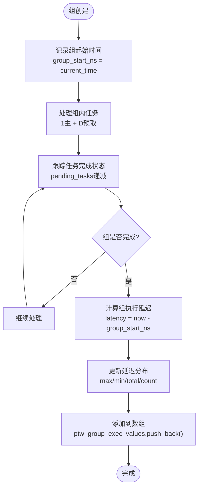

**图表来源**
- [iommu_perf_ptw.cc](file://iommu/iommu_perf_model/iommu_perf_ptw.cc)

**章节来源**
- [iommu_perf_ptw.cc](file://iommu/iommu_perf_model/iommu_perf_ptw.cc)

### 输出间隔测量系统
- **输出间隔统计**
  - **统计字段**：ptw_output_interval_total_ns、ptw_output_interval_max_ns、ptw_output_interval_min_ns、ptw_output_interval_count。
  - **采集时机**：在walk_complete或burst_complete时记录与前一次输出的时间间隔。
  - **计算公式**：output_interval = current_output_ns - ptw_last_output_ns。
  - **应用场景**：分析PTW输出稳定性，识别周期性波动和突发情况。
- **间隔分布分析**
  - **数值数组**：ptw_output_interval_values存储所有输出间隔值。
  - **波动性评估**：通过最大值和最小值评估输出稳定性。
  - **趋势分析**：通过间隔变化趋势识别系统负载变化。
- **性能监控应用**
  - **稳定性监控**：监控PTW输出的稳定性，及时发现性能问题。
  - **负载分析**：通过输出间隔分析系统负载模式。
  - **容量规划**：根据输出间隔分布指导系统容量规划。

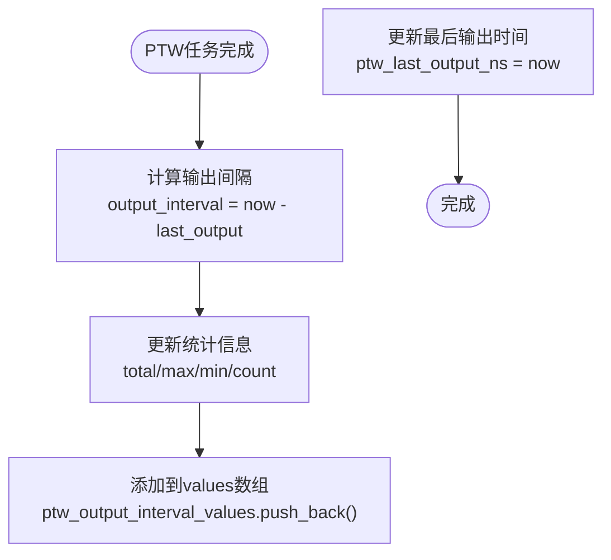

**图表来源**
- [iommu_perf_ptw.cc](file://iommu/iommu_perf_model/iommu_perf_ptw.cc)

**章节来源**
- [iommu_perf_ptw.cc](file://iommu/iommu_perf_model/iommu_perf_ptw.cc)

### DDR读访问模式分离
- **主任务DDR分布**
  - **统计字段**：ptw_main_ddr_reads_distribution、ptw_main_task_count、ptw_main_total_ddr_reads。
  - **分类标准**：task->walk_ctx.is_prefetch_task标志区分主任务和预取任务。
  - **分布统计**：记录每个任务类型的DDR访问次数分布。
  - **分析价值**：评估主任务的DDR访问效率，优化主任务处理路径。
- **预取任务DDR分布**
  - **统计字段**：ptw_prefetch_ddr_reads_distribution、ptw_prefetch_task_count、ptw_prefetch_total_ddr_reads。
  - **预取效果评估**：通过预取任务的DDR访问模式评估预取策略效果。
  - **深度优化**：根据预取任务的DDR访问模式调整预取深度。
- **模式对比分析**
  - **对比指标**：主任务和预取任务的平均DDR访问次数对比。
  - **效率评估**：通过对比分析评估预取策略的有效性。
  - **优化指导**：根据对比结果指导预取策略优化。

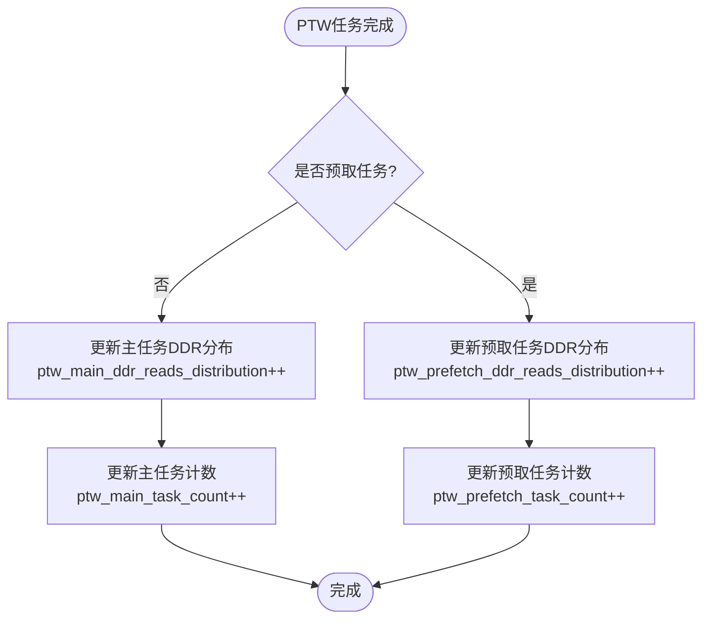

**图表来源**
- [iommu_perf_ptw.cc](file://iommu/iommu_perf_model/iommu_perf_ptw.cc)

**章节来源**
- [iommu_perf_ptw.cc](file://iommu/iommu_perf_model/iommu_perf_ptw.cc)

### 时序分布分析系统
- **任务延迟分布**
  - **数据结构**：ptw_task_latency_values存储每个PTW任务的完整延迟值。
  - **采集时机**：PTW任务完成时计算task_latency = current_time - task_start_time。
  - **分布分析**：自动分桶统计（0~100ns, 100~500ns, 500~1000ns, 1000~5000ns, >5000ns）。
  - **CSV导出**：生成ptw_task_latency.csv文件供Python绘制分布图。
- **组执行时间分布**
  - **数据结构**：ptw_group_exec_values存储每组的完整执行时间。
  - **采集时机**：预取组完成时计算group_exec_ns = current_time - group_start_ns。
  - **分布分析**：自动分桶（0~500ns, 500~1000ns, 1000~2000ns, 2000~5000ns, >5000ns）。
  - **CSV导出**：生成ptw_group_exec_latency.csv文件供Python绘制分布图。
- **Python可视化支持**
  - **数据格式**：CSV文件格式便于Python pandas库读取和处理。
  - **可视化类型**：支持直方图、折线图、箱线图等可视化形式。
  - **分析工具**：结合matplotlib、seaborn等库进行深度分析。

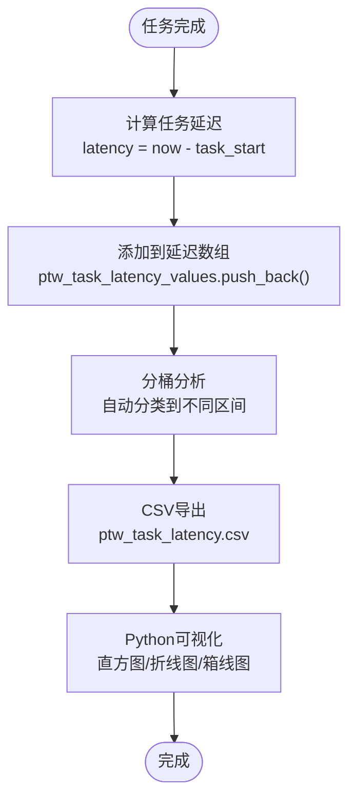

**图表来源**
- [iommu_perf_ptw.cc](file://iommu/iommu_perf_model/iommu_perf_ptw.cc)
- [iommu_top.cc](file://iommu/iommu_top.cc)

**章节来源**
- [iommu_perf_ptw.cc](file://iommu/iommu_perf_model/iommu_perf_ptw.cc)
- [iommu_top.cc](file://iommu/iommu_top.cc)

### CSV数据导出功能
- **输出间隔数据导出**
  - **文件名**：ptw_output_intervals.csv
  - **格式**：index,interval_ns
  - **用途**：Python绘制输出间隔波动曲线，分析PTW输出稳定性。
- **DDR访问分布导出**
  - **文件名**：ptw_ddr_reads_distribution.csv
  - **格式**：task_type,ddr_reads,count,percent
  - **分类**：ALL（全部任务）、MAIN（主任务）、PREFETCH（预取任务）
  - **用途**：Python绘制柱状图，对比不同任务类型的DDR访问模式。
- **任务延迟数据导出**
  - **文件名**：ptw_task_latency.csv
  - **格式**：index,latency_ns
  - **用途**：Python绘制延迟分布图，分析PTW任务延迟特性。
- **组执行时间导出**
  - **文件名**：ptw_group_exec_latency.csv
  - **格式**：group_index,exec_time_ns
  - **用途**：Python绘制组执行时间分布，评估预取策略效果。

**章节来源**
- [iommu_top.cc](file://iommu/iommu_top.cc)

### Walker Cache统计系统
- **VS-stage Walker Cache统计**
  - 统计字段：vs_lookup_count、vs_hit_c3_count、vs_hit_c2_count、vs_hit_c1_count、vs_miss_count。
  - 三级缓存架构：PTWc_1（直接映射，VPN[3]级）、PTWc_2（2-way组相连，VPN[2]级）、PTWc_3（4-way组相连，VPN[1]级）。
  - 仲裁机制：按C3>C2>C1优先级选择最高级命中，仅计最高级延迟。
  - DDR访问节省：C3 hit省3次DDR访问，C2 hit省2次，C1 hit省1次，Miss需4次。
- **S2-stage Walker Cache统计**
  - 独立存储阵列：使用s2_cache_array_与普通Walker Cache物理隔离。
  - 统计字段：s2_lookup_count、s2_hit_c3_count、s2_hit_c2_count、s2_hit_c1_count、s2_miss_count。
  - GPA查询：使用第一阶段翻译完成的GPA作为查询key。
- **统计接口**
  - VS-stage：get_vs_lookup_count()、get_vs_hit_c3_count()、get_vs_hit_c2_count()、get_vs_hit_c1_count()、get_vs_miss_count()。
  - S2-stage：get_s2_lookup_count()、get_s2_hit_c3_count()、get_s2_hit_c2_count()、get_s2_hit_c1_count()、get_s2_miss_count()。

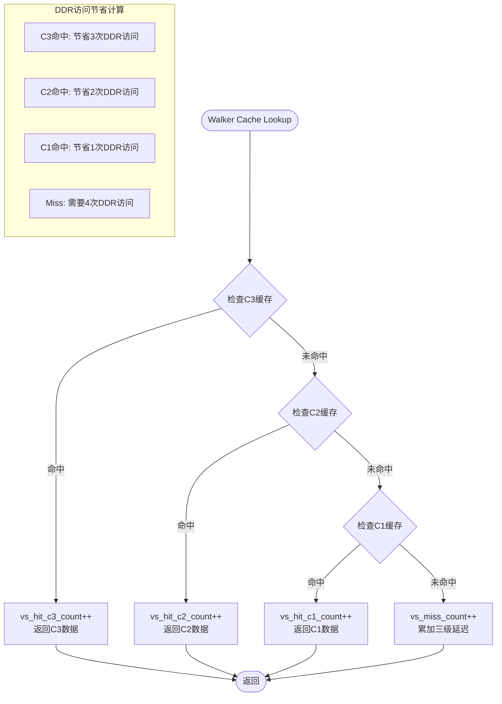

**图表来源**
- [walker_cache.cpp](file://iommu/cache_src/cache/walker_cache.cpp)
- [walker_cache.h](file://iommu/cache_src/cache/walker_cache.h)

**章节来源**
- [walker_cache.h](file://iommu/cache_src/cache/walker_cache.h)
- [walker_cache.cpp](file://iommu/cache_src/cache/walker_cache.cpp)

### 顶层汇总与报告
- 打印缓存统计：使用CacheSubsystem内部StatsCollector输出汇总。
- Walker Cache更新统计：更新类型分布与冗余消除率。
- **新增** 缓冲区持有延时报告：
  - 三种新版打印格式的统计数据：'MAIN head (dedup MISS)'、'MAIN head (PF placeholder)'、'SUSPENDED (deduped)'。
  - 七元组结构的统计数据：n, W1, W2, W3, maxW1, maxW2, maxW3。
  - 报表循环扩展：('main','pf','susp')三元组的详细统计。
- **新增** FIFO利用率报告：
  - 六个关键FIFO的深度、峰值、峰值利用率、平均占用、平均利用率。
  - 时间加权窗口说明和采样步长信息。
  - 便于识别反压点和性能瓶颈。
- PTW并发任务分析输出：
  - 预取组监控统计：组执行时间、DDR访问统计、完成状态。
  - 组索引延迟统计：按组索引的完整执行时间分析。
  - 预取策略评估：通过组级性能分析评估预取效果。
- 输出间隔测量输出：
  - 输出间隔统计：平均/最大/最小输出间隔和采样次数。
  - 波动性分析：通过间隔分布评估PTW输出稳定性。
- DDR访问模式分离输出：
  - 主任务DDR分布：主任务的DDR访问次数分布统计。
  - 预取任务DDR分布：预取任务的DDR访问次数分布统计。
  - 模式对比：主任务与预取任务的DDR访问效率对比。
- 时序分布分析输出：
  - 任务延迟分布：自动分桶的任务执行延迟分布统计。
  - 组执行时间分布：预取组执行时间的分布统计。
  - CSV数据导出：支持Python可视化的CSV文件生成。
- PTW Steady IOPS监控：
  - 通过ptw_steady_start_completed和ptw_steady_end_completed字段精确跟踪稳态窗口内PTW完成数。
  - 计算PTW Steady IOPS = (ptw_steady_end_completed - ptw_steady_start_completed) / steady_duration_ns * 1e3。
- IOMMU/PTW IOPS：总完成数、平均端到端延迟、请求间隔、稳态IOPS与理论峰值效率。
- 端口带宽：入口/出口/DDR端口平均带宽与利用率。
- 峰值outstanding：IOMMU全局、PTW、xDTW、Collector、DDR、输出端口等。

**章节来源**
- [test_rp_nvme10_rr_arb_thread.cc:1259-1261](file://rp/test_rp_nvme10_rr_arb_thread.cc#L1259-L1261)
- [extract_cqfull_table.py:73-76](file://extract_cqfull_table.py#L73-L76)

### 稳态IOPS监控
- **新增字段**：
  - ptw_steady_start_completed：稳态开始时PTW完成数。
  - ptw_steady_end_completed：稳态结束时PTW完成数。
- **监控机制**：
  - 在reorder_output过程中，当达到steady_start_count时记录ptw_steady_start_completed。
  - 当达到steady_end_count时记录ptw_steady_end_completed。
  - 稳态窗口定义为跳过前10%和后10%，只统计中间80%的稳定段。
- **计算公式**：
  - PTW Steady IOPS = (ptw_steady_end_completed - ptw_steady_start_completed) / steady_duration_ns * 1e3。
  - PTW Theory peak = 4.0 / 742.0 * 1e3（基于4并发和742ns平均延迟）。

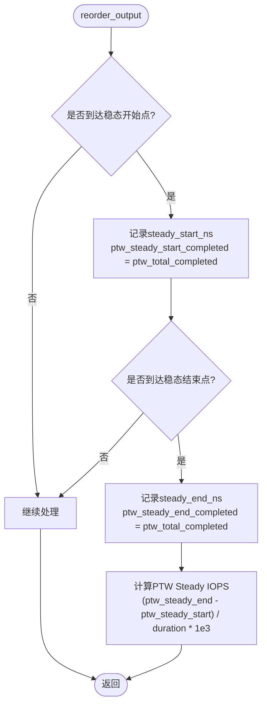

**图表来源**
- [iommu_perf_reorder.cc](file://iommu/iommu_perf_model/iommu_perf_reorder.cc)

**章节来源**
- [iommu_perf_reorder.cc](file://iommu/iommu_perf_model/iommu_perf_reorder.cc)

## 依赖关系分析
- 组件耦合
  - Collector高度依赖CacheSubsystem提供的FIFO与StatsCollector接口。
  - **新增** 缓冲区持有延时统计与解析器的紧密耦合：支持三种新版打印格式的解析和七元组转换。
  - **新增** FIFO利用率监控与CacheSubsystem的紧密耦合：fifo_util_sampler_thread直接访问六个FIFO句柄。
  - PTW并发任务分析与预取组管理的紧密耦合：在prefetch_group_monitor_thread中协调预取组的监控和统计。
  - 输出间隔测量与PTW响应处理的紧密耦合：在walk_complete和burst_complete路径记录输出间隔。
  - DDR访问模式分离与任务分类的紧密耦合：通过is_prefetch_task标志区分任务类型。
  - 时序分布分析与任务生命周期的紧密耦合：在任务完成时记录完整的延迟信息。
  - Walker Cache与StatsCollector的集成：VS-stage和S2-stage分别维护独立统计。
  - PT Cache/MSIPT Cache与PTW/xDTW之间通过FIFO连接，形成流水线。
  - 稳态IOPS监控与reorder_output的紧密耦合：通过ptw_steady_*字段传递统计信息。
  - HPM与功能模块在关键路径上触发事件计数。
- 外部依赖
  - SystemC用于仿真时间与事件通知。
  - 参数文件提供FIFO深度、缓存规模、处理延迟、带宽等约束。
  - Python脚本用于CSV数据分析和可视化。

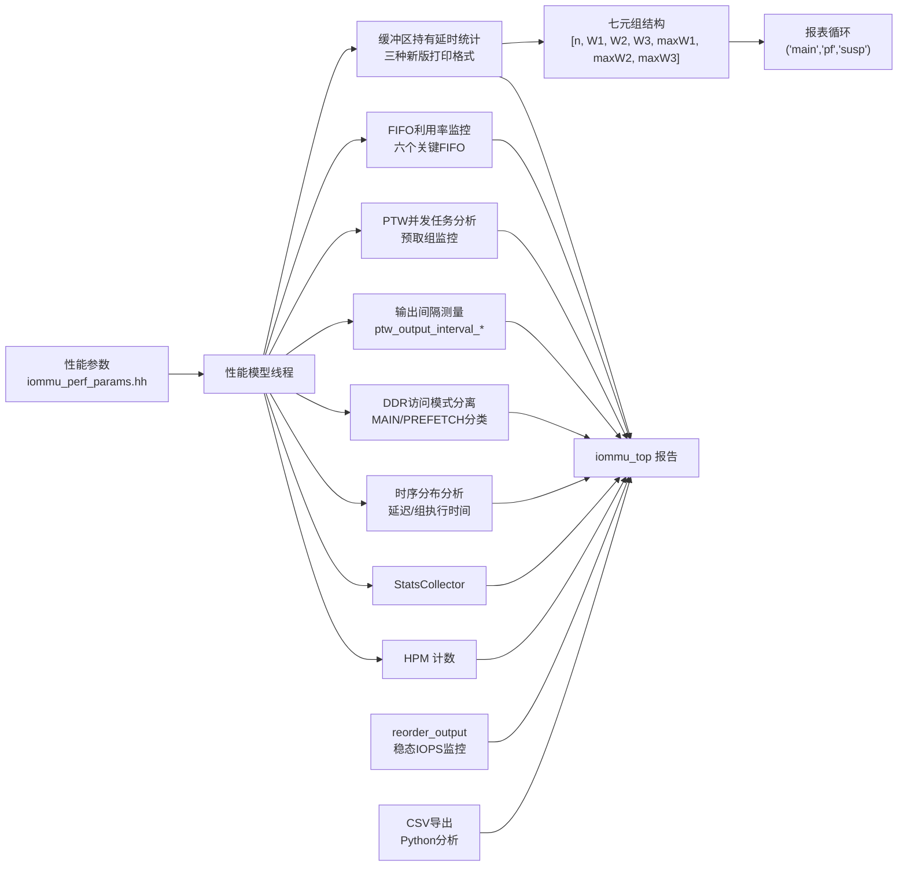

**图表来源**
- [test_rp_nvme10_rr_arb_thread.cc:1259-1261](file://rp/test_rp_nvme10_rr_arb_thread.cc#L1259-L1261)
- [extract_cqfull_table.py:73-76](file://extract_cqfull_table.py#L73-L76)

**章节来源**
- [PERF_MODEL_IMPLEMENTATION.md](file://PERF_MODEL_IMPLEMENTATION.md)

## 性能考量
- 缓存命中率
  - 通过StatsCollector的hit_rate/prefetch_accuracy派生，结合RAM访问路径统计评估替换策略与容量影响。
  - Walker Cache三级命中率分析：VS-stage和S2-stage分别统计C3/C2/C1各级命中率，评估不同级别缓存的有效性。
- 延迟统计
  - 执行/排队/请求平均延迟区分，避免用请求总时间估算IOPS导致高估。
  - 阶段窗口统计（REQUEST/UPDATE）与任务放大系数用于分析缓存与RAM端口的利用。
  - PTW任务延迟分布：通过ptw_task_latency_values分析PTW任务的延迟特性。
  - 组执行时间分布：通过ptw_group_exec_values分析预取组的执行时间特性。
  - Walker Cache延迟统计：仅计最高级命中延迟，Miss时累加三级延迟总和。
  - **新增** 缓冲区持有延时统计：通过七元组结构提供细粒度的缓冲区使用延迟分析。
- 吞吐量测量
  - IOPS采用执行时间作为分子，确保不受排队与窗口期影响。
  - 稳态IOPS：通过跳过热身/尾声窗口，仅统计中间80%稳定段，提供更准确的吞吐量评估。
  - PTW Steady IOPS：基于ptw_steady_start_completed和ptw_steady_end_completed精确计算稳态窗口内PTW完成速率。
  - 组执行时间分析：通过ptw_group_exec_values评估1主+D预取任务的完整执行时间。
  - 性能验证：系统达到122.64M IOPS和100%请求完成率的优异性能表现。
- 带宽与端口利用
  - 顶层报告提供端口平均带宽与利用率，结合理论峰值评估效率。
- 峰值outstanding
  - 各模块峰值outstanding与上限比较，识别潜在背压与瓶颈。
- **新增** 缓冲区持有延时性能考虑
  - **解析开销**：三种新版打印格式的解析开销极小，主要涉及字符串匹配和数值提取。
  - **数据一致性**：七元组结构确保不同类型日志的数据一致性，便于后续分析。
  - **报表扩展**：('main','pf','susp')三元组循环提供了更细粒度的统计维度。
  - **兼容性保证**：向后兼容设计确保新旧格式的统一处理。
- **新增** FIFO利用率性能考虑
  - **采样开销**：fifo_util_sampler_thread每时钟拍的采样开销极小，仅调用num_available()和简单的数值更新。
  - **内存占用**：六个FifoOccStat结构体的内存占用很小，主要包含整数和双精度浮点数。
  - **时间窗口准确性**：时间加权窗口避免了warmup/drain阶段的干扰，提供更准确的利用率评估。
  - **瓶颈识别**：通过峰值利用率和平均利用率识别系统反压点和性能瓶颈。
  - **FIFO深度优化**：基于利用率数据指导FIFO深度配置，平衡内存使用和性能需求。
- PTW并发任务性能考虑
  - 预取组监控线程的开销评估：确保监控过程不影响正常任务执行。
  - 组级性能分析：通过组执行时间评估预取策略的整体效果。
  - 资源占用分析：监控预取组相关的数据结构和统计信息的内存占用。
- 输出间隔稳定性分析
  - 通过输出间隔分布评估PTW输出的稳定性，识别周期性波动。
  - 间隔波动分析：通过最大值和最小值评估输出抖动程度。
  - 负载模式识别：通过间隔变化趋势识别系统负载模式。
- DDR访问优化分析
  - Walker Cache通过三级缓存显著减少DDR访问：C3命中节省3次，C2命中节省2次，C1命中节省1次。
  - DDR访问模式分离：通过主任务和预取任务的DDR分布对比，评估预取策略效果。
  - DDR Walks Saved统计量化缓存优化效果，为容量规划提供依据。
- 时序分布分析价值
  - 任务延迟分布：通过ptw_task_latency_values分析PTW任务的延迟特性，识别长尾延迟。
  - 组执行时间分布：通过ptw_group_exec_values评估预取策略对整体执行时间的影响。
  - 可视化分析：支持Python绘制的直方图、折线图、箱线图等可视化形式。
- 性能监控瓶颈识别
  - 输出间隔监控：通过ptw_output_interval_values识别输出不稳定因素。
  - 组执行时间监控：通过ptw_group_exec_values识别预取组性能瓶颈。
  - DDR访问监控：通过主任务和预取任务的DDR分布对比识别访问热点。
  - **新增** 缓冲区持有延时监控：通过七元组结构分析不同类型的缓冲区持有延时模式。
  - **新增** FIFO利用率监控：通过六个关键FIFO的峰值和平均利用率识别反压点和瓶颈。
- 预取策略优化
  - 通过组执行时间分析评估预取深度配置是否合理。
  - 通过DDR访问模式分析评估预取策略的有效性。
  - 通过时序分布分析识别预取策略的性能特征。
  - **新增** 通过预取占位符(PF placeholder)的持有延时分析评估预取策略的缓冲区使用情况。

**章节来源**
- [test_rp_nvme10_rr_arb_thread.cc:1259-1261](file://rp/test_rp_nvme10_rr_arb_thread.cc#L1259-L1261)
- [extract_cqfull_table.py:73-76](file://extract_cqfull_table.py#L73-L76)

## 故障排查指南
- 命中率异常
  - 若PT Cache命中率为0且场景为空间扫描（无时间局部性），属预期行为；可在容量、替换策略、预取方面优化。
  - Walker Cache命中率分析：检查VS-stage和S2-stage的各级命中率分布，识别缓存层级配置问题。
- 延迟偏高
  - 检查排队平均延迟占比，确认是否存在FIFO积压；关注Walker Cache命中率与更新分布。
  - PTW任务延迟分析：通过ptw_task_latency_values分布识别延迟异常任务。
  - 组执行时间分析：通过ptw_group_exec_values识别预取组性能问题。
  - Walker Cache延迟分析：对比各级缓存延迟差异，识别缓存层级性能瓶颈。
  - **新增** 缓冲区持有延时分析：检查三种新版打印格式的统计数据，识别缓冲区使用异常。
- IOPS不达预期
  - 查看稳态IOPS与理论峰值效率，评估端口带宽利用率与outstanding上限。
  - PTW Steady IOPS分析：通过ptw_steady_start_completed和ptw_steady_end_completed精确诊断稳态窗口内PTW性能。
  - 组执行时间分析：通过ptw_group_exec_values评估预取策略对整体吞吐量的影响。
  - 性能基准：122.64M IOPS和100%请求完成率作为性能基准参考。
- **新增** 缓冲区持有延时异常
  - **格式解析失败**：检查日志格式是否符合三种新版打印格式规范，确认解析器正确识别。
  - **七元组数据异常**：检查n, W1, W2, W3, maxW1, maxW2, maxW3字段的合理性，确认数据统计正确。
  - **报表循环缺失**：检查('main','pf','susp')三元组是否完整输出，确认预取占位符统计正常。
  - **类型分布异常**：对比'MAIN head (dedup MISS)'、'MAIN head (PF placeholder)'、'SUSPENDED (deduped)'三类数据的分布，识别异常模式。
- **新增** FIFO利用率异常
  - **峰值利用率过高**：检查对应FIFO的深度配置是否过小，可能导致频繁的反压和阻塞。
  - **平均利用率过低**：分析FIFO的使用模式，可能存在负载均衡问题或任务调度不均。
  - **时间窗口异常**：检查first_nonempty_ns和last_nonempty_ns的合理性，确认采样线程正常工作。
  - **六个FIFO对比**：对比pt_request_fifo、pt_update_fifo、dedup_request_fifo、dedup_update_fifo、pt_hit_response_fifo、pt_miss_response_fifo的利用率，识别瓶颈位置。
- PTW并发任务问题
  - 检查预取组监控线程：确认组执行时间统计是否正确记录。
  - 验证组索引管理：检查组索引的唯一性和生命周期管理。
  - 分析组执行时间分布：通过分布统计识别异常组。
- 输出间隔异常
  - 检查输出间隔分布：通过ptw_output_interval_values识别输出不稳定原因。
  - 分析间隔波动：通过最大值和最小值评估输出抖动程度。
  - 监控输出模式：通过间隔变化趋势识别系统负载变化。
- DDR访问模式问题
  - 检查主任务和预取任务的DDR分布对比：评估预取策略效果。
  - 分析DDR访问热点：通过分布统计识别访问热点区域。
  - 优化预取策略：根据DDR访问模式调整预取深度和策略。
- 时序分布异常
  - 检查任务延迟分布：通过ptw_task_latency_values识别长尾延迟。
  - 分析组执行时间分布：通过ptw_group_exec_values识别预取组性能问题。
  - 可视化分析：使用Python工具进行深度时序分析。
- HPM计数异常
  - 检查事件ID与ID过滤配置（DMASK/IDT/PV/PSCV/DV/GSCV），确认过滤条件是否过严或过松。
- CSV数据导出问题
  - 检查文件权限和磁盘空间，确认CSV文件是否正常生成。
  - 验证数据完整性：检查CSV文件行数是否与统计计数一致。

**章节来源**
- [test_rp_nvme10_rr_arb_thread.cc:1259-1261](file://rp/test_rp_nvme10_rr_arb_thread.cc#L1259-L1261)
- [extract_cqfull_table.py:73-76](file://extract_cqfull_table.py#L73-L76)

## 结论
本系统通过"线程化性能模型 + 统计收集器 + 顶层报告"的架构，实现了对IOMMU关键路径的全面性能观测。**新增的缓冲区持有延时统计系统**通过对三种新版打印格式（'MAIN head (dedup MISS)'、'MAIN head (PF placeholder)'、'SUSPENDED (deduped)'）的支持，提供了细粒度的缓冲区使用分析能力。**新增的七元组结构标准化**通过将不同格式归一化为[n, W1, W2, W3, maxW1, maxW2, maxW3]标准结构，确保了数据的一致性和可比性。**新增的报表循环扩展**从('main','susp')扩展到('main','pf','susp')，新增预取占位符(PF placeholder)的持有延时细分行，提升了分析的精细度。**增强的解析器兼容性**enhanced iommu_perf_parser.cc确保对新旧格式的完全兼容，保障了系统的向后兼容性。这些增强功能与现有的FIFO利用率监控、PTW并发任务分析、输出间隔测量、DDR访问模式分离、时序分布分析等功能相结合，为性能分析和优化提供了更全面的数据支持，指标覆盖缓存命中、延迟、吞吐、带宽、并发、时序稳定性、资源利用率、缓冲区持有延时和FIFO利用率等维度，并提供直方图、阶段窗口统计、CSV数据导出和缓冲区持有延时报告，便于定位瓶颈与指导优化。结合HPM事件计数与参数化约束，可进一步细化到具体事件与资源限制层面。

## 附录

### 指标定义与计算方法速查
- 命中率：命中 / 总访问
- 缺失率：缺失 / 总访问
- 预取准确率：预取命中 / 预取发出
- 执行平均延迟：执行延迟总和 / 执行样本数
- 排队平均延迟：排队延迟总和 / 排队样本数
- 请求平均延迟：请求延迟总和 / 请求样本数
- IOPS：请求样本数 / 执行时间总和（秒），避免用请求总时间高估
- 任务放大系数：RAM总访问数 / 原始任务数
- 稳态IOPS：稳态窗口内完成数 / 窗口时长（毫微秒）
- **新增** 缓冲区持有延时七元组：[n, W1, W2, W3, maxW1, maxW2, maxW3]
- **新增** 缓冲区持有延时类型：'MAIN head (dedup MISS)'、'MAIN head (PF placeholder)'、'SUSPENDED (deduped)'
- **新增** 报表循环类型：('main','pf','susp')三元组
- FIFO峰值占用：FIFO历史最大占用计数
- FIFO峰值利用率：100.0 * peak / depth
- FIFO时间加权平均占用：integral_occ_ns / (last_nonempty_ns - first_nonempty_ns)
- FIFO时间加权平均利用率：100.0 * avg_occ / depth
- FIFO时间窗口：[首包非空时刻, 末包非空时刻]
- PTW输出间隔：当前输出时刻与前一次输出时刻的时间差（ns）
- 组执行时间：预取组完成时刻与组起始时刻的时间差（ns）
- 组DDR访问次数：主任务 + 预取任务的DDR访问次数总和
- 主任务DDR分布：主任务的DDR访问次数分布统计
- 预取任务DDR分布：预取任务的DDR访问次数分布统计
- 任务延迟分布：ptw_task_latency_values数组中的完整延迟值
- 组执行时间分布：ptw_group_exec_values数组中的完整执行时间
- 输出间隔分布：ptw_output_interval_values数组中的完整间隔值
- Walker Cache DDR访问节省：C3命中×3 + C2命中×2 + C1命中×1
- PTW Steady IOPS：(ptw_steady_end_completed - ptw_steady_start_completed) / steady_duration_ns × 1e3
- 性能基准：122.64M IOPS和100%请求完成率

**章节来源**
- [test_rp_nvme10_rr_arb_thread.cc:1259-1261](file://rp/test_rp_nvme10_rr_arb_thread.cc#L1259-L1261)
- [extract_cqfull_table.py:73-76](file://extract_cqfull_table.py#L73-L76)