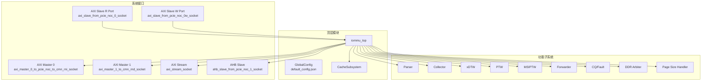
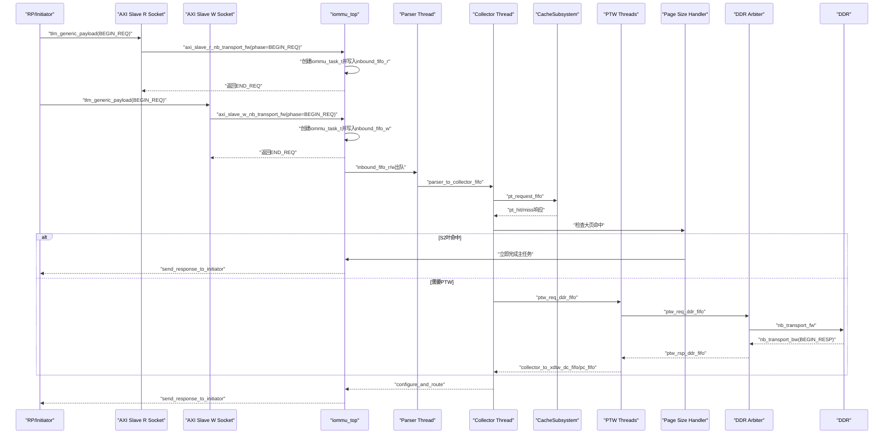
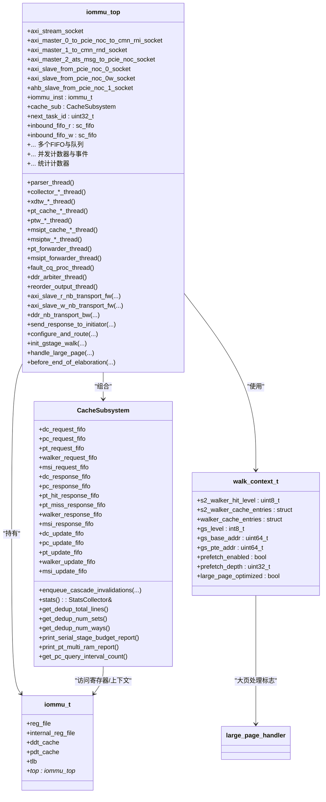
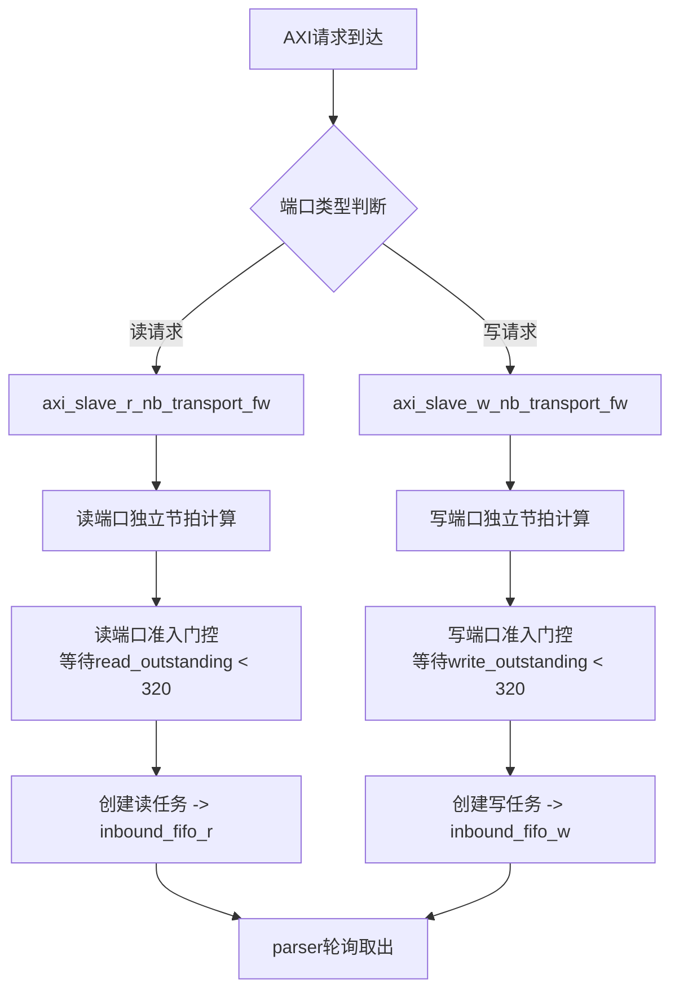
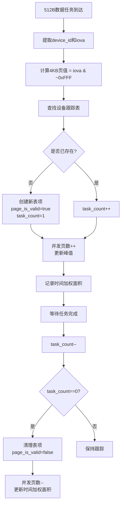
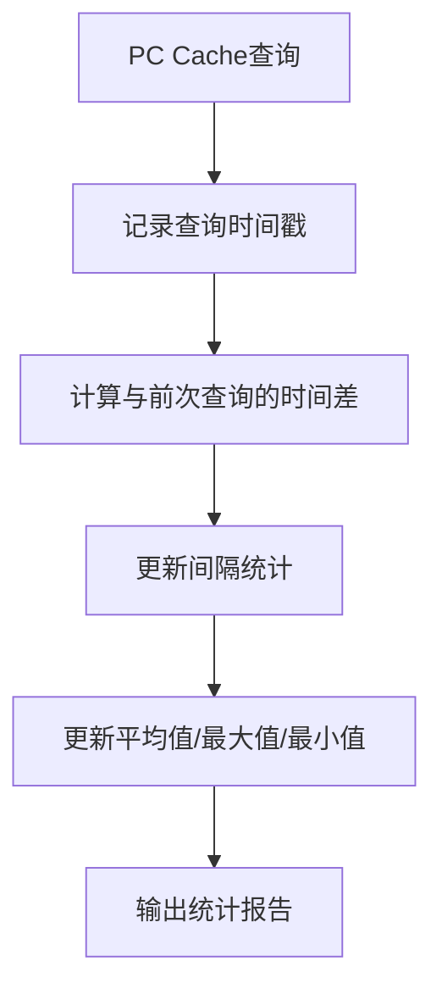
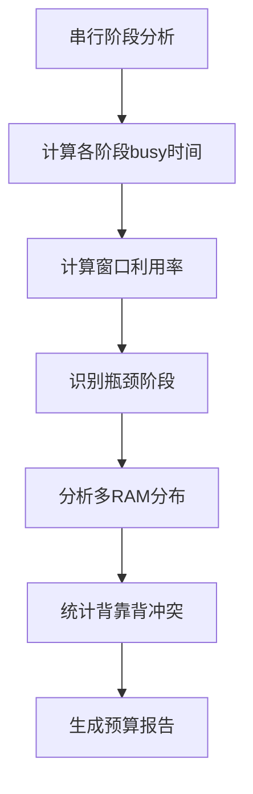
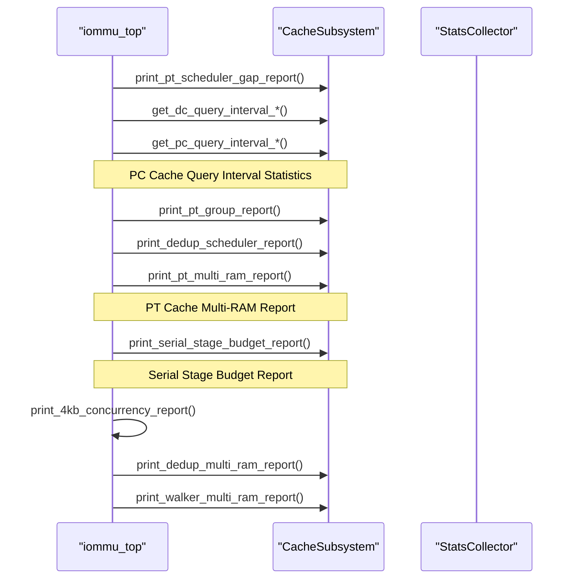
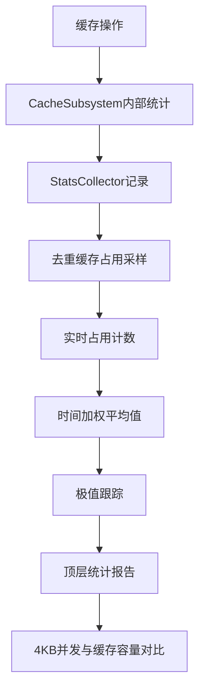
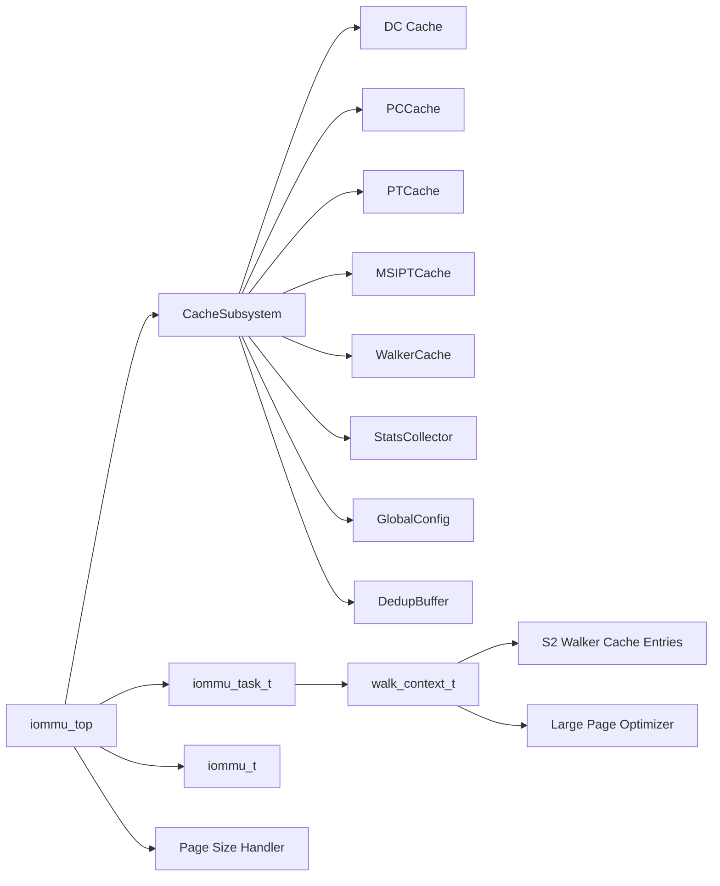

# 顶层模块设计

<cite>
**本文引用的文件**
- [iommu_top.hh](file://iommu/iommu_top.hh)
- [iommu_top.cc](file://iommu/iommu_top.cc)
- [cache_subsystem.h](file://iommu/cache_src/subsystem/cache_subsystem.h)
- [cache_subsystem.cpp](file://iommu/cache_src/subsystem/cache_subsystem.cpp)
- [default_config.json](file://iommu/cache_config/default_config.json)
- [iommu_struct.hh](file://iommu/include/iommu_struct.hh)
- [iommu_task.hh](file://iommu/include/iommu_task.hh)
- [iommu_dedup_params.hh](file://iommu/include/iommu_dedup_params.hh)
- [param_trans_def.hh](file://iommu/include/param_trans_def.hh)
- [iommu_perf_model.hh](file://iommu/include/iommu_perf_model.hh)
- [stats_collector.h](file://iommu/cache_src/common/stats_collector.h)
- [stats_collector.cpp](file://iommu/cache_src/common/stats_collector.cpp)
</cite>

## 更新摘要
**所做更改**
- 集成了split-RW-port架构，支持独立的读/写AXI slave接口
- 实现了4KB页面并发跟踪性能监控功能
- 增强了缓存子系统统计收集，包括去重缓存占用采样
- 优化了端口带宽控制和并发管理机制
- **新增**：增强了顶层集成以在缓存统计输出中显示新的统计信息，包括PC Cache查询间隔统计和串行阶段预算报告，与现有的PT Cache多RAM报告并列展示

## 目录
1. [简介](#简介)
2. [项目结构](#项目结构)
3. [核心组件](#核心组件)
4. [架构总览](#架构总览)
5. [详细组件分析](#详细组件分析)
6. [依赖分析](#依赖分析)
7. [性能考虑](#性能考虑)
8. [故障排查指南](#故障排查指南)
9. [结论](#结论)
10. [附录](#附录)

## 简介
本设计文档围绕RISC-V IOMMU顶层模块iommu_top展开，系统阐述其整体架构理念、SystemC模块继承体系、事件驱动与并发处理机制、初始化流程、进程注册与生命周期管理，以及与缓存子系统、解析器、收集器等核心子模块的集成方式。文档同时给出顶层模块的UML类图与组件关系图，解释关键成员变量与数据结构，并详述模块间通信接口与TLM协议实现。

**最新更新**：通过集成split-RW-port架构和4KB页面并发跟踪功能，显著提升了IOMMU的性能监控能力和端口处理能力，支持独立的读/写AXI slave接口，实现了更精确的带宽控制和并发管理。**新增增强的缓存统计输出功能**，包括PC Cache查询间隔统计和串行阶段预算报告，为性能分析提供了更全面的洞察。

## 项目结构
顶层模块位于iommu目录，采用分层组织：
- 顶层模块：iommu_top（SystemC模块，负责I/O接入、任务编排、缓冲与并发控制）
- 缓存子系统：CacheSubsystem（统一管理DC/PC/PT/MSIPT/Walker缓存及其失效流水线）
- 数据结构与任务模型：iommu_task.hh（统一的任务状态机、行走上下文、DDR请求/响应结构）
- 结构体与寄存器：iommu_struct.hh（顶层实例结构iommu_t，包含寄存器文件、上下文缓存等）
- 参数与传输定义：param_trans_def.hh（TLM扩展PayloadExtention、NocTransaction等）
- 性能模型与参数：iommu_perf_model.hh、iommu_dedup_params.hh、default_config.json

**图表来源**
- [iommu_top.hh:44-496](file://iommu/iommu_top.hh#L44-L496)
- [cache_subsystem.h:21-184](file://iommu/cache_src/subsystem/cache_subsystem.h#L21-L184)
- [default_config.json:1-69](file://iommu/cache_config/default_config.json#L1-L69)

**章节来源**
- [iommu_top.hh:44-496](file://iommu/iommu_top.hh#L44-L496)
- [cache_subsystem.h:21-184](file://iommu/cache_src/subsystem/cache_subsystem.h#L21-L184)
- [default_config.json:1-69](file://iommu/cache_config/default_config.json#L1-L69)

## 核心组件
- 顶层模块iommu_top：继承SystemC sc_module，封装IOMMU实例、缓存子系统、多路FIFO、并发控制与统计计数器，注册TLM回调与SC_THREAD进程。
- 缓存子系统CacheSubsystem：统一管理DC/PC/PT/MSIPT/Walker缓存，提供lookup/update/invalidate流水线，支持去重与统计。
- 任务模型iommu_task_t：贯穿全管道的状态机、行走上下文、DDR请求/响应结构，支撑解析、收集、行走与转发。
- 结构体iommu_t：顶层实例，持有寄存器文件、上下文缓存、指针回连到顶层模块。
- 参数与传输：PayloadExtention/NocTransaction承载设备ID、PASID、地址类型等元数据；TLM协议实现非阻塞回调与带宽控制。

**最新更新**：集成了split-RW-port架构，支持独立的读/写AXI slave接口，实现了4KB页面并发跟踪和增强的缓存子系统统计收集功能。**新增了增强的缓存统计输出功能**，包括PC Cache查询间隔统计和串行阶段预算报告。

**章节来源**
- [iommu_top.hh:44-496](file://iommu/iommu_top.hh#L44-L496)
- [cache_subsystem.h:21-184](file://iommu/cache_src/subsystem/cache_subsystem.h#L21-L184)
- [iommu_task.hh:185-280](file://iommu/include/iommu_task.hh#L185-L280)
- [iommu_struct.hh:42-99](file://iommu/include/iommu_struct.hh#L42-L99)
- [param_trans_def.hh:12-97](file://iommu/include/param_trans_def.hh#L12-97)

## 架构总览
顶层模块采用"事件驱动 + 并发流水线"的架构：
- 事件驱动：通过SystemC事件（sc_event）与PEQ（peq_with_get）协调各阶段完成通知与延迟处理。
- 并发流水线：每个子系统以独立SC_THREAD运行，通过sc_fifo连接，实现解耦与并行处理。
- 接口协议：基于TLM-2非阻塞回调（nb_transport_fw/bw），结合带宽控制与排队策略，确保端口公平性与稳定性。
- 缓存集成：将原分散的查询/更新/失效FIFO整合至CacheSubsystem，简化顶层耦合度，提升可维护性。

**图表来源**
- [iommu_top.cc:680-853](file://iommu/iommu_top.cc#L680-L853)
- [iommu_top.cc:867-1040](file://iommu/iommu_top.cc#L867-L1040)
- [cache_subsystem.h:34-66](file://iommu/cache_src/subsystem/cache_subsystem.h#L34-66)

**章节来源**
- [iommu_top.cc:680-853](file://iommu/iommu_top.cc#L680-L853)
- [iommu_top.cc:867-1040](file://iommu/iommu_top.cc#L867-L1040)
- [cache_subsystem.h:34-66](file://iommu/cache_src/subsystem/cache_subsystem.h#L34-66)

## 详细组件分析

### 类与成员变量概览（UML类图）

**图表来源**
- [iommu_top.hh:44-496](file://iommu/iommu_top.hh#L44-L496)
- [cache_subsystem.h:21-184](file://iommu/cache_src/subsystem/cache_subsystem.h#L21-184)
- [iommu_struct.hh:42-99](file://iommu/include/iommu_struct.hh#L42-L99)
- [iommu_task.hh:83-209](file://iommu/include/iommu_task.hh#L83-209)

**章节来源**
- [iommu_top.hh:44-496](file://iommu/iommu_top.hh#L44-L496)
- [cache_subsystem.h:21-184](file://iommu/cache_src/subsystem/cache_subsystem.h#L21-184)
- [iommu_struct.hh:42-99](file://iommu/include/iommu_struct.hh#L42-L99)
- [iommu_task.hh:83-209](file://iommu/include/iommu_task.hh#L83-209)

### Split-RW-Port架构与独立AXI Slave接口

**新增功能**：实现了split-RW-port架构，支持独立的读/写AXI slave接口，消除了传统单端口下的队头阻塞问题。

#### 读写端口分离架构
传统的单一AXI slave端口现在被拆分为两个独立的端口：
- **读端口**：`axi_slave_from_pcie_noc_0_socket` - 专门处理读请求，绑定`axi_slave_r_nb_transport_fw`
- **写端口**：`axi_slave_from_pcie_noc_0w_socket` - 专门处理写请求，绑定`axi_slave_w_nb_transport_fw`

每个端口都有独立的：
- 带宽节拍计算（512bit@1000MHz：512B=8ns, 128B=2ns, ctrl=1ns）
- 准入门控（读端口只等待读额度，写端口只等待写额度）
- 并发计数器和峰值跟踪
- 输入延时线和FIFO队列

**图表来源**
- [iommu_top.cc:680-853](file://iommu/iommu_top.cc#L680-L853)
- [iommu_top.cc:867-1040](file://iommu/iommu_top.cc#L867-L1040)

#### 端口带宽控制与并发管理
每个端口都有独立的带宽控制和并发管理机制：
- **独立带宽节拍**：读端口使用`AXI_SLAVE_R_PORT_BW_MBPS`，写端口使用`AXI_SLAVE_W_PORT_BW_MBPS`
- **独立准入门控**：避免读满堵写的队头阻塞问题
- **独立统计计数**：分别跟踪读/写的字节数、阻塞次数、节拍占用时间
- **方向错误检测**：如果读端口收到写请求或写端口收到读请求，直接触发FATAL错误

**章节来源**
- [iommu_top.cc:680-853](file://iommu/iommu_top.cc#L680-L853)
- [iommu_top.cc:867-1040](file://iommu/iommu_top.cc#L867-L1040)

### 4KB页面并发跟踪性能监控

**新增功能**：实现了4KB页面级别的并发跟踪性能监控，能够精确统计IOMMU模块中4KB页面的平均并发数量。

#### 4KB页面跟踪机制
系统通过以下机制跟踪4KB页面的并发情况：
- **入口跟踪**：在端口准入点调用`track_4kb_page_in()`，为每个512B数据任务记录其所属的4KB页面
- **出口跟踪**：在reorder释放点调用`track_4kb_page_out()`，当4KB页面所有任务完成后清理跟踪表项
- **按设备分离**：每个device_id维护独立的跟踪表和统计信息
- **时间加权平均**：使用面积法计算时间加权的平均并发数

**图表来源**
- [iommu_top.cc:231-301](file://iommu/iommu_top.cc#L231-L301)

#### 统计报告与性能指标
系统提供了详细的4KB页面并发统计报告：
- **每设备统计**：平均并发页数、峰值并发页数、不同页面数、异常计数
- **全局统计**：所有设备的总并发峰值、时间加权平均并发
- **去重缓存容量对比**：并发页数与去重缓存容量的百分比关系
- **入口队列积压监控**：端口准入后等待parser处理的队列长度统计

**章节来源**
- [iommu_top.cc:231-423](file://iommu/iommu_top.cc#L231-L423)
- [iommu_top.hh:103-137](file://iommu/iommu_top.hh#L103-L137)

### 增强的缓存统计输出功能

**新增功能**：增强了顶层集成以在缓存统计输出中显示新的统计信息，包括PC Cache查询间隔统计和串行阶段预算报告，与现有的PT Cache多RAM报告并列展示。

#### PC Cache查询间隔统计
系统新增了PC Cache查询间隔统计功能，与DC Cache查询间隔统计保持一致的口径：
- **查询总数**：`get_pc_query_total_count()` - 统计PC Cache的总查询次数
- **间隔样本数**：`get_pc_query_interval_count()` - 统计查询间隔的样本数量
- **平均间隔**：`get_pc_query_interval_avg_ns()` - 计算查询间隔的平均值
- **最大间隔**：`get_pc_query_interval_max_ns()` - 记录查询间隔的最大值
- **最小间隔**：`get_pc_query_interval_min_ns()` - 记录查询间隔的最小值

**图表来源**
- [cache_subsystem.h:189-194](file://iommu/cache_src/subsystem/cache_subsystem.h#L189-L194)
- [iommu_top.cc:1771-1782](file://iommu/iommu_top.cc#L1771-L1782)

#### 串行阶段预算报告
系统新增了串行阶段预算报告功能，用于分析每包固定延时的瓶颈定位：
- **窗口分析**：统计PT Cache从第一个开始到最后一个结束的时间窗口
- **各环节利用率**：分析DC/PC/PT/Dedup/Walker等各阶段的忙时占比
- **瓶颈识别**：自动识别利用率最高的串行阶段作为瓶颈
- **多RAM分布**：分析PT Cache在多RAM间的负载分布均匀性
- **背靠背冲突**：统计同RAM连续任务的背靠背冲突比例

**图表来源**
- [cache_subsystem.cpp:1443-1536](file://iommu/cache_src/subsystem/cache_subsystem.cpp#L1443-L1536)

#### 增强的统计输出流程
顶层模块的`print_cache_statistics()`函数现在集成了完整的统计输出流程：

**图表来源**
- [iommu_top.cc:1738-1804](file://iommu/iommu_top.cc#L1738-L1804)

**章节来源**
- [cache_subsystem.h:189-198](file://iommu/cache_src/subsystem/cache_subsystem.h#L189-L198)
- [cache_subsystem.cpp:1443-1536](file://iommu/cache_src/subsystem/cache_subsystem.cpp#L1443-L1536)
- [iommu_top.cc:1738-1804](file://iommu/iommu_top.cc#L1738-L1804)

### 增强的缓存子系统统计收集

**新增功能**：增强了缓存子系统的统计收集能力，特别是去重缓存的占用采样功能。

#### 去重缓存占用采样
CacheSubsystem现在提供了完整的去重缓存占用统计接口：
- **基本统计**：`get_dedup_total_lines()`、`get_dedup_num_sets()`、`get_dedup_num_ways()`
- **实时占用**：`get_dedup_valid_line_count()`、`get_dedup_req_line_count()`
- **采样统计**：`get_dedup_valid_sample_count()`、`get_dedup_avg_valid_lines()`
- **极值统计**：`get_dedup_max_valid_lines()`、`get_dedup_min_valid_lines()`

#### 统计集成与报告
顶层模块集成了这些统计信息：
- **4KB并发报告**：在打印4KB页面并发统计时，显示去重缓存容量和利用率
- **缓存命中率统计**：通过StatsCollector统一管理所有缓存的访问统计
- **性能分析报告**：提供详细的缓存性能分析和瓶颈识别

**图表来源**
- [cache_subsystem.h:112-127](file://iommu/cache_src/subsystem/cache_subsystem.h#L112-L127)
- [iommu_top.cc:377-393](file://iommu/iommu_top.cc#L377-L393)

**章节来源**
- [cache_subsystem.h:112-127](file://iommu/cache_src/subsystem/cache_subsystem.h#L112-L127)
- [stats_collector.h:107-131](file://iommu/cache_src/common/stats_collector.h#L107-L131)
- [stats_collector.cpp:227-240](file://iommu/cache_src/common/stats_collector.cpp#L227-L240)

### 初始化与生命周期管理
- before_end_of_elaboration：完成IOMMU实例复位与能力位配置，设置寄存器模式与能力，准备功能模型。
- 进程注册：构造函数中通过SC_THREAD注册所有子系统线程，形成完整的流水线。
- 生命周期：顶层模块作为SystemC模块，随仿真启动而运行，终止时打印缓存命中率与吞吐统计。

**章节来源**
- [iommu_top.cc:19-48](file://iommu/iommu_top.cc#L19-L48)
- [iommu_top.hh:379-496](file://iommu/iommu_top.hh#L379-L496)

### 事件驱动与并发处理
- 事件：大量sc_event用于通知FIFO可用、槽位释放、任务完成、重排序就绪等。
- 并发：每个子系统独立线程，通过sc_fifo解耦，支持高并发与流水线并行。
- PEQ：ptw_req_peq/ptw_rsp_peq用于非阻塞延迟与并行定时处理。

**章节来源**
- [iommu_top.hh:267-277](file://iommu/iommu_top.hh#L267-L277)
- [iommu_top.cc:279-404](file://iommu/iommu_top.cc#L279-404)

### 缓存子系统集成
- 替代原分散FIFO：顶层不再直接维护DC/PC/PT缓存查询/更新/响应FIFO，改为通过CacheSubsystem统一管理。
- 接口简化：顶层仅通过pt_request_fifo等少量接口与缓存交互，降低耦合度。
- 统一统计：CacheSubsystem内部StatsCollector提供命中率与延迟统计，顶层通过print_cache_statistics汇总展示。
- **去重与预取**：集成了先进的VA去重和预取机制，通过DedupBuffer实现高效的内存管理和任务挂起。

**章节来源**
- [iommu_top.hh:62-63](file://iommu/iommu_top.hh#L62-L63)
- [iommu_top.cc:471-475](file://iommu/iommu_top.cc#L471-L475)
- [cache_subsystem.h:34-66](file://iommu/cache_src/subsystem/cache_subsystem.h#L34-66)
- [cache_subsystem.cpp:669-930](file://iommu/cache_src/subsystem/cache_subsystem.cpp#L669-L930)

### 解析器与收集器协作
- 解析器：从AXI Slave接收请求，创建iommu_task_t并写入inbound_fifo。
- 收集器：从inbound_fifo读取任务，进行DC/PC配置与路由决策，随后进入PT缓存或PTW路径。
- 路由：configure_and_route根据任务属性选择PT缓存或PTW路径，并启用预取。

**章节来源**
- [iommu_top.cc:137-201](file://iommu/iommu_top.cc#L137-L201)
- [iommu_top.cc:437-475](file://iommu/iommu_top.cc#L437-L475)

### PTW与MSIPTW流水线
- PTW：请求/处理分离，使用PEQ与FIFO配合，支持预取与合并Burst读取。
- MSIPTW：针对MSI地址识别与查询，路径与PTW类似但目标不同。
- 响应：通过ptw_rsp_ddr_fifo与msiptw_rsp_ddr_fifo回传，再进入forwarder或fault处理。

**章节来源**
- [iommu_top.cc:332-336](file://iommu/iommu_top.cc#L332-336)
- [iommu_task.hh:82-182](file://iommu/include/iommu_task.hh#L82-L182)

### Forwarder与Fault/CQ
- Forwarder：根据任务状态将翻译结果转发至AXI Master或流接口，支持PT与MSIPT路径。
- Fault/CQ：处理故障与命令队列，必要时生成中断或响应。

**章节来源**
- [iommu_top.cc:348-356](file://iommu/iommu_top.cc#L348-356)
- [iommu_top.cc:408-432](file://iommu/iommu_top.cc#L408-L432)

### DDR仲裁与带宽控制
- 仲裁策略：优先控制路径（ctrl_path）与轮询（xDTW/PTW/MSIPTW）相结合，限制全局与端口并发。
- 带宽控制：基于请求长度与带宽MBPS计算延迟，模拟物理端口速率限制。
- 响应处理：通过ddr_nb_transport_bw接收DDR响应，按源模块路由到对应FIFO。

**章节来源**
- [iommu_top.cc:279-404](file://iommu/iommu_top.cc#L279-404)
- [iommu_top.cc:206-274](file://iommu/iommu_top.cc#L206-L274)

### 重排序与出口保序
- 重排序缓冲：按task_id维护就绪状态与写请求保序队列，确保出口保序。
- 出口释放：任务在重排序后才释放全局outstanding，避免资源泄漏。

**章节来源**
- [iommu_top.hh:279-295](file://iommu/iommu_top.hh#L279-L295)

### VA去重与预取
- VA去重：基于页对齐IOVA与软上下文ID构建键，命中则批量恢复其他任务。
- 预取：支持D>0的预取深度，合并Burst读取，减少PTW开销。
- **去重缓冲区**：通过DedupBuffer实现高效的内存管理和任务挂起，支持链式任务管理。

**章节来源**
- [iommu_top.cc:497-549](file://iommu/iommu_top.cc#L497-L549)
- [iommu_task.hh:128-171](file://iommu/include/iommu_task.hh#L128-L171)
- [cache_subsystem.cpp:669-930](file://iommu/cache_src/subsystem/cache_subsystem.cpp#L669-L930)

### TLM协议与接口设计
- 入口回调：axi_slave_nb_transport_fw处理INBOUND请求，创建任务并写入inbound_fifo。
- DDR回调：ddr_nb_transport_bw处理DDR响应，按源模块路由到对应FIFO。
- b_transport兼容：保留AHB寄存器访问与历史测试兼容路径。
- Payload扩展：PayloadExtention携带设备ID、PASID、地址类型等元数据。

**章节来源**
- [iommu_top.cc:137-201](file://iommu/iommu_top.cc#L137-L201)
- [iommu_top.cc:206-274](file://iommu/iommu_top.cc#L206-L274)
- [param_trans_def.hh:12-97](file://iommu/include/param_trans_def.hh#L12-97)

## 依赖分析
- 顶层模块依赖：
  - CacheSubsystem：统一缓存管理与统计
  - iommu_task_t：任务状态与行走上下文
  - iommu_t：寄存器文件与上下文缓存
  - TLM与SystemC：事件、进程与非阻塞回调
- 缓存子系统依赖：
  - 各种Cache实现（DC/PC/PT/MSIPT/Walker）
  - StatsCollector：统计与报告
  - GlobalConfig：缓存与时序参数
  - DedupBuffer：去重缓冲区管理

**图表来源**
- [iommu_top.hh:62-63](file://iommu/iommu_top.hh#L62-L63)
- [cache_subsystem.h:102-106](file://iommu/cache_src/subsystem/cache_subsystem.h#L102-L106)
- [default_config.json:1-69](file://iommu/cache_config/default_config.json#L1-L69)
- [iommu_task.hh:83-209](file://iommu/include/iommu_task.hh#L83-209)

**章节来源**
- [iommu_top.hh:62-63](file://iommu/iommu_top.hh#L62-L63)
- [cache_subsystem.h:102-106](file://iommu/cache_src/subsystem/cache_subsystem.h#L102-L106)
- [default_config.json:1-69](file://iommu/cache_config/default_config.json#L1-L69)
- [iommu_task.hh:83-209](file://iommu/include/iommu_task.hh#L83-209)

## 性能考虑
- 并发与流水线：通过独立线程与FIFO实现高并发与流水线并行，减少瓶颈。
- 带宽建模：端口带宽与延迟建模，避免仿真与真实硬件差异过大。
- 统计与稳态：提供IOPS、端口带宽、outstanding峰值与稳态测量，便于性能评估。
- 预取与去重：PT Cache预取与VA去重显著降低PTW开销，提升吞吐。
- **Split-RW-Port优化**：独立的读/写端口消除了队头阻塞，提升了端口利用率和吞吐量。
- **4KB并发监控**：精确的4KB页面并发跟踪帮助识别热点页面和优化内存访问模式。
- **增强统计收集**：改进的缓存子系统统计提供更详细的性能洞察和瓶颈分析。
- **新增增强的缓存统计输出**：PC Cache查询间隔统计和串行阶段预算报告为性能分析提供了更全面的数据支持。

**更新**：Split-RW-Port架构显著提升了端口处理能力，4KB并发监控提供了更精确的性能分析能力，增强的统计收集功能帮助识别系统瓶颈。**新增的PC Cache查询间隔统计和串行阶段预算报告功能进一步增强了性能分析的深度和广度**。

**章节来源**
- [iommu_top.cc:554-779](file://iommu/iommu_top.cc#L554-L779)
- [iommu_top.cc:680-1040](file://iommu/iommu_top.cc#L680-L1040)
- [iommu_task.hh:128-171](file://iommu/include/iommu_task.hh#L128-L171)
- [iommu_top.cc:1738-1804](file://iommu/iommu_top.cc#L1738-L1804)

## 故障排查指南
- 回调异常：检查nb_transport_fw/bw回调是否正确返回相位与状态。
- FIFO拥塞：关注outstanding计数与事件通知，定位瓶颈环节。
- DDR响应：确认ddr_pending_queue非空且按源模块正确路由。
- 重排序：若出现乱序，检查reorder_buf与write_order队列一致性。
- 统计异常：核对print_cache_statistics调用时机，确保FIFO清空后再统计。
- **端口方向错误**：如果R端口收到写请求或W端口收到读请求，检查RP的socket绑定配置。
- **4KB跟踪异常**：如果发现4KB页面跟踪计数异常，检查track_4kb_page_in/out调用的正确性。
- **缓存统计缺失**：如果缓存统计不完整，检查CacheSubsystem的StatsCollector配置和采样逻辑。
- **PC Cache统计异常**：如果PC Cache查询间隔统计不准确，检查pc_query_interval相关变量的更新逻辑。
- **串行阶段预算异常**：如果串行阶段预算报告显示异常，检查各阶段busy时间的计算和窗口统计。

**更新**：新增了split-RW-port架构相关的故障排查指导，帮助诊断端口绑定和4KB跟踪相关的问题。**新增了PC Cache查询间隔统计和串行阶段预算报告的故障排查指导**。

**章节来源**
- [iommu_top.cc:206-274](file://iommu/iommu_top.cc#L206-L274)
- [iommu_top.cc:279-404](file://iommu/iommu_top.cc#L279-L404)
- [iommu_top.hh:279-295](file://iommu/iommu_top.hh#L279-L295)
- [cache_subsystem.h:189-198](file://iommu/cache_src/subsystem/cache_subsystem.h#L189-L198)

## 结论
iommu_top通过清晰的SystemC模块化设计、事件驱动与并发流水线、以及与CacheSubsystem的深度集成，实现了高性能、可扩展的IOMMU仿真模型。通过引入split-RW-port架构，系统有效消除了端口间的队头阻塞，显著提升了端口处理能力和吞吐量。4KB页面并发跟踪功能提供了精确的性能监控能力，帮助识别热点页面和优化内存访问模式。增强的缓存子系统统计收集功能提供了更详细的性能洞察，支持更准确的瓶颈分析和性能调优。**新增的PC Cache查询间隔统计和串行阶段预算报告功能进一步增强了性能分析的全面性**，为复杂场景下的性能优化提供了强有力的工具支持。顶层模块以较低耦合度管理复杂的数据通路与统计分析，为后续功能扩展与性能优化提供了坚实基础。

## 附录
- 关键宏与参数：参考iommu_dedup_params.hh中的去重与预取参数定义。
- 性能参数：参考default_config.json中的缓存时序与统计配置。
- 传输定义：参考param_trans_def.hh中的PayloadExtention与NocTransaction。

**章节来源**
- [iommu_dedup_params.hh:1-92](file://iommu/include/iommu_dedup_params.hh#L1-L92)
- [default_config.json:1-69](file://iommu/cache_config/default_config.json#L1-L69)
- [param_trans_def.hh:12-97](file://iommu/include/param_trans_def.hh#L12-97)