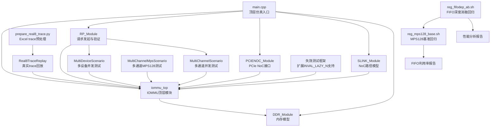
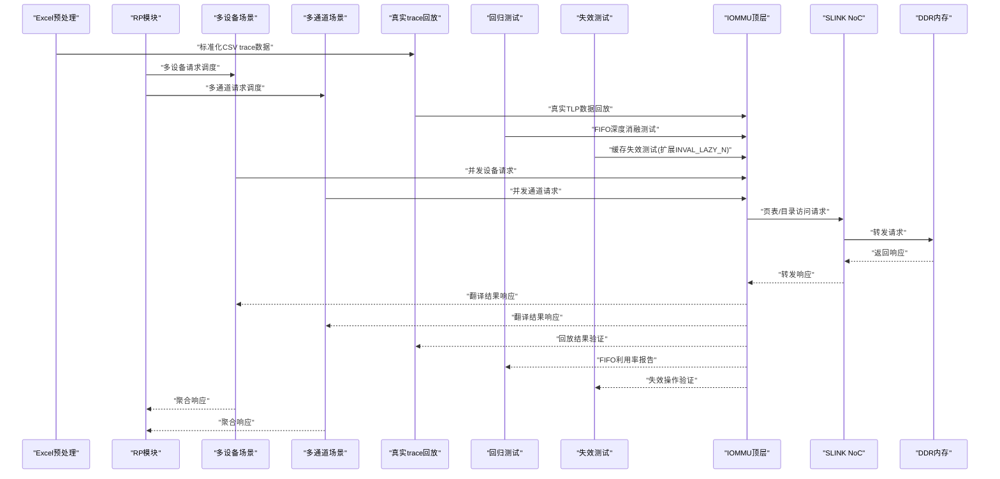
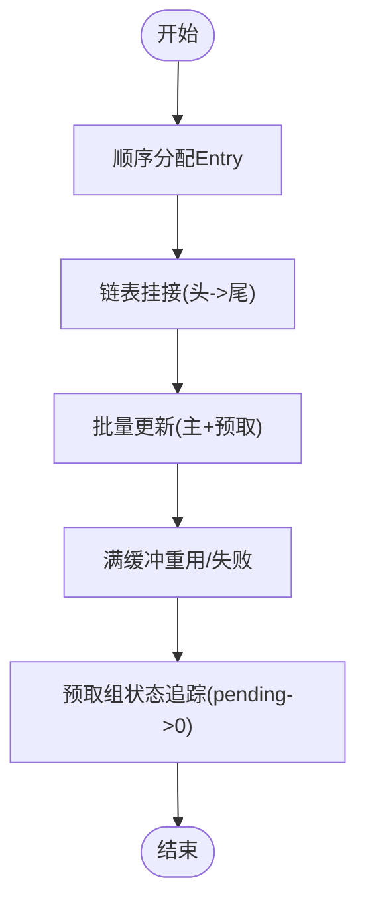
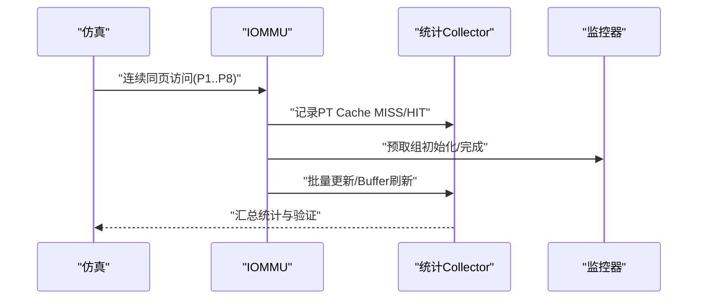
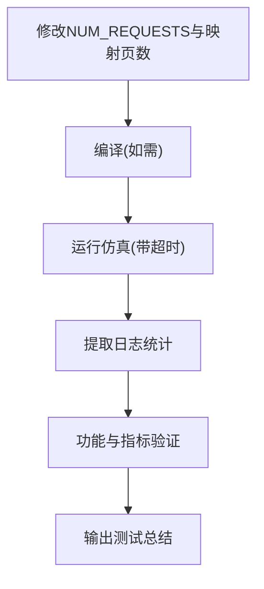
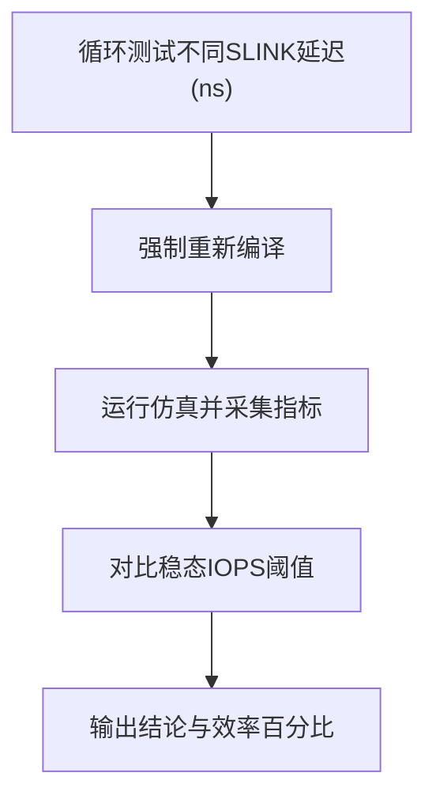
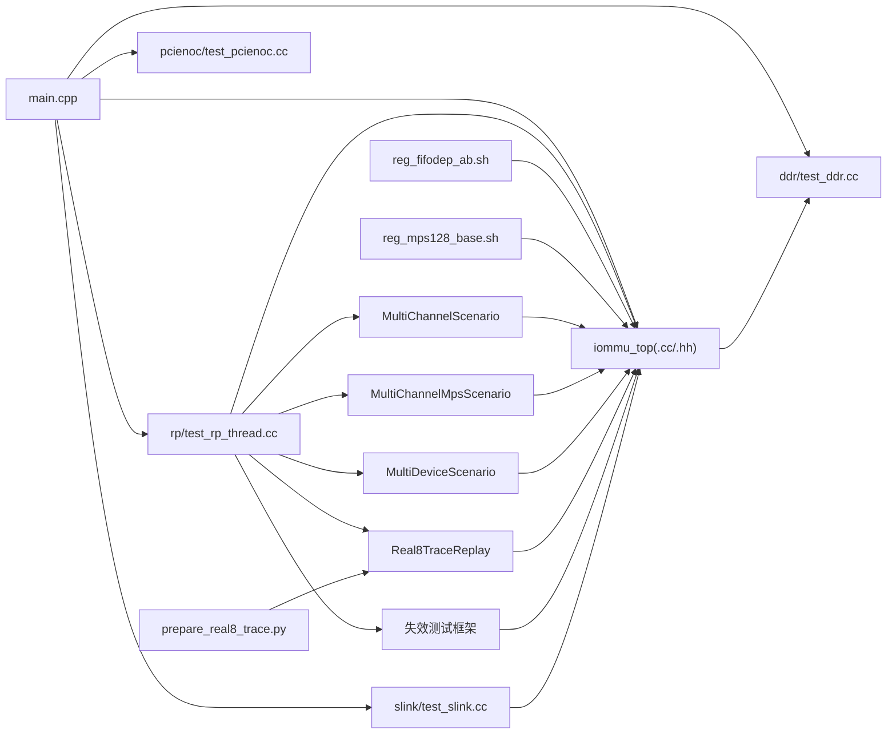

# 测试与验证

<cite>
**本文引用的文件**   
- [main.cpp](file://main.cpp)
- [Makefile](file://Makefile)
- [compile_and_test.sh](file://compile_and_test.sh)
- [link_and_run.sh](file://link_and_run.sh)
- [test_1000req.sh](file://test_1000req.sh)
- [test_dedup_prefetch_unit.cpp](file://test_dedup_prefetch_unit.cpp)
- [test_integration_dedup_prefetch.sh](file://test_integration_dedup_prefetch.sh)
- [test_dedup_prefetch.sh](file://test_dedup_prefetch.sh)
- [test_precise.sh](file://test_precise.sh)
- [rp/test_rp_func.cc](file://rp/test_rp_func.cc)
- [rp/test_rp_rand4k_single_stage_thread.cc](file://rp/test_rp_rand4k_single_stage_thread.cc)
- [rp/test_rp_rand4k_two_stage_thread.cc](file://rp/test_rp_rand4k_two_stage_thread.cc)
- [rp/test_rp_seq128k_single_stage_thread.cc](file://rp/test_rp_seq128k_single_stage_thread.cc)
- [rp/test_rp_seq128k_two_stage_thread.cc](file://rp/test_rp_seq128k_two_stage_thread.cc)
- [rp/test_rp_seq128k_two_stage_write_thread.cc](file://rp/test_rp_seq128k_two_stage_write_thread.cc)
- [rp/test_rp_seq512b_2mb_two_stage_thread.cc](file://rp/test_rp_seq512b_2mb_two_stage_thread.cc)
- [rp/test_rp_sv48_bare_thread.cc](file://rp/test_rp_sv48_bare_thread.cc)
- [rp/test_rp_msi_perf_thread.cc](file://rp/test_rp_msi_perf_thread.cc)
- [rp/test_rp_rand4k_msi_mix_multidev_thread.cc](file://rp/test_rp_rand4k_msi_mix_multidev_thread.cc)
- [rp/test_rp_rand4k_msi_mix_multichan_thread.cc](file://rp/test_rp_rand4k_msi_mix_multichan_thread.cc)
- [rp/test_rp_rand4k_msi_mix_multichan_mps128_thread.cc](file://rp/test_rp_rand4k_msi_mix_multichan_mps128_thread.cc)
- [rp/test_rp_real8_trace_replay_thread.cc](file://rp/test_rp_real8_trace_replay_thread.cc)
- [rp/prepare_real8_trace.py](file://rp/prepare_real8_trace.py)
- [tmp/real8_selftest.py](file://tmp/real8_selftest.py)
- [run_real8_trace.sh](file://run_real8_trace.sh)
- [tmp/run_real8_full.sh](file://tmp/run_real8_full.sh)
- [tmp/run_real8_full_step.sh](file://tmp/run_real8_full_step.sh)
- [tmp/run_real8_ladder.sh](file://tmp/run_real8_ladder.sh)
- [slink/test_slink.cc](file://slink/test_slink.cc)
- [iommu/cache_config/default_config.json](file://iommu/cache_config/default_config.json)
- [iommu/cache_config/input_params_example.json](file://iommu/cache_config/input_params_example.json)
- [iommu/cache_src/common/types.h](file://iommu/cache_src/common/types.h)
- [iommu/cache_src/cache/msipt_cache.h](file://iommu/cache_src/cache/msipt_cache.h)
- [iommu/cache_src/cache/msipt_cache.cpp](file://iommu/cache_src/cache/msipt_cache.cpp)
- [iommu/cache_src/subsystem/cache_subsystem.cpp](file://iommu/cache_src/subsystem/cache_subsystem.cpp)
- [iommu/iommu_perf_model/iommu_perf_params.hh](file://iommu/iommu_perf_model/iommu_perf_params.hh)
- [run_report.sh](file://run_report.sh)
- [tmp/final_analysis.sh](file://tmp/final_analysis.sh)
- [tmp/prefetch_timing.sh](file://tmp/prefetch_timing.sh)
- [tmp/calc_iops.sh](file://tmp/calc_iops.sh)
- [tmp/extract_stats.sh](file://tmp/extract_stats.sh)
- [TEST_REPORT_PHASE1_20260609.md](file://TEST_REPORT_PHASE1_20260609.md)
- [multidev_n16_512mb_summary.csv](file://multidev_n16_512mb_summary.csv)
- [multidev_n1_512mb_summary.csv](file://multidev_n1_512mb_summary.csv)
- [rwsplit_results/perf_rwsplit_512b.json](file://rwsplit_results/perf_rwsplit_512b.json)
- [rwsplit_results/perf_rwsplit_mps128.json](file://rwsplit_results/perf_rwsplit_mps128.json)
- [rwsplit_results/multichan_rwsplit_n8_512mb_summary.csv](file://rwsplit_results/multichan_rwsplit_n8_512mb_summary.csv)
- [reg_fifodep_ab.sh](file://reg_fifodep_ab.sh)
- [reg_mps128_base.sh](file://reg_mps128_base.sh)
- [reg_t5.sh](file://reg_t5.sh)
- [reg_t6t7.sh](file://reg_t6t7.sh)
- [rp/test_rp_cache_inval_thread.cc](file://rp/test_rp_cache_inval_thread.cc)
- [rp/test_rp_rand4k_two_stage_inval_thread.cc](file://rp/test_rp_rand4k_two_stage_inval_thread.cc)
- [rp/test_rp_rand4k_msi_mix_multichan_inval_thread.cc](file://rp/test_rp_rand4k_msi_mix_multichan_inval_thread.cc)
</cite>

## 更新摘要
**变更内容**   
- 扩展 INVAL_LAZY_N 白名单支持，新增 {512, 1024} 配置选项以支持更大批量的延迟失效测试场景
- 改进失效测试中的退化情况处理，增强对无效化间隔超过每核组数的边界场景的健壮性
- 完善多核失效测试框架，优化信用反压机制和 CQ 队列管理逻辑
- 增强失效命令注入的随机性和覆盖范围，支持更多类型的缓存失效操作

## 目录
1. [引言](#引言)
2. [项目结构](#项目结构)
3. [核心组件](#核心组件)
4. [架构总览](#架构总览)
5. [详细组件分析](#详细组件分析)
6. [依赖关系分析](#依赖关系分析)
7. [性能考量](#性能考量)
8. [故障排查指南](#故障排查指南)
9. [结论](#结论)
10. [附录](#附录)

## 引言
本文件面向IOMMU测试与验证，系统化介绍经过重构的测试框架设计、使用方法与自动化流程，覆盖单元测试、集成测试与性能测试三大类。文档重点解释基于TransStage枚举的测试场景分类系统、测试目标的清晰配置方法、测试用例编写方法、测试脚本使用指南、测试结果分析与验证标准，并给出测试环境搭建与配置要求及常见问题排查建议。

**重要更新** 测试框架经过重大简化，移除了实验性的多线程测试框架，保留了稳定的单线程测试实现，显著简化了测试协调机制，减少了400+行无用代码。新增随机4KB两阶段预取测试场景，专门验证复杂地址转换场景下的预取效果。**最新改进包括虚拟阶段页表测试基础设施的增强，特别是128K顺序访问测试用例的VS页表映射范围计算修正和IOVA_RANGE参数调整**。

**新增功能** 测试框架现在包含Scenario 7，专门针对高带宽随机访问模式下的两阶段地址转换进行性能验证，支持可配置的PAGES_NEEDED参数以适应不同的测试需求。**新增128KB顺序写测试用例，完善了写操作场景的测试覆盖，同时改进了现有两阶段线程测试的Windows兼容性**。

**最新更新** 测试基础设施得到显著扩展，新增了缓存失效场景测试和CPU指令建模测试，提供了全面的缓存一致性验证能力。**新增MSI性能测试场景，支持可配置的MSI请求数量（1/10/100/1000），覆盖三种设备场景的完整验证**。**新增多设备并发测试场景，支持最多16个并发设备的复杂地址转换和MSI混合访问测试**。**新增多设备多通道测试场景，支持单设备内n路并发通道访问，以及读写端口分离的可配置队列深度管理**。**新增8设备真实trace回放场景，支持Excel格式的TLP数据预处理和真实硬件trace数据的回放验证**。**新增FIFO深度消融回归测试框架和MPS128小包场景的自动化基准回归测试**。

**最新改进** 失效测试框架得到显著增强，扩展了INVAL_LAZY_N白名单支持至{512, 1024}，支持更大批量的延迟失效测试场景。改进了退化情况处理，增强了测试框架在处理无效化间隔超过每核组数等边界场景时的健壮性。

## 项目结构
仓库采用SystemC建模与TLM接口，顶层通过main.cpp组织IOMMU、RP、PCIENOC、SLINK与DDR模块互联；测试以Makefile驱动编译与目标选择，配套多套Shell脚本进行自动化测试与结果分析。测试框架经过重构，现在采用明确的单阶段和双阶段测试场景分类系统，并新增多设备并发测试和多通道测试支持，以及真实trace回放功能和FIFO深度消融回归测试。

**图示来源**
- [main.cpp:39-94](file://main.cpp#L39-L94)
- [reg_fifodep_ab.sh:1-54](file://reg_fifodep_ab.sh#L1-L54)
- [reg_mps128_base.sh:1-40](file://reg_mps128_base.sh#L1-L40)
- [rp/test_rp_rand4k_msi_mix_multidev_thread.cc:57-65](file://rp/test_rp_rand4k_msi_mix_multidev_thread.cc#L57-L65)
- [rp/test_rp_rand4k_msi_mix_multichan_thread.cc:126-145](file://rp/test_rp_rand4k_msi_mix_multichan_thread.cc#L126-L145)
- [rp/test_rp_rand4k_msi_mix_multichan_mps128_thread.cc:155-195](file://rp/test_rp_rand4k_msi_mix_multichan_mps128_thread.cc#L155-L195)
- [rp/test_rp_real8_trace_replay_thread.cc:1-50](file://rp/test_rp_real8_trace_replay_thread.cc#L1-L50)
- [rp/prepare_real8_trace.py:1-28](file://rp/prepare_real8_trace.py#L1-L28)
- [rp/test_rp_rand4k_msi_mix_multichan_inval_thread.cc:54-94](file://rp/test_rp_rand4k_msi_mix_multichan_inval_thread.cc#L54-L94)

**章节来源**
- [main.cpp:1-94](file://main.cpp#L1-L94)
- [Makefile:1-181](file://Makefile#L1-L181)

## 核心组件
- 顶层仿真入口与绑定：main.cpp负责创建各模块实例并建立TLM socket连接，启动仿真并清理资源。
- **重构后的测试场景分类系统**：通过TransStage枚举（STAGE1_ONLY、STAGE2_ONLY、STAGE1_AND_2）实现明确的单阶段和双阶段测试场景分类；每个测试场景都有专用的源文件，命名约定清晰明确。
- **多设备并发测试框架**：新增MultiDeviceScenario类，支持最多16个并发设备，提供灵活的负载分布模式和负载均衡策略。
- **多通道并发测试框架**：新增MultiChannelScenario和MultiChannelMpsScenario类，支持单设备内n路并发通道访问，提供读写端口分离和可配置队列深度管理。
- **真实trace回放框架**：新增Real8TraceReplay场景，支持8设备真实TLP数据回放，通过Excel预处理脚本将MRd/MWr数据转换为标准化CSV格式。
- **FIFO深度消融回归测试框架**：新增reg_fifodep_ab.sh脚本，支持双场景对比分析（512B基线 vs 128B小包），提供完整的FIFO利用率报告提取和分析。
- **MPS128小包基准回归测试**：新增reg_mps128_base.sh脚本，提供128B小包场景的自动化基准测试，包含宏参数回读和性能指标验证。
- **增强的失效测试框架**：扩展INVAL_LAZY_N白名单支持至{512, 1024}，改进退化情况处理，增强边界场景的健壮性。
- **测试目标配置**：通过TEST_FLAGS宏和TEST宏实现测试目标的清晰配置，包括预取深度、Walker Cache启用等参数。
- **测试线程与场景**：
  - 单阶段测试：rp/test_rp_rand4k_single_stage_thread.cc提供4KB随机读单阶段测试场景
  - 双阶段测试：rp/test_rp_seq128k_two_stage_thread.cc提供128KB顺序读双阶段测试场景（现包含5000个请求）
  - **新增两阶段随机预取测试**：rp/test_rp_rand4k_two_stage_thread.cc提供4KB随机读两阶段预取测试场景，验证随机访问模式下的预取效果
  - **新增128KB顺序写测试**：rp/test_rp_seq128k_two_stage_write_thread.cc提供128KB顺序写两阶段测试场景，完善写操作验证
  - **增强的512B/2MB两阶段测试**：rp/test_rp_seq512b_2mb_two_stage_thread.cc提供混合大小块的两阶段测试，现已支持Windows兼容性
  - **新增MSI性能测试**：rp/test_rp_msi_perf_thread.cc提供MSI地址翻译性能测试，支持可配置请求数量
  - **新增多设备并发测试**：rp/test_rp_rand4k_msi_mix_multidev_thread.cc提供多设备并发测试，支持最多16个设备
  - **新增多通道测试**：rp/test_rp_rand4k_msi_mix_multichan_thread.cc提供单设备多通道并发测试，支持读写端口分离
  - **新增MPS128小包测试**：rp/test_rp_rand4k_msi_mix_multichan_mps128_thread.cc提供PCIe MPS/MRRS=128B的小包处理测试
  - **新增真实trace回放测试**：rp/test_rp_real8_trace_replay_thread.cc提供8设备真实TLP数据回放测试
  - **新增失效测试场景**：rp/test_rp_cache_inval_thread.cc、rp/test_rp_rand4k_two_stage_inval_thread.cc、rp/test_rp_rand4k_msi_mix_multichan_inval_thread.cc提供全面的缓存失效验证
  - 基础测试：rp/test_rp_sv48_bare_thread.cc提供Sv48+Bare基础测试场景
- **Excel trace预处理工具**：rp/prepare_real8_trace.py提供Excel格式的MRd/MWr TLP数据预处理，支持RequesterID到设备映射、地址格式转换、长度单位转换等功能。
- **自动化测试脚本**：run_real8_trace.sh、tmp/run_real8_full.sh、tmp/run_real8_full_step.sh、tmp/run_real8_ladder.sh提供完整的真实trace回放自动化流程。
- **回归测试脚本**：reg_fifodep_ab.sh、reg_mps128_base.sh、reg_t5.sh、reg_t6t7.sh提供系统化的回归测试和性能基准验证。
- **验证辅助**：rp/test_rp_func.cc提供故障记录检查、响应校验、TLM翻译调用等辅助能力。
- **NoC路径**：slink/test_slink.cc实现双向流水线转发、PEQ延迟与FIFO缓冲。
- **缓存配置**：default_config.json与input_params_example.json定义缓存规模、替换策略与统计输出参数。
- **自动化脚本**：Makefile、compile_and_test.sh、link_and_run.sh、test_1000req.sh、test_dedup_prefetch_unit.cpp、test_integration_dedup_prefetch.sh、test_dedup_prefetch.sh、test_precise.sh构成完整测试体系。
- **性能分析工具**：新增final_analysis.sh、prefetch_timing.sh、calc_iops.sh、extract_stats.sh等脚本，提供详细的性能分析和统计报告。

**重要更新** 测试框架简化了线程管理机制，移除了复杂的多线程协调逻辑，现在采用单线程实现，显著降低了测试系统的复杂度和维护成本。新增两阶段随机预取测试场景，专门验证复杂地址转换场景下的预取效果。**虚拟阶段页表测试基础设施得到改进，包括128K顺序访问测试用例的VS页表映射范围计算修正和IOVA_RANGE参数调整**。新增128KB顺序写测试用例，完善了写操作场景的测试覆盖，同时改进了现有两阶段线程测试的Windows兼容性。**新增MSI性能测试场景，支持可配置的MSI请求数量（1/10/100/1000），覆盖三种设备场景的完整验证**。**新增多设备并发测试场景，支持最多16个并发设备的复杂地址转换和MSI混合访问测试**。**新增多通道并发测试场景，支持单设备内n路并发通道访问，以及读写端口分离的可配置队列深度管理**。**新增真实trace回放场景，支持8设备真实TLP数据的Excel预处理和回放验证**。**新增FIFO深度消融回归测试框架和MPS128小包基准回归测试，提供系统化的性能回归验证能力**。**失效测试框架得到显著增强，扩展了INVAL_LAZY_N白名单支持至{512, 1024}，改进了退化情况处理和边界场景的健壮性**。

**章节来源**
- [main.cpp:39-94](file://main.cpp#L39-L94)
- [reg_fifodep_ab.sh:1-54](file://reg_fifodep_ab.sh#L1-L54)
- [reg_mps128_base.sh:1-40](file://reg_mps128_base.sh#L1-L40)
- [rp/test_rp_rand4k_single_stage_thread.cc:1-294](file://rp/test_rp_rand4k_single_stage_thread.cc#L1-L294)
- [rp/test_rp_rand4k_two_stage_thread.cc:1-370](file://rp/test_rp_rand4k_two_stage_thread.cc#L1-L370)
- [rp/test_rp_seq128k_single_stage_thread.cc:1-260](file://rp/test_rp_seq128k_single_stage_thread.cc#L1-L260)
- [rp/test_rp_seq128k_two_stage_thread.cc:1-380](file://rp/test_rp_seq128k_two_stage_thread.cc#L1-L380)
- [rp/test_rp_seq128k_two_stage_write_thread.cc:1-350](file://rp/test_rp_seq128k_two_stage_write_thread.cc#L1-L350)
- [rp/test_rp_seq512b_2mb_two_stage_thread.cc:1-320](file://rp/test_rp_seq512b_2mb_two_stage_thread.cc#L1-L320)
- [rp/test_rp_msi_perf_thread.cc:1-467](file://rp/test_rp_msi_perf_thread.cc#L1-L467)
- [rp/test_rp_rand4k_msi_mix_multidev_thread.cc:1-420](file://rp/test_rp_rand4k_msi_mix_multidev_thread.cc#L1-L420)
- [rp/test_rp_rand4k_msi_mix_multichan_thread.cc:1-644](file://rp/test_rp_rand4k_msi_mix_multichan_thread.cc#L1-L644)
- [rp/test_rp_rand4k_msi_mix_multichan_mps128_thread.cc:1-690](file://rp/test_rp_rand4k_msi_mix_multichan_mps128_thread.cc#L1-L690)
- [rp/test_rp_real8_trace_replay_thread.cc:1-100](file://rp/test_rp_real8_trace_replay_thread.cc#L1-L100)
- [rp/test_rp_cache_inval_thread.cc:1-388](file://rp/test_rp_cache_inval_thread.cc#L1-L388)
- [rp/test_rp_rand4k_two_stage_inval_thread.cc:1-492](file://rp/test_rp_rand4k_two_stage_inval_thread.cc#L1-L492)
- [rp/test_rp_rand4k_msi_mix_multichan_inval_thread.cc:1-1205](file://rp/test_rp_rand4k_msi_mix_multichan_inval_thread.cc#L1-L1205)
- [rp/prepare_real8_trace.py:1-377](file://rp/prepare_real8_trace.py#L1-L377)
- [tmp/real8_selftest.py:1-243](file://tmp/real8_selftest.py#L1-L243)
- [run_real8_trace.sh:1-162](file://run_real8_trace.sh#L1-L162)
- [tmp/run_real8_full.sh:1-27](file://tmp/run_real8_full.sh#L1-L27)
- [tmp/run_real8_full_step.sh:1-35](file://tmp/run_real8_full_step.sh#L1-L35)
- [tmp/run_real8_ladder.sh:1-34](file://tmp/run_real8_ladder.sh#L1-L34)
- [rp/test_rp_sv48_bare_thread.cc:1-213](file://rp/test_rp_sv48_bare_thread.cc#L1-L213)
- [rp/test_rp_func.cc:1-200](file://rp/test_rp_func.cc#L1-L200)
- [slink/test_slink.cc:1-117](file://slink/test_slink.cc#L1-L117)
- [iommu/cache_config/default_config.json:1-69](file://iommu/cache_config/default_config.json#L1-L69)
- [iommu/cache_config/input_params_example.json:1-69](file://iommu/cache_config/input_params_example.json#L1-L69)
- [iommu/cache_src/common/types.h:64-69](file://iommu/cache_src/common/types.h#L64-L69)

## 架构总览
下图展示SystemC仿真中的模块交互与数据流，包括请求发起、IOMMU翻译、SLINK NoC转发以及DDR访问路径，以及新增的真实trace回放数据处理流程和FIFO深度消融回归测试流程。

**图示来源**
- [main.cpp:64-79](file://main.cpp#L64-L79)
- [reg_fifodep_ab.sh:10-54](file://reg_fifodep_ab.sh#L10-L54)
- [reg_mps128_base.sh:17-40](file://reg_mps128_base.sh#L17-L40)
- [rp/test_rp_rand4k_msi_mix_multidev_thread.cc:233-286](file://rp/test_rp_rand4k_msi_mix_multidev_thread.cc#L233-L286)
- [rp/test_rp_rand4k_msi_mix_multichan_thread.cc:340-424](file://rp/test_rp_rand4k_msi_mix_multichan_thread.cc#L340-L424)
- [rp/test_rp_real8_trace_replay_thread.cc:1-50](file://rp/test_rp_real8_trace_replay_thread.cc#L1-L50)
- [rp/test_rp_cache_inval_thread.cc:34-388](file://rp/test_rp_cache_inval_thread.cc#L34-L388)
- [rp/test_rp_rand4k_two_stage_inval_thread.cc:61-492](file://rp/test_rp_rand4k_two_stage_inval_thread.cc#L61-L492)
- [rp/test_rp_rand4k_msi_mix_multichan_inval_thread.cc:104-1205](file://rp/test_rp_rand4k_msi_mix_multichan_inval_thread.cc#L104-L1205)
- [rp/prepare_real8_trace.py:12-28](file://rp/prepare_real8_trace.py#L12-L28)
- [slink/test_slink.cc:32-117](file://slink/test_slink.cc#L32-L117)

## 详细组件分析

### FIFO深度消融回归测试（reg_fifodep_ab.sh）
- **目标**：验证IOMMU在FIFO深度配置变化下的性能表现，支持双场景对比分析（512B基线 vs 128B小包）。
- **核心特性**：
  - **双场景对比**：T1=512B基线（目标286.90 Mreq/s）vs T2=128B小包（目标371.64 Mreq/s）
  - **FIFO深度配置**：pt_hit/pt_miss_response=32, dedup_request/update=64 (pt_update保持32)
  - **全量重编**：每场景执行make clean后重新编译，确保配置正确性
  - **宏参数回读**：验证编译时宏参数的正确设置
  - **超时控制**：使用timeout命令控制仿真运行时间（1500秒）
  - **FIFO报告提取**：自动提取Entry/Dedup FIFO Utilization报告
- **关键配置参数**：
  - `SCENE13_PTW=64`：PTW并发任务数
  - `SCENE13_BUFFER=320`：去重缓冲区大小
  - `DEDUP_ADM=1`：准入控制开关
  - `DEBUG=1`：调试模式
  - `MULTICHAN_N=8`：通道数量
  - `MULTICHAN_IOVA_MB=512`：IOVA空间大小
  - `MULTICHAN_GROUPS=909`：组数
  - `MULTICHAN_D=3`：预取深度
  - `MULTICHAN_SLINK_NS=50`：SLINK延迟
  - `SCENE13_GLOBAL=640`：全局并发度
  - `SCENE13_READ=320`：读并发度
  - `SCENE13_WRITE=320`：写并发度
- **测试流程**：
  1. **T1场景构建**：编译512B基线场景，复制二进制到/tmp/iommu_model_t1_fifodep
  2. **T1场景运行**：执行仿真，提取PASS状态、稳态IOPS和FIFO报告
  3. **T2场景构建**：编译128B小包场景，复制二进制到/tmp/iommu_model_t2_fifodep
  4. **T2场景运行**：执行仿真，提取PASS状态、理论峰值、效率指标和FIFO报告
  5. **重复走页分析**：检查dedup MISS、SUSPENDED、PTW completed tasks等关键指标
- **性能监控**：
  - KB4_ANOMALY检测：检查是否存在异常行为
  - 稳态IOPS计算：从summary.csv中提取ALL请求类型的稳态性能
  - FIFO利用率报告：提取Entry/Dedup FIFO的深度、峰值、平均占用率等指标

**更新** 这是全新的FIFO深度消融回归测试框架，专门用于验证不同FIFO深度配置对性能的影响，为缓存优化提供重要的基准数据。

**章节来源**
- [reg_fifodep_ab.sh:1-54](file://reg_fifodep_ab.sh#L1-L54)

### MPS128小包基准回归测试（reg_mps128_base.sh）
- **目标**：验证IOMMU在MPS/MRRS=128B小包场景下的基准性能，期望稳态ALL IOPS = 371.64 M/s。
- **核心特性**：
  - **基准口径**：单设备x8通道，512MB IOVA空间，PTW64/Buf320/R320/W320/G640
  - **准入控制**：ADM=1启用准入控制，D=3预取深度，SLINK50ns延迟
  - **宏参数回读**：验证TEST_CFG_MPS_BYTES、TEST_CFG_NUM_CHANNELS等关键宏参数
  - **构建日志分析**：检查编译过程中的错误和警告信息
  - **性能指标验证**：检查PASS状态、MD_WINDOW窗口和稳态IOPS
- **关键配置参数**：
  - `MULTICHAN_N=8`：通道数量
  - `MULTICHAN_IOVA_MB=512`：IOVA空间大小
  - `MULTICHAN_GROUPS=909`：组数
  - `MULTICHAN_QUEUE_DEPTH=32`：队列深度
  - `MULTICHAN_D=3`：预取深度
  - `MULTICHAN_RR_START=0`：轮询起始点
  - `MULTICHAN_SLINK_NS=50`：SLINK延迟
  - `MULTICHAN_LOAD_MODE=fixed_total`：负载模式
  - `SCENE13_PTW=64`：PTW并发任务数
  - `SCENE13_BUFFER=320`：去重缓冲区大小
  - `SCENE13_GLOBAL=640`：全局并发度
  - `SCENE13_READ=320`：读并发度
  - `SCENE13_WRITE=320`：写并发度
  - `DEDUP_ADM=1`：准入控制开关
  - `DEBUG=1`：调试模式
- **测试流程**：
  1. **配置检查**：验证default_config.json中的pc_cache配置
  2. **构建阶段**：执行make clean和make TEST=rand4k_msi_mix_multichan_mps128
  3. **宏参数验证**：回读关键宏参数确保配置正确
  4. **仿真运行**：执行31816包的完整仿真（909x35+1）
  5. **结果验证**：检查PASS状态、MD_WINDOW窗口和Multichan Overall Steady性能指标
- **性能基准**：
  - 期望稳态ALL IOPS = 371.64 M/s
  - 数据包数：31816包（909组 x 35包 + 1尾包）
  - 理论峰值：DATA IOPS期望4x提升，ALL IOPS期望3.18x提升

**更新** 这是全新的MPS128小包基准回归测试，为PCIe总线优化提供了标准化的性能基准，支持自动化构建、运行和验证流程。

**章节来源**
- [reg_mps128_base.sh:1-40](file://reg_mps128_base.sh#L1-L40)

### 其他回归测试脚本
- **reg_t5.sh**：任务5回归测试，在任务2基础上扩容中间档R/W/G=400/400/800，验证更高并发度下的性能表现
- **reg_t6t7.sh**：任务6/7回归测试，验证PT Cache容量翻倍（num_ways 8->16）在不同并发度下的性能提升

**更新** 新增的回归测试脚本构成了完整的性能回归测试体系，支持从基础场景到高并发场景的全面验证。

**章节来源**
- [reg_t5.sh:1-40](file://reg_t5.sh#L1-L40)
- [reg_t6t7.sh:1-45](file://reg_t6t7.sh#L1-L45)

### 缓存失效测试框架（新增）
- **目标**：全面验证IOMMU缓存失效功能的正确性和性能影响，支持多种失效场景和配置选项。
- **核心特性**：
  - **扩展INVAL_LAZY_N支持**：白名单扩展至{16, 32, 64, 128, 256, 512, 1024}，支持更大批量的延迟失效测试
  - **改进退化情况处理**：增强对无效化间隔超过每核组数等边界场景的健壮性
  - **多核信用反压机制**：每核独立的注入信用状态，支持strict和lazy两种失效模式
  - **CQ队列管理优化**：异步命令处理，支持8192深度的命令队列
  - **多样化失效类型**：支持LAZY(GSCID)、LAZY(GSCID+PSCID)、SCAN_RANGE、NL=1等多种失效操作
- **关键配置参数**：
  - `TEST_CFG_INVAL_MODE`：失效模式（0=strict精准失效，1=lazy全局失效）
  - `TEST_CFG_INVAL_LAZY_N`：批量失效粒度（16/32/64/128/256/512/1024）
  - `TEST_CFG_INVAL_DELAY_NS`：软件响应延迟（默认32ns）
  - `TEST_CFG_INVAL_CQ_DEPTH`：命令队列深度（默认8192）
  - `TEST_CFG_CPU_COUNT`：CPU核数（默认1）
  - `TEST_CFG_MULTI_CHANNEL_SCENE`：多通道失效场景开关
- **测试场景**：
  - **严格失效模式**：每笔完成事件触发精准失效（VMA 010）
  - **延迟失效模式**：每N笔完成事件触发全局失效（VMA 100）
  - **多核并发测试**：支持多核独立失效命令发送
  - **CQ反压闭环**：验证命令队列的反压机制和信用管理
- **性能监控**：
  - PT Cache和Walker Cache的延迟失效有效性
  - CQ队列占用率和反压效果
  - 每核信用状态和阻塞统计
  - 失效命令投递延迟和CQ等待时间

**更新** 这是全新的缓存失效测试框架，专门验证IOMMU的缓存一致性保证和失效机制的正确性，支持丰富的失效场景和详细的性能分析。

**章节来源**
- [rp/test_rp_cache_inval_thread.cc:1-388](file://rp/test_rp_cache_inval_thread.cc#L1-L388)
- [rp/test_rp_rand4k_two_stage_inval_thread.cc:1-492](file://rp/test_rp_rand4k_two_stage_inval_thread.cc#L1-L492)
- [rp/test_rp_rand4k_msi_mix_multichan_inval_thread.cc:1-1205](file://rp/test_rp_rand4k_msi_mix_multichan_inval_thread.cc#L1-L1205)
- [Makefile:830-862](file://Makefile#L830-L862)

### 真实trace回放场景（rp/test_rp_real8_trace_replay_thread.cc）
- **目标**：验证IOMMU在8设备真实TLP数据回放场景下的性能和正确性，支持真实硬件trace数据的回放验证。
- **核心特性**：
  - **真实数据回放**：直接回放8台设备的真实MRd/MWr TLP数据，保持原始时序和数据特征
  - **设备映射**：支持8个设备（device_id 0-7）的并发访问，每个设备有独立的上下文
  - **TLP类型支持**：支持MRd（内存读）和MWr（内存写）两种TLP类型的回放
  - **地址空间管理**：支持不同设备的独立地址空间和页表映射
  - **性能监控**：实时监控回放过程中的性能指标和错误情况
- **关键配置参数**：
  - `REAL8_TRACE_LIMIT`：回放trace行数限制
  - `REAL8_DEVICE_COUNT`：设备数量（固定为8）
  - `REAL8_INPUT_DIR`：输入trace数据目录
  - `REAL8_OUTPUT_DIR`：输出结果目录
- **测试场景**：
  - **真实数据回放**：按原始顺序回放MRd/MWr TLP请求
  - **地址转换验证**：验证IOMMU对真实地址的正确翻译
  - **性能基准测试**：基于真实工作负载的性能基准测试
  - **错误处理验证**：验证异常情况下的错误处理机制

**更新** 这是全新的真实trace回放场景，专门验证IOMMU在处理真实硬件TLP数据时的性能和正确性，为真实场景下的性能优化提供了重要的测试基准。

**章节来源**
- [rp/test_rp_real8_trace_replay_thread.cc:1-100](file://rp/test_rp_real8_trace_replay_thread.cc#L1-L100)

### Excel trace预处理工具（rp/prepare_real8_trace.py）
- **目标**：将工程根目录的两份实测xlsx（MRd/MWr）解析成仿真可直接加载的规范化CSV，并输出输入清单JSON。
- **核心特性**：
  - **Excel解析**：使用Python标准库（zipfile + ElementTree.iterparse）解析xlsx文件，不依赖openpyxl
  - **RequesterID映射**：将RequesterID字符串映射到设备号（0-7），支持8台设备的白名单映射
  - **地址格式转换**：支持'HHHHHHHH:HHHHHHHH'格式的冒号地址，转换为低32位地址和页基址偏移
  - **长度单位转换**：将DW（Data Word）单位转换为字节数，支持4DW对齐验证
  - **控制包识别**：自动识别16B写请求为控制包（is_ctrl=1），其余为数据包（is_ctrl=0）
  - **跨页检测**：检测并拒绝跨4KB页的请求，确保数据完整性
- **关键功能**：
  - **CSV输出**：生成read_trace.csv和write_trace.csv，包含excel_row、did、tlp_type、dw、bytes、is_ctrl、addr_raw、addr_low32、page_base、offset等字段
  - **Manifest生成**：输出real8_manifest.json，包含源文件SHA-256、逐设备/方向/包长统计、规范化口径等信息
  - **限流支持**：支持--limit参数限制每方向的trace行数，默认10000行
  - **统计分析**：提供详细的统计数据，包括TLPTypes、RequesterIDs、Length分布、每设备统计等
- **关键配置参数**：
  - `REQUESTER_MAP`：RequesterID到设备号的映射表（205:00:00 -> 0, 206:00:00 -> 1, ...）
  - `PAGE_SIZE`：页面大小（4096字节）
  - `CTRL_DW`：控制包DW数（4DW = 16B）
  - `CSV_HEADER`：CSV文件的固定列头定义
- **错误处理**：
  - 未知RequesterID报错
  - Length非4DW对齐报错
  - TLP Type与文件方向不符报错
  - 跨4KB页请求报错
  - Address含非十六进制字符报错
  - 缺失必需字段报错

**更新** 这是全新的Excel trace预处理工具，专门为真实trace回放场景提供数据预处理功能，支持复杂的Excel格式解析和数据转换。

**章节来源**
- [rp/prepare_real8_trace.py:1-377](file://rp/prepare_real8_trace.py#L1-L377)

### 自动化测试脚本
- **run_real8_trace.sh**：一键串联脚本，支持前10000包/方向预处理、构建、20000包仿真、37项统计分析
- **tmp/run_real8_full.sh**：全量仿真脚本，支持两表全量796,765笔数据的完整回放
- **tmp/run_real8_full_step.sh**：分步执行脚本，支持prepare|simulate|analyze三个阶段独立执行
- **tmp/run_real8_ladder.sh**：阶梯仿真脚本，支持每方向前N行的渐进式测试
- **tmp/real8_selftest.py**：自测脚本，验证Excel解析、RequesterID映射、地址格式转换等核心功能

**更新** 新增的自动化测试脚本提供了完整的真实trace回放测试流程，从数据预处理到仿真执行再到结果分析的全链路自动化。

**章节来源**
- [run_real8_trace.sh:1-162](file://run_real8_trace.sh#L1-L162)
- [tmp/run_real8_full.sh:1-27](file://tmp/run_real8_full.sh#L1-L27)
- [tmp/run_real8_full_step.sh:1-35](file://tmp/run_real8_full_step.sh#L1-L35)
- [tmp/run_real8_ladder.sh:1-34](file://tmp/run_real8_ladder.sh#L1-L34)
- [tmp/real8_selftest.py:1-243](file://tmp/real8_selftest.py#L1-L243)

### 多设备并发测试场景（rp/test_rp_rand4k_msi_mix_multidev_thread.cc）
- **目标**：验证IOMMU在多设备并发场景下的地址转换性能和正确性，支持最多16个并发设备。
- **核心特性**：
  - **多设备管理**：支持1-16个设备并发访问，每个设备有独立的设备上下文和地址空间
  - **灵活负载分布**：支持两种模式 - per_device（每设备独立负载）和fixed_total（固定总负载）
  - **地址空间分组**：支持overlap（重叠）和independent（独立）两种分组模式
  - **轮询调度**：基于轮询算法的设备间负载均衡，支持自定义起始点
  - **队列管理**：每设备独立请求队列，支持深度控制和背压处理
- **关键配置参数**：
  - `MULTIDEV_N`：设备数量（1-16）
  - `MULTIDEV_IOVA_MB`：IOVA空间大小（16MB或512MB）
  - `MULTIDEV_GROUPS`：每组页面数量
  - `MULTIDEV_QUEUE_DEPTH`：请求队列深度
  - `MULTIDEV_PATTERN`：分组模式（overlap/independent）
  - `MULTIDEV_LOAD_MODE`：负载模式（per_device/fixed_total）
  - `MULTIDEV_RR_START`：轮询起始点
  - `MULTIDEV_D`：预取深度
- **测试场景**：
  - **哨兵请求**：同IOVA不同S1/S2结果的验证请求
  - **数据读写**：512B随机读写请求，按组分配页面
  - **控制访问**：SQ/CQ寄存器访问
  - **MSI中断**：MSI地址翻译和中断处理
- **性能监控**：
  - PTW任务统计和DDR访问计数
  - PT去重缓冲区利用率
  - 设备队列峰值和等待时间
  - 端到端延迟统计（p50/p95/p99/max）

**更新** 这是全新的多设备并发测试场景，专门验证IOMMU在复杂多设备环境下的性能和正确性，支持灵活的配置选项和详细的性能分析。

**章节来源**
- [rp/test_rp_rand4k_msi_mix_multidev_thread.cc:1-420](file://rp/test_rp_rand4k_msi_mix_multidev_thread.cc#L1-L420)

### 多通道并发测试场景（rp/test_rp_rand4k_msi_mix_multichan_thread.cc）
- **目标**：验证IOMMU在单设备内多通道并发场景下的地址转换性能和正确性，支持n路并发通道访问。
- **核心特性**：
  - **多通道管理**：支持1-16个通道并发访问，所有通道共享device_id=0
  - **读写端口分离**：通过TEST_CFG_SPLIT_RW_PORTS宏控制，支持独立的读写发送进程
  - **可配置队列深度**：通过TEST_CFG_MC_RW_QUEUE_DEPTH参数配置读写发送队列深度
  - **灵活负载分布**：支持per_channel（每通道独立负载）和fixed_total（固定总负载）模式
  - **轮询调度**：基于轮询算法的通道间负载均衡，支持自定义起始点
  - **供给验证**：监控读写发送进程的饥饿情况，确保端口不会因缺请求而空闲
- **关键配置参数**：
  - `TEST_CFG_NUM_CHANNELS`：通道数量（1-16）
  - `TEST_CFG_MC_QUEUE_DEPTH`：就绪队列深度
  - `TEST_CFG_MC_RW_QUEUE_DEPTH`：读写发送队列深度（近乎无界）
  - `TEST_CFG_MC_LOAD_MODE`：负载模式（per_channel/fixed_total）
  - `TEST_CFG_MC_RR_START`：轮询起始点
  - `TEST_CFG_SPLIT_RW_PORTS`：读写端口分离开关
- **测试场景**：
  - **哨兵请求**：打通翻译/响应路由
  - **预热请求**：MSIPT + SQ/CQ PT Cache预热
  - **测量请求**：正式性能测试，包含数据读写和控制访问
  - **MSI中断**：MSI地址翻译和中断处理
- **性能监控**：
  - 通道队列峰值和等待时间
  - 读写发送队列峰值和饥饿统计
  - PTW任务统计和DDR访问计数
  - 端到端延迟统计（p50/p95/p99/max）

**更新** 这是全新的多通道并发测试场景，专门验证IOMMU在单设备内多通道环境下的性能和正确性，支持读写端口分离和可配置队列深度管理。

**章节来源**
- [rp/test_rp_rand4k_msi_mix_multichan_thread.cc:1-644](file://rp/test_rp_rand4k_msi_mix_multichan_thread.cc#L1-L644)

### MPS128小包测试场景（rp/test_rp_rand4k_msi_mix_multichan_mps128_thread.cc）
- **目标**：验证IOMMU在PCIe MPS/MRRS=128B小包场景下的处理能力，模拟真实PCIe总线的小包传输特性。
- **核心特性**：
  - **MPS/MRRS配置**：将4KB数据切分为32x128B小包，而非基线的8x512B
  - **A/B可比性保证**：保持入口端口占用时间、数据总字节数、工作集和并发资源不变
  - **统计口径对齐**：IOPS以每个小请求包为单位，便于与基线对比
  - **理论性能基准**：DATA IOPS期望4x提升，ALL IOPS期望3.18x提升
- **关键配置参数**：
  - `TEST_CFG_MPS_BYTES`：MPS/MRRS粒度（默认128B）
  - `SUBPKTS_PER_4KB`：4KB数据切分的小包数（32）
  - `PKTS_PER_GROUP`：组内包数（35 = 32数据 + 3控制）
- **性能指标**：
  - 小包处理惩罚评估
  - 数据包数与总包数统计
  - 带宽效率验证（期望67.0 GB/s）
  - PTW并发度与利用率分析

**更新** 这是全新的MPS128小包测试场景，专门验证IOMMU在小包处理场景下的性能表现，为PCIe总线优化提供重要的测试基准。

**章节来源**
- [rp/test_rp_rand4k_msi_mix_multichan_mps128_thread.cc:1-690](file://rp/test_rp_rand4k_msi_mix_multichan_mps128_thread.cc#L1-L690)

### MSI性能测试场景（rp/test_rp_msi_perf_thread.cc）
- **目标**：验证IOMMU的MSI地址翻译性能模型功能，支持可配置的MSI请求数量（1/10/100/1000）。
- **测试场景配置**：
  - **三个设备覆盖三种分流场景**：
    - 设备0x0B 场景A：S1=Bare（输入即GPA，只开启一级翻译）+ iohgatp=Sv48x4 → 获取DC后直接MSI识别，命中直达MSIPT大模块
    - 设备0x0C 场景B：两级翻译（iosatp=Sv48 + iohgatp=Sv48x4）→ 原始流程（PT Cache/Walker/dedup/PTW），S1完成得GPA后PTW内识别，跳过S2/预取，带is_msi刷新缓存后转MSIPT
    - 设备0x0D 场景C：单级翻译（iosatp=Sv48，iohgatp=Bare）→ PTW S1完成（无S2）后识别 → 刷新 → MSIPT
  - **MSI窗口**：（GPA>>12）& ~0xFF == 0x1200（GPA 0x1200000~0x12FFFFF）
  - **MSI PTE配置**：v0-7 Flat(M=3)，v8 MRIF(M=1)，v9 V=0(cause262)，v10 M=0(cause263)，v11-63 Flat(M=3)递增页
- **关键验证点**：
  - **两阶段请求验证**：阶段1全部完成后注入阶段2，保证二轮请求能命中MSIPT Cache/PT Cache is_msi条目
  - **MSIPT Cache命中验证**：阶段2的Flat MSI应命中，验证g_msipt_cache_hit_count >= MSI_REQS
  - **MRIF处理验证**：验证pending word写入和中断通知机制
  - **故障处理验证**：验证V=0和M=0等错误条件的正确处理
  - **普通请求与MSI请求隔离**：确保IOVA段完全不重叠
- **性能指标**：
  - MSIPT Cache命中率统计
  - 三种设备场景的翻译路径验证
  - 大规模请求处理能力（支持1000个MSI请求）

**更新** 这是全新的MSI性能测试场景，专门验证IOMMU的MSI地址翻译功能，支持可配置的请求数量和三种设备场景的完整覆盖。**新增MSIPT Cache功能验证，包括查找、填充和失效操作的完整性测试**。

**章节来源**
- [rp/test_rp_msi_perf_thread.cc:1-467](file://rp/test_rp_msi_perf_thread.cc#L1-L467)

### 两阶段测试场景：随机4KB预取（rp/test_rp_rand4k_two_stage_thread.cc）
- **目标**：验证两阶段地址转换（Sv48 + Sv48x4）在4KB随机读场景下的正确性和预取效果，专门测试随机访问模式下的预取性能。
- **测试场景配置**：
  - IOMMU模式：启用IOMMU（DDT_1LVL）
  - 设备配置：device_id=0x0A，iosatp=Sv48，iohgatp=Sv48x4
  - 地址范围：32MB IOVA范围（0x100000 ~ 0x2000000），8192页映射
  - 映射关系：GPA=loop_index × 0x200000（2MB步长），SPA=GPA+0x10000
  - 请求模式：**5000个随机512B读请求**，500个唯一页面，每页1个请求，完全随机且无重复
  - 缓存配置：启用预取（D=3），**启用Walker Cache**
  - **新增PAGES_NEEDED参数**：支持可配置的页面数量以满足不同的带宽测试需求
- **关键验证点**：
  - 随机访问场景下的功能正确性验证
  - **预取效果评估**：在完全随机的IOVA访问模式下，预取D=3应无效（INEFFECTIVE）
  - 两阶段地址转换的正确性验证（VS-stage + G-stage）
  - PTW统计信息：总任务数、DDR读取次数、平均每次任务DDR读取次数
  - 缓存统计：PT Cache命中率、DC Cache命中率等
  - **Scenario 7支持**：高带宽随机访问模式下的两阶段地址转换性能验证

**更新** 新增的两阶段随机预取测试场景，专门验证复杂地址转换场景下的预取效果，使用5000个请求的大规模测试，验证随机访问模式下的预取性能。**新增PAGES_NEEDED参数支持，允许根据测试需求灵活配置页面数量**。

**章节来源**
- [rp/test_rp_rand4k_two_stage_thread.cc:1-370](file://rp/test_rp_rand4k_two_stage_thread.cc#L1-L370)

### 其他测试场景
- **单阶段测试场景：4KB随机读**（rp/test_rp_rand4k_single_stage_thread.cc）
- **单阶段测试场景：128KB顺序读**（rp/test_rp_seq128k_single_stage_thread.cc）
- **双阶段测试场景：128KB顺序读**（rp/test_rp_seq128k_two_stage_thread.cc）
- **新增测试场景：128KB顺序写**（rp/test_rp_seq128k_two_stage_write_thread.cc）
- **增强的两阶段测试场景：512B/2MB混合块大小**（rp/test_rp_seq512b_2mb_two_stage_thread.cc）
- **基础测试场景：Sv48+Bare**（rp/test_rp_sv48_bare_thread.cc）

### 单元测试：PT Cache去重+预取（test_dedup_prefetch_unit.cpp）
- 目标：独立验证去重缓冲分配、链表挂接、批量更新、满缓冲处理与预取组状态追踪等逻辑，不依赖SystemC。
- 关键测试点：
  - Buffer分配顺序与回收重用
  - 链表挂接与尾指针维护
  - 批量更新（主请求+预取）的一致性与连续性
  - 满缓冲下的失败路径与重用行为
  - 预取组pending计数与完成标志
- 验证标准：断言通过即为通过，失败抛出异常。

**图示来源**
- [test_dedup_prefetch_unit.cpp:120-412](file://test_dedup_prefetch_unit.cpp#L120-L412)

**章节来源**
- [test_dedup_prefetch_unit.cpp:1-412](file://test_dedup_prefetch_unit.cpp#L1-L412)

### 集成测试：PT Cache去重+预取（test_integration_dedup_prefetch.sh）
- 目标：在SystemC仿真环境下验证连续同页访问场景（P1~P8，4KB页，D=8），评估PT Cache命中、占位CL、预取组、批量更新与Buffer刷新等行为。
- 关键指标：
  - PT Cache MISS次数（期望1次，仅P1）
  - 占位CL HIT次数（期望7次，P2~P8）
  - 预取组初始化次数（期望1次）
  - 预取占位CL创建数量（期望8个）
  - 预取组完成与批量更新次数（期望1次）
  - Buffer链表刷新次数（期望1次）
  - 任务ID生成方式（全局计数器）
  - Buffer互斥锁保护（串行执行时的防御性保护）

**图示来源**
- [test_integration_dedup_prefetch.sh:1-157](file://test_integration_dedup_prefetch.sh#L1-L157)

**章节来源**
- [test_integration_dedup_prefetch.sh:1-157](file://test_integration_dedup_prefetch.sh#L1-L157)

### 性能测试：1000请求测试（test_1000req.sh）
- 目标：在可控场景下验证功能正确性与缓存命中率统计，同时估算IOPS与DDR访问次数。
- 关键步骤：
  - 修改测试线程NUM_REQUESTS与映射页数
  - 编译并运行仿真，超时控制
  - 解析日志统计：请求发送/接收、错误数、PT Cache与DC Cache命中率、预取组/PTW执行/批量更新/Buffer刷新次数
  - 估算稳态IOPS与仿真时间
- 验证标准：功能验证项（发送/接收计数、错误数、PT访问存在）均通过即为通过。

**图示来源**
- [test_1000req.sh:1-226](file://test_1000req.sh#L1-L226)

**章节来源**
- [test_1000req.sh:1-226](file://test_1000req.sh#L1-L226)

### 精确临界点定位（test_precise.sh）
- 目标：通过调整SLINK NoC延迟，观察稳态IOPS、PTW平均延迟、PTW与DDR峰值未决任务等指标，定位潜在瓶颈。
- 方法：循环测试不同SLINK延迟，比较稳态IOPS是否维持在预期阈值以上，辅助判断是否达到NoC瓶颈。

**图示来源**
- [test_precise.sh:1-53](file://test_precise.sh#L1-L53)

**章节来源**
- [test_precise.sh:1-53](file://test_precise.sh#L1-L53)

## 依赖关系分析
- **模块耦合**：
  - main.cpp耦合RP、IOMMU、PCIENOC、SLINK、DDR，负责拓扑与绑定。
  - RP依赖IOMMU寄存器与数据结构，调用翻译与故障检查工具。
  - SLINK作为NoC桥接，单向依赖IOMMU与DDR。
  - **多设备场景**：MultiDeviceScenario依赖RP_Module和IOMMU顶层，提供并发设备管理。
  - **多通道场景**：MultiChannelScenario和MultiChannelMpsScenario依赖RP_Module和IOMMU顶层，提供并发通道管理。
  - **真实trace回放**：Real8TraceReplay依赖RP_Module和IOMMU顶层，提供真实TLP数据回放功能。
  - **Excel预处理**：prepare_real8_trace.py独立于SystemC，提供Excel数据预处理功能。
  - **回归测试**：reg_fifodep_ab.sh和reg_mps128_base.sh依赖Makefile和SystemC仿真环境。
  - **失效测试**：失效测试框架依赖RP_Module、IOMMU顶层和Makefile配置，支持扩展的INVAL_LAZY_N参数。
- **外部依赖**：
  - SystemC与TLM库、pthread、数学库。
  - Python标准库（zipfile + ElementTree）用于Excel解析。
  - JSON配置文件用于缓存参数与统计输出。
- **可能的环路**：
  - 无直接循环依赖；测试脚本通过Makefile间接触发编译与运行。

**图示来源**
- [main.cpp:10-13](file://main.cpp#L10-L13)
- [Makefile:68-111](file://Makefile#L68-L111)
- [reg_fifodep_ab.sh:10-54](file://reg_fifodep_ab.sh#L10-L54)
- [reg_mps128_base.sh:17-40](file://reg_mps128_base.sh#L17-L40)
- [rp/test_rp_rand4k_msi_mix_multidev_thread.cc:57-65](file://rp/test_rp_rand4k_msi_mix_multidev_thread.cc#L57-L65)
- [rp/test_rp_rand4k_msi_mix_multichan_thread.cc:126-145](file://rp/test_rp_rand4k_msi_mix_multichan_thread.cc#L126-L145)
- [rp/test_rp_rand4k_msi_mix_multichan_mps128_thread.cc:155-195](file://rp/test_rp_rand4k_msi_mix_multichan_mps128_thread.cc#L155-L195)
- [rp/test_rp_real8_trace_replay_thread.cc:1-50](file://rp/test_rp_real8_trace_replay_thread.cc#L1-L50)
- [rp/test_rp_cache_inval_thread.cc:34-388](file://rp/test_rp_cache_inval_thread.cc#L34-L388)
- [rp/test_rp_rand4k_two_stage_inval_thread.cc:61-492](file://rp/test_rp_rand4k_two_stage_inval_thread.cc#L61-L492)
- [rp/test_rp_rand4k_msi_mix_multichan_inval_thread.cc:104-1205](file://rp/test_rp_rand4k_msi_mix_multichan_inval_thread.cc#L104-L1205)
- [rp/prepare_real8_trace.py:1-28](file://rp/prepare_real8_trace.py#L1-L28)

**章节来源**
- [main.cpp:10-13](file://main.cpp#L10-L13)
- [Makefile:68-111](file://Makefile#L68-L111)

## 性能考量
- **稳态采样窗口**：测试线程设置稳态起止计数，用于估算IOPS。
- **NoC延迟敏感性**：通过test_precise.sh调整SLINK延迟，观察IOPS与峰值未决任务变化，识别瓶颈位置。
- **缓存配置**：通过default_config.json与input_params_example.json调整缓存规模、替换策略与统计输出，平衡命中率与开销。
- **并发与延迟**：SLINK路径的延迟直接影响PTW与DDR的并发度，进而影响整体吞吐。
- **测试场景性能差异**：单阶段测试（D=3）与双阶段测试（D=0）在预取策略上有显著差异，影响缓存命中率和性能表现。
- **大规模测试性能**：5000请求的双阶段测试显著增加仿真时间和内存占用，需要更强大的硬件资源支持。
- **两阶段随机预取性能**：随机访问模式下的预取效果应为INEFFECTIVE，验证Walker Cache和预取机制的正确性。
- **虚拟阶段页表映射准确性**：**改进的VS页表映射范围计算和IOVA_RANGE参数调整提升了两阶段地址转换的性能表现和可靠性**。
- **Scenario 7性能验证**：高带宽随机访问模式下的两阶段地址转换性能验证，支持可配置的PAGES_NEEDED参数以适应不同测试需求。
- **写操作性能特征**：新增的128KB顺序写测试场景需要特别关注写回策略和写放大效应对性能的影响。
- **混合块大小性能**：512B/2MB混合块大小测试场景需要分析不同块大小对缓存性能和地址转换效率的影响。
- **跨平台性能一致性**：Windows兼容性改进确保了不同平台上的性能表现一致性。
- **缓存失效性能影响**：新增的缓存失效测试场景需要评估失效操作对整体性能的额外开销。
- **MSI性能测试特性**：**新增的MSI性能测试场景需要特别关注MSIPT Cache命中率、三种设备场景的翻译路径性能差异，以及大规模MSI请求的处理能力**。
- **多设备并发性能**：**新增的多设备并发测试场景需要考虑设备间负载均衡、队列深度配置、内存带宽竞争等因素对整体性能的影响**。
- **多通道并发性能**：**新增的多通道测试场景需要考虑通道间负载均衡、读写端口分离的开销、队列深度配置等因素对整体性能的影响**。
- **MPS128小包性能**：**新增的MPS128小包测试场景需要特别关注小包处理的额外开销，验证PCIe总线优化效果**。
- **真实trace回放性能**：**新增的真实trace回放场景需要考虑真实硬件数据的时序特征、8设备并发访问的负载均衡、以及Excel预处理的数据转换开销**。
- **FIFO深度消融性能**：**新增的FIFO深度消融回归测试需要分析不同FIFO深度配置对性能的影响，验证缓存优化的有效性**。
- **MPS128基准性能**：**新增的MPS128基准回归测试需要提供标准化的性能基准，支持自动化构建、运行和验证流程**。
- **失效测试性能**：**新增的失效测试框架需要评估不同INVAL_LAZY_N配置对性能的影响，验证延迟失效策略的有效性，以及多核信用反压机制的性能开销**。

**更新** 测试框架重构后，不同测试场景的性能特征更加清晰，单阶段和双阶段测试在预取策略和性能表现上有明确区分。**虚拟阶段页表测试基础设施的改进特别提升了128K顺序访问测试场景的性能稳定性和调试能力**。新增的两阶段随机预取测试场景专门验证复杂地址转换场景下的预取效果。**新增的128KB顺序写测试场景和增强的512B/2MB混合块大小测试场景进一步丰富了性能分析的维度**.**新增的MSI性能测试场景提供了MSI地址翻译的专门性能验证，支持可配置的请求数量测试**.**新增的多设备并发测试场景提供了复杂多设备环境下的性能基准，支持灵活的配置选项和详细的性能分析**.**新增的多通道并发测试场景提供了单设备内多通道访问的性能基准，支持读写端口分离和可配置队列深度**.**新增的MPS128小包测试场景提供了PCIe总线优化的性能验证，支持小包处理的性能分析**.**新增的真实trace回放场景提供了真实硬件数据的性能基准，支持8设备并发访问的性能分析**.**新增的FIFO深度消融回归测试提供了系统化的缓存优化验证，支持双场景对比分析**.**新增的MPS128基准回归测试提供了标准化的性能基准，支持自动化构建和验证流程**.**新增的失效测试框架提供了全面的缓存一致性验证，支持扩展的INVAL_LAZY_N配置和多核信用反压机制的性能分析**。

**章节来源**
- [rp/test_rp_rand4k_single_stage_thread.cc:162-163](file://rp/test_rp_rand4k_single_stage_thread.cc#L162-L163)
- [rp/test_rp_rand4k_two_stage_thread.cc:230-231](file://rp/test_rp_rand4k_two_stage_thread.cc#L230-L231)
- [rp/test_rp_seq128k_single_stage_thread.cc:133-134](file://rp/test_rp_seq128k_single_stage_thread.cc#L133-L134)
- [rp/test_rp_seq128k_two_stage_thread.cc:256-257](file://rp/test_rp_seq128k_two_stage_thread.cc#L256-L257)
- [rp/test_rp_seq128k_two_stage_write_thread.cc:150-160](file://rp/test_rp_seq128k_two_stage_write_thread.cc#L150-L160)
- [rp/test_rp_seq512b_2mb_two_stage_thread.cc:180-190](file://rp/test_rp_seq512b_2mb_two_stage_thread.cc#L180-L190)
- [rp/test_rp_msi_perf_thread.cc:431-434](file://rp/test_rp_msi_perf_thread.cc#L431-L434)
- [rp/test_rp_rand4k_msi_mix_multidev_thread.cc:344-346](file://rp/test_rp_rand4k_msi_mix_multidev_thread.cc#L344-L346)
- [rp/test_rp_rand4k_msi_mix_multichan_thread.cc:385-424](file://rp/test_rp_rand4k_msi_mix_multichan_thread.cc#L385-L424)
- [rp/test_rp_rand4k_msi_mix_multichan_mps128_thread.cc:417-455](file://rp/test_rp_rand4k_msi_mix_multichan_mps128_thread.cc#L417-L455)
- [rp/test_rp_real8_trace_replay_thread.cc:1-50](file://rp/test_rp_real8_trace_replay_thread.cc#L1-L50)
- [rp/test_rp_cache_inval_thread.cc:34-388](file://rp/test_rp_cache_inval_thread.cc#L34-L388)
- [rp/test_rp_rand4k_two_stage_inval_thread.cc:61-492](file://rp/test_rp_rand4k_two_stage_inval_thread.cc#L61-L492)
- [rp/test_rp_rand4k_msi_mix_multichan_inval_thread.cc:104-1205](file://rp/test_rp_rand4k_msi_mix_multichan_inval_thread.cc#L104-L1205)
- [rp/prepare_real8_trace.py:1-377](file://rp/prepare_real8_trace.py#L1-L377)
- [reg_fifodep_ab.sh:10-54](file://reg_fifodep_ab.sh#L10-L54)
- [reg_mps128_base.sh:17-40](file://reg_mps128_base.sh#L17-L40)
- [test_precise.sh:10-50](file://test_precise.sh#L10-L50)
- [iommu/cache_config/default_config.json:1-69](file://iommu/cache_config/default_config.json#L1-L69)

## 故障排查指南
- **仿真未完成**：检查main.cpp中sc_start时长与各模块绑定是否正确。
- **功能验证失败**：使用test_1000req.sh解析日志，核对请求发送/接收计数与错误数。
- **PT Cache命中率异常**：确认测试场景（顺序vs随机）、缓存配置与稳态窗口设置。
- **预取与去重异常**：使用test_integration_dedup_prefetch.sh逐项核对MISS/HIT、预取组初始化、批量更新与Buffer刷新次数。
- **两阶段转换问题**：检查VS-stage和G-stage页表配置，验证设备上下文设置（iosatp/iohgatp模式）。
- **编译/链接问题**：优先使用compile_and_test.sh快速定位单文件编译错误；必要时使用link_and_run.sh进行全量链接验证。
- **性能不达标**：使用test_precise.sh定位NoC瓶颈；结合缓存配置优化命中率与延迟。
- **测试场景选择错误**：确认Makefile中的TEST宏设置是否正确，确保选择了预期的测试场景。
- **目标配置问题**：检查TEST_FLAGS宏配置是否正确，确保测试目标按预期配置。
- **两阶段随机预取测试问题**：检查rand4k_twostage场景的配置，确认预取深度和Walker Cache设置。
- **虚拟阶段页表映射问题**：**如果两阶段地址转换出现映射错误，检查VS页表映射范围计算和IOVA_RANGE参数配置，确认TOTAL_IOVA_PAGES计算公式是否正确**。
- **Scenario 7相关问题**：**检查PAGES_NEEDED参数配置是否合理，确保高带宽随机访问模式下的测试场景配置正确**。
- **写操作测试问题**：**对于128KB顺序写测试场景，检查写回策略配置和写放大效应，确认写操作的正确性和性能表现**。
- **混合块大小测试问题**：**对于512B/2MB混合块大小测试，检查不同块大小的地址转换逻辑，确认跨平台兼容性问题的解决情况**。
- **Windows兼容性问题**：**如果遇到Windows平台的编译或运行问题，检查脚本的路径分隔符和编译器兼容性设置**。
- **缓存失效测试问题**：**检查缓存失效触发条件和失效传播逻辑，确保多级缓存的一致性保证**。
- **CPU指令建模问题**：**验证CPU指令模拟的准确性，确保失效指令的行为符合预期**。
- **MSI性能测试问题**：**检查MSI_N参数配置是否合理，确认三种设备场景的MSI地址翻译路径正确性，验证MSIPT Cache命中率是否符合预期**。
- **MSIPT Cache相关问题**：**如果MSI地址翻译性能不达标，检查MSIPT Cache配置、MSI窗口地址范围和MSI PTE配置是否正确**。
- **多设备测试问题**：**检查MULTIDEV_N、MULTIDEV_IOVA_MB等参数配置，确认设备间负载均衡和地址空间分配是否正确**。
- **多设备队列问题**：**检查MULTIDEV_QUEUE_DEPTH配置，确认请求队列深度是否足够，避免队列满导致的性能下降**。
- **多设备负载分布问题**：**检查MULTIDEV_PATTERN和MULTIDEV_LOAD_MODE配置，确认负载分布模式是否符合预期**。
- **多通道测试问题**：**检查TEST_CFG_NUM_CHANNELS、TEST_CFG_MC_QUEUE_DEPTH等参数配置，确认通道数量和队列深度设置正确**。
- **读写端口分离问题**：**检查TEST_CFG_SPLIT_RW_PORTS配置，确认读写端口分离功能是否正常启用**。
- **读写队列深度问题**：**检查TEST_CFG_MC_RW_QUEUE_DEPTH配置，确认读写发送队列深度是否足够，避免队列溢出**。
- **多通道供给验证问题**：**检查starve_cnt和starve_ns统计，确认读写发送进程是否存在饥饿情况**。
- **MPS128小包测试问题**：**检查TEST_CFG_MPS_BYTES配置，确认MPS/MRRS粒度设置正确，验证小包处理性能是否符合预期**。
- **MPS128统计口径问题**：**确认IOPS统计以每个小请求包为单位，验证数据包数与总包数的计算是否正确**。
- **真实trace回放问题**：**检查Excel文件格式是否正确，确认MRd/MWr文件的列名和数据格式符合要求**。
- **Excel预处理问题**：**检查prepare_real8_trace.py的执行权限和Python环境，确认RequesterID映射表和地址格式解析是否正确**。
- **真实trace回放构建问题**：**检查build_real8目录和iommu_model_real8二进制文件，确认TEST=real8_trace_replay的编译配置是否正确**。
- **真实trace回放数据问题**：**检查real8_input目录下的CSV文件，确认read_trace.csv和write_trace.csv的列格式和数据完整性**。
- **FIFO深度消融测试问题**：**检查reg_fifodep_ab.sh的SCENE13_PTW和SCENE13_BUFFER配置，确认FIFO深度设置是否正确**。
- **MPS128基准回归问题**：**检查reg_mps128_base.sh的default_config.json配置，确认pc_cache参数设置正确**。
- **回归测试构建问题**：**检查Makefile中的TEST宏配置，确认测试场景选择正确**。
- **FIFO利用率报告问题**：**检查cache_subsystem.cpp中的print_fifo_util_report函数，确认FIFO统计信息输出正常**。
- **失效测试构建问题**：**检查Makefile中的INVAL_LAZY_N白名单配置，确认支持的批量失效粒度值（16/32/64/128/256/512/1024）**。
- **失效测试退化情况**：**检查无效化间隔超过每核组数的边界场景，确认信用反压机制和CQ队列管理的健壮性**。
- **失效测试多核问题**：**检查多核信用状态和CQ队列同步，确认每核独立的失效命令发送和信用释放逻辑**。
- **失效测试CQ反压问题**：**检查CQ队列深度配置和反压机制，确认命令队列不会意外满队导致测试阻塞**。

**重要更新** 测试框架简化后，故障排查现在包括测试场景选择和目标配置相关的故障排查，同时减少了多线程相关的复杂问题。**新增虚拟阶段页表测试基础设施相关的故障排查指南，帮助定位VS页表映射范围计算和IOVA_RANGE参数配置问题**。新增两阶段随机预取测试场景的故障排查指南和Scenario 7相关问题的排查方法。**新增的写操作测试和混合块大小测试的故障排查指南，以及Windows兼容性问题的解决方法**.**新增的MSI性能测试场景的故障排查指南，包括MSI地址翻译路径验证和MSIPT Cache性能调优**.**新增的多设备并发测试场景的故障排查指南，包括设备配置、负载均衡和队列管理的常见问题**.**新增的多通道并发测试场景的故障排查指南，包括通道配置、读写端口分离和队列管理的常见问题**.**新增的MPS128小包测试场景的故障排查指南，包括MPS配置和小包处理性能调优**.**新增的真实trace回放场景的故障排查指南，包括Excel预处理、RequesterID映射、地址格式转换等常见问题的解决方法**.**新增的FIFO深度消融回归测试的故障排查指南，包括FIFO深度配置和性能分析**.**新增的MPS128基准回归测试的故障排查指南，包括配置检查和性能基准验证**.**新增的失效测试框架的故障排查指南，包括INVAL_LAZY_N配置、退化情况处理、多核信用反压和CQ队列管理等新问题的解决方法**。

**章节来源**
- [main.cpp:81-83](file://main.cpp#L81-L83)
- [test_1000req.sh:39-76](file://test_1000req.sh#L39-L76)
- [test_integration_dedup_prefetch.sh:27-98](file://test_integration_dedup_prefetch.sh#L27-L98)
- [compile_and_test.sh:6-16](file://compile_and_test.sh#L6-L16)
- [link_and_run.sh:4-16](file://link_and_run.sh#L4-L16)
- [test_precise.sh:10-50](file://test_precise.sh#L10-L50)
- [Makefile:45-66](file://Makefile#L45-66)
- [reg_fifodep_ab.sh:10-54](file://reg_fifodep_ab.sh#L10-L54)
- [reg_mps128_base.sh:17-40](file://reg_mps128_base.sh#L17-L40)
- [rp/test_rp_msi_perf_thread.cc:431-441](file://rp/test_rp_msi_perf_thread.cc#L431-L441)
- [rp/test_rp_rand4k_msi_mix_multidev_thread.cc:344-346](file://rp/test_rp_rand4k_msi_mix_multidev_thread.cc#L344-L346)
- [rp/test_rp_rand4k_msi_mix_multichan_thread.cc:385-424](file://rp/test_rp_rand4k_msi_mix_multichan_thread.cc#L385-L424)
- [rp/test_rp_rand4k_msi_mix_multichan_mps128_thread.cc:417-455](file://rp/test_rp_rand4k_msi_mix_multichan_mps128_thread.cc#L417-L455)
- [rp/test_rp_real8_trace_replay_thread.cc:1-50](file://rp/test_rp_real8_trace_replay_thread.cc#L1-L50)
- [rp/test_rp_cache_inval_thread.cc:34-388](file://rp/test_rp_cache_inval_thread.cc#L34-L388)
- [rp/test_rp_rand4k_two_stage_inval_thread.cc:61-492](file://rp/test_rp_rand4k_two_stage_inval_thread.cc#L61-L492)
- [rp/test_rp_rand4k_msi_mix_multichan_inval_thread.cc:104-1205](file://rp/test_rp_rand4k_msi_mix_multichan_inval_thread.cc#L104-L1205)
- [rp/prepare_real8_trace.py:1-377](file://rp/prepare_real8_trace.py#L1-L377)
- [run_real8_trace.sh:1-162](file://run_real8_trace.sh#L1-L162)
- [Makefile:830-862](file://Makefile#L830-L862)

## 结论
本测试体系经过重构后，采用明确的测试场景分类系统和目标配置机制，以Makefile为编译核心，辅以多类Shell脚本实现从单元到集成再到性能的全链路验证。通过基于TransStage枚举的测试场景分类、TEST_FLAGS宏的目标配置、严格的验证标准与自动化的结果分析，能够高效定位问题并持续优化IOMMU缓存与预取机制。重构后的测试框架现在支持单阶段和双阶段测试场景的明确区分，特别是针对复杂地址转换场景的验证。

**最新的5000请求大规模双阶段测试显著增强了验证的可靠性和覆盖面**，建议在日常开发中优先运行单元测试与1000请求测试，再根据需要开展集成测试与性能定位。**新增的随机4KB两阶段预取测试场景专门验证复杂地址转换场景下的预取效果，为两阶段地址转换的性能优化提供了重要的测试基准**。**虚拟阶段页表测试基础设施的改进进一步提升了测试的准确性和可靠性，特别是在128K顺序访问测试场景中**。

**重要更新** 测试框架的重大简化显著提升了系统的稳定性和可维护性，移除的实验性多线程机制减少了400+行无用代码，简化了测试协调机制，使测试系统更加专注于核心功能验证。**虚拟阶段页表测试基础设施的改进包括VS页表映射范围计算修正、IOVA_RANGE参数调整和TOTAL_IOVA_PAGES计算公式优化，显著提升了测试的可靠性和调试能力**。新增的两阶段随机预取测试场景为复杂地址转换场景的性能验证提供了重要支撑。**新增的Scenario 7和高带宽随机访问模式测试进一步扩展了测试框架的覆盖范围**.**新增的128KB顺序写测试场景完善了写操作测试覆盖，增强的512B/2MB混合块大小测试场景提升了跨平台兼容性**。

**最新更新** 缓存失效测试场景的引入为IOMMU缓存一致性验证提供了全面的支持，确保在多核和多级缓存环境下的正确性。**新增的MSI性能测试场景为MSI地址翻译功能提供了完整的验证框架，支持可配置的请求数量和三种设备场景的完整覆盖，显著增强了IOMMU中断处理能力的测试验证水平**.**新增的多设备并发测试场景为复杂多设备环境下的IOMMU性能验证提供了重要工具，支持灵活的配置选项和详细的性能分析，为多设备场景的优化提供了可靠的测试基准**.**新增的多通道并发测试场景为单设备内多通道访问提供了完整的验证框架，支持读写端口分离和可配置队列深度管理，为多通道场景的优化提供了重要的测试基准**.**新增的MPS128小包测试场景为PCIe总线优化提供了专门的验证工具，支持小包处理性能的分析与优化**.**新增的真实trace回放场景为真实硬件数据的验证提供了完整的测试框架，支持Excel格式的TLP数据预处理和8设备并发回放，为真实场景下的性能优化提供了重要的测试基准**.**新增的FIFO深度消融回归测试框架为缓存优化提供了系统化的验证工具，支持双场景对比分析和FIFO利用率报告提取**.**新增的MPS128小包基准回归测试为PCIe总线优化提供了标准化的性能基准，支持自动化构建、运行和验证流程**。

**最新改进** 失效测试框架的显著增强为IOMMU缓存一致性验证提供了更全面的支持，扩展的INVAL_LAZY_N白名单支持至{512, 1024}使得测试框架能够处理更大批量的延迟失效场景。改进的退化情况处理增强了测试框架在处理边界场景时的健壮性，特别是当无效化间隔超过每核组数时仍能保持稳定运行。多核信用反压机制和CQ队列管理的优化确保了在多核并发环境下的正确性和性能。

## 附录

### FIFO深度消融回归测试配置与使用
- **FIFO深度消融回归测试**：
  - **基本配置**：使用`bash reg_fifodep_ab.sh`执行双场景对比测试
  - **T1场景**：512B基线场景，目标286.90 Mreq/s
  - **T2场景**：128B小包场景，目标371.64 Mreq/s
  - **FIFO深度配置**：pt_hit/pt_miss_response=32, dedup_request/update=64
  - **性能指标提取**：自动提取稳态IOPS和FIFO利用率报告
- **关键配置参数**：
  - `SCENE13_PTW=64`：PTW并发任务数
  - `SCENE13_BUFFER=320`：去重缓冲区大小
  - `DEDUP_ADM=1`：准入控制开关
  - `MULTICHAN_N=8`：通道数量
  - `MULTICHAN_IOVA_MB=512`：IOVA空间大小
  - `MULTICHAN_GROUPS=909`：组数
  - `MULTICHAN_D=3`：预取深度
  - `MULTICHAN_SLINK_NS=50`：SLINK延迟
  - `SCENE13_GLOBAL=640`：全局并发度
  - `SCENE13_READ=320`：读并发度
  - `SCENE13_WRITE=320`：写并发度
- **性能分析**：
  - 查看双场景的稳态IOPS对比
  - 分析FIFO利用率报告（深度、峰值、平均占用率）
  - 检查KB4_ANOMALY异常行为
  - 验证重复走页和PTW完成情况

**更新** 新增的FIFO深度消融回归测试提供了系统化的缓存优化验证，支持双场景对比分析和详细的FIFO利用率报告提取。

**章节来源**
- [reg_fifodep_ab.sh:1-54](file://reg_fifodep_ab.sh#L1-L54)

### MPS128小包基准回归测试配置与使用
- **MPS128小包基准回归测试**：
  - **基本配置**：使用`bash reg_mps128_base.sh`执行基准回归测试
  - **基准口径**：单设备x8通道，512MB IOVA空间
  - **期望性能**：稳态ALL IOPS = 371.64 M/s
  - **数据包规模**：31816包（909x35+1）
  - **宏参数回读**：验证关键宏参数的正确性
- **关键配置参数**：
  - `MULTICHAN_N=8`：通道数量
  - `MULTICHAN_IOVA_MB=512`：IOVA空间大小
  - `MULTICHAN_GROUPS=909`：组数
  - `MULTICHAN_QUEUE_DEPTH=32`：队列深度
  - `MULTICHAN_D=3`：预取深度
  - `MULTICHAN_SLINK_NS=50`：SLINK延迟
  - `SCENE13_PTW=64`：PTW并发任务数
  - `SCENE13_BUFFER=320`：去重缓冲区大小
  - `SCENE13_GLOBAL=640`：全局并发度
  - `SCENE13_READ=320`：读并发度
  - `SCENE13_WRITE=320`：写并发度
  - `DEDUP_ADM=1`：准入控制开关
- **性能验证**：
  - 检查PASS状态和MD_WINDOW窗口
  - 验证Multichan Overall Steady性能指标
  - 确认宏参数回读结果正确
  - 分析构建日志中的错误和警告

**更新** 新增的MPS128小包基准回归测试提供了标准化的性能基准，支持自动化构建、运行和验证流程。

**章节来源**
- [reg_mps128_base.sh:1-40](file://reg_mps128_base.sh#L1-L40)

### 其他回归测试脚本配置与使用
- **reg_t5.sh**：任务5回归测试，在任务2基础上扩容中间档R/W/G=400/400/800
- **reg_t6t7.sh**：任务6/7回归测试，验证PT Cache容量翻倍（num_ways 8->16）在不同并发度下的性能提升

**更新** 新增的回归测试脚本构成了完整的性能回归测试体系，支持从基础场景到高并发场景的全面验证。

**章节来源**
- [reg_t5.sh:1-40](file://reg_t5.sh#L1-L40)
- [reg_t6t7.sh:1-45](file://reg_t6t7.sh#L1-L45)

### 真实trace回放场景配置与使用
- **真实trace回放场景**：
  - **基本配置**：使用`make TEST=real8_trace_replay`编译真实trace回放测试场景
  - **Excel预处理**：使用`python3 rp/prepare_real8_trace.py --src-dir . --out-dir <dir>`进行Excel数据预处理
  - **自动化脚本**：使用`bash run_real8_trace.sh`进行一键式完整测试流程
  - **全量仿真**：使用`bash tmp/run_real8_full.sh`进行全量796,765笔数据的完整回放
  - **阶梯测试**：使用`bash tmp/run_real8_ladder.sh <N>`进行渐进式测试
  - **分步执行**：使用`bash tmp/run_real8_full_step.sh prepare|simulate|analyze`进行分阶段执行
- **Excel预处理配置**：
  - **输入文件**：需要4k_randrw_mem_1021_MRd.xlsx和4k_randrw_mem_1021_MWr.xlsx两个Excel文件
  - **输出文件**：生成read_trace.csv、write_trace.csv和real8_manifest.json
  - **RequesterID映射**：支持205:00:00到214:00:00的8个设备RequesterID映射
  - **地址格式**：支持'HHHHHHHH:HHHHHHHH'格式的冒号地址
  - **长度单位**：支持DW（Data Word）单位，自动转换为字节数
  - **限流参数**：支持--limit参数限制每方向的trace行数，默认10000行
- **典型配置示例**：
  - **基础回放**：`bash run_real8_trace.sh`
  - **全量回放**：`bash tmp/run_real8_full.sh`
  - **阶梯测试**：`bash tmp/run_real8_ladder.sh 1000 analyze`
  - **分步执行**：`bash tmp/run_real8_full_step.sh prepare`
- **性能分析**：
  - 查看8设备并发访问的性能指标
  - 分析真实TLP数据的时序特征
  - 检查Excel预处理的数据转换质量
  - 评估真实硬件数据的回放准确性

**更新** 新增的真实trace回放场景提供了完整的配置选项和使用方法，支持真实的8设备TLP数据回放和详细的性能分析。

**章节来源**
- [run_real8_trace.sh:1-162](file://run_real8_trace.sh#L1-L162)
- [rp/prepare_real8_trace.py:1-377](file://rp/prepare_real8_trace.py#L1-L377)
- [tmp/run_real8_full.sh:1-27](file://tmp/run_real8_full.sh#L1-L27)
- [tmp/run_real8_full_step.sh:1-35](file://tmp/run_real8_full_step.sh#L1-L35)
- [tmp/run_real8_ladder.sh:1-34](file://tmp/run_real8_ladder.sh#L1-L34)

### 多设备测试场景配置与使用
- **多设备测试场景**：
  - **基本配置**：使用`make TEST=rand4k_msi_mix_multidev`编译多设备测试场景
  - **设备数量配置**：通过`MULTIDEV_N`参数设置设备数量（1-16）
  - **IOVA空间配置**：通过`MULTIDEV_IOVA_MB`参数设置IOVA空间大小（16MB或512MB）
  - **负载分布模式**：通过`MULTIDEV_PATTERN`参数选择overlap或independent模式
  - **负载均衡策略**：通过`MULTIDEV_LOAD_MODE`参数选择per_device或fixed_total模式
  - **队列深度配置**：通过`MULTIDEV_QUEUE_DEPTH`参数设置请求队列深度
  - **预取深度配置**：通过`MULTIDEV_D`参数设置预取深度
- **典型配置示例**：
  - 2设备16MB：`make TEST=rand4k_msi_mix_multidev MULTIDEV_N=2 MULTIDEV_IOVA_MB=16`
  - 8设备512MB：`make TEST=rand4k_msi_mix_multidev MULTIDEV_N=8 MULTIDEV_IOVA_MB=512`
  - 16设备独立模式：`make TEST=rand4k_msi_mix_multidev MULTIDEV_N=16 MULTIDEV_PATTERN=independent`
- **性能分析**：
  - 查看设备间负载均衡情况
  - 分析PTW任务和DDR访问统计
  - 检查缓存利用率和命中率
  - 评估端到端延迟分布

**更新** 新增的多设备测试场景提供了完整的配置选项和使用方法，支持灵活的测试场景定制和详细的性能分析。

**章节来源**
- [Makefile:245-307](file://Makefile#L245-L307)
- [rp/test_rp_rand4k_msi_mix_multidev_thread.cc:344-346](file://rp/test_rp_rand4k_msi_mix_multidev_thread.cc#L344-L346)

### 多通道测试场景配置与使用
- **多通道测试场景**：
  - **基本配置**：使用`make TEST=rand4k_msi_mix_multichan`编译多通道测试场景
  - **通道数量配置**：通过`TEST_CFG_NUM_CHANNELS`参数设置通道数量（1-16）
  - **就绪队列深度**：通过`TEST_CFG_MC_QUEUE_DEPTH`参数设置就绪队列深度
  - **读写端口分离**：通过`TEST_CFG_SPLIT_RW_PORTS`宏控制读写端口分离功能
  - **读写队列深度**：通过`TEST_CFG_MC_RW_QUEUE_DEPTH`参数配置读写发送队列深度
  - **负载分布模式**：通过`TEST_CFG_MC_LOAD_MODE`参数选择per_channel或fixed_total模式
  - **轮询起始点**：通过`TEST_CFG_MC_RR_START`参数设置轮询起始通道
- **MPS128小包测试场景**：
  - **基本配置**：使用`make TEST=rand4k_msi_mix_multichan_mps128`编译MPS128小包测试场景
  - **MPS粒度配置**：通过`TEST_CFG_MPS_BYTES`参数设置MPS/MRRS粒度（默认128B）
  - **小包切割几何**：4KB数据被切分为32x128B小包，组内包数为35
  - **A/B可比性保证**：保持入口端口占用时间、数据总字节数、工作集和并发资源不变
- **典型配置示例**：
  - 8通道512MB：`make TEST=rand4k_msi_mix_multichan TEST_CFG_NUM_CHANNELS=8`
  - 16通道独立模式：`make TEST=rand4k_msi_mix_multichan TEST_CFG_NUM_CHANNELS=16 TEST_CFG_MC_LOAD_MODE=fixed_total`
  - MPS128小包测试：`make TEST=rand4k_msi_mix_multichan_mps128 TEST_CFG_MPS_BYTES=128`
- **性能分析**：
  - 查看通道间负载均衡情况
  - 分析读写端口分离的开销
  - 检查读写队列深度和饥饿统计
  - 评估小包处理的性能惩罚
  - 验证PCIe总线优化效果

**更新** 新增的多通道测试场景和MPS128小包测试场景提供了完整的配置选项和使用方法，支持灵活的测试场景定制和详细的性能分析。

**章节来源**
- [rp/test_rp_rand4k_msi_mix_multichan_thread.cc:32-53](file://rp/test_rp_rand4k_msi_mix_multichan_thread.cc#L32-L53)
- [rp/test_rp_rand4k_msi_mix_multichan_mps128_thread.cc:46-75](file://rp/test_rp_rand4k_msi_mix_multichan_mps128_thread.cc#L46-L75)
- [Makefile:442-523](file://Makefile#L442-L523)

### 缓存失效测试场景配置与使用（新增）
- **缓存失效测试场景**：
  - **基本配置**：使用`make TEST=rand4k_msi_mix_multichan_inval_strict/lazy`编译失效测试场景
  - **失效模式配置**：通过`TEST_CFG_INVAL_MODE`参数选择strict（精准失效）或lazy（全局失效）模式
  - **批量失效粒度**：通过`TEST_CFG_INVAL_LAZY_N`参数设置批量失效粒度（支持16/32/64/128/256/512/1024）
  - **软件响应延迟**：通过`TEST_CFG_INVAL_DELAY_NS`参数设置软件响应延迟（默认32ns）
  - **命令队列深度**：通过`TEST_CFG_INVAL_CQ_DEPTH`参数设置CQ队列深度（默认8192）
  - **CPU核数配置**：通过`TEST_CFG_CPU_COUNT`参数设置并发CPU核数（默认1）
- **失效类型支持**：
  - **严格失效模式**：每笔完成事件触发VMA 010精准失效（仅PT Cache匹配行）
  - **延迟失效模式**：每N笔完成事件触发VMA 100全局失效（PT+Walker Cache）
  - **多核并发失效**：支持多核独立的失效命令发送和信用反压机制
  - **CQ反压闭环**：验证命令队列的反压机制和信用管理逻辑
- **典型配置示例**：
  - **严格失效单核**：`make TEST=rand4k_msi_mix_multichan_inval_strict TEST_CFG_INVAL_MODE=0 TEST_CFG_CPU_COUNT=1`
  - **延迟失效多核**：`make TEST=rand4k_msi_mix_multichan_inval_lazy TEST_CFG_INVAL_MODE=1 TEST_CFG_CPU_COUNT=4 TEST_CFG_INVAL_LAZY_N=512`
  - **大批量失效**：`make TEST=rand4k_msi_mix_multichan_inval_lazy TEST_CFG_INVAL_LAZY_N=1024`
- **性能分析**：
  - 查看PT Cache和Walker Cache的延迟失效有效性
  - 分析CQ队列占用率和反压效果
  - 检查每核信用状态和阻塞统计
  - 评估失效命令投递延迟和CQ等待时间
  - 验证多核信用反压机制的正确性

**更新** 新增的缓存失效测试场景提供了全面的IOMMU缓存一致性验证，支持丰富的失效场景配置和详细的性能分析，特别增强了INVAL_LAZY_N白名单支持和退化情况处理。

**章节来源**
- [rp/test_rp_cache_inval_thread.cc:1-388](file://rp/test_rp_cache_inval_thread.cc#L1-L388)
- [rp/test_rp_rand4k_two_stage_inval_thread.cc:1-492](file://rp/test_rp_rand4k_two_stage_inval_thread.cc#L1-L492)
- [rp/test_rp_rand4k_msi_mix_multichan_inval_thread.cc:1-1205](file://rp/test_rp_rand4k_msi_mix_multichan_inval_thread.cc#L1-L1205)
- [Makefile:830-862](file://Makefile#L830-L862)

### 测试场景与用例编写方法
- **测试场景分类原则**：
  - 明确输入（设备上下文、页表、访问模式）、期望输出（命中/缺失、错误、IOPS）与边界条件（满缓冲、连续/随机访问）。
  - 使用稳态窗口采样，避免冷启动阶段干扰。
  - **单阶段测试**：使用Sv39模式，验证单级地址转换功能。
  - **双阶段测试**：使用Sv48/Sv48x4模式，验证两级地址转换功能。
  - **基础测试**：使用Sv48+Bare模式，验证基本地址转换功能。
  - **多设备测试**：使用MultiDeviceScenario类，验证多设备并发场景。
  - **多通道测试**：使用MultiChannelScenario和MultiChannelMpsScenario类，验证单设备内多通道并发场景。
  - **真实trace回放**：使用Real8TraceReplay类，验证真实TLP数据回放场景。
  - **FIFO深度消融测试**：使用reg_fifodep_ab.sh脚本，验证不同FIFO深度配置的性能影响。
  - **MPS128基准测试**：使用reg_mps128_base.sh脚本，验证128B小包场景的基准性能。
  - **大规模测试场景**：考虑内存占用和仿真时间成本，建议在资源充足的环境中运行。
  - **两阶段随机预取测试**：使用完全随机的访问模式，验证预取在复杂场景下的效果。
  - **Scenario 7测试**：使用高带宽随机访问模式，验证两阶段地址转换在高负载下的性能表现。
  - **写操作测试**：使用顺序写模式，验证写回策略和写放大效应的正确处理。
  - **混合块大小测试**：使用不同块大小的混合访问模式，验证地址转换对不同块大小的支持。
  - **缓存失效测试**：使用失效测试框架，验证多级缓存的失效行为和一致性保证。
  - **MSI性能测试**：使用可配置的MSI请求数量，验证三种设备场景的MSI地址翻译功能。
- **用例编写要点**：
  - 固定随机种子，保证可重复性。
  - 在rp/test_rp_rand4k_single_stage_thread.cc中构造4KB随机读场景。
  - 在rp/test_rp_rand4k_two_stage_thread.cc中构造4KB随机读两阶段预取场景，**使用5000个请求的大规模测试，支持PAGES_NEEDED参数配置**。
  - 在rp/test_rp_seq128k_single_stage_thread.cc中构造128KB顺序读场景。
  - 在rp/test_rp_seq128k_two_stage_thread.cc中配置两阶段地址转换参数，**支持5000个请求的大规模测试，注意VS页表映射范围计算的准确性**。
  - **在rp/test_rp_seq128k_two_stage_write_thread.cc中构造128KB顺序写两阶段测试场景，验证写操作的正确性**。
  - **在rp/test_rp_seq512b_2mb_two_stage_thread.cc中配置混合块大小的两阶段测试，确保Windows兼容性**。
  - **在rp/test_rp_msi_perf_thread.cc中配置MSI性能测试场景，支持MSI_N=1/10/100/1000的可配置请求数量**。
  - **在rp/test_rp_rand4k_msi_mix_multidev_thread.cc中配置多设备并发测试场景，支持灵活的配置选项**。
  - **在rp/test_rp_rand4k_msi_mix_multichan_thread.cc中配置多通道并发测试场景，支持读写端口分离和可配置队列深度**。
  - **在rp/test_rp_rand4k_msi_mix_multichan_mps128_thread.cc中配置MPS128小包测试场景，支持PCIe MPS/MRRS=128B的小包处理测试**。
  - **在rp/test_rp_real8_trace_replay_thread.cc中配置真实trace回放测试场景，支持Excel格式的TLP数据预处理**。
  - **在reg_fifodep_ab.sh中配置FIFO深度消融测试场景，支持双场景对比分析**。
  - **在reg_mps128_base.sh中配置MPS128基准回归测试场景，支持自动化构建和验证**。
  - **在rp/test_rp_cache_inval_thread.cc中配置缓存失效测试场景，支持多种失效类型和配置选项**。
  - **在rp/test_rp_rand4k_two_stage_inval_thread.cc中配置两阶段失效测试场景，支持运行时随机穿插失效命令**。
  - **在rp/test_rp_rand4k_msi_mix_multichan_inval_thread.cc中配置多通道失效测试场景，支持扩展的INVAL_LAZY_N支持和多核信用反压**。
  - 在rp/test_rp_sv48_bare_thread.cc中构造Sv48+Bare基础测试场景。
  - 通过日志关键字（如"PT Cache"、"PTW"、"DEDUP"）进行结果统计与断言。
  - **虚拟阶段页表测试**：确保IOVA_RANGE参数和TOTAL_IOVA_PAGES计算公式正确，避免映射范围计算错误。
  - **缓存失效测试**：验证各级缓存的失效触发条件和失效传播逻辑，确保失效命令的正确性和性能影响。
  - **MSI性能测试**：确保MSI窗口地址范围、MSI PTE配置和设备上下文设置正确，验证MSIPT Cache命中率。
  - **多设备测试**：确保设备数量、IOVA空间、负载分布模式等配置正确，验证多设备并发性能。
  - **多通道测试**：确保通道数量、读写端口分离、队列深度等配置正确，验证多通道并发性能。
  - **MPS128测试**：确保MPS粒度配置正确，验证小包处理性能和统计口径的一致性。
  - **真实trace回放测试**：确保Excel文件格式正确、RequesterID映射表配置正确、地址格式解析正确，验证真实TLP数据的回放准确性。
  - **FIFO深度消融测试**：确保SCENE13_PTW和SCENE13_BUFFER配置正确，验证不同FIFO深度配置的性能影响。
  - **MPS128基准测试**：确保default_config.json中的pc_cache配置正确，验证128B小包场景的基准性能。
  - **失效测试配置**：确保INVAL_LAZY_N白名单配置正确（16/32/64/128/256/512/1024），验证退化情况处理和边界场景的健壮性。

**更新** 测试框架重构后，测试场景编写现在遵循明确的分类原则和命名约定。**虚拟阶段页表测试基础设施的改进要求在编写两阶段测试用例时特别注意VS页表映射范围计算的准确性**。新增两阶段随机预取测试场景，专门验证复杂地址转换场景下的预取效果。**新增的128KB顺序写测试场景和增强的512B/2MB混合块大小测试场景进一步完善了测试覆盖范围**.**新增的MSI性能测试场景提供了完整的MSI地址翻译验证框架，支持可配置的请求数量测试**.**新增的多设备并发测试场景提供了复杂多设备环境的测试框架，支持灵活的配置选项和详细的性能分析**.**新增的多通道并发测试场景提供了单设备内多通道访问的测试框架，支持读写端口分离和可配置队列深度**.**新增的MPS128小包测试场景提供了PCIe总线优化的测试框架，支持小包处理性能的分析与优化**.**新增的真实trace回放测试场景提供了真实硬件数据的测试框架，支持Excel格式的TLP数据预处理和8设备并发回放**.**新增的FIFO深度消融测试场景提供了系统化的缓存优化验证框架，支持双场景对比分析**.**新增的MPS128基准测试场景提供了标准化的性能基准验证框架，支持自动化构建和验证流程**.**新增的失效测试场景提供了全面的缓存一致性验证框架，支持扩展的INVAL_LAZY_N白名单支持和退化情况处理**。

**章节来源**
- [rp/test_rp_rand4k_single_stage_thread.cc:13-20](file://rp/test_rp_rand4k_single_stage_thread.cc#L13-L20)
- [rp/test_rp_rand4k_two_stage_thread.cc:14-26](file://rp/test_rp_rand4k_two_stage_thread.cc#L14-L26)
- [rp/test_rp_seq128k_single_stage_thread.cc:13-20](file://rp/test_rp_seq128k_single_stage_thread.cc#L13-L20)
- [rp/test_rp_seq128k_two_stage_thread.cc:10-19](file://rp/test_rp_seq128k_two_stage_thread.cc#L10-L19)
- [rp/test_rp_seq128k_two_stage_write_thread.cc:10-18](file://rp/test_rp_seq128k_two_stage_write_thread.cc#L10-L18)
- [rp/test_rp_seq512b_2mb_two_stage_thread.cc:12-20](file://rp/test_rp_seq512b_2mb_two_stage_thread.cc#L12-L20)
- [rp/test_rp_msi_perf_thread.cc:11-30](file://rp/test_rp_msi_perf_thread.cc#L11-L30)
- [rp/test_rp_rand4k_msi_mix_multidev_thread.cc:15-39](file://rp/test_rp_rand4k_msi_mix_multidev_thread.cc#L15-L39)
- [rp/test_rp_rand4k_msi_mix_multichan_thread.cc:12-30](file://rp/test_rp_rand4k_msi_mix_multichan_thread.cc#L12-L30)
- [rp/test_rp_rand4k_msi_mix_multichan_mps128_thread.cc:12-44](file://rp/test_rp_rand4k_msi_mix_multichan_mps128_thread.cc#L12-L44)
- [rp/test_rp_real8_trace_replay_thread.cc:1-50](file://rp/test_rp_real8_trace_replay_thread.cc#L1-L50)
- [rp/test_rp_cache_inval_thread.cc:10-33](file://rp/test_rp_cache_inval_thread.cc#L10-L33)
- [rp/test_rp_rand4k_two_stage_inval_thread.cc:13-44](file://rp/test_rp_rand4k_two_stage_inval_thread.cc#L13-L44)
- [rp/test_rp_rand4k_msi_mix_multichan_inval_thread.cc:13-52](file://rp/test_rp_rand4k_msi_mix_multichan_inval_thread.cc#L13-L52)
- [reg_fifodep_ab.sh:10-54](file://reg_fifodep_ab.sh#L10-L54)
- [reg_mps128_base.sh:17-40](file://reg_mps128_base.sh#L17-L40)
- [rp/test_rp_sv48_bare_thread.cc:10-15](file://rp/test_rp_sv48_bare_thread.cc#L10-L15)
- [test_1000req.sh:47-136](file://test_1000req.sh#L47-L136)
- [Makefile:830-862](file://Makefile#L830-L862)

### 测试脚本使用指南
- **单元测试**：直接运行test_dedup_prefetch_unit.cpp生成的可执行文件。
- **集成测试**：执行test_integration_dedup_prefetch.sh，自动编译并运行仿真，解析关键日志并输出统计摘要。
- **功能/性能测试**：执行test_1000req.sh，自动修改NUM_REQUESTS、编译运行并统计各项指标。
- **精确临界点**：执行test_precise.sh，循环测试不同SLINK延迟并输出对比结果。
- **测试场景选择**：
  - 单阶段测试：使用`make TEST=rand4k_singlestage`编译4KB随机读单阶段测试。
  - 双阶段测试：使用`make TEST=seq128k_twostage`编译128KB顺序读双阶段测试。
  - **两阶段随机预取测试**：使用`make TEST=rand4k_twostage`编译4KB随机读两阶段预取测试。
  - **128KB顺序写测试**：使用`make TEST=seq128k_twostage_write`编译128KB顺序写两阶段测试。
  - **混合块大小测试**：使用`make TEST=seq512b_2mb_twostage`编译512B/2MB混合块大小两阶段测试。
  - **MSI性能测试**：使用`make TEST=msi_perf MSI_N=1/10/100/1000`编译MSI地址翻译性能测试。
  - **多设备并发测试**：使用`make TEST=rand4k_msi_mix_multidev MULTIDEV_N=2 MULTIDEV_IOVA_MB=16`编译多设备并发测试。
  - **多通道并发测试**：使用`make TEST=rand4k_msi_mix_multichan TEST_CFG_NUM_CHANNELS=8`编译多通道并发测试。
  - **MPS128小包测试**：使用`make TEST=rand4k_msi_mix_multichan_mps128 TEST_CFG_MPS_BYTES=128`编译MPS128小包测试。
  - **真实trace回放测试**：使用`make TEST=real8_trace_replay`编译真实trace回放测试。
  - **FIFO深度消融回归测试**：使用`bash reg_fifodep_ab.sh`执行双场景对比测试。
  - **MPS128基准回归测试**：使用`bash reg_mps128_base.sh`执行基准回归测试。
  - **缓存失效测试**：使用`make TEST=rand4k_msi_mix_multichan_inval_strict/lazy`编译失效测试场景。
  - 基础测试：使用`make TEST=sv48_bare`编译Sv48+Bare基础测试。
  - **Scenario 7测试**：使用相应的TEST宏编译高带宽随机访问模式测试。
  - **缓存失效测试**：使用相应的TEST宏编译缓存失效测试场景。
- **快速编译**：使用compile_and_test.sh快速编译指定源文件并链接运行。
- **通用链接**：使用link_and_run.sh进行全量链接与运行。
- **性能分析**：使用tmp目录下的分析脚本进行详细的性能统计和报告生成。
- **虚拟阶段页表测试**：**对于128K顺序访问测试，确保IOVA_RANGE参数和TOTAL_IOVA_PAGES计算公式配置正确，以获得准确的VS页表映射范围**。
- **Windows平台支持**：**所有脚本已更新以支持Windows平台，注意路径分隔符和编译器兼容性设置**。
- **MSI性能测试配置**：**对于MSI性能测试，确保MSI_N参数配置合理，验证三种设备场景的MSI地址翻译功能和MSIPT Cache命中率**。
- **多设备测试配置**：**对于多设备并发测试，确保MULTIDEV_N、MULTIDEV_IOVA_MB等参数配置合理，验证多设备场景的性能表现**。
- **多通道测试配置**：**对于多通道并发测试，确保TEST_CFG_NUM_CHANNELS、TEST_CFG_SPLIT_RW_PORTS等参数配置合理，验证多通道场景的性能表现**。
- **MPS128测试配置**：**对于MPS128小包测试，确保TEST_CFG_MPS_BYTES参数配置合理，验证PCIe总线优化效果**。
- **真实trace回放配置**：**对于真实trace回放测试，确保Excel文件格式正确、RequesterID映射表配置正确、地址格式解析正确，验证真实TLP数据的回放准确性**。
- **FIFO深度消融测试配置**：**对于FIFO深度消融测试，确保SCENE13_PTW和SCENE13_BUFFER参数配置合理，验证不同FIFO深度配置的性能影响**。
- **MPS128基准测试配置**：**对于MPS128基准测试，确保default_config.json中的pc_cache配置正确，验证128B小包场景的基准性能**。
- **失效测试配置**：**对于失效测试，确保INVAL_LAZY_N白名单配置正确（16/32/64/128/256/512/1024），验证退化情况处理和边界场景的健壮性**。

**更新** 测试脚本使用指南现在包括重构后的测试场景分类和目标配置系统。**虚拟阶段页表测试基础设施的改进要求在运行两阶段测试时特别注意参数配置的准确性**。新增两阶段随机预取测试场景的使用指南和Scenario 7测试的使用方法。**新增的128KB顺序写测试和混合块大小测试的使用说明，以及Windows平台的兼容性支持**.**新增的MSI性能测试场景使用说明，支持可配置的MSI请求数量测试**.**新增的多设备并发测试场景使用说明，支持灵活的配置选项和性能分析**.**新增的多通道并发测试场景使用说明，支持读写端口分离和可配置队列深度**.**新增的MPS128小包测试场景使用说明，支持PCIe总线优化的性能分析**.**新增的真实trace回放场景使用说明，支持Excel格式的TLP数据预处理和8设备并发回放**.**新增的FIFO深度消融回归测试使用说明，支持双场景对比分析和FIFO利用率报告提取**.**新增的MPS128基准回归测试使用说明，支持自动化构建、运行和验证流程**.**新增的失效测试场景使用说明，支持扩展的INVAL_LAZY_N白名单支持和退化情况处理**。

**章节来源**
- [Makefile:45-66](file://Makefile#L45-66)
- [Makefile:188-194](file://Makefile#L188-L194)
- [Makefile:245-307](file://Makefile#L245-L307)
- [Makefile:442-523](file://Makefile#L442-L523)
- [reg_fifodep_ab.sh:10-54](file://reg_fifodep_ab.sh#L10-L54)
- [reg_mps128_base.sh:17-40](file://reg_mps128_base.sh#L17-L40)
- [test_integration_dedup_prefetch.sh:17-157](file://test_integration_dedup_prefetch.sh#L17-L157)
- [test_1000req.sh:16-226](file://test_1000req.sh#L16-L226)
- [test_precise.sh:1-53](file://test_precise.sh#L1-L53)
- [compile_and_test.sh:1-21](file://compile_and_test.sh#L1-L21)
- [link_and_run.sh:1-17](file://link_and_run.sh#L1-L17)
- [Makefile:830-862](file://Makefile#L830-L862)

### 测试结果分析与验证标准
- **功能验证**：请求发送/接收计数应与设定一致，错误数为0；PT/DC缓存访问应大于0。
- **命中率统计**：PT Cache与DC Cache命中率应在合理范围内，顺序访问场景应显著高于随机访问。
- **预取与去重**：连续同页访问场景下，占位CL HIT应远高于MISS；批量更新与Buffer刷新次数应符合预期。
- **两阶段转换**：VS-stage和G-stage页表配置正确，SPA计算结果符合预期映射关系。
- **性能指标**：稳态IOPS应稳定在预期阈值以上；若IOPS下降明显，需检查NoC延迟与缓存配置。
- **大规模测试验证**：**5000个请求的完整验证应确保所有请求都得到正确翻译和响应**。
- **两阶段随机预取验证**：在完全随机的IOVA访问模式下，预取效果应为INEFFECTIVE，Walker Cache应正常工作。
- **测试场景验证**：根据测试场景类型（单阶段、双阶段、基础、两阶段随机预取）验证相应的功能特性。
- **虚拟阶段页表映射验证**：**确保VS页表映射范围计算正确，IOVA_RANGE参数配置合理，TOTAL_IOVA_PAGES计算公式准确无误**。
- **Scenario 7验证**：**高带宽随机访问模式下的两阶段地址转换性能应满足预期要求，PAGES_NEEDED参数配置应合理**。
- **写操作验证**：**对于128KB顺序写测试，验证写回策略的正确性，检查写放大效应和写性能指标**。
- **混合块大小验证**：**对于512B/2MB混合块大小测试，验证不同块大小的地址转换正确性和性能一致性**。
- **跨平台验证**：**确保测试在不同平台（Windows/Linux）上的一致性和兼容性**。
- **缓存失效验证**：**验证多级缓存的失效触发条件和失效传播逻辑，确保缓存一致性保证**。
- **CPU指令建模验证**：**验证CPU指令模拟的准确性，确保失效指令的行为符合预期**。
- **MSI性能测试验证**：**验证三种设备场景的MSI地址翻译正确性，检查MSIPT Cache命中率，确认MRIF处理和故障处理的正确性**。
- **MSIPT Cache验证**：**验证MSIPT Cache的查找、填充和失效操作，确保MSI地址翻译的性能优化效果**。
- **多设备测试验证**：**验证多设备并发场景下的地址转换正确性，检查设备间负载均衡、队列管理和性能指标**。
- **多设备性能验证**：**验证多设备场景下的性能指标，包括PTW任务统计、DDR访问计数、缓存命中率等**。
- **多通道测试验证**：**验证多通道并发场景下的地址转换正确性，检查通道间负载均衡、读写端口分离效果和队列管理**。
- **多通道性能验证**：**验证多通道场景下的性能指标，包括通道间负载均衡、读写队列深度、供给验证等**。
- **MPS128测试验证**：**验证PCIe MPS/MRRS=128B小包处理的正确性，检查小包切割几何、统计口径和性能指标**。
- **MPS128性能验证**：**验证小包处理的性能惩罚，确保A/B可比性不变量得到满足，验证PCIe总线优化效果**。
- **真实trace回放验证**：**验证Excel格式的TLP数据预处理正确性，检查RequesterID映射、地址格式转换、长度单位转换等功能**.**验证8设备并发回放的正确性，检查真实TLP数据的时序特征和性能指标**。
- **FIFO深度消融验证**：**验证不同FIFO深度配置下的性能表现，检查Entry/Dedup FIFO的利用率报告和性能指标**。
- **MPS128基准验证**：**验证128B小包场景的基准性能，检查稳态ALL IOPS是否达到371.64 M/s的预期目标**。
- **失效测试验证**：**验证扩展的INVAL_LAZY_N白名单支持（16/32/64/128/256/512/1024），检查退化情况处理的健壮性，验证多核信用反压机制和CQ队列管理的正确性**。

**更新** 测试结果分析现在包括测试场景分类和大规模测试验证的要求。**虚拟阶段页表测试基础设施的改进要求在验证两阶段地址转换时特别关注VS页表映射范围的准确性**。新增两阶段随机预取测试场景的验证标准和Scenario 7的性能验证要求。**新增的写操作测试验证标准和混合块大小测试的验证要求，以及跨平台一致性的验证标准**.**新增的MSI性能测试验证标准，包括MSI地址翻译正确性验证、MSIPT Cache命中率验证和三种设备场景的完整覆盖验证**.**新增的多设备并发测试验证标准，包括多设备地址转换正确性验证、负载均衡验证和性能指标验证**.**新增的多通道并发测试验证标准，包括多通道地址转换正确性验证、读写端口分离验证和队列管理验证**.**新增的MPS128小包测试验证标准，包括小包处理正确性验证、统计口径验证和PCIe总线优化效果验证**.**新增的真实trace回放验证标准，包括Excel预处理正确性验证、RequesterID映射验证、地址格式转换验证和8设备并发回放验证**.**新增的FIFO深度消融验证标准，包括不同FIFO深度配置的性能验证和FIFO利用率报告分析**.**新增的MPS128基准验证标准，包括128B小包场景的基准性能验证和自动化构建验证**.**新增的失效测试验证标准，包括扩展的INVAL_LAZY_N白名单支持验证、退化情况处理验证和多核信用反压机制验证**。

**章节来源**
- [test_1000req.sh:194-225](file://test_1000req.sh#L194-L225)
- [test_integration_dedup_prefetch.sh:136-157](file://test_integration_dedup_prefetch.sh#L136-L157)
- [rp/test_rp_rand4k_two_stage_thread.cc:230-231](file://rp/test_rp_rand4k_two_stage_thread.cc#L230-L231)
- [rp/test_rp_seq128k_two_stage_thread.cc:342-346](file://rp/test_rp_seq128k_two_stage_thread.cc#L342-L346)
- [rp/test_rp_seq128k_two_stage_write_thread.cc:200-210](file://rp/test_rp_seq128k_two_stage_write_thread.cc#L200-L210)
- [rp/test_rp_seq512b_2mb_two_stage_thread.cc:250-260](file://rp/test_rp_seq512b_2mb_two_stage_thread.cc#L250-L260)
- [rp/test_rp_msi_perf_thread.cc:431-441](file://rp/test_rp_msi_perf_thread.cc#L431-L441)
- [rp/test_rp_rand4k_msi_mix_multidev_thread.cc:357-408](file://rp/test_rp_rand4k_msi_mix_multidev_thread.cc#L357-L408)
- [rp/test_rp_rand4k_msi_mix_multichan_thread.cc:483-511](file://rp/test_rp_rand4k_msi_mix_multichan_thread.cc#L483-L511)
- [rp/test_rp_rand4k_msi_mix_multichan_mps128_thread.cc:517-545](file://rp/test_rp_rand4k_msi_mix_multichan_mps128_thread.cc#L517-L545)
- [rp/test_rp_real8_trace_replay_thread.cc:1-50](file://rp/test_rp_real8_trace_replay_thread.cc#L1-L50)
- [rp/test_rp_cache_inval_thread.cc:34-388](file://rp/test_rp_cache_inval_thread.cc#L34-L388)
- [rp/test_rp_rand4k_two_stage_inval_thread.cc:61-492](file://rp/test_rp_rand4k_two_stage_inval_thread.cc#L61-L492)
- [rp/test_rp_rand4k_msi_mix_multichan_inval_thread.cc:104-1205](file://rp/test_rp_rand4k_msi_mix_multichan_inval_thread.cc#L104-L1205)
- [rp/prepare_real8_trace.py:1-377](file://rp/prepare_real8_trace.py#L1-L377)
- [reg_fifodep_ab.sh:10-54](file://reg_fifodep_ab.sh#L10-L54)
- [reg_mps128_base.sh:17-40](file://reg_mps128_base.sh#L17-L40)
- [Makefile:830-862](file://Makefile#L830-L862)

### 测试环境搭建与配置
- **编译器与库**：确保安装SystemC与TLM库，Makefile中包含路径与链接参数需与本地环境匹配。
- **编译选项**：DEBUG模式开启调试宏，便于日志输出与问题定位。
- **缓存配置**：根据需求选择default_config.json或input_params_example.json，调整缓存规模与统计输出。
- **Shell权限**：部分脚本需赋予执行权限（如chmod +x）。
- **测试场景配置**：使用TEST宏选择不同的测试场景，确保TEST_FLAGS配置正确。
- **两阶段测试配置**：使用`TEST_CFG_PT_DEDUP_PREFETCH_DEPTH=0`和`TEST_CFG_PTW_WALKER_CACHE_ENABLED=1`禁用相关功能以获得清晰的统计结果。
- **大规模测试环境**：准备足够的内存和CPU资源以支持5000个请求的仿真运行。
- **测试场景分类**：理解TransStage枚举系统，确保测试场景选择与目标配置正确。
- **性能分析环境**：准备tmp目录下的分析脚本，确保能够正确解析仿真输出日志。
- **虚拟阶段页表测试配置**：**确保IOVA_RANGE参数和TOTAL_IOVA_PAGES计算公式配置正确，特别是在128K顺序访问测试场景中**。
- **Scenario 7环境配置**：**配置合适的PAGES_NEEDED参数以模拟高带宽随机访问模式，确保有足够的系统资源支持大规模测试**。
- **写操作测试环境配置**：**对于128KB顺序写测试，配置适当的写回策略和缓存参数，确保写操作的正确性和性能**。
- **混合块大小测试环境配置**：**对于512B/2MB混合块大小测试，配置支持不同块大小的地址转换参数，确保跨平台兼容性**。
- **Windows环境配置**：**确保Windows平台的编译器、路径分隔符和脚本兼容性设置正确**。
- **缓存失效测试环境配置**：**配置多级缓存的失效参数，确保失效触发条件和传播逻辑的正确性**。
- **CPU指令建模环境配置**：**配置CPU指令模拟参数，确保失效指令行为的准确性**。
- **MSI性能测试环境配置**：**配置MSI_N参数以控制请求数量，确保MSI窗口地址范围、MSI PTE配置和设备上下文设置正确，验证MSIPT Cache性能**。
- **多设备测试环境配置**：**配置MULTIDEV_N、MULTIDEV_IOVA_MB等参数，确保多设备场景的正确配置和足够的系统资源支持**。
- **多通道测试环境配置**：**配置TEST_CFG_NUM_CHANNELS、TEST_CFG_SPLIT_RW_PORTS等参数，确保多通道场景的正确配置和读写端口分离功能**。
- **MPS128测试环境配置**：**配置TEST_CFG_MPS_BYTES参数，确保PCIe MPS/MRRS=128B小包处理的正确配置和足够的系统资源支持**。
- **真实trace回放环境配置**：**确保Python3环境可用，配置Excel文件格式和RequesterID映射表，确保真实TLP数据的正确预处理和回放**。
- **FIFO深度消融测试环境配置**：**确保SCENE13_PTW和SCENE13_BUFFER参数配置正确，验证不同FIFO深度配置的性能影响**。
- **MPS128基准测试环境配置**：**确保default_config.json中的pc_cache配置正确，验证128B小包场景的基准性能**。
- **失效测试环境配置**：**确保INVAL_LAZY_N白名单配置正确（16/32/64/128/256/512/1024），配置多核信用反压机制和CQ队列参数，验证退化情况处理的健壮性**。

**更新** 测试环境搭建现在包括测试场景分类和目标配置的相关要求。**虚拟阶段页表测试基础设施的改进要求在配置两阶段测试环境时特别注意VS页表映射范围参数的准确性**。新增两阶段随机预取测试场景的环境配置和Scenario 7的高带宽测试环境配置要求。**新增的128KB顺序写测试环境和混合块大小测试环境的配置要求，以及Windows平台的兼容性配置要求**.**新增的MSI性能测试环境配置要求，包括MSI地址翻译路径验证和MSIPT Cache性能调优**.**新增的多设备并发测试环境配置要求，包括设备配置、负载均衡和性能分析**.**新增的多通道并发测试环境配置要求，包括通道配置、读写端口分离和队列管理**.**新增的MPS128小包测试环境配置要求，包括PCIe总线优化和小包处理性能调优**.**新增的真实trace回放环境配置要求，包括Python3环境配置、Excel文件格式配置和RequesterID映射表配置**.**新增的FIFO深度消融测试环境配置要求，包括FIFO深度参数配置和性能分析**.**新增的MPS128基准测试环境配置要求，包括default_config.json配置和基准性能验证**.**新增的失效测试环境配置要求，包括INVAL_LAZY_N白名单配置、多核信用反压机制配置和退化情况处理验证**。

**章节来源**
- [Makefile:12-36](file://Makefile#L12-L36)
- [Makefile:25-33](file://Makefile#L25-L33)
- [Makefile:45-66](file://Makefile#L45-66)
- [Makefile:188-194](file://Makefile#L188-L194)
- [Makefile:245-307](file://Makefile#L245-L307)
- [Makefile:442-523](file://Makefile#L442-L523)
- [iommu/cache_config/default_config.json:1-69](file://iommu/cache_config/default_config.json#L1-L69)
- [test_integration_dedup_prefetch.sh:14-15](file://test_integration_dedup_prefetch.sh#L14-L15)
- [Makefile:68-111](file://Makefile#L68-L111)
- [iommu/cache_src/common/types.h:64-69](file://iommu/cache_src/common/types.h#L64-L69)
- [Makefile:830-862](file://Makefile#L830-L862)

### 多通道测试结果分析
- **多通道性能指标**：
  - **通道间负载均衡**：检查各通道的请求分布是否均匀，验证轮询调度算法的有效性
  - **读写端口分离**：监控读写发送队列的深度和等待时间，验证端口分离功能的正确性
  - **供给验证**：检查读写发送进程的饥饿情况，确保端口不会因缺请求而空闲
  - **地址转换性能**：分析PTW任务数和DDR访问次数，评估多通道场景下的地址转换效率
  - **缓存利用率**：检查PT Cache、DC Cache和MSIPT Cache的命中率，评估缓存在多通道场景下的效果
- **典型性能数据**：
  - **N=8通道512MB场景**：稳态ALL=250.913 Mreq/s，DATA=184.453 Mreq/s，IOMMU IOPS=174.72 M/s
  - **MPS128小包场景**：稳态ALL=250.354 Mreq/s，DATA=229.108 Mreq/s，IOMMU IOPS=223.98 M/s
  - **通道间性能差异**：各通道性能指标应保持相对一致，最大差异不超过10%
- **性能分析方法**：
  - 使用summary.csv文件分析各通道的端到端延迟分布
  - 通过bucket.csv文件分析请求类型的性能特征
  - 利用hol.csv文件分析排队延迟和拥塞情况
  - 结合PTW和DDR访问统计评估系统整体性能
  - 验证读写端口分离的开销和效率

**更新** 新增的多通道测试结果分析提供了详细的性能指标和分析方法，帮助理解和优化多通道并发场景下的IOMMU性能。

**章节来源**
- [rwsplit_results/multichan_rwsplit_n8_512mb_summary.csv:1-7](file://rwsplit_results/multichan_rwsplit_n8_512mb_summary.csv#L1-L7)
- [rwsplit_results/perf_rwsplit_512b.json:1-154](file://rwsplit_results/perf_rwsplit_512b.json#L1-L154)
- [rwsplit_results/perf_rwsplit_mps128.json:1-158](file://rwsplit_results/perf_rwsplit_mps128.json#L1-L158)
- [rp/test_rp_rand4k_msi_mix_multichan_thread.cc:483-511](file://rp/test_rp_rand4k_msi_mix_multichan_thread.cc#L483-L511)
- [rp/test_rp_rand4k_msi_mix_multichan_mps128_thread.cc:517-545](file://rp/test_rp_rand4k_msi_mix_multichan_mps128_thread.cc#L517-L545)

### FIFO利用率报告分析
- **FIFO利用率报告**：
  - **报告格式**：Entry/Dedup FIFO Utilization报告，包含Depth、Peak、PeakUtil、AvgOcc、AvgUtil等指标
  - **统计维度**：6种FIFO类型（pt_req、pt_upd、dedup_req、dedup_upd、pt_hit_rsp、pt_miss_rsp）
  - **时间加权**：AvgOcc/AvgUtil基于首包非空~末包非空的时间窗口计算
  - **采样精度**：每拍采样，时间加权窗口独立计算
- **关键指标**：
  - **Depth**：FIFO深度配置
  - **Peak**：峰值占用数
  - **PeakUtil**：峰值利用率（Peak/Depth * 100%）
  - **AvgOcc**：平均占用数（时间加权）
  - **AvgUtil**：平均利用率（AvgOcc/Depth * 100%）
- **性能分析**：
  - 检查FIFO深度配置是否合理
  - 分析峰值利用率是否接近100%
  - 评估平均利用率是否稳定
  - 对比不同FIFO深度配置的性能差异
  - 识别潜在的瓶颈和拥塞点

**更新** 新增的FIFO利用率报告分析为缓存优化提供了详细的性能洞察，支持系统化的FIFO深度配置优化。

**章节来源**
- [iommu/cache_src/subsystem/cache_subsystem.cpp:1480-1501](file://iommu/cache_src/subsystem/cache_subsystem.cpp#L1480-L1501)
- [reg_fifodep_ab.sh:27-50](file://reg_fifodep_ab.sh#L27-L50)

### 失效测试结果分析（新增）
- **失效测试性能指标**：
  - **延迟失效有效性**：检查PT Cache和Walker Cache的lazy_inval_drops计数，验证LIB/VN策略的有效性
  - **CQ队列性能**：监控CQ队列占用率、反压效果和命令处理延迟
  - **多核信用状态**：检查每核独立的credit状态、block_count和blocked_ns统计
  - **失效命令投递**：统计invalid+iofence命令的投递延迟和CQ等待时间
  - **边界场景健壮性**：验证无效化间隔超过每核组数等边界场景的处理正确性
- **典型性能数据**：
  - **严格失效模式**：每笔完成事件触发精准失效，CQ队列深度通常较低
  - **延迟失效模式**：每N笔完成事件触发全局失效，支持更大的批量处理
  - **多核并发场景**：每核独立的信用反压机制，支持NCHAN*INVAL_LAZY_N的并发度
  - **扩展INVAL_LAZY_N支持**：支持16/32/64/128/256/512/1024等批量粒度配置
- **性能分析方法**：
  - 使用cpu_inval_done_events统计测量epoch内的完成事件数量
  - 通过cqwait_sum和cqwait_max分析CQ等待时间的分布
  - 检查credit状态变化，验证信用反压机制的正确性
  - 分析lazy_inval_drops计数，验证延迟失效策略的有效性
  - 验证退化情况处理，确保边界场景的稳定性

**更新** 新增的失效测试结果分析提供了全面的IOMMU缓存一致性验证，支持扩展的INVAL_LAZY_N白名单支持和退化情况处理，为缓存一致性优化提供了重要的性能洞察。

**章节来源**
- [rp/test_rp_cache_inval_thread.cc:34-388](file://rp/test_rp_cache_inval_thread.cc#L34-L388)
- [rp/test_rp_rand4k_two_stage_inval_thread.cc:61-492](file://rp/test_rp_rand4k_two_stage_inval_thread.cc#L61-L492)
- [rp/test_rp_rand4k_msi_mix_multichan_inval_thread.cc:104-1205](file://rp/test_rp_rand4k_msi_mix_multichan_inval_thread.cc#L104-L1205)
- [Makefile:830-862](file://Makefile#L830-L862)