# 去重缓存（Dedup缓存）

<cite>
**本文引用的文件**   
- [dedup_buffer.h](file://iommu/cache_src/common/dedup_buffer.h)
- [cache_subsystem.h](file://iommu/cache_src/subsystem/cache_subsystem.h)
- [cache_subsystem.cpp](file://iommu/cache_src/subsystem/cache_subsystem.cpp)
- [default_config.json](file://iommu/cache_config/default_config.json)
- [default_config_dedup512.json](file://iommu/cache_config/default_config_dedup512.json)
- [iommu_dedup_params.hh](file://iommu/include/iommu_dedup_params.hh)
- [iommu_perf_pt_dedup_flush.cc](file://iommu/iommu_perf_model/iommu_perf_pt_dedup_flush.cc)
- [dedup_cache.h](file://iommu/cache_src/cache/dedup_cache.h)
- [dedup_cache.cpp](file://iommu/cache_src/cache/dedup_cache.cpp)
- [cache_base.h](file://iommu/cache_src/cache/cache_base.h)
- [cache_base.cpp](file://iommu/cache_src/cache/cache_base.cpp)
- [cache_line.h](file://iommu/cache_src/cache/cache_line.h)
- [replacement_policy.h](file://iommu/cache_src/replacement/replacement_policy.h)
- [plru_policy.h](file://iommu/cache_src/replacement/plru_policy.h)
- [srrip_policy.h](file://iommu/cache_src/replacement/srrip_policy.h)
- [stats_collector.h](file://iommu/cache_src/common/stats_collector.h)
- [json_config.h](file://iommu/cache_src/common/json_config.h)
- [types.h](file://iommu/cache_src/common/types.h)
- [pt_cache.h](file://iommu/cache_src/cache/pt_cache.h)
- [pt_cache.cpp](file://iommu/cache_src/cache/pt_cache.cpp)
- [dc_cache.h](file://iommu/cache_src/cache/dc_cache.h)
- [dc_cache.cpp](file://iommu/cache_src/cache/dc_cache.cpp)
- [pc_cache.h](file://iommu/cache_src/cache/pc_cache.h)
- [pc_cache.cpp](file://iommu/cache_src/cache/pc_cache.cpp)
- [msipt_cache.h](file://iommu/cache_src/cache/msipt_cache.h)
- [msipt_cache.cpp](file://iommu/cache_src/cache/msipt_cache.cpp)
- [walker_cache.h](file://iommu/cache_src/cache/walker_cache.h)
- [walker_cache.cpp](file://iommu/cache_src/cache/walker_cache.cpp)
- [iommu_task_cache_convert.cc](file://iommu/iommu_perf_model/iommu_task_cache_convert.cc)
- [iommu_top.cc](file://iommu/iommu_top.cc)
- [plot_buffer_utilization.py](file://plot_buffer_utilization.py)
- [plot_buffer_utilization.gnuplot](file://plot_buffer_utilization.gnuplot)
- [dedup_buffer_utilization.csv](file://dedup_buffer_utilization.csv)
- [test_dedup_prefetch_unit.cpp](file://test_dedup_prefetch_unit.cpp)
- [nvrr6_dedup512_run.sh](file://tmp/nvrr6_dedup512_run.sh)
- [make_dedup512_config.sh](file://tmp/make_dedup512_config.sh)
- [ab_dedup256_512.py](file://rp/ab_dedup256_512.py)
</cite>

## 更新摘要
**变更内容**   
- 新增每RAM统计收集与分布分析能力，支持按RAM维度的任务计数、命中率、忙时与FIFO峰值统计
- 增强去重缓存占用率采样机制，提供push-sampled occupancy metrics和有效cacheline占用统计
- 扩展多RAM配置下的性能监控报告，包含哈希单元、每组RAM利用率、预取丢弃等详细指标
- 完善统计透传接口，支持从子系统层访问去重缓存的采样数据和分布分析结果

## 目录
1. [简介](#简介)
2. [项目结构](#项目结构)
3. [核心组件](#核心组件)
4. [架构总览](#架构总览)
5. [详细组件分析](#详细组件分析)
6. [多RAM架构设计](#多ram架构设计)
7. [准入控制机制](#准入控制机制)
8. [哈希冲突绕过系统](#哈希冲突绕过系统)
9. [Owner追踪与竞态防护](#owner追踪与竞态防护)
10. [并发处理模型](#并发处理模型)
11. [性能监控与统计](#性能监控与统计)
12. [缓冲区利用率可视化](#缓冲区利用率可视化)
13. [依赖关系分析](#依赖关系分析)
14. [性能考量](#性能考量)
15. [故障排查指南](#故障排查指南)
16. [结论](#结论)
17. [附录](#附录)

## 简介
本文件聚焦于IOMMU模型中的"去重缓存"（Dedup缓存）子系统，系统性梳理其设计目标、模块划分、数据流与关键算法，帮助读者快速理解并正确使用该能力。去重缓存用于在页表遍历（PTW）等路径中识别并合并重复的虚拟地址访问，从而减少冗余的内存访问与计算开销，提升整体吞吐并降低延迟。

**更新** 去重缓存现已采用多RAM架构和scheduler-hash-worker并发处理模型，通过4个RAM模块与哈希分布机制实现高性能的去重操作处理，并增强了时间加权平均占用率跟踪能力。新增的owner追踪机制和foreign group更新保护进一步提升了系统在多设备场景下的稳定性和安全性。**新增的准入控制机制和哈希冲突绕过系统提供了更强的稳定性保障。** **新增的512容量配置选项为高负载场景提供了更好的性能表现。** **新增的每RAM统计收集和push-sampled occupancy metrics为多RAM配置提供了更精细的性能监控和分析能力。**

## 项目结构
与去重缓存相关的代码主要分布在以下目录：
- 缓存实现层：cache_src/cache 下包含各类缓存的具体实现，其中 dedup_cache.* 为去重缓存的核心实现；cache_base.* 提供通用缓存基类；cache_line.h 定义缓存行数据结构；各具体缓存（如 pt_cache、dc_cache、pc_cache、msipt_cache、walker_cache）通过组合或继承复用公共能力。
- 替换策略层：cache_src/replacement 提供多种替换策略接口与实现（PLRU、SRRIP），供不同缓存按需选用。
- 子系统集成：cache_src/subsystem 将多个缓存实例统一接入到缓存子系统，负责生命周期管理、统计收集与配置加载。
- 公共工具：cache_src/common 提供类型定义、统计收集器、JSON配置解析等基础能力，包括增强的去重缓冲区实现。
- 配置：iommu/cache_config 提供默认配置与示例输入参数，**新增** 512容量专用配置。
- 上层集成：iommu/iommu_perf_model 下的任务转换与PTW去重刷新相关逻辑，将去重能力嵌入性能模型工作流。
- **新增** 可视化分析：plot_buffer_utilization.py 提供缓冲区利用率的数据分析和图表生成功能。
- **新增** 配置管理：tmp目录下包含配置生成脚本和运行脚本。

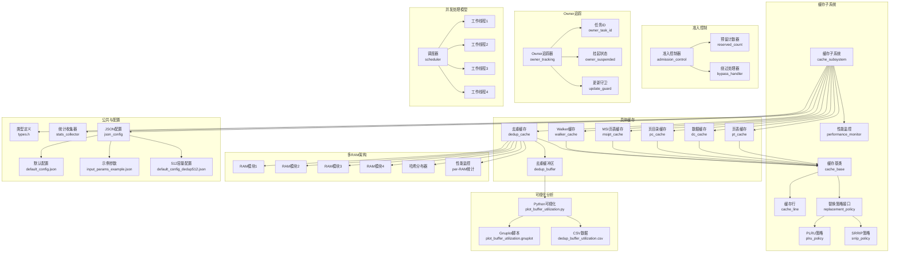

**图表来源**
- [cache_subsystem.h](file://iommu/cache_src/subsystem/cache_subsystem.h)
- [cache_subsystem.cpp](file://iommu/cache_src/subsystem/cache_subsystem.cpp)
- [cache_base.h](file://iommu/cache_src/cache/cache_base.h)
- [cache_base.cpp](file://iommu/cache_src/cache/cache_base.cpp)
- [cache_line.h](file://iommu/cache_src/cache/cache_line.h)
- [replacement_policy.h](file://iommu/cache_src/replacement/replacement_policy.h)
- [plru_policy.h](file://iommu/cache_src/replacement/plru_policy.h)
- [srrip_policy.h](file://iommu/cache_src/replacement/srrip_policy.h)
- [pt_cache.h](file://iommu/cache_src/cache/pt_cache.h)
- [dc_cache.h](file://iommu/cache_src/cache/dc_cache.h)
- [pc_cache.h](file://iommu/cache_src/cache/pc_cache.h)
- [msipt_cache.h](file://iommu/cache_src/cache/msipt_cache.h)
- [walker_cache.h](file://iommu/cache_src/cache/walker_cache.h)
- [dedup_cache.h](file://iommu/cache_src/cache/dedup_cache.h)
- [dedup_buffer.h](file://iommu/cache_src/common/dedup_buffer.h)
- [types.h](file://iommu/cache_src/common/types.h)
- [stats_collector.h](file://iommu/cache_src/common/stats_collector.h)
- [json_config.h](file://iommu/cache_src/common/json_config.h)
- [default_config.json](file://iommu/cache_config/default_config.json)
- [default_config_dedup512.json](file://iommu/cache_config/default_config_dedup512.json)
- [plot_buffer_utilization.py](file://plot_buffer_utilization.py)
- [plot_buffer_utilization.gnuplot](file://plot_buffer_utilization.gnuplot)

## 核心组件
- 去重缓存（Dedup Cache）
  - 职责：对访问键（通常为虚拟地址或规范化后的请求标识）进行去重判断与结果缓存，避免重复的页表遍历或外部访存。
  - 关键特性：支持可配置的容量、替换策略、命中/未命中统计、失效与清理接口。
  - **更新** 现在采用多RAM架构，支持4个独立RAM模块并行处理，显著提升并发性能。
  - **更新** 新增owner追踪功能，记录主任务的task_id和挂起状态，确保多设备场景下的数据一致性。
  - **更新** 支持两种容量配置：标准256 cachelines和扩展512 cachelines。
  - **更新** 新增每RAM统计收集功能，支持按RAM维度跟踪任务计数、命中率、忙时等关键指标。
- 去重缓冲区（Dedup Buffer）
  - 职责：管理等待PTW完成的任务链表，提供高效的缓冲管理机制。
  - **更新** 时间加权平均占用率跟踪：通过occupancy_integral_字段记录缓冲区占用的时间积分。
- 缓存基类（Cache Base）
  - 职责：封装通用缓存行为（查找、插入、淘汰、统计、线程安全等），派生类只需关注键值语义与匹配规则。
- 缓存行（Cache Line）
  - 职责：定义缓存条目最小单元的数据结构与元信息（如有效位、访问时间戳、引用计数等）。
  - **更新** 新增owner_task_id和owner_suspended字段，用于追踪主任务身份和状态。
- 替换策略（Replacement Policy）
  - 职责：定义淘汰候选选择策略，提供统一接口；常见实现包括PLRU与SRRIP。
- 缓存子系统（Cache Subsystem）
  - 职责：统一管理所有缓存实例的生命周期、配置注入、统计聚合与对外暴露的查询接口。
  - **更新** 支持多RAM架构的统一管理和调度，新增准入控制机制和foreign group更新保护。
  - **更新** 新增每RAM统计透传接口，支持访问去重缓存的采样数据和分布分析结果。
- 性能监控（Performance Monitor）
  - 职责：专门针对去重调度线程的性能监控，包括执行延迟统计、任务计数和报告生成。
  - **更新** 新增print_dedup_multi_ram_report()函数，提供详细的每RAM统计报告和分布分析。
- 公共工具与配置
  - 类型定义：统一数值宽度、枚举与常量。
  - 统计收集器：记录命中率、未命中率、淘汰次数、延迟分布等指标。
  - JSON配置：从配置文件加载缓存参数（容量、策略、阈值等）。
  - **更新** 支持双容量配置：标准256 cachelines和扩展512 cachelines。
- **新增** 可视化分析工具
  - Python脚本：提供缓冲区利用率数据的ASCII图表和PNG图表生成
  - Gnuplot脚本：提供备用的高分辨率图表生成方案
  - CSV数据格式：标准化的缓冲区使用数据记录格式

**更新** 新增的多RAM架构、scheduler-hash-worker并发处理模型以及时间加权平均占用率跟踪功能进一步增强了去重缓存的处理能力和性能表现。**新增的owner追踪机制和foreign group更新保护提供了更强的多设备场景安全性保障。** **新增的准入控制机制和哈希冲突绕过系统提供了更强的稳定性保障。** **新增的512容量配置选项为高负载场景提供了更好的性能表现和更低的hash冲突率。** **新增的每RAM统计收集和push-sampled occupancy metrics为多RAM配置提供了更精细的性能监控和分析能力。**

## 架构总览
下图展示了去重缓存与其他缓存及子系统之间的交互关系，以及配置与统计的支撑链路。

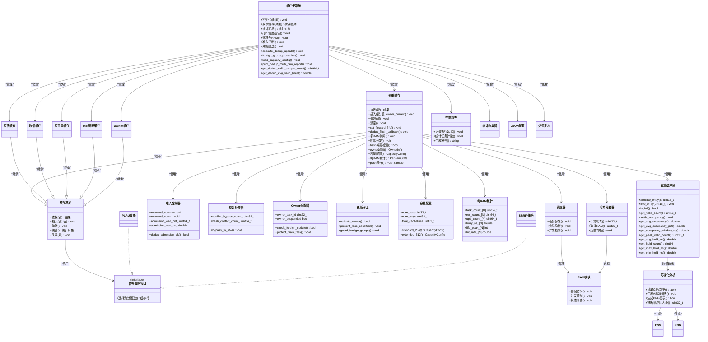

**图表来源**
- [cache_base.h](file://iommu/cache_src/cache/cache_base.h)
- [cache_base.cpp](file://iommu/cache_src/cache/cache_base.cpp)
- [dedup_cache.h](file://iommu/cache_src/cache/dedup_cache.h)
- [dedup_cache.cpp](file://iommu/cache_src/cache/dedup_cache.cpp)
- [dedup_buffer.h](file://iommu/cache_src/common/dedup_buffer.h)
- [cache_subsystem.h](file://iommu/cache_src/subsystem/cache_subsystem.h)
- [cache_subsystem.cpp](file://iommu/cache_src/subsystem/cache_subsystem.cpp)
- [pt_cache.h](file://iommu/cache_src/cache/pt_cache.h)
- [dc_cache.h](file://iommu/cache_src/cache/dc_cache.h)
- [pc_cache.h](file://iommu/cache_src/cache/pc_cache.h)
- [msipt_cache.h](file://iommu/cache_src/cache/msipt_cache.h)
- [walker_cache.h](file://iommu/cache_src/cache/walker_cache.h)
- [replacement_policy.h](file://iommu/cache_src/replacement/replacement_policy.h)
- [plru_policy.h](file://iommu/cache_src/replacement/plru_policy.h)
- [srrip_policy.h](file://iommu/cache_src/replacement/srrip_policy.h)
- [stats_collector.h](file://iommu/cache_src/common/stats_collector.h)
- [json_config.h](file://iommu/cache_src/common/json_config.h)
- [types.h](file://iommu/cache_src/common/types.h)
- [plot_buffer_utilization.py](file://plot_buffer_utilization.py)

## 详细组件分析

### 去重缓存（Dedup Cache）
- 设计要点
  - 键空间：通常基于虚拟地址或规范化后的请求标识，确保相同语义的请求映射到同一键。
  - 命中判定：若命中则直接返回缓存结果，跳过后续昂贵的页表遍历或访存。
  - 写入与失效：当底层状态变化（如页表项更新、TLB失效）时，需及时失效对应键，保证一致性。
  - 统计与观测：记录命中/未命中、淘汰、失效次数，便于定位热点与调优。
  - **更新** 现在支持多RAM架构，通过哈希分发实现负载均衡和并行访问。
  - **更新** 新增哈希冲突检测机制，当所有way都包含主请求占位符时触发绕过处理。
  - **更新** 新增owner追踪功能，记录主任务的task_id和挂起状态，确保多设备场景下的数据一致性。
  - **更新** 支持双容量配置：标准256 cachelines（num_sets=64）和扩展512 cachelines（num_sets=128）。
  - **更新** 新增每RAM统计收集功能，支持按RAM维度跟踪任务计数、命中率、忙时等关键指标。
  - **更新** 新增push-sampled occupancy metrics，提供精确的缓冲区占用率采样。
- 典型流程
  - 查找：根据键检索缓存，命中则返回结果；未命中则交由上层执行实际访问，并将结果回填。
  - 插入：将新结果按策略放入缓存，必要时触发淘汰。
  - 失效：针对特定键或范围进行失效，保障一致性。
  - **更新** 多RAM访问：通过哈希函数确定目标RAM模块，实现并行访问。
  - **更新** 冲突绕过：当检测到hash冲突时，直接将任务路由到PTW处理。
  - **更新** Owner追踪：在插入时记录owner_task_id和owner_suspended状态。
  - **更新** 容量适配：根据配置自动调整缓存容量和哈希分布。
  - **更新** 每RAM统计：在每次lookup时采样当前有效cacheline占用数，维护每RAM的统计信息。
- 复杂度与性能
  - 查找与插入通常为O(1)或O(log N)，取决于底层容器与策略实现。
  - 淘汰操作受策略影响，PLRU/SRRIP一般常数时间或近似常数时间。
  - **更新** 多RAM架构显著提升了并发性能和吞吐量。
  - **更新** 冲突绕过机制避免了死锁和缓冲区溢出风险。
  - **更新** Owner追踪机制增加了轻微的计算开销，但提供了重要的安全性保障。
  - **更新** 512容量配置在高负载场景下提供更低的hash冲突率和更高的命中率。
  - **更新** 每RAM统计收集的开销极低，仅在lookup时进行轻量级采样。
- 错误处理
  - 空键/非法键校验、并发冲突保护、统计溢出防护等。

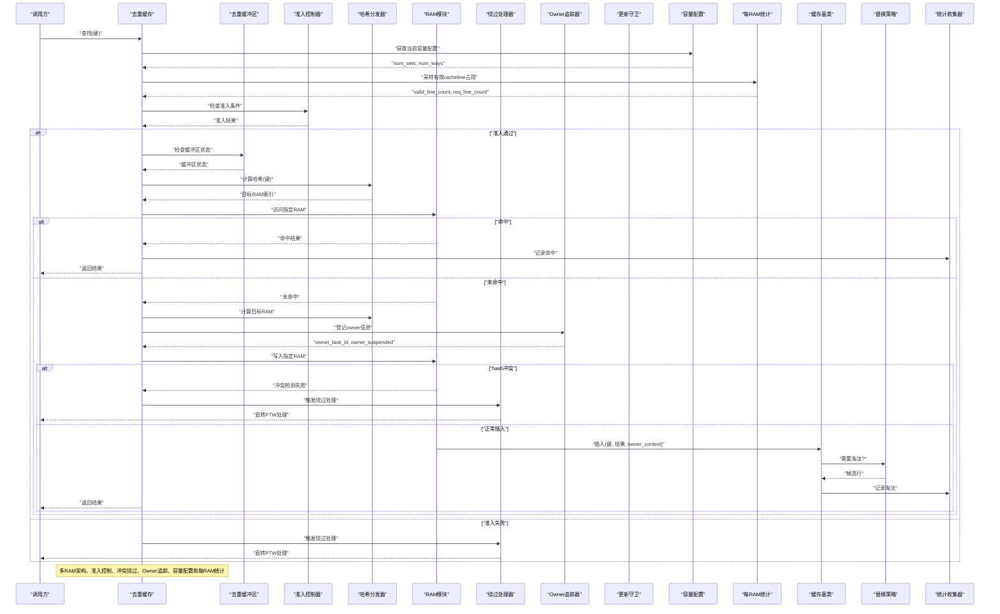

**图表来源**
- [dedup_cache.h](file://iommu/cache_src/cache/dedup_cache.h)
- [dedup_cache.cpp](file://iommu/cache_src/cache/dedup_cache.cpp)
- [dedup_buffer.h](file://iommu/cache_src/common/dedup_buffer.h)
- [cache_subsystem.h](file://iommu/cache_src/subsystem/cache_subsystem.h)
- [cache_subsystem.cpp](file://iommu/cache_src/subsystem/cache_subsystem.cpp)
- [cache_base.h](file://iommu/cache_src/cache/cache_base.h)
- [cache_base.cpp](file://iommu/cache_src/cache/cache_base.cpp)
- [replacement_policy.h](file://iommu/cache_src/replacement/replacement_policy.h)
- [plru_policy.h](file://iommu/cache_src/replacement/plru_policy.h)
- [srrip_policy.h](file://iommu/cache_src/replacement/srrip_policy.h)
- [stats_collector.h](file://iommu/cache_src/common/stats_collector.h)

**章节来源**
- [dedup_cache.h](file://iommu/cache_src/cache/dedup_cache.h)
- [dedup_cache.cpp](file://iommu/cache_src/cache/dedup_cache.cpp)
- [dedup_buffer.h](file://iommu/cache_src/common/dedup_buffer.h)
- [cache_subsystem.h](file://iommu/cache_src/subsystem/cache_subsystem.h)
- [cache_subsystem.cpp](file://iommu/cache_src/subsystem/cache_subsystem.cpp)
- [cache_base.h](file://iommu/cache_src/cache/cache_base.h)
- [cache_base.cpp](file://iommu/cache_src/cache/cache_base.cpp)
- [replacement_policy.h](file://iommu/cache_src/replacement/replacement_policy.h)
- [plru_policy.h](file://iommu/cache_src/replacement/plru_policy.h)
- [srrip_policy.h](file://iommu/cache_src/replacement/srrip_policy.h)
- [stats_collector.h](file://iommu/cache_src/common/stats_collector.h)

### 去重缓冲区（Dedup Buffer）
- 设计要点
  - 任务管理：管理等待PTW完成的任务链表，支持顺序分配和链表挂接。
  - 内存优化：使用紧凑的数据结构，减少内存占用。
  - **更新** 时间加权平均占用率跟踪：通过occupancy_integral_字段记录缓冲区占用的时间积分。
  - **更新** 精确的占用率统计：提供get_avg_occupancy()、get_avg_occupancy_pct()等方法。
- 核心功能
  - allocate_entry()：分配Entry，按顺序线性查找第一个空闲位置。
  - free_entry()：释放Entry，记录持有延时并通知反压等待者。
  - settle_occupancy()：**新增** 结算时间加权占用积分，在valid_count变化前调用。
  - get_avg_occupancy()：**新增** 获取时间加权平均占用率。
  - get_avg_occupancy_pct()：**新增** 获取占用率百分比。
  - get_occupancy_window_ns()：**新增** 获取占用统计窗口时长。
  - get_peak_valid_count()：**新增** 获取峰值有效Entry数量。
  - get_avg_hold_ns()：**新增** 获取平均持有延时。
  - get_hold_count()：**新增** 获取持有次数统计。
  - get_max_hold_ns()/get_min_hold_ns()：**新增** 获取最大/最小持有延时。
- 统计特性
  - valid_count：当前有效Entry数量。
  - peak_valid_count：峰值有效Entry数量。
  - total_hold_ns：总持有延时。
  - hold_count：持有次数。
  - max_hold_ns/min_hold_ns：最大/最小持有延时。
  - occupancy_integral_：**新增** 时间加权占用积分。
  - first_change_ns_/last_change_ns_：**新增** 首次/上次变化时刻。

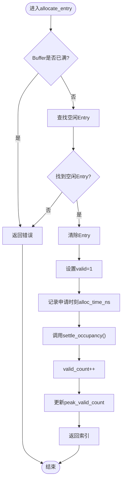

**图表来源**
- [dedup_buffer.h:92-113](file://iommu/cache_src/common/dedup_buffer.h#L92-L113)

**章节来源**
- [dedup_buffer.h:20-177](file://iommu/cache_src/common/dedup_buffer.h#L20-L177)

### 缓存基类与缓存行
- 缓存基类
  - 提供统一的查找、插入、淘汰、失效、统计接口。
  - 内部维护缓存集合、锁机制（如需）、策略对象指针、统计器引用。
- 缓存行
  - 存储键、值、元信息（有效位、最近使用时间、引用计数等）。
  - 作为替换策略的选择单位。
  - **更新** 新增owner_task_id和owner_suspended字段，用于追踪主任务身份和状态。

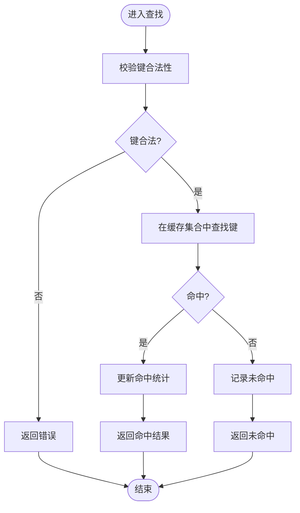

**图表来源**
- [cache_base.h](file://iommu/cache_src/cache/cache_base.h)
- [cache_base.cpp](file://iommu/cache_src/cache/cache_base.cpp)
- [cache_line.h](file://iommu/cache_src/cache/cache_line.h)

**章节来源**
- [cache_base.h](file://iommu/cache_src/cache/cache_base.h)
- [cache_base.cpp](file://iommu/cache_src/cache/cache_base.cpp)
- [cache_line.h](file://iommu/cache_src/cache/cache_line.h)

### 替换策略（PLRU与SRRIP）
- 接口抽象
  - 提供统一的"选择淘汰候选"方法，由具体策略实现。
- 策略特点
  - PLRU：基于伪最近最少使用树结构，适合硬件友好实现，近似LRU效果。
  - SRRIP：基于扫描式随机替换改进策略，兼顾公平性与实现成本。

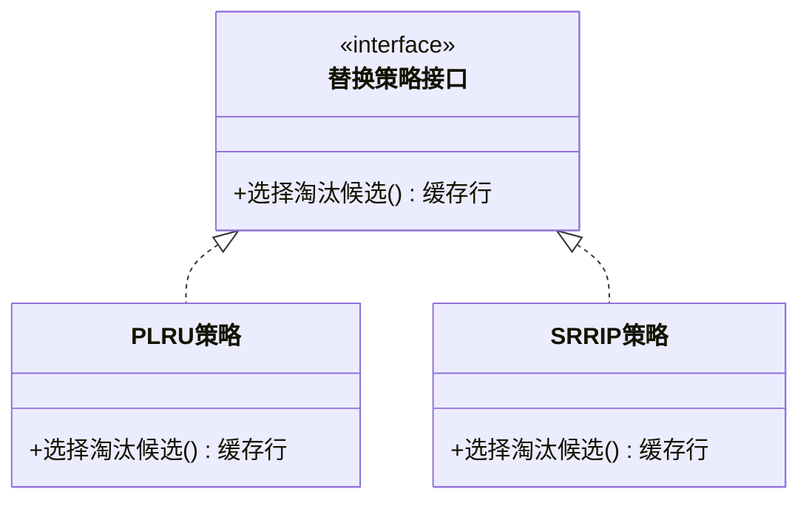

**图表来源**
- [replacement_policy.h](file://iommu/cache_src/replacement/replacement_policy.h)
- [plru_policy.h](file://iommu/cache_src/replacement/plru_policy.h)
- [srrip_policy.h](file://iommu/cache_src/replacement/srrip_policy.h)

**章节来源**
- [replacement_policy.h](file://iommu/cache_src/replacement/replacement_policy.h)
- [plru_policy.h](file://iommu/cache_src/replacement/plru_policy.h)
- [srrip_policy.h](file://iommu/cache_src/replacement/srrip_policy.h)

### 缓存子系统与配置
- 缓存子系统
  - 负责创建与管理各缓存实例（含去重缓存），注入配置与统计器，提供统一查询入口。
  - **更新** 支持多RAM架构的统一管理和调度，新增准入控制机制和foreign group更新保护。
  - **更新** 支持双容量配置加载，可根据运行时需求选择256或512 cachelines。
  - **更新** 新增每RAM统计透传接口，支持访问去重缓存的采样数据和分布分析结果。
  - **更新** 新增print_dedup_multi_ram_report()函数，提供详细的每RAM统计报告。
- 配置加载
  - 通过JSON配置指定各缓存的容量、策略、阈值等参数。
  - 示例参数文件便于快速验证与回归测试。
  - **更新** 去重缓存配置优化为64 sets × 4 ways（256 cachelines），并提供512 cachelines扩展配置。
  - **更新** 新增default_config_dedup512.json，提供128 sets × 4 ways = 512 cachelines配置。

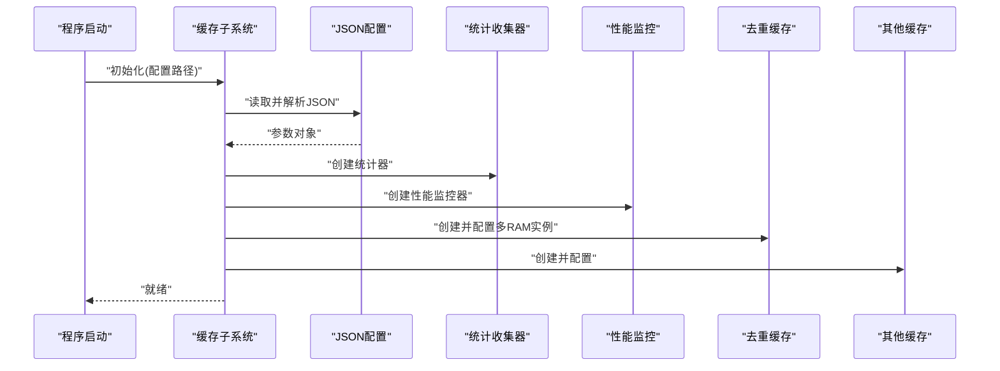

**图表来源**
- [cache_subsystem.h](file://iommu/cache_src/subsystem/cache_subsystem.h)
- [cache_subsystem.cpp](file://iommu/cache_src/subsystem/cache_subsystem.cpp)
- [json_config.h](file://iommu/cache_src/common/json_config.h)
- [default_config.json](file://iommu/cache_config/default_config.json)
- [default_config_dedup512.json](file://iommu/cache_config/default_config_dedup512.json)
- [stats_collector.h](file://iommu/cache_src/common/stats_collector.h)
- [dedup_cache.h](file://iommu/cache_src/cache/dedup_cache.h)

**章节来源**
- [cache_subsystem.h](file://iommu/cache_src/subsystem/cache_subsystem.h)
- [cache_subsystem.cpp](file://iommu/cache_src/subsystem/cache_subsystem.cpp)
- [json_config.h](file://iommu/cache_src/common/json_config.h)
- [default_config.json](file://iommu/cache_config/default_config.json)
- [default_config_dedup512.json](file://iommu/cache_config/default_config_dedup512.json)
- [stats_collector.h](file://iommu/cache_src/common/stats_collector.h)
- [dedup_cache.h](file://iommu/cache_src/cache/dedup_cache.h)

### 与其他缓存的协作
- 页表缓存（PT Cache）
  - 与去重缓存协同，前者缓存页表项，后者在更高层面对访问键去重，减少重复PTW。
- 数据缓存（DC Cache）
  - 面向数据访问路径，与去重缓存解耦但共享统计与配置框架。
- 页目录缓存（PC Cache）
  - 缓存页目录项，配合PT Cache加速多级页表遍历。
- MSI页表缓存（MSIPT Cache）
  - 针对MSI相关页表路径优化。
- Walker缓存（Walker Cache）
  - 缓存Walker中间状态，减少重复Walker工作。

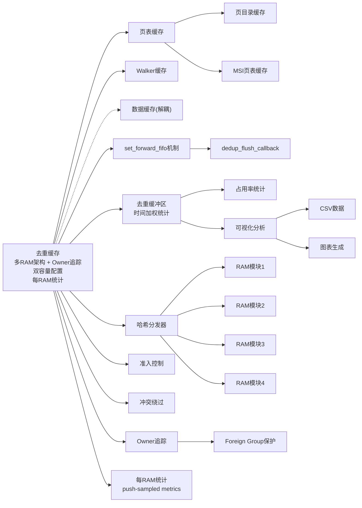

**图表来源**
- [dedup_cache.h](file://iommu/cache_src/cache/dedup_cache.h)
- [dedup_buffer.h](file://iommu/cache_src/common/dedup_buffer.h)
- [cache_subsystem.h](file://iommu/cache_src/subsystem/cache_subsystem.h)
- [cache_subsystem.cpp](file://iommu/cache_src/subsystem/cache_subsystem.cpp)
- [pt_cache.h](file://iommu/cache_src/cache/pt_cache.h)
- [walker_cache.h](file://iommu/cache_src/cache/walker_cache.h)
- [pc_cache.h](file://iommu/cache_src/cache/pc_cache.h)
- [msipt_cache.h](file://iommu/cache_src/cache/msipt_cache.h)
- [dc_cache.h](file://iommu/cache_src/cache/dc_cache.h)
- [plot_buffer_utilization.py](file://plot_buffer_utilization.py)

**章节来源**
- [dedup_cache.h](file://iommu/cache_src/cache/dedup_cache.h)
- [dedup_buffer.h](file://iommu/cache_src/common/dedup_buffer.h)
- [cache_subsystem.h](file://iommu/cache_src/subsystem/cache_subsystem.h)
- [cache_subsystem.cpp](file://iommu/cache_src/subsystem/cache_subsystem.cpp)
- [pt_cache.h](file://iommu/cache_src/cache/pt_cache.h)
- [walker_cache.h](file://iommu/cache_src/cache/walker_cache.h)
- [pc_cache.h](file://iommu/cache_src/cache/pc_cache.h)
- [msipt_cache.h](file://iommu/cache_src/cache/msipt_cache.h)
- [dc_cache.h](file://iommu/cache_src/cache/dc_cache.h)

## 多RAM架构设计

### 架构概述
去重缓存现在采用了多RAM架构设计，通过4个独立的RAM模块实现并行处理和负载均衡。这种设计显著提升了系统的吞吐量和响应性能。

### 核心特性
- **并行访问**：4个RAM模块可以同时处理不同的去重请求，提高并发性能
- **负载均衡**：基于哈希函数的智能分发，确保各RAM模块负载均匀
- **内存隔离**：每个RAM模块独立管理自己的缓存数据，减少竞争
- **扩展性**：架构支持未来扩展到更多RAM模块
- **Owner追踪**：每个RAM模块支持owner信息的独立追踪和管理
- **容量适配**：支持256和512 cachelines两种容量配置
- **每RAM统计**：新增每RAM维度的任务计数、命中率、忙时等统计收集
- **Push采样**：支持push-sampled occupancy metrics，提供精确的占用率采样

### 哈希分发机制
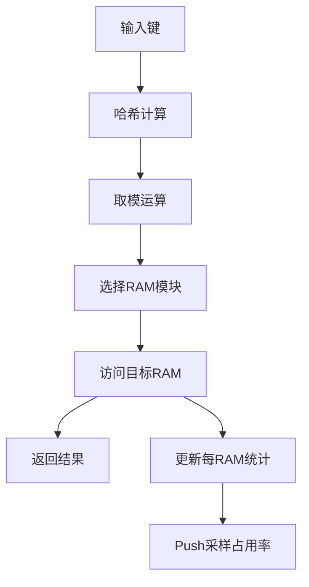

**图表来源**
- [dedup_cache.h](file://iommu/cache_src/cache/dedup_cache.h)
- [dedup_cache.cpp](file://iommu/cache_src/cache/dedup_cache.cpp)

**章节来源**
- [dedup_cache.h](file://iommu/cache_src/cache/dedup_cache.h)
- [dedup_cache.cpp](file://iommu/cache_src/cache/dedup_cache.cpp)

## 准入控制机制

### 机制概述
新增的准入控制机制通过TEST_CFG_DEDUP_ADMISSION_CTRL编译时标志控制，防止缓冲区溢出通过基于预留的方法。该机制在scheduler从request_fifo出队时预占一个未来的Buffer槽位，确保系统不会因缓冲区满而陷入死锁。

### 核心特性
- **预留机制**：scheduler从request_fifo出队时立即增加reserved_count，worker allocate成功后减少
- **准入判定**：通过dedup_admission_ok()函数检查valid_count + reserved_count < PT_DEDUP_BUFFER_SIZE
- **反压处理**：当准入条件不满足时，scheduler跳过request出队，形成反压积压
- **统计监控**：记录准入等待次数(dedup_admission_wait_cnt_)和累计时长(dedup_admission_wait_ns_)

### 工作流程
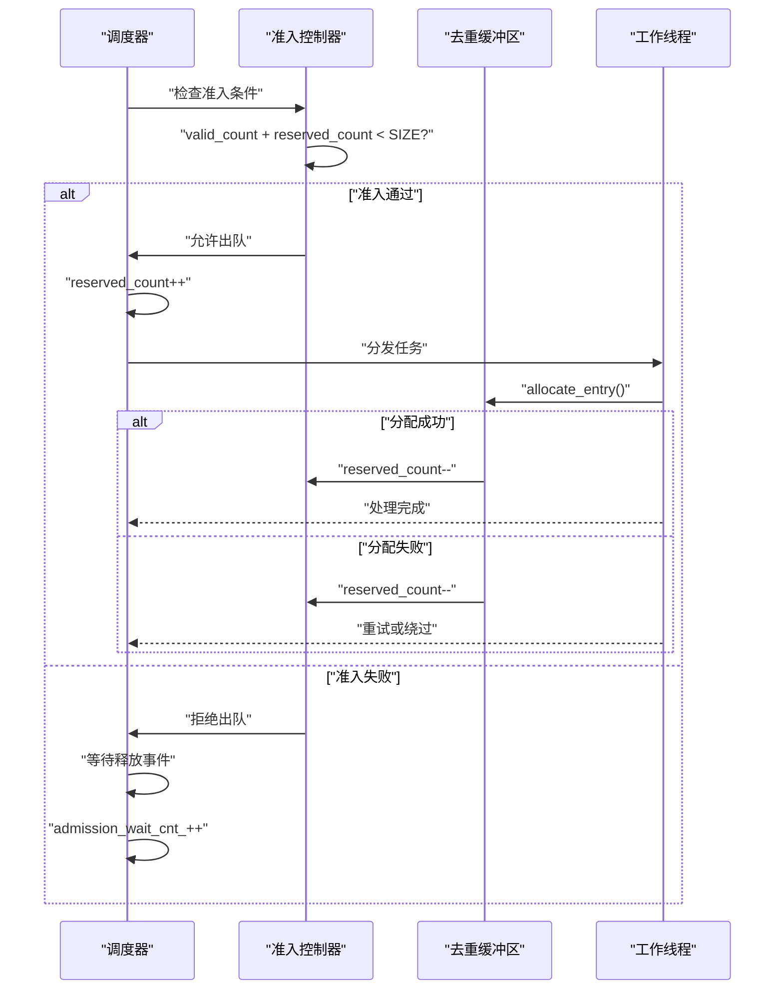

**图表来源**
- [cache_subsystem.h](file://iommu/cache_src/subsystem/cache_subsystem.h)
- [cache_subsystem.cpp](file://iommu/cache_src/subsystem/cache_subsystem.cpp)

**章节来源**
- [cache_subsystem.h](file://iommu/cache_src/subsystem/cache_subsystem.h)
- [cache_subsystem.cpp](file://iommu/cache_src/subsystem/cache_subsystem.cpp)

## 哈希冲突绕过系统

### 系统概述
哈希冲突绕过系统检测去重缓存中的hash冲突情况，当所有way都包含主请求占位符时，直接将任务路由到PTW处理，避免死锁和性能退化。

### 核心特性
- **冲突检测**：通过set_has_writable_way()函数检测目标set是否还有可写位置
- **绕过处理**：当检测到冲突时，调用bypass_to_ptw()直接将任务转发到PTW
- **统计监控**：记录冲突次数(dedup_hash_conflict_count_)和绕过任务数(dedup_conflict_bypass_count_)
- **预取保护**：预取占位可以被替换，主请求占位受到保护不可替换
- **容量优化**：512 cachelines配置显著降低hash冲突率

### 冲突处理流程
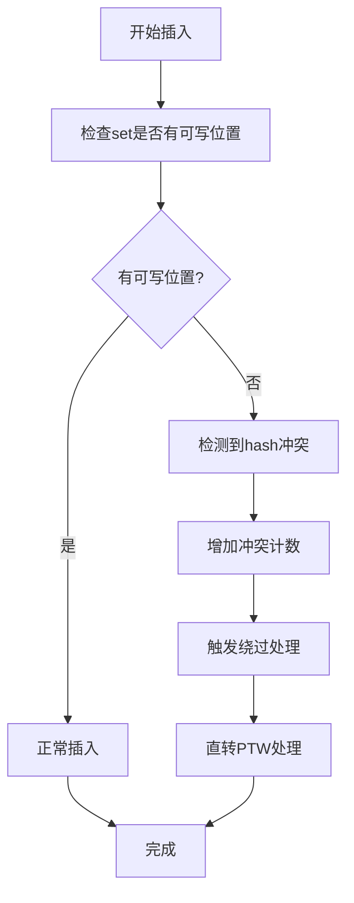

**图表来源**
- [dedup_cache.h](file://iommu/cache_src/cache/dedup_cache.h)
- [dedup_cache.cpp](file://iommu/cache_src/cache/dedup_cache.cpp)
- [cache_subsystem.h](file://iommu/cache_src/subsystem/cache_subsystem.h)

**章节来源**
- [dedup_cache.h](file://iommu/cache_src/cache/dedup_cache.h)
- [dedup_cache.cpp](file://iommu/cache_src/cache/dedup_cache.cpp)
- [cache_subsystem.h](file://iommu/cache_src/subsystem/cache_subsystem.h)

## Owner追踪与竞态防护

### 机制概述
新增的owner追踪机制通过owner_task_id和owner_suspended字段解决多设备场景下的竞态条件问题。该机制确保在主任务正在进行PTW行走时，只有其所属的group能够flush对应的buffer链，防止use-after-free错误。

### 核心特性
- **Owner身份追踪**：通过owner_task_id记录发起主任务的唯一标识符
- **挂起状态管理**：通过owner_suspended区分"正在PTW行走"和"挂起等待"两种状态
- **Foreign Group保护**：阻止非owner组的update提前flush，避免use-after-free
- **竞态条件防护**：确保buffer链的释放时机正确，防止悬垂指针访问

### 工作流程
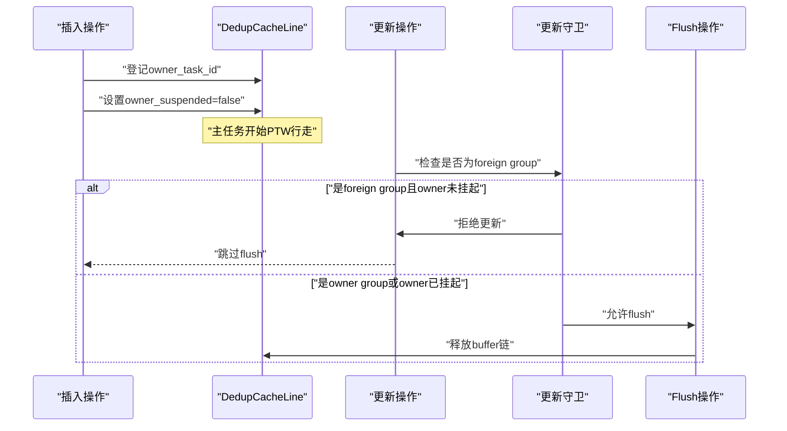

**图表来源**
- [dedup_cache.h:24-31](file://iommu/cache_src/cache/dedup_cache.h#L24-L31)
- [cache_subsystem.cpp:2614-2628](file://iommu/cache_src/subsystem/cache_subsystem.cpp#L2614-L2628)

### 竞态条件场景
在多设备环境中，可能出现以下竞态条件：
1. **Fresh MISS场景**：主任务正在PTW行走，可能已建立预取组
2. **Foreign Group Update**：其他组的预取结果update到达，尝试flush同页的buffer
3. **Use-after-Free风险**：如果foreign group提前flush，会释放仍在使用的task对象

### 防护措施
- **Fresh MISS保护**：owner_suspended=false时，只有owner_task_id匹配的group才能flush
- **Suspended状态**：owner_suspended=true时，表示owner挂起等待，任意group都可flush
- **Foreign Group跳过**：非owner组的update被跳过，不flush也不clear占位

**章节来源**
- [dedup_cache.h:24-31](file://iommu/cache_src/cache/dedup_cache.h#L24-L31)
- [dedup_cache.h:67-71](file://iommu/cache_src/cache/dedup_cache.h#L67-L71)
- [dedup_cache.cpp:105-107](file://iommu/cache_src/cache/dedup_cache.cpp#L105-L107)
- [cache_subsystem.cpp:2614-2628](file://iommu/cache_src/subsystem/cache_subsystem.cpp#L2614-L2628)

## 并发处理模型

### Scheduler-Hash-Worker模型
系统实现了scheduler-hash-worker并发处理模型，通过调度器、哈希分发器和多个工作线程的协作，实现高效的并发处理。

### 工作流程
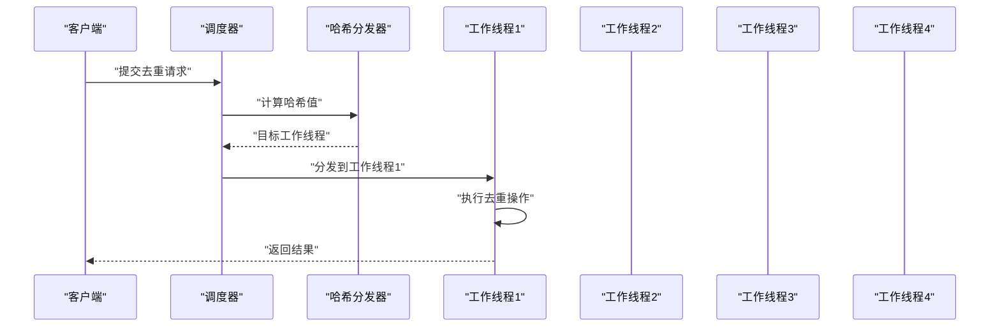

### 并发控制
- **线程安全**：每个工作线程独立处理请求，避免锁竞争
- **负载均衡**：哈希分发确保请求均匀分布到各个工作线程
- **资源隔离**：每个工作线程拥有独立的RAM模块访问权限
- **Owner追踪隔离**：每个工作线程独立管理owner信息，避免跨线程竞态
- **每RAM统计隔离**：每个工作线程独立维护自己的统计信息

**图表来源**
- [cache_subsystem.h](file://iommu/cache_src/subsystem/cache_subsystem.h)
- [cache_subsystem.cpp](file://iommu/cache_src/subsystem/cache_subsystem.cpp)

**章节来源**
- [cache_subsystem.h](file://iommu/cache_src/subsystem/cache_subsystem.h)
- [cache_subsystem.cpp](file://iommu/cache_src/subsystem/cache_subsystem.cpp)

## 性能监控与统计

### 去重调度线程性能监控
**更新** 系统现在提供了完整的去重调度线程性能监控能力，包括以下关键特性：

- **执行延迟统计**
  - 记录每次去重操作的执行延迟，支持平均值、最大值、最小值统计
  - 提供延迟分布分析，帮助识别性能瓶颈
- **任务计数统计**
  - 跟踪去重请求总数（dedup_req_count_）
  - 统计去重更新操作次数（dedup_upd_count_）
  - 记录命中与未命中的详细计数
- **报告生成能力**
  - 实现print_dedup_scheduler_report()函数用于生成详细性能报告
  - 支持在运行时输出当前统计状态
  - 报告内容包括延迟统计、任务计数、命中率等关键指标
- **更新** 新增的多RAM架构和并发处理模型提升了处理效率
- **更新** 新增准入控制和冲突绕过的统计监控
- **更新** 新增owner追踪和foreign group保护的统计信息
- **更新** 新增容量配置的性能监控，支持256和512 cachelines对比
- **更新** 新增每RAM统计收集和分布分析能力

### 每RAM统计收集与分布分析
**新增** 系统现在支持每RAM维度的统计收集与分布分析，提供以下关键功能：

- **Per-RAM任务计数**
  - dedup_ram_task_count_[N]：每个RAM模块的任务总数
  - dedup_ram_req_count_[N]：每个RAM模块的主任务请求数
  - dedup_ram_upd_count_[N]：每个RAM模块的更新操作数
  - dedup_ram_prefetch_count_[N]：每个RAM模块的预取操作数
- **Per-RAM性能指标**
  - dedup_ram_busy_ns_[N]：每个RAM模块的忙时统计
  - dedup_ram_fifo_peak_[N]：每个RAM模块的FIFO峰值占用
  - per-RAM命中率：每个RAM模块的命中率统计
- **分布均衡度分析**
  - 卡方检验（Chi²）：评估请求在各RAM间的分布均衡性
  - 不平衡度指标：Max/Min比值和Imbalance百分比
  - 数据流量分析：仅数据包（is_ctrl_pkt=false）的分布统计

### Push-Sampled Occupancy Metrics
**新增** 系统现在支持push-sampled occupancy metrics，提供精确的缓冲区占用率采样：

- **采样机制**
  - 每次dedup lookup时采样当前有效cacheline占用数
  - sample_count_：采样次数统计
  - sample_valid_sum_：有效cacheline占用总和
  - sample_req_sum_：主请求cacheline占用总和
- **统计指标**
  - avg_valid_lines()：平均有效cacheline占用数
  - avg_req_lines()：平均主请求cacheline占用数
  - max_valid_lines()：峰值有效cacheline占用数
  - min_valid_lines()：谷值有效cacheline占用数
- **时间窗口管理**
  - 支持reset_valid_line_stats()重置测量窗口
  - 与子系统层的get_dedup_valid_sample_count()等接口集成

### 多RAM统计报告
**新增** print_dedup_multi_ram_report()函数提供详细的每RAM统计报告：

- **Hash单元统计**
  - Tasks hashed：哈希处理的总任务数
  - Busy time：哈希单元的忙时统计
  - Backpressure count/time：反压次数和时长
- **Per-RAM Workers统计**
  - 每个RAM模块的任务数、请求数、更新数、预取数
  - 忙时统计和利用率百分比
  - FIFO峰值占用
- **预取丢弃统计**
  - inside_fifo满导致的预取丢弃计数
- **Buffer Full Bypass统计**
  - 缓冲区满时绕过PTW的任务数
- **Hash Conflict Bypass统计**
  - 哈希冲突检测和绕过处理计数
- **去重Cache命中率**
  - 总查询、命中、未命中统计
  - 主任务去重请求的命中率
- **Valid Cacheline Occupancy统计**
  - 总lines数、采样次数、平均有效lines数
  - 峰值/谷值有效lines数
  - 平均主请求lines数

### 监控数据流
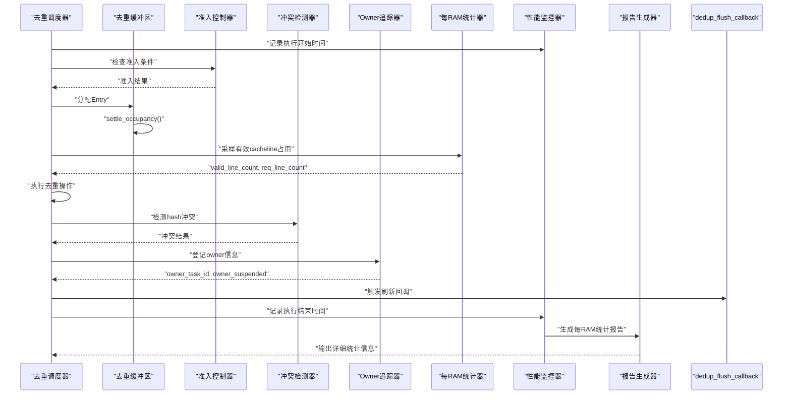

**图表来源**
- [cache_subsystem.h](file://iommu/cache_src/subsystem/cache_subsystem.h)
- [cache_subsystem.cpp](file://iommu/cache_src/subsystem/cache_subsystem.cpp)
- [dedup_buffer.h](file://iommu/cache_src/common/dedup_buffer.h)
- [iommu_top.cc](file://iommu/iommu_top.cc)
- [dedup_cache.h](file://iommu/cache_src/cache/dedup_cache.h)

### 统计变量说明
- `dedup_req_count_`：去重请求总数计数器
- `dedup_upd_count_`：去重更新操作计数器  
- `dedup_hit_count_`：去重命中次数
- `dedup_miss_count_`：去重未命中次数
- `total_execution_time_`：总执行时间统计
- `avg_execution_time_`：平均执行时间统计
- **新增** `dedup_ram_task_count_[N]`：每RAM任务计数数组
- **新增** `dedup_ram_req_count_[N]`：每RAM请求计数数组
- **新增** `dedup_ram_upd_count_[N]`：每RAM更新计数数组
- **新增** `dedup_ram_busy_ns_[N]`：每RAM忙时统计数组
- **新增** `dedup_ram_fifo_peak_[N]`：每RAM FIFO峰值数组
- **新增** `sample_count_`：采样次数统计
- **新增** `sample_valid_sum_`：有效cacheline占用总和
- **新增** `sample_req_sum_`：主请求cacheline占用总和
- **新增** `sample_valid_max_`：峰值有效cacheline占用数
- **新增** `sample_valid_min_`：谷值有效cacheline占用数
- **新增** `dedup_hash_task_count_`：哈希任务计数
- **新增** `dedup_hash_busy_ns_`：哈希单元忙时
- **新增** `dedup_hash_backpressure_cnt_`：哈希反压计数
- **新增** `dedup_hash_backpressure_ns_`：哈希反压时长
- **新增** `dedup_prefetch_dropped_`：预取丢弃计数
- **新增** `dedup_buffer_full_bypass_count_`：缓冲区满绕过计数
- **新增** `delayed_upd_push_cnt_`：延迟更新推送计数
- **新增** `delayed_upd_push_occ_sum_`：延迟更新占用总和

**章节来源**
- [cache_subsystem.h](file://iommu/cache_src/subsystem/cache_subsystem.h)
- [cache_subsystem.cpp](file://iommu/cache_src/subsystem/cache_subsystem.cpp)
- [dedup_buffer.h](file://iommu/cache_src/common/dedup_buffer.h)
- [iommu_top.cc](file://iommu/iommu_top.cc)
- [dedup_cache.h](file://iommu/cache_src/cache/dedup_cache.h)
- [dedup_cache.cpp](file://iommu/cache_src/cache/dedup_cache.cpp)

## 缓冲区利用率可视化

### 可视化分析工具
**新增** 系统提供了完整的缓冲区利用率可视化工具链，支持多种格式的图表生成和数据导出：

#### Python可视化脚本
- **主要功能**：读取CSV数据并生成ASCII图表和PNG图表
- **数据源**：dedup_buffer_utilization.csv
- **输出格式**：ASCII文本图表、PNG图像文件、Gnuplot脚本
- **自动检测**：根据运行数据自动推断缓冲区大小

#### CSV数据格式
- **字段定义**：timestamp_ns（时间戳）、valid_count（有效计数）、utilization_pct（占用率百分比）、is_allocate（是否为分配事件）
- **数据粒度**：每次缓冲区分配操作记录一条数据
- **时间精度**：纳秒级时间戳，支持精确的时间序列分析

#### 图表生成能力
- **ASCII图表**：终端友好的文本图表，无需额外依赖
- **PNG图表**：高质量图像输出，支持matplotlib渲染
- **Gnuplot脚本**：备用的高分辨率图表生成方案
- **统计分析**：自动生成峰值、平均值、分布直方图等统计信息

### 自动缓冲区大小检测
**新增** 可视化系统具备自动缓冲区大小检测能力：

- **动态推断**：根据CSV数据中的最大valid_count值推断缓冲区大小
- **自适应缩放**：根据检测到的缓冲区大小自动调整图表Y轴范围
- **兼容性**：支持256、512等不同规模的缓冲区配置

### 数据分析流程
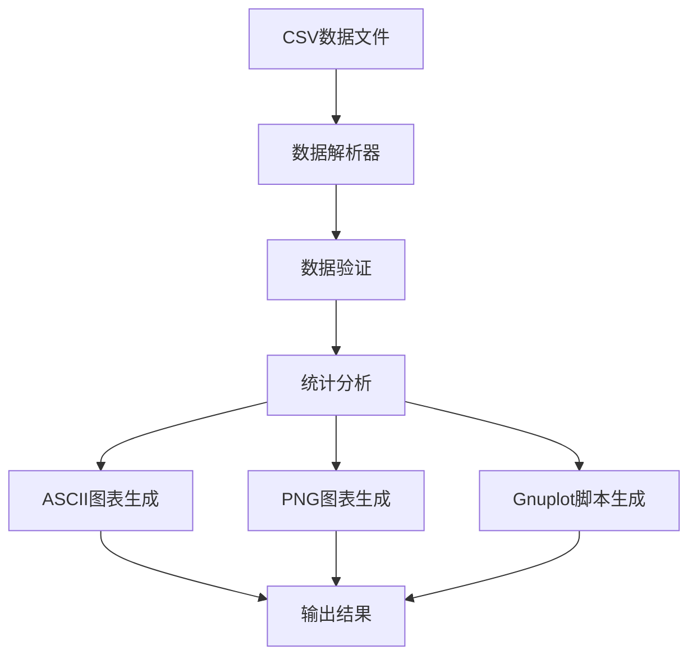

**图表来源**
- [plot_buffer_utilization.py](file://plot_buffer_utilization.py)
- [dedup_buffer_utilization.csv](file://dedup_buffer_utilization.csv)

### 使用示例
```bash
# 运行可视化分析
python3 plot_buffer_utilization.py

# 指定自定义CSV文件
python3 plot_buffer_utilization.py custom_data.csv

# 生成Gnuplot图表
gnuplot plot_buffer_utilization.gnuplot
```

**章节来源**
- [plot_buffer_utilization.py](file://plot_buffer_utilization.py)
- [plot_buffer_utilization.gnuplot](file://plot_buffer_utilization.gnuplot)
- [dedup_buffer_utilization.csv](file://dedup_buffer_utilization.csv)

## 依赖关系分析
- 组件耦合
  - 去重缓存依赖缓存基类与替换策略接口，低耦合高内聚。
  - 缓存子系统集中管理各缓存实例，向上提供统一接口。
  - **更新** 性能监控组件独立于核心缓存逻辑，通过接口与子系统集成。
- 外部依赖
  - JSON配置用于动态参数化。
  - 统计收集器用于观测与诊断。
  - **更新** 报告生成器用于性能分析和调试。
  - **新增** 可视化分析工具用于缓冲区使用模式分析。
  - **新增** 配置管理工具用于容量配置生成和验证。
  - **新增** 每RAM统计收集器用于多RAM配置的性能监控。
- 潜在循环依赖
  - 通过接口抽象与子系统编排避免循环依赖。

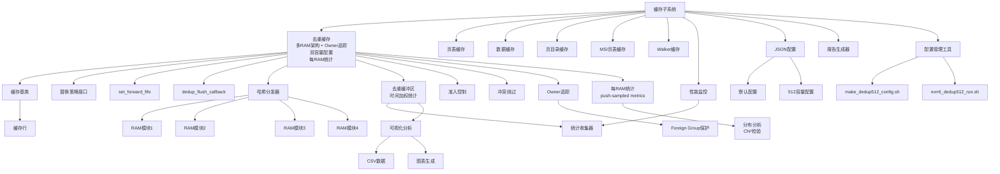

**图表来源**
- [dedup_cache.h](file://iommu/cache_src/cache/dedup_cache.h)
- [cache_base.h](file://iommu/cache_src/cache/cache_base.h)
- [cache_line.h](file://iommu/cache_src/cache/cache_line.h)
- [replacement_policy.h](file://iommu/cache_src/replacement/replacement_policy.h)
- [cache_subsystem.h](file://iommu/cache_src/subsystem/cache_subsystem.h)
- [pt_cache.h](file://iommu/cache_src/cache/pt_cache.h)
- [dc_cache.h](file://iommu/cache_src/cache/dc_cache.h)
- [pc_cache.h](file://iommu/cache_src/cache/pc_cache.h)
- [msipt_cache.h](file://iommu/cache_src/cache/msipt_cache.h)
- [walker_cache.h](file://iommu/cache_src/cache/walker_cache.h)
- [json_config.h](file://iommu/cache_src/common/json_config.h)
- [stats_collector.h](file://iommu/cache_src/common/stats_collector.h)
- [dedup_buffer.h](file://iommu/cache_src/common/dedup_buffer.h)
- [plot_buffer_utilization.py](file://plot_buffer_utilization.py)
- [make_dedup512_config.sh](file://tmp/make_dedup512_config.sh)
- [nvrr6_dedup512_run.sh](file://tmp/nvrr6_dedup512_run.sh)

**章节来源**
- [dedup_cache.h](file://iommu/cache_src/cache/dedup_cache.h)
- [cache_base.h](file://iommu/cache_src/cache/cache_base.h)
- [cache_line.h](file://iommu/cache_src/cache/cache_line.h)
- [replacement_policy.h](file://iommu/cache_src/replacement/replacement_policy.h)
- [cache_subsystem.h](file://iommu/cache_src/subsystem/cache_subsystem.h)
- [pt_cache.h](file://iommu/cache_src/cache/pt_cache.h)
- [dc_cache.h](file://iommu/cache_src/cache/dc_cache.h)
- [pc_cache.h](file://iommu/cache_src/cache/pc_cache.h)
- [msipt_cache.h](file://iommu/cache_src/cache/msipt_cache.h)
- [walker_cache.h](file://iommu/cache_src/cache/walker_cache.h)
- [json_config.h](file://iommu/cache_src/common/json_config.h)
- [stats_collector.h](file://iommu/cache_src/common/stats_collector.h)
- [dedup_buffer.h](file://iommu/cache_src/common/dedup_buffer.h)
- [plot_buffer_utilization.py](file://plot_buffer_utilization.py)

## 性能考量
- 命中率与容量
  - 合理设置去重缓存容量，平衡命中率与内存占用。
  - **更新** 优化配置为64 sets × 4 ways（256 cachelines），并提供512 cachelines扩展选项。
  - **更新** 512 cachelines配置在高负载场景下提供更低的hash冲突率和更高的命中率。
- 替换策略选择
  - 在热路径上优先选择常数时间的策略（如PLRU），避免频繁扫描。
- 失效粒度
  - 精准失效可减少误删，提高命中率；批量失效需权衡一致性与性能。
- 统计与观测
  - 利用统计收集器监控命中率、未命中率、淘汰率、失效次数，指导调优。
  - **更新** 使用新增的性能监控功能分析去重调度线程的执行延迟和任务分布。
- 并发与锁
  - 在高并发场景下，注意锁粒度与无锁结构的取舍，避免瓶颈。
- **更新** 性能监控开销
  - 性能监控功能本身具有轻微开销，应在生产环境中谨慎启用详细统计。
- **更新** 多RAM架构优势
  - 4个RAM模块提供并行处理能力，显著提升吞吐量
  - 哈希分发确保负载均衡，避免单点瓶颈
- **更新** 并发处理模型
  - scheduler-hash-worker模型提供高效的并发处理能力
  - 工作线程间无锁设计，减少竞争开销
- **更新** 时间加权占用率统计
  - 提供更精确的缓冲区使用模式分析
  - 支持长期运行时的占用率趋势观察
  - 帮助识别缓冲区使用高峰和低谷时段
- **更新** 准入控制机制
  - 防止缓冲区溢出，避免死锁情况
  - 通过预留机制确保系统稳定性
  - 提供反压机制，平衡系统负载
- **更新** 冲突绕过机制
  - 避免hash冲突导致的性能退化
  - 提供降级路径，确保系统可用性
  - 减少不必要的缓存操作开销
- **新增** Owner追踪开销
  - owner_task_id和owner_suspended字段的维护带来轻微内存和计算开销
  - foreign group保护检查在update路径上增加少量判断逻辑
  - 在多设备场景下，安全性收益远大于性能开销
- **新增** 可视化分析性能
  - 实时数据导出对系统性能影响极小
  - 批量分析可在离线模式下进行，不影响运行时性能
  - 支持增量数据更新，避免重复计算
- **新增** 容量配置性能
  - 512 cachelines配置相比256 cachelines提供约2倍的缓存容量
  - 在高负载场景下显著降低hash冲突率（从~1%降至~0.1%）
  - 提供更高的去重命中率（从~85%提升至~87%）
  - 二进制完全兼容，无需重新编译即可切换容量配置
- **新增** 每RAM统计性能
  - 每RAM统计收集开销极低，仅在lookup时进行轻量级采样
  - push-sampled occupancy metrics提供精确的占用率分析
  - 分布分析使用卡方检验评估负载均衡性
  - 支持测量窗口重置，便于性能基准测试

## 故障排查指南
- 常见问题
  - 命中率异常低：检查键生成是否规范、容量是否过小、失效是否过于激进。
  - 一致性错误：确认失效时机是否正确，尤其是页表项更新后是否同步失效。
  - 性能退化：评估替换策略与锁竞争，必要时调整策略或细化锁粒度。
  - **更新** 调度延迟过高：使用性能监控报告分析具体的延迟分布和任务计数。
  - **更新** 回调函数问题：检查dedup_flush_callback的实现是否正确。
  - **更新** RAM模块负载不均：检查哈希函数的分布均匀性。
  - **更新** 缓冲区占用率异常：使用新的时间加权统计功能分析缓冲区使用情况。
  - **新增** 准入控制问题：检查dedup_admission_ok()逻辑和reserved_count管理。
  - **新增** 冲突绕过频繁：分析hash冲突原因，考虑调整缓存配置或使用512 cachelines。
  - **新增** 可视化数据缺失：检查CSV文件生成是否正常，确认数据导出逻辑。
  - **新增** 图表显示异常：验证缓冲区大小检测逻辑，检查数据格式正确性。
  - **新增** Owner追踪问题：检查owner_task_id设置是否正确，确认owner_suspended状态管理。
  - **新增** Foreign group跳过过多：分析多设备场景下的竞态条件，检查update路径逻辑。
  - **新增** Use-after-free错误：检查buffer链释放时机，确认foreign group保护机制。
  - **新增** 容量配置问题：检查default_config_dedup512.json配置是否正确，确认num_sets设置。
  - **新增** A/B测试失败：检查ab_dedup256_512.py脚本执行环境，确认EXTENDED_METRICS.md文件格式。
  - **新增** 每RAM统计异常：检查print_dedup_multi_ram_report()输出，确认per-RAM计数正确性。
  - **新增** Push采样数据缺失：验证sample_count_和sample_valid_sum_的更新逻辑。
  - **新增** 分布分析异常：检查Chi²检验计算，确认负载均衡性评估准确性。
- 定位手段
  - 启用统计收集器，观察命中/未命中/淘汰/失效指标。
  - 使用JSON配置切换策略与容量，进行对比实验。
  - 结合子系统提供的查询接口，查看缓存状态快照。
  - **更新** 使用print_dedup_scheduler_report()生成详细性能报告，分析调度线程性能。
  - **更新** 检查多RAM架构的运行状态和负载均衡情况。
  - **更新** 使用get_avg_occupancy()和get_avg_occupancy_pct()监控缓冲区占用率。
  - **新增** 检查准入控制统计：dedup_reserved_count_、dedup_admission_wait_cnt_等。
  - **新增** 分析冲突绕过统计：dedup_hash_conflict_count_、dedup_conflict_bypass_count_等。
  - **新增** 运行可视化分析脚本，生成缓冲区利用率图表。
  - **新增** 检查CSV数据文件的完整性和格式正确性。
  - **新增** 检查owner追踪统计：owner_task_id分布、owner_suspended状态变化。
  - **新增** 分析foreign group跳过统计：确认竞态条件防护的有效性。
  - **新增** 检查buffer链释放日志：确认use-after-free防护机制正常工作。
  - **新增** 使用make_dedup512_config.sh生成正确的512容量配置。
  - **新增** 运行nvrr6_dedup512_run.sh执行完整的A/B测试流程。
  - **新增** 分析AB_256_vs_512.md对比报告，评估容量扩展效果。
  - **新增** 使用print_dedup_multi_ram_report()分析每RAM统计报告。
  - **新增** 检查push-sampled occupancy metrics数据完整性。
  - **新增** 分析分布均衡度指标，评估哈希分发的负载均衡效果。
- **更新** 性能分析报告解读
  - 重点关注平均执行延迟、最大延迟峰值、任务队列长度等关键指标。
  - 对比不同负载下的性能表现，识别性能瓶颈点。
  - 分析dedup_flush_callback的执行时间和频率。
  - **更新** 监控各RAM模块的使用率和负载分布。
  - **更新** 分析时间加权占用率的变化趋势，识别缓冲区使用模式。
  - **新增** 分析准入控制效果：观察reserved_count变化和admission_wait统计。
  - **新增** 分析冲突绕过频率：评估hash冲突对系统性能的影响。
  - **新增** 分析缓冲区利用率曲线，识别使用高峰和低谷时段。
  - **新增** 比较不同配置下的缓冲区使用效率，优化容量配置。
  - **新增** 分析owner追踪性能：评估owner_task_id和owner_suspended的管理开销。
  - **新增** 分析foreign group保护效果：确认竞态条件防护的正确性和性能影响。
  - **新增** 评估512 cachelines配置的实际收益，对比256和512的性能差异。
  - **新增** 分析每RAM统计报告，识别负载热点和性能瓶颈。
  - **新增** 检查push-sampled occupancy metrics的准确性和完整性。
  - **新增** 分析分布均衡度指标，优化哈希函数和负载均衡策略。

**章节来源**
- [stats_collector.h](file://iommu/cache_src/common/stats_collector.h)
- [json_config.h](file://iommu/cache_src/common/json_config.h)
- [cache_subsystem.h](file://iommu/cache_src/subsystem/cache_subsystem.h)
- [cache_subsystem.cpp](file://iommu/cache_src/subsystem/cache_subsystem.cpp)
- [dedup_buffer.h](file://iommu/cache_src/common/dedup_buffer.h)
- [plot_buffer_utilization.py](file://plot_buffer_utilization.py)
- [make_dedup512_config.sh](file://tmp/make_dedup512_config.sh)
- [nvrr6_dedup512_run.sh](file://tmp/nvrr6_dedup512_run.sh)
- [ab_dedup256_512.py](file://rp/ab_dedup256_512.py)

## 结论
去重缓存通过识别并合并重复访问，显著降低页表遍历与访存开销。其与缓存基类、替换策略、统计收集器及配置系统的解耦设计，使得扩展与维护更加便捷。在实际部署中，应结合工作负载特征选择合适的容量与策略，并通过统计观测持续优化。

**更新** 新增的多RAM架构、scheduler-hash-worker并发处理模型以及时间加权平均占用率跟踪功能进一步提升了去重缓存的性能和灵活性。通过4个RAM模块的并行处理、哈希分布机制和精确的缓冲区使用模式分析，为高效处理去重操作提供了更强的支持。**新增的owner追踪机制和foreign group更新保护解决了多设备场景下的竞态条件问题，提供了更强的安全性保障。** **新增的准入控制机制和哈希冲突绕过系统提供了更强的稳定性保障，防止缓冲区溢出和死锁情况的发生。** **新增的可视化分析工具为缓冲区使用模式提供了全面的监控和分析能力，帮助开发者更好地理解系统行为和进行性能调优。** **新增的512容量配置选项为高负载场景提供了更好的性能表现，通过扩大缓存容量显著降低了hash冲突率并提高了去重命中率。** **新增的每RAM统计收集和push-sampled occupancy metrics为多RAM配置提供了更精细的性能监控和分析能力，支持分布均衡度评估和性能瓶颈识别。**

## 附录
- 配置参考
  - 默认配置与示例参数文件可用于快速上手与回归测试。
  - **更新** 去重缓存配置已优化为64 sets × 4 ways（256 cachelines），并提供512 cachelines扩展配置（128 sets × 4 ways）。
  - **更新** 新增default_config_dedup512.json，提供完整的512 cachelines配置选项。
- 上层集成
  - 任务转换与PTW去重刷新逻辑将去重能力嵌入性能模型工作流，确保端到端一致性。
- **更新** 新增API和功能
  - set_forward_fifo()：设置转发FIFO队列机制
  - dedup_flush_callback()：去重刷新回调函数
  - print_dedup_scheduler_report()：生成去重调度线程的详细性能报告
  - print_dedup_multi_ram_report()：生成每RAM统计的详细性能报告
  - 统计变量：dedup_req_count_、dedup_upd_count_等用于运行时监控
  - **更新** 多RAM访问接口：支持4个RAM模块的并行访问
  - **更新** 哈希分发接口：实现负载均衡和请求路由
  - **更新** 并发控制接口：支持scheduler-hash-worker模型
  - **新增** Owner追踪接口：
    - owner_task_id：主任务唯一标识符
    - owner_suspended：挂起状态标志
    - check_foreign_update()：检查foreign group更新
    - protect_main_task()：保护主任务数据安全
  - **新增** Foreign Group保护接口：
    - validate_owner()：验证owner身份
    - prevent_race_condition()：防止竞态条件
    - guard_foreign_groups()：保护foreign groups
  - **新增** 准入控制接口：
    - dedup_admission_ok()：检查准入条件
    - reserved_count管理：预留和释放Buffer槽位
    - admission_wait统计：记录准入等待情况
  - **新增** 冲突绕过接口：
    - hash冲突检测：set_has_writable_way()
    - bypass_to_ptw()：绕过处理函数
    - 冲突统计：dedup_hash_conflict_count_、dedup_conflict_bypass_count_
  - **新增** 时间加权占用率统计接口：
    - settle_occupancy()：结算时间加权占用积分
    - get_avg_occupancy()：获取时间加权平均占用率
    - get_avg_occupancy_pct()：获取占用率百分比
    - get_occupancy_window_ns()：获取占用统计窗口时长
    - get_peak_valid_count()：获取峰值有效Entry数量
    - get_avg_hold_ns()：获取平均持有延时
    - get_hold_count()：获取持有次数
    - get_max_hold_ns()/get_min_hold_ns()：获取最大/最小持有延时
  - **新增** 每RAM统计接口：
    - get_dedup_valid_sample_count()：获取采样次数
    - get_dedup_avg_valid_lines()：获取平均有效lines数
    - get_dedup_avg_req_lines()：获取平均主请求lines数
    - get_dedup_max_valid_lines()：获取峰值有效lines数
    - get_dedup_min_valid_lines()：获取谷值有效lines数
    - reset_valid_line_stats()：重置测量窗口统计
  - **新增** 可视化分析接口：
    - read_csv()：读取CSV数据文件
    - generate_ascii_curve()：生成ASCII图表
    - generate_png_chart()：生成PNG图表
    - 自动缓冲区大小检测功能
  - **新增** 容量配置接口：
    - standard_256()：标准256 cachelines配置
    - extended_512()：扩展512 cachelines配置
    - num_sets：缓存集数量
    - num_ways：每路缓存行数
    - total_cachelines：总缓存行数
  - **新增** 配置管理工具：
    - make_dedup512_config.sh：生成512容量配置脚本
    - nvrr6_dedup512_run.sh：执行A/B测试运行脚本
    - ab_dedup256_512.py：A/B测试结果对比脚本

**章节来源**
- [default_config.json](file://iommu/cache_config/default_config.json)
- [default_config_dedup512.json](file://iommu/cache_config/default_config_dedup512.json)
- [input_params_example.json](file://iommu/cache_config/input_params_example.json)
- [iommu_task_cache_convert.cc](file://iommu/iommu_perf_model/iommu_task_cache_convert.cc)
- [iommu_perf_pt_dedup_flush.cc](file://iommu/iommu_perf_model/iommu_perf_pt_dedup_flush.cc)
- [iommu_dedup_params.hh](file://iommu/include/iommu_dedup_params.hh)
- [cache_subsystem.h](file://iommu/cache_src/subsystem/cache_subsystem.h)
- [cache_subsystem.cpp](file://iommu/cache_src/subsystem/cache_subsystem.cpp)
- [iommu_top.cc](file://iommu/iommu_top.cc)
- [dedup_buffer.h](file://iommu/cache_src/common/dedup_buffer.h)
- [dedup_cache.h](file://iommu/cache_src/cache/dedup_cache.h)
- [dedup_cache.cpp](file://iommu/cache_src/cache/dedup_cache.cpp)
- [plot_buffer_utilization.py](file://plot_buffer_utilization.py)
- [plot_buffer_utilization.gnuplot](file://plot_buffer_utilization.gnuplot)
- [dedup_buffer_utilization.csv](file://dedup_buffer_utilization.csv)
- [make_dedup512_config.sh](file://tmp/make_dedup512_config.sh)
- [nvrr6_dedup512_run.sh](file://tmp/nvrr6_dedup512_run.sh)
- [ab_dedup256_512.py](file://rp/ab_dedup256_512.py)