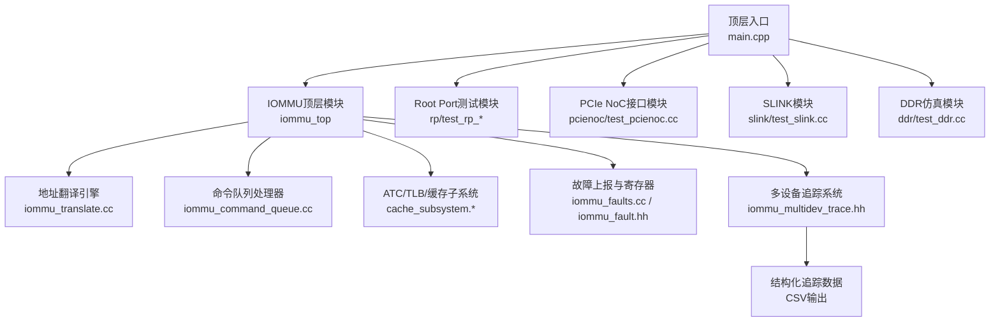
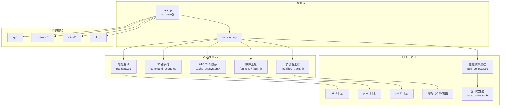
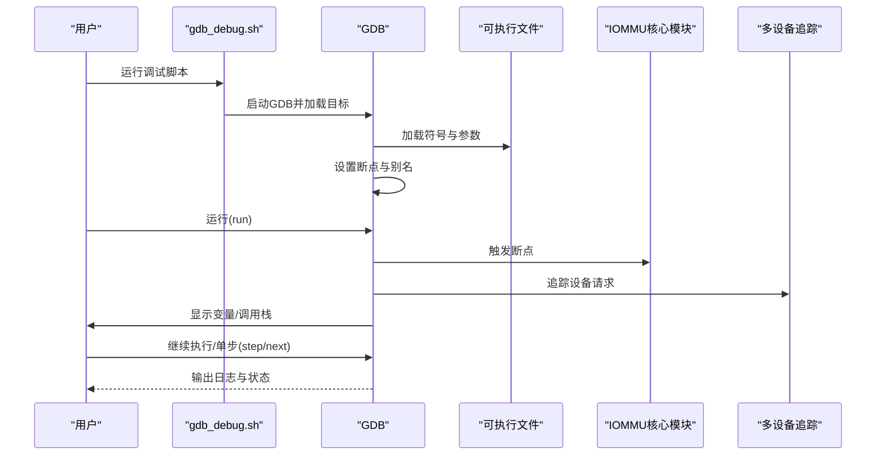
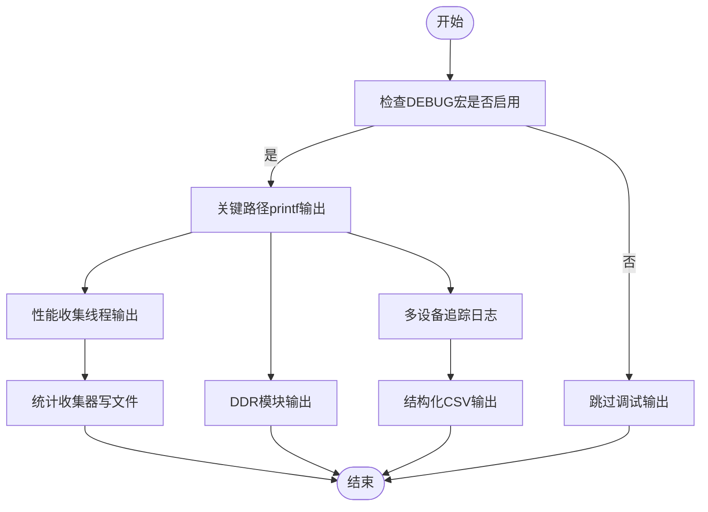
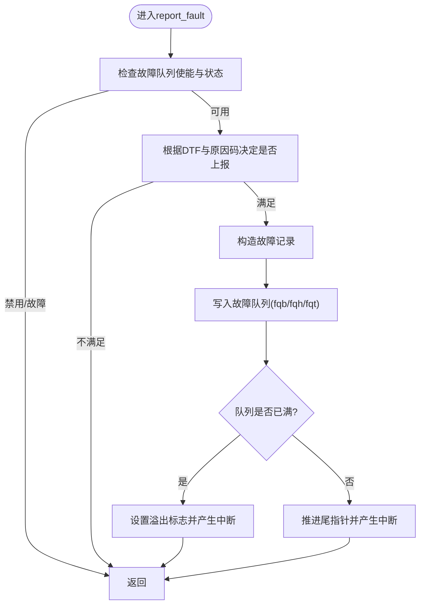
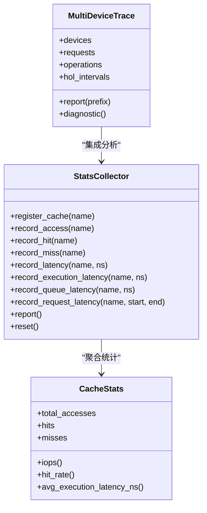
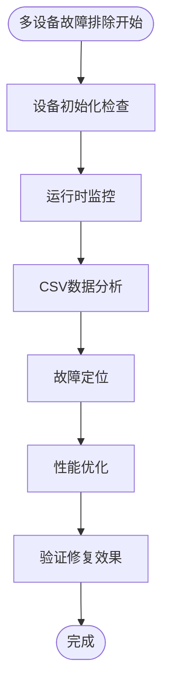
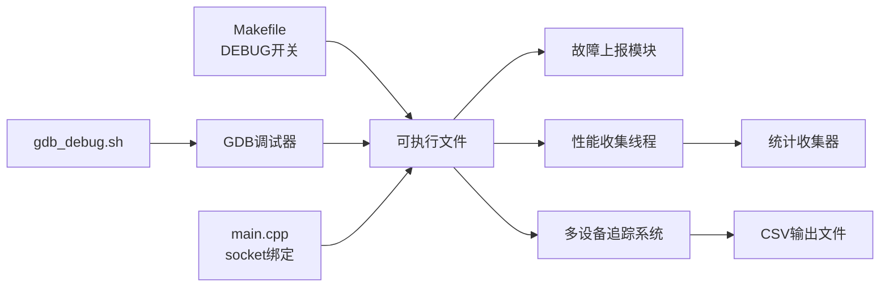

# 调试与故障排除

<cite>
**本文引用的文件**
- [README.md](file://README.md)
- [GDB_DEBUG_GUIDE.md](file://GDB_DEBUG_GUIDE.md)
- [gdb_debug.sh](file://gdb_debug.sh)
- [Makefile](file://Makefile)
- [main.cpp](file://main.cpp)
- [iommu_struct.hh](file://iommu/include/iommu_struct.hh)
- [iommu_fault.hh](file://iommu/include/iommu_fault.hh)
- [iommu_faults.cc](file://iommu/iommu_fun_model/iommu_faults.cc)
- [iommu_perf_collector.cc](file://iommu/iommu_perf_model/iommu_perf_collector.cc)
- [stats_collector.h](file://iommu/cache_src/common/stats_collector.h)
- [test_ddr.cc](file://ddr/test_ddr.cc)
- [iommu_msi_trans.cc](file://iommu/iommu_fun_model/iommu_msi_trans.cc)
- [iommu_multidev_trace.hh](file://iommu/iommu_perf_model/iommu_multidev_trace.hh)
- [test_rp_rand4k_msi_mix_multidev_thread.cc](file://rp/test_rp_rand4k_msi_mix_multidev_thread.cc)
- [iommu_process_context.cc](file://iommu/iommu_fun_model/iommu_process_context.cc)
</cite>

## 更新摘要
**变更内容**
- 新增多设备故障排除方法章节
- 添加多设备追踪点管理和进度跟踪功能说明
- 扩展设备上下文处理调试指南
- 增加结构化多设备追踪数据分析方法
- 更新故障排除流程以支持多设备场景

## 目录
1. [简介](#简介)
2. [项目结构](#项目结构)
3. [核心组件](#核心组件)
4. [架构总览](#架构总览)
5. [详细组件分析](#详细组件分析)
6. [多设备故障排除](#多设备故障排除)
7. [依赖关系分析](#依赖关系分析)
8. [性能考量](#性能考量)
9. [故障排除指南](#故障排除指南)
10. [结论](#结论)
11. [附录](#附录)

## 简介
本文件面向IOMMU调试与故障排除场景，结合仓库中的GDB调试指南、构建脚本与源码中的日志输出，提供从断点设置、变量查看、调用栈分析到日志系统使用、常见故障诊断、性能定位与自动化调试流程的完整实践指南。**特别新增了多设备故障排除方法**，包括多设备追踪点管理、进度跟踪和设备上下文处理，帮助开发者在复杂的多设备环境中快速定位问题。读者可据此快速定位地址翻译异常、故障上报、缓存命中/缺失、以及性能瓶颈等问题，并形成可复用的调试脚本与最佳实践。

## 项目结构
项目采用SystemC建模，核心IOMMU功能分布在多个子模块中，顶层通过main.cpp进行模块绑定与仿真启动；调试相关资源集中在GDB调试指南、调试脚本与构建配置中。**新增的多设备追踪系统提供了跨设备的统一调试接口**。

**图表来源**
- [main.cpp:39-94](file://main.cpp#L39-L94)
- [Makefile:52-94](file://Makefile#L52-L94)
- [iommu_multidev_trace.hh:61-315](file://iommu/iommu_perf_model/iommu_multidev_trace.hh#L61-L315)

**章节来源**
- [README.md:63-92](file://README.md#L63-L92)
- [main.cpp:39-94](file://main.cpp#L39-L94)
- [Makefile:12-36](file://Makefile#L12-L36)

## 核心组件
- 调试构建与运行
  - 默认启用DEBUG模式，包含大量调试宏与符号，便于GDB单步与变量检查。
  - 提供gdb_debug.sh一键启动GDB并加载断点与源码路径。
- 日志与输出
  - 多处printf用于跟踪事务、缓存查询、故障上报等关键路径。
  - 性能收集线程输出DC/PC查找结果、路由决策与阶段状态。
  - 统计收集器支持将缓存统计与直方图输出到文件，辅助性能分析。
- 故障上报
  - 故障记录结构与队列机制，支持DTF屏蔽、溢出与内存访问故障标记。
- **多设备追踪**
  - 统一的设备请求追踪框架，支持最多16个设备并发调试。
  - 结构化CSV输出，包含延迟分布、公平性分析和HOL阻塞检测。
  - 实时进度监控和超时保护机制。

**章节来源**
- [Makefile:25-33](file://Makefile#L25-L33)
- [gdb_debug.sh:1-37](file://gdb_debug.sh#L1-L37)
- [iommu_perf_collector.cc:39-200](file://iommu/iommu_perf_model/iommu_perf_collector.cc#L39-L200)
- [stats_collector.h:107-196](file://iommu/cache_src/common/stats_collector.h#L107-L196)
- [iommu_faults.cc:8-160](file://iommu/iommu_fun_model/iommu_faults.cc#L8-L160)
- [iommu_multidev_trace.hh:20-78](file://iommu/iommu_perf_model/iommu_multidev_trace.hh#L20-L78)

## 架构总览
下图展示调试与日志在系统中的交互位置：顶层main.cpp绑定各模块并启动仿真；IOMMU核心模块在关键路径打印日志；性能收集线程输出统计；故障模块负责故障记录与中断生成；**多设备追踪系统提供跨设备的统一监控接口**。

**图表来源**
- [main.cpp:39-94](file://main.cpp#L39-L94)
- [iommu_faults.cc:8-160](file://iommu/iommu_fun_model/iommu_faults.cc#L8-L160)
- [iommu_perf_collector.cc:14-200](file://iommu/iommu_perf_model/iommu_perf_collector.cc#L14-L200)
- [stats_collector.h:107-196](file://iommu/cache_src/common/stats_collector.h#L107-L196)
- [iommu_multidev_trace.hh:61-315](file://iommu/iommu_perf_model/iommu_multidev_trace.hh#L61-L315)

## 详细组件分析

### GDB调试与断点策略
- 编译与准备
  - 使用DEBUG=1编译，确保符号与调试宏开启。
  - 使用gdb_debug.sh一键启动GDB并设置断点与源码路径。
- 关键断点建议
  - 地址翻译入口与两阶段翻译函数。
  - 设备上下文定位与命令队列处理线程。
  - 故障上报函数，便于捕获故障记录写入与中断触发。
  - **多设备追踪关键点**：`register_request`、`accept`、`stamp`、`response`等方法。
- 变量与调用栈
  - 在断点处打印请求参数、寄存器状态与关键数据结构字段。
  - 使用backtrace查看调用链，结合display自动显示关键表达式。
  - **多设备调试**：检查`Trace`类的设备计数、请求映射和进度状态。

**图表来源**
- [gdb_debug.sh:22-37](file://gdb_debug.sh#L22-L37)
- [GDB_DEBUG_GUIDE.md:21-68](file://GDB_DEBUG_GUIDE.md#L21-L68)
- [GDB_DEBUG_GUIDE.md:71-102](file://GDB_DEBUG_GUIDE.md#L71-L102)
- [iommu_multidev_trace.hh:81-136](file://iommu/iommu_perf_model/iommu_multidev_trace.hh#L81-L136)

**章节来源**
- [Makefile:25-33](file://Makefile#L25-L33)
- [gdb_debug.sh:1-37](file://gdb_debug.sh#L1-L37)
- [GDB_DEBUG_GUIDE.md:21-102](file://GDB_DEBUG_GUIDE.md#L21-L102)
- [iommu_multidev_trace.hh:81-136](file://iommu/iommu_perf_model/iommu_multidev_trace.hh#L81-L136)

### 日志系统与日志级别
- 日志来源
  - 地址翻译与MSI转换路径包含多处printf，便于观察关键步骤与参数。
  - 性能收集线程输出DC/PC命中、路由决策与阶段状态。
  - DDR模块输出调度与响应时间等信息。
  - **多设备追踪日志**：设备请求注册、接受、完成和响应的详细时间戳。
- 日志级别与控制
  - DEBUG宏在编译期开启各类调试输出，可通过修改Makefile或使用DEBUG环境变量切换。
  - 统计收集器支持将报告写入文件，便于离线分析。
  - **多设备CSV输出**：自动生成requests.csv、summary.csv、operations.csv等结构化数据。

**图表来源**
- [Makefile:25-33](file://Makefile#L25-L33)
- [iommu_msi_trans.cc:26-213](file://iommu/iommu_fun_model/iommu_msi_trans.cc#L26-L213)
- [iommu_perf_collector.cc:39-200](file://iommu/iommu_perf_model/iommu_perf_collector.cc#L39-L200)
- [test_ddr.cc:76-138](file://ddr/test_ddr.cc#L76-L138)
- [stats_collector.h:162-196](file://iommu/cache_src/common/stats_collector.h#L162-L196)
- [iommu_multidev_trace.hh:207-315](file://iommu/iommu_perf_model/iommu_multidev_trace.hh#L207-L315)

**章节来源**
- [Makefile:25-33](file://Makefile#L25-L33)
- [iommu_msi_trans.cc:26-213](file://iommu/iommu_fun_model/iommu_msi_trans.cc#L26-L213)
- [iommu_perf_collector.cc:39-200](file://iommu/iommu_perf_model/iommu_perf_collector.cc#L39-L200)
- [test_ddr.cc:76-138](file://ddr/test_ddr.cc#L76-L138)
- [stats_collector.h:162-196](file://iommu/cache_src/common/stats_collector.h#L162-L196)
- [iommu_multidev_trace.hh:207-315](file://iommu/iommu_perf_model/iommu_multidev_trace.hh#L207-L315)

### 故障上报与诊断
- 故障记录结构与队列
  - 故障记录包含原因码、设备ID、进程ID、事务类型等字段。
  - 队列满/内存访问故障会设置相应标志位并可能触发中断。
- 诊断要点
  - 检查DTF屏蔽位与故障队列使能状态。
  - 关注队列溢出与内存访问故障标志，避免丢失后续故障。
  - 结合日志输出定位具体故障步骤与参数。
  - **多设备故障关联**：通过device_id关联不同设备的故障事件。

**图表来源**
- [iommu_faults.cc:8-160](file://iommu/iommu_fun_model/iommu_faults.cc#L8-L160)
- [iommu_fault.hh:63-88](file://iommu/include/iommu_fault.hh#L63-L88)

**章节来源**
- [iommu_faults.cc:8-160](file://iommu/iommu_fun_model/iommu_faults.cc#L8-L160)
- [iommu_fault.hh:63-88](file://iommu/include/iommu_fault.hh#L63-L88)

### 性能分析与定位
- 关键输出点
  - 性能收集线程输出DC/PC命中、路由决策与阶段状态，便于定位瓶颈。
  - 统计收集器提供命中率、IOPS、延迟直方图等指标，支持离线分析。
  - **多设备性能分析**：按设备维度统计延迟分布、吞吐量和公平性指标。
- 分析步骤
  - 通过日志确认DC/PC命中率与路由路径。
  - 对比执行延迟与排队延迟，识别端口拥塞或互斥等待。
  - 使用统计收集器报告评估整体吞吐与缓存效率。
  - **多设备优化**：分析Jain公平性指数和设备间负载偏斜。

**图表来源**
- [stats_collector.h:107-196](file://iommu/cache_src/common/stats_collector.h#L107-L196)
- [iommu_multidev_trace.hh:61-315](file://iommu/iommu_perf_model/iommu_multidev_trace.hh#L61-L315)

**章节来源**
- [iommu_perf_collector.cc:39-200](file://iommu/iommu_perf_model/iommu_perf_collector.cc#L39-L200)
- [stats_collector.h:107-196](file://iommu/cache_src/common/stats_collector.h#L107-L196)
- [iommu_multidev_trace.hh:207-315](file://iommu/iommu_perf_model/iommu_multidev_trace.hh#L207-L315)

## 多设备故障排除

### 多设备追踪系统概述
多设备追踪系统提供了统一的接口来监控和分析最多16个并发设备的请求处理过程。该系统通过结构化的CSV输出和实时监控，帮助开发者快速定位多设备环境下的性能问题和故障。

### 设备上下文处理调试
- **设备上下文定位**
  - 使用`locate_process_context`函数调试设备上下文查找过程。
  - 检查PDT（进程目录表）遍历过程中的G-stage地址转换。
  - 验证设备上下文配置的有效性和一致性。
- **上下文缓存调试**
  - 监控IOATC（IOMMU地址转换缓存）的命中情况。
  - 分析上下文缓存失效对性能的影响。
  - 检查上下文配置的位域编码是否正确。

### 多设备追踪点管理
- **请求生命周期追踪**
  - `register_request`：请求注册时的设备ID、IOVA和预期PA验证。
  - `accept`：请求接受时的任务ID分配和时间戳记录。
  - `stamp`：关键阶段的标记（ACCEPT、POP、ADMIT、READY_OUT、OUT_LAUNCH、RESPONSE、RELEASE）。
  - `response`：响应验证和设备ID匹配检查。
- **进度跟踪机制**
  - `progress_serial`：全局进度序列号，用于检测死锁和超时。
  - `last_progress_ns`：最后进度时间戳，用于超时检测。
  - `watchdog`：看门狗机制，监控长时间无进展的情况。

### 结构化多设备追踪数据分析
- **CSV输出格式**
  - `requests.csv`：每个请求的详细时间线和状态信息。
  - `summary.csv`：按设备和类型聚合的性能指标。
  - `operations.csv`：缓存操作和PTW事件的详细记录。
  - `hol.csv`：队头阻塞（Head-of-Line blocking）分析数据。
- **关键性能指标**
  - 延迟分布：p50、p95、p99和最大延迟。
  - 吞吐量：窗口内的请求速率（Mreq/s）。
  - 公平性：Jain公平性指数和设备间负载偏斜。
  - HOL阻塞：跨设备阻塞的检测和持续时间分析。

### 多设备故障诊断流程
1. **初始化检查**
   - 验证设备数量配置（1-16个设备）。
   - 检查设备上下文配置的有效性。
   - 确认页表映射的正确性。
2. **运行时监控**
   - 观察请求注册和接受的时序。
   - 监控设备间的负载均衡情况。
   - 检测潜在的竞争条件和死锁。
3. **故障定位**
   - 分析CSV数据中的异常延迟和错误状态。
   - 检查设备特定的故障标志和原因码。
   - 使用`diagnostic()`方法获取详细的设备状态信息。
4. **性能优化**
   - 识别热点设备和瓶颈路径。
   - 调整队列深度和调度策略。
   - 优化设备间的资源分配。

**图表来源**
- [test_rp_rand4k_msi_mix_multidev_thread.cc:341-410](file://rp/test_rp_rand4k_msi_mix_multidev_thread.cc#L341-L410)
- [iommu_multidev_trace.hh:165-180](file://iommu/iommu_perf_model/iommu_multidev_trace.hh#L165-L180)
- [iommu_process_context.cc:12-196](file://iommu/iommu_fun_model/iommu_process_context.cc#L12-L196)

**章节来源**
- [iommu_multidev_trace.hh:20-315](file://iommu/iommu_perf_model/iommu_multidev_trace.hh#L20-L315)
- [test_rp_rand4k_msi_mix_multidev_thread.cc:44-410](file://rp/test_rp_rand4k_msi_mix_multidev_thread.cc#L44-L410)
- [iommu_process_context.cc:12-196](file://iommu/iommu_fun_model/iommu_process_context.cc#L12-L196)

## 依赖关系分析
- 构建与调试
  - Makefile通过DEBUG开关控制编译选项与调试宏，影响符号与日志输出。
  - gdb_debug.sh负责GDB启动、断点设置与源码路径配置。
- 运行时绑定
  - main.cpp中将IOMMU与各模块socket绑定，形成完整的数据通路。
- 功能耦合
  - 故障上报依赖寄存器状态与内存访问，受队列容量与内存一致性影响。
  - 性能收集线程与缓存子系统紧密耦合，输出直接影响统计准确性。
  - **多设备追踪系统**：与所有IOMMU核心模块集成，提供统一的监控接口。

**图表来源**
- [Makefile:25-33](file://Makefile#L25-L33)
- [gdb_debug.sh:22-37](file://gdb_debug.sh#L22-L37)
- [main.cpp:64-80](file://main.cpp#L64-L80)
- [iommu_multidev_trace.hh:207-315](file://iommu/iommu_perf_model/iommu_multidev_trace.hh#L207-L315)

**章节来源**
- [Makefile:25-33](file://Makefile#L25-L33)
- [gdb_debug.sh:22-37](file://gdb_debug.sh#L22-L37)
- [main.cpp:64-80](file://main.cpp#L64-L80)
- [iommu_multidev_trace.hh:207-315](file://iommu/iommu_perf_model/iommu_multidev_trace.hh#L207-L315)

## 性能考量
- 调试模式的影响
  - DEBUG=1关闭优化并启用大量日志，运行速度显著降低，属于预期行为。
- 性能观测点
  - 通过性能收集线程输出与统计收集器报告，关注DC/PC命中率、IOPS、执行/排队延迟。
  - **多设备性能监控**：关注设备间负载均衡、公平性指数和HOL阻塞影响。
- 优化建议
  - 在定位问题后切换至DEBUG=0进行性能回归验证。
  - 使用统计收集器的直方图与区间命中率分析，识别热点与异常波动。
  - **多设备优化**：调整设备调度策略，减少跨设备竞争和HOL阻塞。

**章节来源**
- [GDB_DEBUG_GUIDE.md:171-173](file://GDB_DEBUG_GUIDE.md#L171-L173)
- [iommu_perf_collector.cc:39-200](file://iommu/iommu_perf_model/iommu_perf_collector.cc#L39-L200)
- [stats_collector.h:94-104](file://iommu/cache_src/common/stats_collector.h#L94-L104)
- [iommu_multidev_trace.hh:291-303](file://iommu/iommu_perf_model/iommu_multidev_trace.hh#L291-L303)

## 故障排除指南
- 常见问题与对策
  - 符号不可用：确认DEBUG=1且未strip符号；检查源码路径与编译产物。
  - 断点无法命中：核对函数名拼写、确认在DEBUG模式下、确保代码路径被执行。
  - 性能异常：对比执行与排队延迟，排查缓存命中率与端口拥塞。
  - **多设备问题**：检查设备上下文配置、页表映射和请求追踪完整性。
- 诊断流程
  - 设置关键断点（翻译入口、上下文定位、命令队列、故障上报）。
  - 在断点处打印请求参数、寄存器状态与关键数据结构字段。
  - 结合日志输出与统计报告定位瓶颈与异常路径。
  - **多设备调试**：使用`diagnostic()`方法获取设备状态，分析CSV数据中的异常模式。
- 自动化调试
  - 使用gdb_debug.sh一键启动GDB并设置常用断点与别名，缩短调试准备时间。
  - **多设备自动化**：利用多设备测试场景的自动验证和报告生成功能。

**章节来源**
- [GDB_DEBUG_GUIDE.md:160-193](file://GDB_DEBUG_GUIDE.md#L160-L193)
- [gdb_debug.sh:22-37](file://gdb_debug.sh#L22-L37)
- [iommu_faults.cc:8-160](file://iommu/iommu_fun_model/iommu_faults.cc#L8-L160)
- [iommu_multidev_trace.hh:165-180](file://iommu/iommu_perf_model/iommu_multidev_trace.hh#L165-L180)

## 结论
通过DEBUG构建、GDB脚本与日志输出的协同，本项目提供了从地址翻译到故障上报、从缓存命中到性能瓶颈的全链路调试能力。**新增的多设备追踪系统进一步增强了复杂多设备环境下的调试能力**，提供了结构化的数据分析工具和实时监控机制。建议在问题定位阶段保持DEBUG=1与详尽日志，在回归验证阶段切换至RELEASE模式评估真实性能，并利用统计收集器和多设备追踪报告持续监控关键指标。

## 附录
- 快速参考
  - 编译：使用DEBUG=1；运行：./iommu_model；调试：./gdb_debug.sh。
  - 关键断点：翻译入口、上下文定位、命令队列、故障上报。
  - 关键变量：请求参数、寄存器状态、故障记录字段、缓存统计。
  - 日志位置：翻译与MSI转换路径、性能收集线程、DDR模块。
  - **多设备调试**：使用`iommu_md::Trace`类进行设备请求追踪，分析生成的CSV文件。
- 多设备调试工具
  - 多设备测试场景：`test_rp_rand4k_msi_mix_multidev_thread.cc`
  - 追踪输出：`multidev_n*_*.csv`系列文件
  - 监控接口：`top.md_trace`对象和方法

**章节来源**
- [README.md:77-86](file://README.md#L77-L86)
- [GDB_DEBUG_GUIDE.md:21-102](file://GDB_DEBUG_GUIDE.md#L21-L102)
- [iommu_msi_trans.cc:26-213](file://iommu/iommu_fun_model/iommu_msi_trans.cc#L26-L213)
- [iommu_perf_collector.cc:39-200](file://iommu/iommu_perf_model/iommu_perf_collector.cc#L39-L200)
- [test_ddr.cc:76-138](file://ddr/test_ddr.cc#L76-L138)
- [iommu_multidev_trace.hh:20-315](file://iommu/iommu_perf_model/iommu_multidev_trace.hh#L20-L315)
- [test_rp_rand4k_msi_mix_multidev_thread.cc:341-410](file://rp/test_rp_rand4k_msi_mix_multidev_thread.cc#L341-L410)